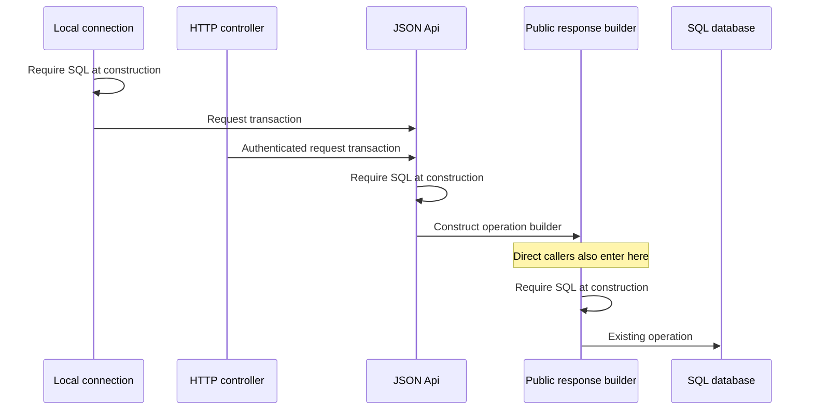

# Workspace caller migration inventory and design

> **Status: Planned.** Inventory, migration design and the scoped test-owner implementation are
> complete. Prepared-declaration removal and its named test migrations are implemented and
> validated. Procedure removal and its named test migrations are implemented and validated. The
> standalone query result-value removal and its named test migrations are implemented and validated.
> Named-route removal and its security-test migration are implemented and validated.
> Memory-backed workspace removal and its exact test migrations are implemented and validated.
> Protected Push/shared-result implementation and its exact test migrations are complete and validated.
> Protected atomic Invoke and its approved HTTP ordering correction are complete and validated.
> The normal lifecycle/remaining-caller proposal is reconciled against that baseline with a closed
> 81-path implementation and exact test map. That cutover is approved and in progress; see the
> [current implementation record](#normal-lifecycle-cutover-in-progress--2026-10-15).
> The later review paused its remaining test extension. Cache-preserving ownership simplification is
> implemented and validated; see [cache ownership](#cache-ownership-simplification--2026-10-16).
> The [test-consolidation map](#test-consolidation-map--2026-10-16) is complete; its exact 18-path
> implementation and existing-test changes await explicit approval.

The inventory records retained, non-generated .NET and TypeScript sources on 2026-10-14, before
the test-owner additions, after the completed
[read and PushRead plan](workspace-connection-session-plan.md). The design below assigns caller
ownership and the implemented test-owner boundary. It does not establish that the legacy
suites can run unchanged with scoped construction.
[Complete workspace reads](../workspace-reads.md) owns supported behavior and host configuration.
Applications must not rely on this internals page. Downstream applications were not inspected.

## Cache ownership simplification — 2026-10-16

The review against `origin/main` found both duplicated coverage and tests of unnecessary public
lifetime machinery. The user approved keeping discovery and cache reuse, making the connection
their sole owner, and removing the standalone store, coordinator and pin APIs without compatibility
wrappers. The mapped existing-test rewrites and removals were explicitly approved and are complete.
The earlier failed lifecycle matrix remains historical evidence.

The scope covers 25 production files, seven existing test files and seven documentation/changelog
files. Seven production files move into the .NET remote adapter, giving 46 old/new path identities.
Sessions and checkpoints keep immutable records directly; requests hold the exact bodies they
advertise. One connection operation gate covers dispatch through application and notifications.
Current permission information remains separate from historical editing baselines.

Discovery, request counts, wire messages and live historical cache lookup remain unchanged.
Closing rejects new work immediately and clears cache lookup after dispatched handling drains;
held values remain inspectable. This change does not bound a live connection's cache history.
The [storage](workspace-read-store.md), [coordination](workspace-read-coordinator.md) and
[Session](workspace-session-state.md) maps own the resulting implementation details.

Tests solely about removed pin accounting, manual eviction and independently managed owners
retire; mixed tests retain their immutable-value, exact-reuse, permission and lifetime assertions.
The scope also removes six calls to absent raw methods from
`ScopedSessionReadsAndMergesThroughEverySqlTransport`, preserving its supported read/merge checks.
The other previously proposed nine-test-extension changes remain paused. No new test project,
parallel compatibility suite, cache eviction policy or single-request optimization is included.
Server-endpoint removal, signals and Git publication remain outside this approval.

The full .NET solution builds, and TypeScript typechecks, emitted declarations, consumer compilation,
formatting and lint pass. Final pure validation passes 710 .NET and 631 TypeScript cases. Each SQL
provider passes the same 417 integration cases: 95 Local, nine server/cache transport cases, 123
with each HTTP codec, and 67 TypeScript HTTP cases. All 2,175 selected executions pass. Earlier
failed attempts are retained separately; these totals count only the final source. A reproduced
close/cancellation callback bug now has an admission check after request copying and before dispatch.
The previously recorded unrelated expectation failures remain pending; the full PR matrix was not rerun.

Measured against the incoming implementation, with moves counted once, production code shrank by
563 physical lines and test code grew by 216. Connection fixtures and the dispatch regression
account for the added test setup. Three obsolete TypeScript cases and one .NET theory row retire;
the other existing argument rows remain. This completes ownership simplification. Consolidating
duplicate codec test sources and separating pure checks from repeated provider runs are mapped
in the [next proposal](#test-consolidation-map--2026-10-16); implementation still requires approval.

Validation used isolated databases and temporary HTTP hosts, which were removed afterward. The
incoming work outside the 46-path scope, all 339 generated outputs, branch, refs and index are unchanged.
Git publication remains unapproved.

## Test-consolidation map — 2026-10-16

**Status: Planned; map complete, implementation awaiting explicit approval.** This notes-only step
covers duplicate remote-codec PullTests sources and pure-test scheduling in the existing test
projects. It preserves cache ownership, discovery, supported codecs, both SQL providers and every
current case. It does not authorize the implementation below or resume the paused test-expectation
packet. The cache-ownership completion above supersedes the earlier failed-build record below.

### Current census and proposed ownership

Each remote codec's `Tests/PullTests.cs` contains **1,475 lines, 28 declared methods and 43 rows**.
The two sources differ at five codec-binding lines; their 28 attributed method bodies are identical.
Each class also inherits 68 integration facts. Four declared methods use only a controlled HTTP
handler, yet the class lifecycle initializes a real Profile: `InitializeAsync` sends `Test/Setup`
and logs in before the method runs. Moving those four methods removes that service dependency.

| Contract | Proposed owner and schedule | Preserved cases |
| --- | --- | ---: |
| Local pure protocol, cache, Session and lifecycle checks | Existing Local assembly, marked methods, once without services | 710 |
| Controlled HTTP transport validation, retry and cancellation | Fixture-free shared source compiled once into each existing codec assembly | 7 per codec |
| Live remote Pull, Push, Invoke, identity and close/drain | Shared source compiled into each existing codec assembly, each SQL provider | 36 declared + 68 inherited per codec/provider |
| Other Local and HTTP integration cases | Existing assemblies and fixtures, each SQL provider | Unchanged |
| TypeScript controlled connection behavior | Existing `database/security/response-context.spec.ts`, once without services | 156 |
| TypeScript protocol corpus | Existing `protocol/read-contract.spec.ts`, once without services | 475 |
| TypeScript HTTP behavior | Remaining 20 existing spec files, each SQL provider | 231 |

The .NET pure total is **724** (710 + 7 + 7); TypeScript is **631**. The proposed split removes
**1,355 repeated executions** from a two-provider workspace matrix, without retiring cases.
Sharing source alone saves no executions. The source/identity census predicts 212 Local, 242 per
remote codec and 231 TypeScript integration rows per provider after the split. These are expected
partition sizes, not fresh passing results. No wall-time saving is claimed; the expensive inherited
relation permutations are unchanged.

The latest completed ownership validation passed 710 .NET and 631 TypeScript pure cases plus its
selected provider checks. It did not run the full provider matrix. This map compares current source
hashes and exact identities with that evidence and the prior full runs; it does not relabel prior
failures as passing or treat truncated theory display labels as unique identities.

### Exact existing-test changes

In `dotnet/Core/Workspace/Tests.Local/Tests/PullTests.cs`, add
`[Trait("Category", "Pure")]` to **124 of the 126 declared test methods**: all except the two integration methods
`NormalLocalProfileLoginDrainsAllOwnedConnections` and `JsonApiPullDisposesItsTransaction`.
There are 126 declared methods in total; the latter two have one and two rows respectively.
Do not add a class-level trait: the class also inherits 68 integration facts. Preserve every body,
signature, argument row, member-data source and helper. The exact 124-method/710-row identity and
body-hash map is retained with the evidence named below.

Move these methods from each codec's `Tests.Workspace.Remote.PullTests` into
`Tests.Workspace.Remote.ReadTransportTests` in the same assembly:

| Method | Existing argument rows | Rows per codec |
| --- | --- | ---: |
| `ReadTransportRejectsInvalidRequestBeforeSending` | Duplicate `v`; unexpected `procedure` | 2 |
| `ReadTransportStrictlyDecodesTheOriginalResponse` | Duplicate `i`; wrong correlation `i` | 2 |
| `ReadTransportNeverRetriesHttpFailure` | Fact | 1 |
| `ReadTransportCancellationSuppressesSuccess` | `false`, `true` | 2 |

Keep all exact argument strings and assertions. Move their exclusive `ReadWire` constant and
`ReadHandler` helper with them. The four moved methods receive `[Trait("Category", "Pure")]`. Their new class has no base test
class, fixture, Profile or lifecycle hooks. The other **24 declared methods/36 rows**, seven
nested helper types and `ScopedOwnerQuery` remain in the shared integration `PullTests`; its base,
constructor, Profile and fixture behavior remain. The 68 inherited facts remain unchanged and
continue to execute for both codecs and both providers. No other class or test body changes.

Both shared files live under `dotnet/Core/Workspace/Tests/Remote/`. Explicitly exclude these two
files from the shared project's compilation, then link them into both existing remote projects.
They therefore retain the original test-assembly identities and internal adapter access. Bind two
MSBuild namespace aliases in each remote project:

| Alias | Newtonsoft assembly | SystemText assembly |
| --- | --- | --- |
| `RemoteAdapter` | `Allors.Workspace.Adapters.Remote.Newtonsoft` | `Allors.Workspace.Adapters.Remote.SystemText` |
| `RemoteCodec` | `Allors.Protocol.Json.Newtonsoft` | `Allors.Protocol.Json.SystemTextJson` |

Qualify the concrete `DatabaseConnection`, `ReadTransport`, `PushReadTransport` and
`InvokeReadTransport` types through `RemoteAdapter`; qualify `ReadJson`, `PushReadJson`,
`InvokeReadJson` and `UnitConvert` through `RemoteCodec`. These are type-binding substitutions only.
Keep the codec-specific `Profile` and `HttpTestResources` files as they are. No new abstract test
framework, production reference, friend assembly, test project or runtime abstraction is required.

No TypeScript callback or test file changes. The pure boundary is exactly the two paths above;
all other discovered spec files remain in integration. The proposed path expression is:

```text
libs/system/workspace/adapters-json-tests/src/lib/(database/security/response-context|protocol/read-contract)\.spec\.ts$
```

### Build and CI routing

Add `DotnetCoreWorkspacePureTest` and its CI wrapper. The leaf depends on Core generation and the
results directory, and runs the three existing assemblies with `.SetFilter("Category=Pure")`,
using separate TRX filenames. It has no publish, database reset, population or server dependency;
the new CI wrapper does not depend on process-wide `Reset` either. Apply
`.SetFilter("Category!=Pure")` to the three existing Local/codec provider leaves.
`DotnetCoreWorkspaceTest` adds the pure leaf and remains the complete aggregate.

In the existing TypeScript Nx project add explicit `test-pure` and `test-integration` targets,
using the existing Jest executor/configuration. The first uses `testPathPattern` with the exact
expression above; the second uses that expression in `testPathIgnorePatterns`. Both set
`passWithNoTests: false`. Keep the original unfiltered `test` target and npm script unchanged.
Add `system-workspace-adapters-json:test:pure` and `:integration` npm scripts using
`npx nx run system-workspace-adapters-json-tests:test-pure --skipNxCache` and the corresponding
`test-integration` command. Use distinct `pure`/`integration` coverage output directories under
the existing adapters-json coverage root. The installed Nx version
silently falls back for an unknown configuration name, so named targets avoid that selection trap.

Add `TypescriptSystemWorkspaceAdaptersJsonPure` to the existing `TypescriptWorkspaceTest` aggregate,
with generation/results prerequisites and a distinct TRX filename. It has no server/database
prerequisites. Switch the existing HTTP leaf to the new `:integration` script. Both new TypeScript
scripts bypass Nx result caching, so provider runs execute against their selected database.

Schedule the .NET pure CI wrapper and the existing `CiTypescriptWorkspaceTest` once in the current
service-free job matrix; move the latter out of the SQL Server matrix and add conditional Node 24
setup to its new job. Existing SQL Server integration entries remain. Current CI runs only the
adapter suite in its PostgreSQL job; expanding full PostgreSQL CI remains separate work. Both
providers remain required for local consolidation validation. The normal default Nuke target
still installs/generates; it does not currently run tests and this proposal does not change it.

The existing direct Local/codec and adapters-json Nuke provider targets become integration-only.
Use the .NET aggregate, or the TypeScript pure aggregate plus its HTTP target, for complete coverage.
Unfiltered `dotnet test`, the existing Nx `test` target and its existing npm script still discover
all tests. This makes the scheduling change explicit rather than adding a hidden skip switch.

### Exact proposed implementation manifest

The single future implementation has **18 path identities: 14 edits, two additions and two
replaced-source deletions**. The notes-only step changes only this inventory in the repository.

| Action | Path |
| --- | --- |
| Delete duplicate source | `dotnet/Core/Workspace/Tests.Remote.Json.Newtonsoft/Tests/PullTests.cs` |
| Delete duplicate source | `dotnet/Core/Workspace/Tests.Remote.Json.SystemText/Tests/PullTests.cs` |
| Add linked integration source | `dotnet/Core/Workspace/Tests/Remote/PullTests.cs` |
| Add linked pure source | `dotnet/Core/Workspace/Tests/Remote/ReadTransportTests.cs` |
| Edit compile ownership | `dotnet/Core/Workspace/Tests/Workspace.Tests.csproj` |
| Edit links and codec aliases | `dotnet/Core/Workspace/Tests.Remote.Json.Newtonsoft/Workspace.Tests.Remote.Json.Newtonsoft.csproj` |
| Edit links and codec aliases | `dotnet/Core/Workspace/Tests.Remote.Json.SystemText/Workspace.Tests.Remote.Json.SystemText.csproj` |
| Add exact method traits | `dotnet/Core/Workspace/Tests.Local/Tests/PullTests.cs` |
| Edit .NET scheduling | `build/Dotnet/Core/Build.cs` |
| Add pure CI wrapper | `build/Build.ci.cs` |
| Edit TypeScript scheduling | `build/Typescript/Modules/Build.cs` |
| Edit existing CI matrices | `.github/workflows/ci.yml` |
| Add explicit Nx targets | `typescript/modules/libs/system/workspace/adapters-json-tests/project.json` |
| Add npm scripts | `typescript/modules/package.json` |
| Update moved-source links | `docs/internals/workspace-session-state.md` |
| Update moved-source links | `docs/internals/workspace-read-coordinator.md` |
| Record implementation and validation | `docs/internals/workspace-caller-migration-inventory.md` |
| Record Unreleased change | `CHANGELOG.md` |

### Validation and boundary

Before editing, freeze the existing test bodies, argument rows, source hashes, generated outputs,
Git identities and index. Use fresh evidence names. After the structural edits:

1. Compile the Nuke project and full `dotnet/Allors.slnx`; generate through the normal target and
   verify all 339 generated outputs unchanged. Inspect evaluated project compile items to prove
   each shared source belongs to exactly the intended two test assemblies, not the shared assembly.
2. Audit bodies after only the listed type substitutions; compare exact argument values, multiplicity,
   inherited coverage and helper ownership. The only allowed test-identity moves are the four methods
   and seven rows per codec from `PullTests` to `ReadTransportTests`. All Local identities stay fixed.
3. Discover and compare full, pure and integration selections: their intersection must be empty and
   their union must equal the full suite. Verify actual nonzero results, not command exit status alone.
   Compare argument identities as well as display labels. TypeScript must discover 2 pure + 20
   integration files and account for 631 + 231 cases. Default unfiltered discovery remains complete.
4. Run 724 .NET and 631 TypeScript pure cases with SQL credentials and test-host configuration absent.
   Run the existing TypeScript pure aggregate too, using `TypescriptWorkspaceTest` or direct Nx
   locally; its existing CI wrapper still invokes process-wide `Reset`. Inspect the Nuke dependency graph to ensure no
   pure path starts a server, resets/populates a database or pulls in an integration target.
5. Run all 36 directly declared shared live-codec rows for each codec on both SQL providers, then the
   full complementary Local/codec/TypeScript integration selections on both providers. Reconcile
   every identity and result against the preserved baseline, including the known pending failures.
   Use direct test commands with fresh isolated databases/hosts: the existing Nuke provider leaves
   reset the fixed `Core` database, so exercise those leaves only in disposable CI environments.
   No additional expectation migration, case skip, retirement or endpoint cleanup is authorized.
   If those failures prevent green validation, record the exact boundary and request their separate
   reconciliation; do not report this implementation or the full migration as completely green.
6. Validate Nx options and CI routing: an unknown target must fail before Jest and a no-match
   selection must fail; retain unfiltered discovery. Run affected formatting/type/lint checks and documentation
   link/whitespace checks, and inspect final source/Git/generated preservation. Remove only resources
   created for these runs; preserve provider services and pre-existing databases. Do not execute
   broad process cleanup or reuse the previous implementation's evidence/resource names.

This is a structural consolidation, so no extra behavioral cases are proposed merely to preserve
counts. Existing executable contracts, source/argument audits and disjoint/exhaustive discovery
provide its validation. The prior expectation failures, unrelated duplicate pruning, relation-loop
optimization, old endpoint/decoder removal, signals and Git staging/publication remain outside scope.

Recommendation: implement this bounded map next. It removes one duplicate codec contract and gives
pure execution a clear home while preserving real decoder, transport and SQL boundaries. Its costs
are explicit linked-source/type bindings, 124 method annotations, scheduling maintenance and the
change in direct provider-target meaning. Retaining the current layout avoids those edits but keeps
source drift risk, unnecessary HTTP setup and repeated pure executions. Broader pruning would need
another contract map and would obscure this preservation-only change.

Evidence is in `/private/tmp/allors-test-consolidation-map-20261016/`: `baseline.json` and
`generated-baseline.json`; `implementation-manifest.json` and captured inputs; `codec/exact-map.json`;
`dotnet/local-methods.json` and `local-pure-rows.json`; `typescript/census.json`; the companion reports;
and final documentation/preservation audits. No build, test, benchmark, service or Git mutation was
performed during this map. The exact next action is approval of the 18-path implementation and its
named existing-test changes; a plan or restart by itself does not authorize it.

## Replacement direction — 2026-10-14

The agreed end state is that the new workspace implementation replaces the existing one in
both .NET and TypeScript. There must be one supported workspace behavior and API, without a
permanent legacy mode, compatibility implementation or request-by-request fallback. Temporary
coexistence during migration is not the completed outcome. Local and HTTP transports and the
SQL providers can still implement the same workspace contract.

The caller assignments below describe the completed test-owner step and the current migration
state. They are not permanent exceptions to replacement. Every remaining legacy dependency
needs an explicit resolution before removal: migrate its capability, redesign it within the new
contract, or agree to retire it. An unsupported capability is an open decision, not permission
to remove it. Preserve useful behavioral coverage; tests that assert replaced behavior need
an explicitly approved change.

The replacement contract decisions are recorded below. Remaining work is to agree:

- Implementation/default sequencing and removal of obsolete implementations, endpoints and helpers
  after their consumers and required authentication/authorization coverage have moved.
- Bounded implementation scopes, exact existing-test migrations and validation.

The user approved this direction and recording the discussion. The decisions below settle
specific capabilities; implementation details and subsequent implementation subtasks are still to be
agreed. This discussion records the intended outcome without applying runtime/test changes,
default switching, signals work or Git publication. The completed read and test-owner work is a
foundation for replacement, not a claim that replacement is complete.

### Decided: remove procedures

The user explicitly chose to fully remove the Allors procedure feature everywhere. It will no
longer be supported anywhere in the platform. This is platform-wide retirement, not merely
omission from the replacement workspace or a restriction on new callers. Do not retain it in
the existing implementation, a server-only API, an adapter, a compatibility mode or test-only
procedure service. Do not recreate it as a generic command API under a different name.

Implementation must remove every layer belonging to this feature:

- Workspace public APIs and implementations in .NET and TypeScript, including the named
  `Procedure` / `CallAsync(Procedure, ...)` / `call` facility and public exports.
- Database-side procedure definitions, execution interfaces, contexts, inputs, outputs and services.
- Server dispatch, resolution and execution, protocol payload members/types, and serialization visitors.
- Configuration and registrations across Core, Identity, Entra and Diamond, concrete procedures,
  and any feature-specific generation/templates found during the removal inventory.
- Procedure-specific tests, scaffolding, examples and documentation advertising support. Remove
  obsolete runtime branches that exist only to distinguish or reject the retired procedure API;
  preserve general strict-input validation and historical records of the removal.

The three former concrete procedures, `TestUnitSamples`, `TestValues` and `TestPermissionRefresh`,
were in the Core test domain and are removed. Their useful unit-role and permission coverage now
uses ordinary Push/Pull and isolated authenticated test actions, respectively. The
[implementation record](#implemented-procedure-removal-and-validation--2026-10-14) identifies the
retained tests and completed validation. No inheritable production test hooks were introduced.

This decision removes procedural results with their producer. It does not remove ordinary unit
roles on objects. Standalone query result values, prepared declarations and named workspace routes
have separate removal decisions below; object method invocation is retained under the
[protected Invoke decision](#decided-protected-atomic-object-method-invocation). Internal SQL stored routines are database
adapter implementation details, distinct from the retired Allors procedure feature; a text match
on "procedure" alone does not establish a dependency. Removal must be verified across the full
feature, including public-surface absence and absence of effects from old wire payloads. The
[approved design and validation matrix](#procedure-removal-design--2026-10-14) record this removal
without changing the separate replacement decisions.

### Decided: remove standalone query result values

The user chose to fully remove standalone query result values from both runtime APIs and their
protocols. Remove the result `Values` / `GetValue` / `values` / `value` facility in .NET and
TypeScript, including standalone completed-read results, Session results, response value maps,
serialization, validation and supporting plumbing. Do not retain an always-empty result map or
a compatibility path. Before removal, the complete-read server emitted an empty map; the only
concrete populated producer found in the original census was the removed `TestValues` procedure.
Downstream applications were not inspected.

Scalar query arguments and predicate literals remain supported, as do ordinary unit roles on
objects and their serialization. Remove fields by their result-value meaning, not their spelling:
`v` also denotes protocol versions, object/security versions, unit-role payloads and predicate
literals. Named object and collection outputs, including null objects and empty collections,
remain supported. This decision introduces no aggregate or scalar-projection facility; a future
typed facility for counts, totals or computed outputs would require a separate design and approval.

The approved removal deletes 74 empty-map assertions in the shared .NET PullTests and 76 active
empty-map assertions in TypeScript Pull specs. Synthetic coordinator/protocol cases and shared wire
fixtures now use supported fields, preserving unit-role encoding, result ownership, null objects,
empty collections and strict JSON coverage. The
[implementation record](#implemented-result-value-removal-and-validation--2026-10-15) records the
exact source/test boundary and completed validation.
[Requests and results](../workspace-reads.md#requests-and-results) owns current supported behavior.

### Decided: remove prepared declarations everywhere

The user chose to fully remove the Allors prepared-declaration feature everywhere, including
database/domain APIs and both workspace runtimes. This supersedes the proposal to retain the
new `ReadCatalog` and the earlier plan to migrate legacy registrations into it. Remove both
implementations; no server-only registry, compatibility path or replacement registration API
is to remain.

Implementation must remove:

- `IPreparedExtents` / `IPreparedSelects`, their concrete registries and service registrations
  across Core, Identity, Entra and Diamond, and registered definitions such as `OrganisationByName`.
- `ReadCatalog`, its expansion/resolution logic and catalog configuration in host registration,
  read/PushRead executors and Local connection construction.
- Database and workspace `ExtentRef` / `SelectRef` APIs, TypeScript `extentRef` / `selectRef`
  members and builders, corresponding wire members, converters, serializers and validation.
- Feature-specific tests, fixtures, examples, templates/generation if present, and documentation
  advertising prepared declarations. Remove obsolete feature-specific diagnostic branches while
  retaining strict validation of the supported grammar.

Inline declarative extents, selects, includes, scalar arguments and named object/collection outputs
remain supported. Reusing ordinary code to construct an inline declaration does not register a
server definition. Representation revisions remain necessary for the rest of the read contract.
Database adapters' SQL prepared statements are a separate implementation mechanism; do not remove
them on a text match. Short wire names must likewise be classified by their meaning.

Preserve useful predicate, argument, include, result-shape, declaration-capture, revision and
transport coverage using inline declarations. Prepared-only coverage is obsolete under this
decision. Do not add the previously proposed positive prepared-catalog HTTP coverage. Exact changes
to existing tests are recorded in the approved implementation scope below. Prepared-declaration
removal is implemented; [inline declarations](../workspace-reads.md#inline-declarations) own the
current supported behavior. Procedure removal has its own implementation record below; other
capability decisions remain pending implementation.

### Decided: remove named workspace routes everywhere

The user chose to fully remove the Allors named-route query feature everywhere. Remove its
workspace APIs, named dispatch/transport support, legacy query endpoints and feature-specific
scaffolding/documentation. This includes `.NET CallAsync(object args, string name)` and its
connection/transport overloads, any TypeScript named-route transport override, and all nine
legacy Pull-producing actions identified below. No compatibility, adapter or test-only named
workspace query service is to remain.

Named result outputs remain supported. Fixed platform endpoints such as complete reads and
save/refresh, authentication endpoints and unrelated HTTP controllers are separate facilities.
Object method invocation is retained under its separate protected contract below. Do not replace the removed feature with
another arbitrary executable query or generic command dispatch facility.
The database `IExtent` abstraction and built-in declarative execution are not retired by these
feature removals; broader custom database-query behavior is a separate scope.

Preserve the authentication and antiforgery behavior currently exercised by eight direct
`Organisations/Pull` HTTP sends (two Core, six Identity). Move these assertions to supported
endpoints with valid requests and the required host configuration; 404 or missing-service 503
responses cannot substitute for that coverage. Four retiring test routes select the server's
current user or an organisation owned by that user. The authenticated scope already exposes its
user ID for ordinary inline selection, but a caller-supplied ID does not retain a server-forced
"current user" query guarantee. No new trusted-user grammar or executable replacement is approved
by this removal decision. Any required replacement selection must keep server authorization and
state its actual semantics explicitly.

The exact endpoint, host and existing-test changes are implemented under the approved
[29-path removal design](#named-route-removal-design--2026-10-15). Its
[implementation record](#implemented-named-route-removal-and-validation--2026-10-15) records validation.
The four server-forced selections retire with their routes; ordinary inline declarations do not
introduce a replacement current-user query guarantee.

### Decided: remove Memory-backed workspace support

The user chose to retain the Memory database adapter and its database/domain tests while removing
Memory-backed workspace support. The supported workspace database backends are PostgreSQL and SQL
Server. The remaining replacement contracts are separate work. Local remains an in-process transport over these
SQL adapters; HTTP remains supported. Do not keep a legacy or test-only Memory workspace path,
or introduce a separate Memory workspace contract.

Memory's default implementation reuses one mutable transaction. It does not provide the protected
committed snapshots and write scopes required by the replacement workspace. Implementing Memory
parity is not part of the agreed replacement. Its database/domain APIs and tests remain, including
the Memory adapter tests and the Core, Identity, Entra and Diamond domain suites.

Migrate useful Memory-backed workspace coverage to the supported SQL Local harnesses, and keep
controlled-transport and other provider-independent tests where they remain useful. Do not delete
the Local workspace suite wholesale: the prior run's 770 passing executions include synthetic and
controlled-transport cases, not 770 distinct Memory workspace behaviors. Preserve retained behavior
across both SQL providers, both .NET HTTP serializers and TypeScript HTTP, with Memory database/domain
coverage verified separately. Real workspace integration will require SQL services; losing the
service-free Memory workspace is an accepted consequence.

The exact 19-path implementation and validation are complete; the
[implementation record](#implemented-memory-backed-workspace-removal-and-validation--2026-10-15)
records the constructor guards, SQL Local fixture, retained coverage and measured cost.
Ordinary SQL constructors still use the legacy protocol. Broader provider/default switching and
migration to normal scoped construction remain unapproved.

### Decided: one Session, cache and identity contract

The user chose the existing scoped ownership and identity rules as the sole supported workspace
contract in both runtimes. The [scoped Session reference](../workspace-reads.md#scoped-sessions)
owns those rules; the [Session map](workspace-session-state.md#scoped-session-ownership) owns
implementation and existing tests. Apply them when replacing legacy callers:

- Each Session owns its accepted records, editing baseline and checkpoints. Another Session's
  read cannot silently replace them. Sessions on one connection can reuse immutable cached bodies,
  but an existing database object requires that Session's own accepted read before it can be
  instantiated or supply an editing baseline. No cache-only second-Session loading remains.
- Permissions use the connection's latest accepted relevant membership, security and permission
  information, separately from Session baselines. Newly learned revocations take precedence;
  historical data cannot restore authority. This promises no immediate notification of subsequent
  server changes. Server authorization remains authoritative for requests.
- One connection has fixed identity and scope configuration across operations. Before changing
  credentials, population, workspace, metadata/revision or exact context, stop admission, retire
  and drain dispatched work, then create a replacement connection and Sessions. Do not silently
  transfer edits, checkpoints or pending operations, or automatically replay mutations. Context
  partitions stored results; it does not establish identity or tenancy.

The TypeScript `databasPullOtherSession` test currently expects instantiation in Session 2 after
only Session 1 reads. That expectation must change to require Session 2's own read. Legacy tests
that mutate login/context on a live connection must instead exercise explicit replacement. The
ordinary second-Session Pull costs two requests; shared bodies can reduce transferred data.
Replacing identity/configuration requires explicit handling of outstanding edits and work.

Construction, lifetime and automatic bootstrap have a separate
[decision below](#decided-normal-connection-creation-and-cleanup).
This does not redesign merge/Reset semantics, align runtime error conventions or introduce signals/
server notifications. The separate Push and Invoke decisions follow. Exact caller and existing-test
changes require an approved implementation subtask; none have been made during this discussion.

### Decided: one protected Push contract

The user chose the protected save contract for every workspace Push in both runtimes. Ordinary
Push must use the protected write path already established by PushRead, including saves without
refresh. Remove the separate legacy workspace Push behavior during replacement; do not select
the write contract per request or keep a compatibility path.

Before allowing effects, the server resolves the authenticated identity from trusted host inputs
and checks the expected population, user, workspace, representation revision and context against
the actual write scope. Request scope fields check consistency; they do not choose identity.
The population fence and protected transaction cover admission through commit. The saving Session
pauses edits through capture and acknowledgement/application, with complete new-ID validation.

All saves distinguish the same outcomes:

| Outcome | Contract |
| --- | --- |
| Committed | The commit succeeded. A later refresh failure cannot turn it into a failed save. |
| Rejected | This attempt did not commit. |
| Unknown | The outcome cannot be established safely; reconcile before further mutation. |

Make one mutation attempt, with no automatic retry or replay. A lost response after dispatch or
an unusable acknowledgement can leave the save uncertain even if the database committed. Block
further mutation in that Session, inspect the server state and continue in a fresh Session after
reconciliation. Retirement does not imply rollback. No durable receipt or exactly-once guarantee
is introduced.

Saving and refreshing remain separate outcomes. A save can omit refresh or request affected-object
refresh and optional query discovery/completion through the existing protected mechanism. The
refresh default, operation names/options and result/error contract are decided below. Both a save without
refresh and a save with affected-object refresh take one request on a bound connection; refresh
also opens a fresh database snapshot and returns record/security bodies. A bundled query still
needs explicit final completion. Do not silently change Reset/checkpoint behavior while migrating
ordinary Push. Without refreshed records, acknowledged submitted objects retain the existing
pushed write restriction until a successful read supplies their baseline; uncertainty instead
blocks the Session's further mutations.

Migration must cover both runtimes, Local and both .NET HTTP serializers, TypeScript HTTP, and
both SQL providers, preserving diagnostics, mappings, save/refresh separation and uncertainty
tests. Exact runtime and existing-test changes require a separately approved implementation
subtask. Invoke has its own decision below. No implementation/default switch is authorized here.

### Decided: protected atomic object method invocation

The user chose to retain object method invocation (`Invoke`) with protected execution in both
runtimes. Every workspace Invoke uses trusted host identity, exact expected scope, protected
database admission and the same explicit mutation outcomes and uncertainty/reconciliation rules
as [Push](#decided-one-protected-push-contract). No legacy or compatibility Invoke path remains.

A request containing one or several method invocations is one atomic database batch. The
executor owns the transaction boundary and commits once after successful method execution and
derivation validation. If a method or validation fails, none of that batch's database changes
commit. Individual methods cannot commit or roll back the protected transaction themselves.
Preserve method/workspace eligibility, object-version and execute-permission checks; execution
must not change the admitted user. The guarantee covers changes within the protected database
transaction, not external effects or independently opened transactions.

Remove the isolated and continue-on-error invocation modes everywhere in this feature: public
options in both runtimes, protocol members, forwarding, server branches and feature-specific
tests/documentation. The separately named derivation `ContinueOnError` is unrelated. Do not retain
partial-success batching behind an adapter or compatibility option. Applications wanting
independent successes must issue separate explicit requests; three independent actions cost
three requests instead of one. A lost response can leave an atomic batch's outcome unknown;
never automatically retry it or treat uncertainty as rollback.

Four distinct retained tests explicitly supply invocation options: .NET `CallMultipleIsolated`,
TypeScript `callMultipleIsolated`, .NET `ScopedSessionInvokePreservesOptionsVersionErrorsAndOneAttempt`
(three transport cases), and TypeScript's controlled option-capture test. Preserve useful single/
multiple-method, version, permission, derivation and one-attempt coverage, replace option-only
expectations, and validate rollback when a later method fails. These are source-test counts, not
execution counts. Exact existing-test changes require a separately approved implementation scope.

Operation names/options, Invoke refresh and the result/error contract are decided below. The current
builder still contains its own commit/rollback calls; enforcing this contract requires separating
method application from executor-owned commitment. No runtime/test implementation or default
switch has started for this decision.

### Decided: refresh affected objects by default after Push

The user chose affected-object refresh as the default for workspace saves in both runtimes,
with an explicit option to skip it. A normal save commits and returns affected objects with
their readable values and security information before completing. Successful application accepts
the refreshed baseline; permitted objects can then be edited again. Refresh covers the protected
write's affected set, including derivation and relation changes, rather than only the objects
whose fields the caller submitted.

The user explicitly accepted the resulting Reset behavior: if an empty baseline is changed to
`X`, saved, and a successful refresh supplies `X`, Reset returns to that refreshed `X`. With refresh
skipped, the prior baseline remains until a later read, and acknowledged submitted database roles
remain unwritable. Reset never undoes a committed database write. Keep the existing merge rules
and checkpoint ownership; save/refresh does not implicitly call Reset or Checkpoint. Preserve
unsaved edits and report merge conflicts where affected records cannot be accepted.

Affected refresh uses a fresh post-commit snapshot and can include derived values or later commits;
it does not promise the exact versions written by the save. It does not establish list membership,
ordering or pagination, or refresh all untouched security. Query refresh/completion remains explicit.
The save and refresh outcomes remain independent: a known commit stays committed when refresh
fails, and objects lacking a usable new baseline still require a successful read.

Both choices take one save request on a bound connection. Refresh adds a database snapshot and
record/security response data. The skip option remains useful when callers do not need those
records, for example when closing the Session. Existing bounds and explicit refresh-failure
behavior remain applicable; do not silently truncate the affected set.

This changes the intended normal save behavior, including Reset-after-save expectations. Exact
test migrations and application of the default require a separately approved implementation subtask.
The [operation decision](#decided-public-operations-and-options) names the option `Refresh` / `refresh`.
Invoke refresh has its own decision below. No runtime/test/default
change has been applied during this discussion.

### Decided: refresh affected objects by default after Invoke

The user chose affected-object refresh as the default after a confirmed Invoke in both runtimes,
with an explicit option to skip it. Return refreshed invocation targets and affected objects,
including method/derivation changes, creations, deletions and related endpoints, using protected
post-commit reads. Apply usable records before the call completes. This is new Invoke work;
the current Invoke implementation returns mutation diagnostics without affected records.

Invoke acts on committed database state and does not submit local unsaved edits. Its refresh
uses the existing Pull merge rules: retain local edits, or keep the old baseline and edits and
report a merge conflict where records cannot be accepted. Do not acknowledge unsaved edits as
pushed, clear their creation/change trackers, or implicitly call Push, Reset or Checkpoint. A
caller wanting a method to use edited values must explicitly save them first. Accepted refresh
can update permissions; preserving an edit does not preserve revoked authority.

Keep confirmed method commitment separate from refresh/application outcomes. Failed or skipped
refresh leaves a potentially stale local view that needs an explicit read; it does not turn a
known commit into an unknown outcome. Do not use Push acknowledgement flags to clear or suppress
unsaved edits. Unknown method commitment retains the agreed Session reconciliation block and
prohibition on automatic retry.

As with Push, affected refresh uses a fresh snapshot, can include concurrent commits, does not
refresh all untouched security, and establishes no query membership/order/page. It adds snapshot
and response work within the single Invoke request and retains the existing bounds/failure
principles. By comparison, Invoke followed by an ordinary coordinated Pull takes three requests
on a bound connection. An explicit skip is useful when no returned records are needed.

Protected Invoke protocol/receipts, transport support and client refresh adaptation must be
implemented in both runtimes and tested with both SQL providers. Reuse protected affected tracking
and response assembly where suitable; preserve the difference between applying a method result
and acknowledging saved edits. The [operation decision](#decided-public-operations-and-options)
keeps bundled query discovery on Push only; Invoke uses a separate Pull for query results.
Existing-test edits and implementation require a separately approved subtask. No runtime/test/default
changes have been made here.

### Decided: normal connection creation and cleanup

The normal `DatabaseConnection` owns initialization and the lifetime of its Sessions. The user
chose asynchronous creation that returns a ready connection, synchronous workspace/Session
factories and asynchronous connection cleanup. Use one supported construction path and the normal
`DatabaseConnection`, `Workspace` and `Session` names; no public legacy/scoped mode or additional
owner wrapper. The intended lifecycle names are .NET `CreateAsync` / `DisposeAsync` and TypeScript
`create` / `close`. Exact factory parameters remain implementation design.

Before returning, the factory completes initial scope binding under the fixed identity and
configuration. Failure cleans up owned partial resources and returns no usable connection. The
existing empty read bootstrap uses discovery and completion: two HTTP requests per connection.
Additional workspaces/Sessions on that connection add no bootstrap requests. Independent or
replacement connections initialize separately. Current Local construction also opens an eager
validation snapshot; the two protocol steps are not a claim of only two Local transactions.
The accepted cost is upfront server availability and startup work rather than a caller-managed
initialization prerequisite before mutations.

Expose Session cleanup through the common interfaces: .NET `ISession : IDisposable` and
TypeScript `ISession.close(): void`. The connection tracks Sessions created through all its
workspaces. Its asynchronous cleanup stops admission and new workspace/Session creation, waits
for dispatched operations, closes its Sessions and releases connection-owned resources. An
individual Session can be closed earlier; closure stops further active operations but leaves held
values and diffs inspectable. It does not cancel or roll back a dispatched operation, whose outcome
must still be observed. Connection cleanup provides the wait for dispatched work; synchronous
Session cleanup does not promise that wait.

Closing never saves edits, replays operations, moves Session state to a replacement or implies
rollback. A database or HTTP transport supplied by the application remains application-owned
unless ownership transfer is explicit. Borrowed resources must keep the configured identity
stable until connection cleanup finishes. In particular, the Local database/population stays
host-owned. Do not dispose borrowed resources when initialization fails or the connection closes.

This promotes the initialization/lifetime responsibility currently supplied by test owners into
the normal API. It requires common-interface, adapter/factory and caller/test migration in both
runtimes, including failure cleanup and in-flight-operation coverage. Runtime changes, existing-test
edits and default switching require a separately approved implementation subtask. No such changes
have been applied during this discussion; the result/error contract has a separate decision below.

### Decided: public operations and options

Keep the normal `Pull`, `Push` and `Invoke` operation names in both runtimes, with the existing
.NET `Async` suffix and runtime-idiomatic casing. Move the supported `PushRead` capabilities into
ordinary `Push` options and remove the separate public `PushRead` / `pushRead` operation. Do not
retain an alias or compatibility path. The procedure and named-route `Call` APIs are removed.
Neither belongs in this operation surface.

Both `PushOptions` and `InvokeOptions` use `Refresh` in .NET and `refresh` in TypeScript, defaulting
to `true`; `false` explicitly skips affected-object refresh. The user chose this name instead of
the proposed `RefreshAffected` / `refreshAffected`. The existing `ReturnChanged` / `returnChanged`
option is replaced as part of the public API migration. This option refreshes affected records
under the decisions above; it does not automatically refresh list membership, ordering or pages.

Push also retains optional `Discover` / `discover` query declarations. The save request can perform
their discovery phase alongside affected-object refresh and return a pending query. The caller
explicitly uses `CompleteAsync()` / `complete()` to obtain ordinary query results. Discovery is
not a final list result. Completion reevaluates the captured query against a fresh snapshot and
can include concurrent changes. The pending query is one-use and holds no database transaction
open while the caller waits. Query/refresh failure never undoes a confirmed save or justifies
automatic replay.

On an initialized HTTP connection, Push with affected refresh costs one request; Push followed
by ordinary Pull costs three; Push with discovery followed by explicit completion costs two.
These counts exclude connection bootstrap. Retaining the optional discovery capability saves
the separate discovery request, at the cost of an option and explicit completion in the caller.
This capability already exists in PushRead; exposing it through normal Push is migration work.

Invoke has the `Refresh` / `refresh` option but no bundled query discovery in this replacement.
Callers use a separate Pull when they need updated query results after methods run. Adding Invoke
discovery would require additional protocol/server/client work and a separate future decision.
The retired invocation isolation/continue-on-error options do not return.

This settles operation names/options and the explicit query-completion shape. Result/error
conventions have a separate decision below. Exact interface/adapter/protocol implementation and
existing-test migrations require a separately approved implementation subtask; no runtime,
test or default changes have been applied here.

### Decided: shared results and exceptions

The user chose the same result/error contract in .NET and TypeScript. Push and Invoke return
inspectable outcomes, including expected validation, authorization, version and derivation
rejections. Do not throw `ResultError` for an expected mutation rejection in TypeScript while
returning a result in .NET. Awaiting a call successfully does not by itself mean the write committed.

| Database outcome | Meaning |
| --- | --- |
| `committed` | The database confirmed commitment. |
| `rejected` | This attempt did not commit; diagnostics explain the rejection. |
| `unknown` | Commitment cannot be established. Reconcile before further mutations; never automatically replay. |

Report affected refresh, optional Push discovery and local application problems separately from
the database outcome. A confirmed commit remains committed if refresh/query discovery fails or
the client cannot apply its acknowledgement. Preserve any trustworthy receipt; malformed or
missing evidence that prevents establishing the outcome yields `unknown` instead. Continue to
validate creation mappings before changing object identities. Exact result member/type definitions
belong to implementation design, but a single success/error Boolean cannot replace these distinctions.

Expose an explicit reconciliation state. Unknown commitment or an unusable acknowledgement can
block further Session mutation even when some other result parts are available. A refresh failure
alone does not necessarily block the whole Session: affected objects may still need a read, while
other permitted operations remain possible. Do not infer a Session-wide block solely from refresh
failure. Merge conflicts remain visible and preserve unsaved edits under the accepted merge rules.
Successfully processing a refresh does not imply that every record merged without conflict.

Incorrect API use, invalid configuration, closed/retired admission and cancellation before mutation
dispatch can throw. After dispatch, transport failure or cancellation must preserve any trustworthy
outcome; otherwise return `unknown`, rather than an exception suggesting the write was never sent.
Later refresh or local-application failure cannot erase confirmed commitment. Ordinary Pull and
pending query completion may still throw for transport/malformed-response or API/lifetime failures;
structured read rejection/merge diagnostics remain in read results. Reads have no mutation
commitment to preserve.

The accepted tradeoff is explicit outcome handling instead of relying on exceptions to force the
caller into an error path. TypeScript callers currently using `catch` for expected mutation
rejections must inspect the result. Two retained TypeScript test files explicitly depend on
`ResultError`; that is a lower bound, because generic catches/rejection assertions also need review.
.NET consumers likewise need richer outcome checks. Preserve the diagnostics and behavioral
coverage while migrating delivery; exact existing-test edits require implementation approval.

This settles the shared result/exception contract, without changing runtime code, tests, defaults
or the remaining implementation approval boundary.

## Construction and caller counts — historical baseline

These counts describe the original pre-owner census, before prepared-declaration and procedure
removal. They are not current source counts. The implementation records below describe subsequent
changes. All discovered external connection constructors were in test infrastructure. The retained trees
contain no production application composition root to migrate. Identity, Entra and Diamond have
no workspace tree; TypeScript `modules/apps` is empty and `typescript/e2e` does not exist.

Counts below are source sites or matching lines, **not** test executions or required edits.
The searches include already scoped callers, helper factories and intentional rejection cases.

| Category | Reconciled inventory |
| --- | --- |
| .NET connection construction | 9 `new DatabaseConnection` lines: **6 legacy sites** in three Profiles, plus 3 internal scoped factory constructions. Each Profile constructs its default connection and an exclusive-workspace connection. |
| .NET scoped construction | 14 `CreateScoped` call lines in 4 test files, including helpers and rejection cases. |
| .NET Session/read calls | 246 `CreateSession` lines in 25 files; 410 `PullAsync` lines in 31 files, all tests/helpers. One internal `new Session` factory serves both connection modes. |
| TypeScript connection construction | **1 legacy site** in the common fixture; 5 scoped sites in two specs. Internal Workspace/Session factories are not extra application callers. |
| TypeScript Session/read calls | 212 `createSession` syntax nodes, all tests; 354 `pull` nodes: 352 in tests and 2 legacy adapter forwards. |
| .NET procedure/named calls | 10 `CallAsync` lines: 4 shared procedure tests, 2 HTTP permission-mutation helpers and 4 rejection assertions. Two rejection assertions use the named-route overload; there is no successful Session named-route caller. |
| TypeScript procedure calls | 17 `.call` sites: 7 Session calls and 10 JavaScript function calls. The 7 comprise 5 positive legacy calls, 1 unknown-procedure test and 1 scoped rejection. No named-route override caller or Session overload exists. |
| Nonempty Session values | 8 .NET `GetValue<T>` calls, all in one `TestValues` test. TypeScript has no `value(...)` caller or populated Session values consumer. |

Construction owners are the [Local Profile](../../dotnet/Core/Workspace/Tests.Local/Tests/Profile.cs),
the [Newtonsoft Profile](../../dotnet/Core/Workspace/Tests.Remote.Json.Newtonsoft/Tests/Profile.cs),
the [System.Text.Json Profile](../../dotnet/Core/Workspace/Tests.Remote.Json.SystemText/Tests/Profile.cs),
and the [TypeScript fixture](../../typescript/modules/libs/system/workspace/adapters-json-tests/src/lib/fixture.ts).
Changing these few owners would affect the wider suites; the small constructor count is not a
measure of migration effort.

## Call shapes and their owners

This map reflects the implemented removals; the counts above preserve their historical baseline.

| Shape | Concrete callers/producers | Migration finding |
| --- | --- | --- |
| Declarative objects, extents, includes and named outputs | Shared [.NET PullTests](../../dotnet/Core/Workspace/Tests/Tests/PullTests.cs), [AssociationTests](../../dotnet/Core/Workspace/Tests/Tests/AssociationTests.cs), and [TypeScript pull specs](../../typescript/modules/libs/system/workspace/adapters-json-tests/src/lib/runtime/pull.spec.ts) | Supported shapes have scoped coverage. `WithResultName` / `withResultName` name returned membership; they do not dispatch to a named route. The 3 .NET workspace `Select` assignments select objects with composite includes, not units. |
| Executable procedures (removed) | Former `.NET ProcedureTests`, TypeScript `runtime/procedure.spec.ts` and permission-setup callers | The procedure API, wire input and execution are removed. Useful cases moved to [.NET UnitTests](../../dotnet/Core/Workspace/Tests/Tests/Database/UnitTests.cs), [TypeScript unit specs](../../typescript/modules/libs/system/workspace/adapters-json-tests/src/lib/runtime/database/database/unit.spec.ts) and the isolated [permission fixture](../../dotnet/Core/Database/Server/Test/Test/TestPermissionController.cs). Scoped save/refresh tests use fixed authenticated setup requests. The implementation is validated. |
| Named server routes (removed) | Former nine Core/Identity Pull-producing actions and .NET named Session/connection APIs | [Removal is implemented](#named-route-removal-design--2026-10-15). The eight security-test sends now use strict complete reads; authenticated probes require 404 from all nine retired routes. Named outputs remain supported. |
| Prepared declarations | Former Core `OrganisationByName` registry (removed); original scoped integration in [PullRetryTests](../../dotnet/Core/Database/Server.Local.Tests/Json/Pull/PullRetryTests.cs) | [Removal is implemented](#prepared-declaration-removal-design--2026-10-14) for both registry implementations. Inline filter, argument and include coverage remains. |
| Custom query execution | The retired named controllers contained server query logic; the legacy query interfaces also allow executable definitions | No additional server `IExtent` implementation was found beyond the four System built-ins. TypeScript's custom extent is an intentional rejection fixture. Arbitrary implementations remain unsupported, regardless of the absence of a positive repository caller. |
| Returned scalar values | Former `dotnet/Core/Database/Domain/Test/Procedures/TestValues.cs` produced 8 units consumed by the retired `.NET ProcedureTests.TestValues`; standalone result-value plumbing is now removed | [Standalone result-value removal](#implemented-result-value-removal-and-validation--2026-10-15) preserves object unit roles and scalar query inputs; no scalar projection or aggregate facility is introduced. |

The three former procedure implementations belonged to Core's test domain. Their shared service
and its four concrete Test configuration registrations are removed. The eight former prepared-registry implementations (extent/select pairs in four Test
trees) contained one fixed named definition, `OrganisationByName`; no additional registry insertion
sites were found. Those registries and their definition are now removed.

The [named-route removal design](#named-route-removal-design--2026-10-15) records all nine
retired Core/Identity producers. Their security callers now use complete reads. Four retired
selections derived from the server's current user; the
[removal decision](#decided-remove-named-workspace-routes-everywhere) distinguishes that guarantee
from caller-selected query data. Downstream application callers were not inspected.

At the inventory baseline, shared .NET PullTests contained 74 empty-map assertions and TypeScript
Pull specs contained 76 active and three commented assertions. Synthetic coordinator cases accepted
populated maps. The approved result-value removal retires those assertions and preserves ordinary
role decoding, result ownership and supported output coverage through its exact test migration map.

## Configuration and lifecycle gaps at the inventory baseline

These findings preceded the test owners. The implemented owner lifecycle is described
[below](#own-initialization-and-disposal); migration of the existing callers remains pending.

| Owner | Evidence and consequence before a default switch |
| --- | --- |
| Local Profile | Uses Memory. `ScopedSessionLocalFactoryRejectsMemory` proves that the current scoped factory rejects it. [Memory-backed workspace removal is now decided](#decided-remove-memory-backed-workspace-support); migrate useful workspace coverage to SQL while retaining the Memory database adapter and database/domain tests. |
| HTTP Profiles and TypeScript fixture | Login mutates credentials on the existing HTTP client. Scoped ownership requires retirement/quiescence before replacement, with one identity shared by read/push/invoke/PushRead. The TypeScript [FetchClient](../../typescript/modules/libs/system/workspace/adapters-json-tests/src/lib/fetch-client.ts) remains mutable; scoped test read wrappers capture credentials while push/invoke bind that client. Those tests log in before construction and do not prove safe later identity changes. |
| Session creation and disposal | Common interfaces do not expose the full scoped lifetime/PushRead API. TypeScript's fixture returns `IWorkspace`/`ISession`, hiding `close` and `pushRead`. The [normal connection lifecycle decision](#decided-normal-connection-creation-and-cleanup) assigns initialization and Session cleanup to the connection; the [operation decision](#decided-public-operations-and-options) folds PushRead into Push. Current behavior is in [Session ownership](workspace-session-state.md#scoped-session-ownership). |
| Mutation bootstrap | .NET [PushTests](../../dotnet/Core/Workspace/Tests/Tests/PushTests.cs) `PushNewObject`, `PushAndPullNewObject` and `PushNewObjectWithChangedRoles`, and TypeScript `pushNewObject` in [push specs](../../typescript/modules/libs/system/workspace/adapters-json-tests/src/lib/runtime/push.spec.ts), push before any Pull. Scoped mutation requires a successful complete read first. The [normal connection factory will bind scope before returning](#decided-normal-connection-creation-and-cleanup); migration remains unimplemented. |
| Session-owned records | Scoped construction changes cross-Session cache instantiation and permission/lifetime behavior. [The scoped ownership rules are now the sole agreed contract](#decided-one-session-cache-and-identity-contract). Existing baseline/merge characterization remains necessary; a supported query shape alone does not prove equivalent caller state behavior. |
| Host registration | Only Core's test-harness [Startup](../../dotnet/Core/Database/Server/Startup.cs) and one isolated Entra SQL admission test call `AddAllorsRead`; neither supplies a catalog. Identity/Entra harness Startups do not enable complete reads. Their authenticated-503 tests intentionally exercise missing configuration. |
| Prepared catalog coverage | 5 `new ReadCatalog` sites are all tests. The .NET three-transport test proves positive resolution using a supplied test catalog. TypeScript has 5 prepared-reference assignments: 3 builder forwards and 2 unknown-reference tests; it has no successful registered-catalog HTTP caller. |

The [read reference](../workspace-reads.md#scoped-sessions) owns the lifecycle rules. The
[read coordinator map](workspace-read-coordinator.md) owns declaration capture. In particular,
.NET Session Pull currently sends an empty dependency array; explicit protocol dependencies and
scalar workspace-rule dependencies are different concepts. Inventory does not expand that API.

## Existing coverage to retain

This map names retained coverage after the approved prepared-declaration, procedure, result-value
and named-route test migrations. The removal decisions above
supersede feature-only assertions; other existing-test changes still require an approved
implementation scope.

| Decision or boundary | Authoritative existing tests |
| --- | --- |
| Procedure retirement | [Local PullTests](../../dotnet/Core/Workspace/Tests.Local/Tests/PullTests.cs): `PublicContractsDoNotExposeProcedures`; [PullRetryTests](../../dotnet/Core/Database/Server.Local.Tests/Json/Pull/PullRetryTests.cs): `LegacyPullDoesNotExecuteRemovedProcedurePayload`; [TypeScript response-context specs](../../typescript/modules/libs/system/workspace/adapters-json-tests/src/lib/database/security/response-context.spec.ts): `exposes no procedure call on legacy or scoped Sessions`. |
| Unit persistence and refresh | [.NET UnitTests](../../dotnet/Core/Workspace/Tests/Tests/Database/UnitTests.cs): `PushAndPullUnitValues`, `PushAndPullClearedUnitValues`; [TypeScript unit specs](../../typescript/modules/libs/system/workspace/adapters-json-tests/src/lib/runtime/database/database/unit.spec.ts): `persists and refreshes unit role values`, `persists and refreshes removed unit roles`. |
| Named-route retirement | Local PullTests: `PublicContractsDoNotExposeNamedWorkspaceRoutes`; Core `AuthenticationSchemeTests.NamedWorkspaceQueryRoutesAreGone`; Identity `AntiforgeryTests.NamedWorkspaceQueryRouteIsGone`. |
| Raw failures, cold mutations and Memory rejection | Local PullTests: `ScopedSessionReportsRawFailureAndRejectsUnsupportedCallsWithoutDispatch`, `ScopedSessionLocalFactoryRejectsMemory`. |
| Strict grammar and arguments | Same .NET class: `ScopedSessionCapturesDeclarationsBeforeQueueingAndRejectsExistsParameters`; [TypeScript response-context specs](../../typescript/modules/libs/system/workspace/adapters-json-tests/src/lib/database/security/response-context.spec.ts): `rejects unsupported Exists parameters and custom extents before any transport`, `rejects unknown executable fields and declaration accessors without invoking them`. |
| Inline declarations and transport adaptation | [PullExtentTests](../../dotnet/Core/Database/Server.Local.Tests/Json/Pull/PullExtentTests.cs): `CompleteReadRejectsInvalidInlineDeclarations`, `ReadTransportRejectsCyclicInlineDeclarations`, `ReadTransportOwnsInlineExtentSelectIncludeAndArgumentDefinitions`, `CompleteReadRejectsUnadmittedInlineExecution`. [PullRetryTests](../../dotnet/Core/Database/Server.Local.Tests/Json/Pull/PullRetryTests.cs): `ScopedSessionPreservesInlineArgumentsAndEmptyResults` across 3 transports. Protected configuration/scope tests retain revision coverage; shared wire cases reject removed reference fields. |
| Named outputs and empty results | [TypeScript pull specs](../../typescript/modules/libs/system/workspace/adapters-json-tests/src/lib/runtime/pull.spec.ts): `scoped Session HTTP preserves inline arguments optional parameters and empty results`. Inline arguments, optional absent parameters, named outputs and explicit empty results remain covered. |
| Cold scope and lifetime | TypeScript response-context specs: `requires a bound generation for mutations and never retries transport failure`, `rejects context changes and zero IDs before transport`; .NET Local PullTests: `ScopedSessionGateOrdersMutationAndRetirementWithoutReplay`. The broader [Session test map](workspace-session-state.md#authoritative-scoped-tests) owns baseline, security and closure coverage. |
| Host admission | PullRetryTests: `ReadControllerRequiresExplicitReadConfiguration`; [EntraOptionsTests](../../dotnet/Entra/Database/Server.Local.Tests/Hosting/EntraOptionsTests.cs): `ReadRouteOpensItsProtectedSnapshotOnlyAfterCommittedBearerAdmission`. Core/Identity authentication and antiforgery tests use strict complete reads; Identity's isolated Local missing-configuration test remains unchanged. |

## Reproduce the census

The counts below belong to the historical pre-owner inventory baseline. Owner additions and
feature removals change the results when these commands run on the current tree; these are not
current source totals.

Run from the repository root. `rg` uses repository ignore rules; exclude generated files.
For each pattern below, use `rg -n -g '*.cs' -g '!*.g.cs' PATTERN dotnet` or
`rg -n -g '*.ts' -g '!*.g.ts' PATTERN typescript`. Counts are matching lines before the
classification described above. TypeScript syntax was also inspected with its parser to exclude
comments and distinguish procedure calls from `Function.call`; the parser visited 314 files.

| Runtime | Pattern | Lines |
| --- | --- | ---: |
| .NET | `new (?:[A-Za-z_][A-Za-z_0-9]*\.)*DatabaseConnection\(` | 9 |
| .NET | `\.CreateScoped\(` | 14 |
| .NET | `\.CreateSession\(` | 246 |
| .NET | `\.PullAsync\(` | 410 |
| .NET | `\.CallAsync\(` | 10 |
| .NET | `class .*:.*IProcedure\b` | 3 |
| .NET | `new ReadCatalog\(` | 5 |
| TypeScript | `new (?:Scoped)?DatabaseConnection\(` | 6 |
| TypeScript | `\.call\(` | 17 |
| TypeScript | `\b(?:extentRef|selectRef)\s*:` | 5 |
| TypeScript | `\bresult\.values\b` | 80 (77 active, 3 comments) |

For named-route producers, search `CreatePullResponseBuilder\(` under each
`dotnet/*/Database/Server/Test` directory: 9 lines in 9 files. Search `Organisations/Pull`
under `dotnet` to find the 8 direct HTTP sends. Search the other controller/action names
separately; none has a retained caller reference. Searches are a repository census, not
whole-program proof about aliases, dynamic external calls or downstream consumers.

## Migration design and scoped test owners

The explicit asynchronous **test owner** holds a scoped connection before migrating shared
fixtures. It owns one fixed identity/configuration, its transport resources and the Sessions it
creates. Keep the existing legacy fixtures and test bodies unchanged in the first implementation.
Use the current concrete scoped APIs; do not change the common workspace interfaces for this step.

This is deliberately a test-infrastructure step. It establishes a usable scoped lifecycle and
bootstrap for later caller groups; it does not make scoped construction the repository default.
Keeping the existing fixtures costs continued legacy coverage and additive scoped tests. At this
original design boundary, procedure calls, identity changes and cache assumptions required separate
resolutions before a fixture-wide switch. Procedure removal is now implemented; the other
replacement decisions remain separate. Never select a protocol by inspecting an individual request.

### Interim caller assignments

These assignments record the completed test-owner step, with subsequent procedure removal noted
where it changes the remaining work. Apply the
[replacement direction](#replacement-direction--2026-10-14) when planning further migration.

| Caller group | Assigned path and migration condition |
| --- | --- |
| .NET Local Profile | Memory and legacy construction were retained during the test-owner step. [Memory-backed workspace removal](#implemented-memory-backed-workspace-removal-and-validation--2026-10-15) now gives ordinary Local integration a lazy SQL Profile; legacy SQL construction remains. Service-free cases avoid SQL initialization, and Memory database/domain coverage remains separate. Scoped caller migration is still pending. |
| Both .NET HTTP Profiles and their shared test wrappers | Their legacy default was retained in the test-owner implementation. New scoped cases obtain a separate asynchronous owner. Procedure removal replaced permission setup with fixed authenticated HTTP actions; it does not switch these defaults. |
| TypeScript Fixture, synchronous workspace factories and contexts | Keep their present contracts. Add an explicitly asynchronous scoped-owner entrypoint. Existing context constructors synchronously obtain independent connections and can later push through them; they cannot bootstrap those connections by awaiting inside the current factory. |
| Existing scoped tests | Retain their current bodies and raw construction helpers. Add owner-specific cases beside them; tests of cold admission still need deliberately cold raw connections. Consolidating old helpers or migrating their callers is later work. |
| Procedure/value/unknown-procedure tests | Retained during the owner step, then migrated or retired during [procedure removal](#decided-remove-procedures). Unit-role coverage now uses ordinary Push/Pull. Procedure-only lookup/producer coverage is retired; standalone result-value plumbing is also removed under its separate approved implementation. |
| Former `TestPermissionRefresh` setup | Replaced with three fixed authenticated actions in the isolated [TestPermissionController](../../dotnet/Core/Database/Server/Test/Test/TestPermissionController.cs). Tests send committed target IDs and explicitly read changed state in the scoped Session; no legacy objects, results or records enter its store. |
| Direct security tests and former Test query actions | Retained during the completed test-owner step, then migrated during [named-route removal](#named-route-removal-design--2026-10-15). Security tests now use complete reads and the query actions are deleted. |
| Tests asserting legacy connection behavior | Retained during the completed test-owner step. [The sole ownership/identity contract is now decided](#decided-one-session-cache-and-identity-contract): TypeScript `databasPullOtherSession` in [life-cycle specs](../../typescript/modules/libs/system/workspace/adapters-json-tests/src/lib/runtime/database/life-cycle.spec.ts) must require Session 2's own read; mutable-login/context cases must use connection replacement. No equivalent positive cache-only .NET caller was found. Exact test edits require a separately approved implementation scope. |
| Other declarative callers | Candidates for later, named caller groups after checking bootstrap, identity, ownership and state assumptions. An unchanged test body is reusable only when its existing assertions still describe scoped behavior. No blanket migration of the 410 .NET or 352 TypeScript test Pull sites is planned here. |

### Own initialization and disposal

Keep the owner small and test-local. Reuse the existing configuration/metadata builders; do not
construct an extra legacy connection solely to discover configuration. Its asynchronous creation
accepts already authenticated identity and explicit workspace, revision and context. Local SQL
also needs a committed `LocalReadIdentity` and a ready population, as required by the public
[host contract](../workspace-reads.md#host-configuration).
Database provisioning and population lifecycle stay with the existing isolated harness; the owner
neither disposes a borrowed database nor renews its population.

Create a temporary scoped Session and perform an empty Pull (`PullAsync()` in .NET, `pull([])`
in TypeScript). Check the returned error result as well as exceptions. Return the owner only after
success, and close the temporary Session in all cases. Failed setup retires/drains the connection
and disposes its resources; it returns no usable owner and performs no mutation or automatic retry.

Binding is per connection, not per Session. A fresh owner costs **two read requests** for discovery
and completion; creating another Session on that bound owner adds no bootstrap request. Another
independent connection needs its own asynchronous initialization. Record setup traffic separately
from save assertions; the existing one-request changed save and two-request save/query contracts
remain unchanged. Do not add implicit reads to production Push/Invoke or block on async work in a
synchronous workspace factory.

The owner exposes a tracked factory returning concrete .NET remote `Session` or TypeScript
`ScopedSession`, so callers can use close/dispose and PushRead without changing `ISession`.
Keep the factory's Session list for cleanup, including Sessions created in another workspace of
the same owner. New tests create Sessions through that factory; bypassing it with raw workspace
factories leaves lifetime responsibility with the caller. No service interception or replacement
of production Session factories is needed for this first step.

```mermaid
sequenceDiagram
    participant T as Scoped test
    participant O as Test owner
    participant C as Scoped connection
    participant S as Server or Local executor
    T->>O: Await creation with fixed identity/configuration
    O->>C: Construct; create temporary Session
    C->>S: Discover empty selection
    S-->>C: Scope and headers
    C->>S: Complete empty selection
    S-->>C: Complete response
    O->>O: Check outcome; close temporary Session
    O-->>T: Ready owner, or fail and clean up
    T->>O: Create tracked concrete Sessions
    T->>C: Explicit reads and mutations
    T->>O: Await disposal or identity replacement
    O->>C: Retire; wait for dispatched work
    O->>O: Close Sessions; dispose owned transports
    Note over T,O: A replacement starts fresh; edits and mutations are not replayed
```

For HTTP tests, copy the credential and endpoint into resources owned by this connection. Both
.NET serializers use a dedicated `HttpClient`; they must not forward requests through a Profile's
mutable client. TypeScript captures the credential/base URL once and uses that same transport
identity for read, pushRead, push and invoke. Keep mutation dispatch to one attempt. Changing a
legacy fixture login must have no effect on an existing scoped owner's identity.

On disposal or replacement, stop the owner's admission, retire its connection, await .NET
`RetireAsync()` or TypeScript `retire()` followed by `quiesce()`, then close every tracked Session
and dispose owned resources in cleanup paths. Preserve outcomes of work already dispatched;
retirement or a lost response does not imply rollback. Do not silently move edits, checkpoints or
pending reads to the replacement. A new identity, context, population or revision gets a new owner
and a new bootstrap. The [Session contract](../workspace-reads.md#scoped-sessions) remains the
authority for uncertainty and reconciliation.

### Defer prepared-catalog registration

This earlier deferral belonged to the completed test-owner step. The proposal to later register
a test catalog and add positive prepared-reference HTTP coverage is superseded by
[complete prepared-declaration removal](#decided-remove-prepared-declarations-everywhere).
The approved removal is now implemented; no catalog registration remains. Representation revisions still protect the remaining read contract,
so changes to protocol/representation must coordinate host configuration and callers.

### Implemented test-owner boundary

The asynchronous scoped test owners and additive lifecycle tests are implemented in both runtimes.
Every existing test body and default fixture remains unchanged. The
[Session test map](workspace-session-state.md#scoped-test-owners) owns the helper entrypoints and
authoritative test references.

| Implemented files/systems | Validation |
| --- | --- |
| Both `.NET Tests.Remote.Json.*` test projects: test-only owner/transport helpers beside the existing Profile/PullTests code; additive cases in the existing PullTests classes | Bootstrap before immediate creation/Push; one immutable credential across read/push/invoke/PushRead; independent owners; retirement during dispatched mutation; cleanup of all tracked Sessions on success/failure. Exercise both actual HTTP serializers. |
| `dotnet/Core/Database/Server.Local.Tests/Json/Pull/PullRetryTests.cs` and test-only helpers in that project | Equivalent owned Local SQL setup/cleanup with a committed identity on each provider. Retain Memory rejection. No production Local factory changes. |
| TypeScript `adapters-json-tests` fixture/fetch-client test helpers; additive cases in existing `database/security/response-context.spec.ts` and `runtime/pull.spec.ts` | Controlled interleavings for failed setup, identity stability and draining; real HTTP bootstrap, immediate Push and replacement-owner isolation. Concrete return types expose lifecycle and PushRead. Existing fixture methods retain their behavior. |
| Documentation affected by the implemented helpers, including this plan and the index | Mark only implemented behavior current; retain exception assignments and pending migration/default decisions. |

The additive owner tests precede their helpers. They verify the two-request empty bootstrap,
no mutation on failed bootstrap, no extra bootstrap for a sibling Session, and fresh bootstrap
for an independent owner.
Exercise all four transport methods with the captured identity after the legacy fixture changes
login. Delay a dispatched mutation to prove cleanup waits; queued work must fail after retirement,
and mutation outcomes must not be replayed. Check Session closure and retained inspection through
public behavior rather than requiring new production test hooks.

Validation includes the full .NET solution build and retained Memory Local workspace suite;
affected SQL Server.Local suites on PostgreSQL and SQL Server; both complete .NET HTTP serializer suites and the complete
TypeScript HTTP suite against each SQL provider. Run affected TypeScript typechecks, lint and
formatting checks, plus preservation of incoming files and existing test bodies. Keep native SQL,
actual HTTP and controlled transport results distinguishable. No browser test application or new
CI system is needed for this test-owner step.

Only after that evidence should a later approved subtask move a named caller group to the scoped
owner. Shared fixture/default changes, edits to existing test bodies, public interfaces, signals,
implementation of agreed capability removals and Git publication remain separately scoped work. If unchanged-body
migration proves impossible for a group, record the conflicting assertion and seek that narrower
approval; do not weaken its test or add protocol fallback.

## Prepared-declaration removal design — 2026-10-14

**Status: Historical design; implementation and validation complete.**
[Inline declarations](../workspace-reads.md#inline-declarations) hold the current supported behavior.
The manifest, test map and validation plan below preserve the approved design record; their future
tense describes the original plan. The earlier notes-only subtask inspected sources and tests on
`refactor/workspace-pull-refresh`, HEAD
`dd34ff56f261d1060ef4bc87eaa37abc4598a867`, parent
`a8265eb08059f66ddb9dfa0289d93d29b429c0b4`. The design itself implemented none of the replacement decisions.
The incoming working tree has 104 uncommitted files (68 tracked modifications and 36 untracked),
with an empty index. Preserve their accumulated changes when applying this future manifest.

The proposed removal touches **62 repository files: 12 deletions and 50 edits**. These comprise
45 runtime/configuration files (11 deletions, 34 edits), 11 test/fixture files (one deletion,
10 edits), and six documentation files. Update the external handoff separately. No new repository
file, project, registration API, template or generated-file edit is planned. Counts are files,
not test executions; paths shared by legacy and scoped code are counted once.

### Exact source manifest

Each block lists concrete repository-relative paths. The stated action applies to every path
in that block. This is the approved implementation allowlist; the original design made no source edits.

#### Delete legacy registries (10)

Delete both interfaces and all eight registry implementations. Core alone defines
`OrganisationByName`; the other extent registries and all select registries contain no fixed
definition. Do not keep a server-only or test-only registry.

```text
dotnet/System/Database/Allors.Database.Workspace/Services/Database/PreparedExtent/IPreparedExtents.cs
dotnet/System/Database/Allors.Database.Workspace/Services/Database/PreparedSelect/IPreparedSelects.cs
dotnet/Core/Database/Configuration/Test/Database/PreparedExtents/PreparedExtents.cs
dotnet/Core/Database/Configuration/Test/Database/PreparedFetches/PreparedSelects.cs
dotnet/Identity/Database/Configuration/Test/Database/PreparedExtents/PreparedExtents.cs
dotnet/Identity/Database/Configuration/Test/Database/PreparedFetches/PreparedSelects.cs
dotnet/Entra/Database/Configuration/Test/Database/PreparedExtents/PreparedExtents.cs
dotnet/Entra/Database/Configuration/Test/Database/PreparedFetches/PreparedSelects.cs
dotnet/Diamond/Database/Configuration/Test/Database/PreparedExtents/PreparedExtents.cs
dotnet/Diamond/Database/Configuration/Test/Database/PreparedFetches/PreparedSelects.cs
```

#### Edit legacy APIs and execution (17)

Remove the two service fields/resolutions from each of the four Test configurations and
`Api`, and remove their constructor plumbing through `PullResponseBuilder`, `PullExtent` and
`PullInstantiate`. Remove `ExtentRef`/`SelectRef` from database/workspace models and their visitors;
remove only wire `Pull.er` and `Result.r`. Keep inline `IExtent.Build(arguments)`, selects,
includes, ACL trimming, pagination and named results. Missing inline extent gets an actionable
error, without registry lookup. Ordinary `IArguments` and its test helper remain.

```text
dotnet/Core/Database/Configuration/Test/Database/DatabaseServices.cs
dotnet/Identity/Database/Configuration/Test/Database/DatabaseServices.cs
dotnet/Entra/Database/Configuration/Test/Database/DatabaseServices.cs
dotnet/Diamond/Database/Configuration/Test/Database/DatabaseServices.cs
dotnet/System/Database/Allors.Database.Workspace.Json/Api.cs
dotnet/System/Database/Allors.Database.Workspace.Json/Pull/PullResponseBuilder.cs
dotnet/System/Database/Allors.Database.Workspace.Json/Pull/PullExtent.cs
dotnet/System/Database/Allors.Database.Workspace.Json/Pull/PullInstantiate.cs
dotnet/System/Database/Allors.Database/Data/Pull.cs
dotnet/System/Database/Allors.Database/Data/Result.cs
dotnet/System/Workspace/Allors.Workspace.Domain/Data/Pull.cs
dotnet/System/Workspace/Allors.Workspace.Domain/Data/Result.cs
dotnet/System/Protocol/Allors.Protocol.Json/Data/Pull.cs
dotnet/System/Protocol/Allors.Protocol.Json/Data/Result.cs
dotnet/System/Database/Allors.Database.Workspace.Json/Data/FromJsonVisitor.cs
dotnet/System/Database/Allors.Database.Workspace.Json/Data/ToJsonVisitor.cs
dotnet/System/Workspace/Allors.Workspace.Protocol.Json/Data/ToJsonVisitor.cs
```

#### Delete scoped catalog (1)

Delete registration, copied dictionaries, resolution and catalog-specific diagnostics.

```text
dotnet/System/Database/Allors.Database.Workspace.Json/Read/ReadCatalog.cs
```

#### Edit scoped execution and construction (5)

Keep `ReadCompiler`: remove reference expansion, its catalog/revision parameters and the
second capture used for expanded definitions. Retain one inline capture, all grammar/dependency/
workspace admission and argument adaptation before object resolution. Rename the capture's
internal request ID from `catalog` to `read-capture`. `ReadGrammar` itself needs no edit.
Remove catalog fields/parameters from both executors, both PushRead compiler calls, host DI and
the Local factory. Keep pre-write discovery validation and post-commit discovery revalidation.

The resulting signatures are `ReadExecutor(database, configuration, logger = null)`,
`PushReadExecutor(database, configuration, logger = null)`, and
`AddAllorsRead(services, configuration)`. `CreateScoped` loses only its trailing catalog
parameter; it remains synchronous for this subtask. Internal compilation becomes
`Compile(transaction, workspaceName, pull, unitConvert)`. Host DI forwards the logger by name.
`ReadConfiguration`, `ReadScopeFactory` and expected-scope revision checks remain authoritative.
Core Startup, Entra's admission test and `ScopedLocalTestOwner` already omit catalog arguments
and require no source change.

```text
dotnet/System/Database/Allors.Database.Workspace.Json/Read/ReadCompiler.cs
dotnet/System/Database/Allors.Database.Workspace.Json/Read/ReadExecutor.cs
dotnet/System/Database/Allors.Database.Workspace.Json/PushRead/PushReadExecutor.cs
dotnet/Core/Database/Server/Core/Hosting/AllorsReadServiceCollectionExtensions.cs
dotnet/System/Workspace/Adapters/Allors.Workspace.Adapters.Local/Database/DatabaseConnection.cs
```

#### Edit shared .NET wire validation (1)

Remove `er` from selection keys and `r` from result keys, their checks and the now-unused
private `GuidValue` helper. Keep strict unknown-key rejection, including null obsolete fields.
Use a generic actionable unknown-field diagnostic; the current suggestion to use procedure/
named APIs must not imply a fallback for removed fields. Both JSON serializers and embedded
PushRead discovery share this validator and need no separate decoder implementation.

```text
dotnet/System/Protocol/Allors.Protocol.Json/Api/Read/ReadValidation.cs
```

#### Edit TypeScript APIs, builders and wire validation (11)

Remove reference members from Pull/FlatPull/FlatResult/Result; remove builder forwarding and
reference-specific fallback/conflict branches. Keep default inline Filter construction and
all supported flat/explicit result paths. Remove `extentRefToJson` and `er`/result-`r` emission;
the existing `export *` removes that export without a barrel edit. Tighten scoped declaration
allowlists and shared wire validation, remove its reference-only GUID helper, and replace
legacy/procedure fallback advice in generic unknown-field diagnostics with supported-inline
query guidance. Embedded PushRead discovery uses that same validation. Other `r` meanings,
ordinary GUID unit conversion and scalar query inputs stay unchanged.

```text
typescript/modules/libs/system/workspace/domain/src/lib/api/pull/pull.ts
typescript/modules/libs/system/workspace/domain/src/lib/api/pull/flat-pull.ts
typescript/modules/libs/system/workspace/domain/src/lib/api/pull/flat-result.ts
typescript/modules/libs/system/workspace/domain/src/lib/data/result.ts
typescript/modules/libs/system/workspace/meta-json/src/lib/builders/lazy-pull-builder.ts
typescript/modules/libs/system/workspace/meta-json/src/lib/builders/lazy-result-builder.ts
typescript/modules/libs/system/workspace/adapters-json/src/lib/json/to-json.ts
typescript/modules/libs/system/workspace/adapters-json/src/lib/read/scoped-to-json.ts
typescript/modules/libs/system/common/protocol-json/src/lib/data/pull.ts
typescript/modules/libs/system/common/protocol-json/src/lib/data/result.ts
typescript/modules/libs/system/common/protocol-json/src/lib/api/read/read-validation.ts
```

#### Delete prepared-only domain test (1)

Delete the one registry-specific `WithParameter` fact. Its retained argument behavior is
already checked by `ParametrizedTests.EqualsWithArguments`; keep that class and `Arguments.cs`.

```text
dotnet/Core/Database/Domain.Tests/Domain/Data/PreparedExtentTests.cs
```

#### Edit .NET tests (3)

Apply only the named existing-test changes and additions below. Other test bodies and fixture
defaults stay as they are.

```text
dotnet/Core/Database/Server.Local.Tests/Json/Pull/PullExtentTests.cs
dotnet/Core/Database/Server.Local.Tests/Json/Pull/PullRetryTests.cs
dotnet/Core/Workspace/Tests.Local/Tests/PullTests.cs
```

#### Edit TypeScript tests and shared fixtures (7)

Apply only the named changes below. The three JSON fixtures are shared with .NET; keep the
independent expected-object constructor synchronized. `push-read-contract.json` and the .NET
project's embedded-resource declarations require no change.

```text
typescript/modules/libs/system/workspace/meta-json-tests/src/lib/builders/pull-builder.spec.ts
typescript/modules/libs/system/workspace/adapters-json-tests/src/lib/runtime/pull.spec.ts
typescript/modules/libs/system/workspace/adapters-json-tests/src/lib/database/security/response-context.spec.ts
typescript/modules/libs/system/workspace/adapters-json-tests/src/lib/protocol/read-contract.spec.ts
typescript/modules/libs/system/workspace/adapters-json-tests/src/lib/protocol/read-contract.json
typescript/modules/libs/system/workspace/adapters-json-tests/src/lib/protocol/read-validation-cases.json
typescript/modules/libs/system/workspace/adapters-json-tests/src/lib/protocol/push-read-validation-cases.json
```

#### Edit documentation (6)

At implementation completion, replace catalog instructions with inline declaration guidance
in the read reference, preserving the supported grammar paragraphs. Update compiler ownership
and authoritative test names in foundations; remove the Session map's catalog-resolution clause.
Correct the index descriptions, add the removal under `[Unreleased]` in the changelog, and mark
this bounded design implemented in the inventory without declaring the wider migration complete.
Representation revisions remain deployment-owned; coordinate clients/hosts and revise deployment
revisions when rolling out the changed representation. No test-harness revision/default switch
is needed merely to remove these fields.

```text
docs/workspace-reads.md
docs/internals/workspace-read-foundations.md
docs/internals/workspace-session-state.md
docs/README.md
CHANGELOG.md
docs/internals/workspace-caller-migration-inventory.md
```

### Exact existing-test changes and retained coverage

The proposed test edits below require approval with the implementation. No test was edited or
run during this design. Renamed/replaced cases preserve the stated assertions; an implementation
must not silently broaden this list or weaken a failing assertion.

| Existing .NET test | Proposed change and coverage |
| --- | --- |
| `PreparedExtentTests.WithParameter` | Delete the file/fact. Keep the nine `ParametrizedTests` facts, including `EqualsWithArguments`, and the ordinary inline select tests. |
| `PullExtentTests.ExtentRef` | Rename to `InlineExtentWithArguments`. Use inline Organisation Filter with Name Equals parameter `name`, argument `Acme`; preserve the single default-named `Organisations` result. |
| `PullRetryTests.PullRetriesOnDbException` | Replace only prepared query setup with that inline declaration. Preserve first `DbException` injection, successful controller retry, `failed` assertion and one returned organisation. This legacy retry test does not change the scoped no-retry contract. |
| `PullExtentTests.ReadCatalogRejectsInvalidDeclarations` (14 rows) | Replace with `CompleteReadRejectsInvalidInlineDeclarations` (13 acyclic rows), executing against configured SQL/identity and requiring structured `ReadFailure`, an actionable error and no successful payload, plus `ReadTransportRejectsCyclicInlineDeclarations` (one fact) through public Local `ReadTransport.CaptureRequest`, which throws before execution. |
| `PullExtentTests.ReadCatalogRequiresRevision` (3 rows) | Delete. Unchanged `PullSecurityTests.ProtectedReadConfigurationRequiresARevision` already tests null, empty and whitespace revisions. |
| `PullExtentTests.ReadCatalogOwnsPreparedExtentSelectAndIncludeDefinitions` | Replace with `ReadTransportOwnsInlineExtentSelectIncludeAndArgumentDefinitions`. Capture an inline request, mutate original extent/predicate/select/include/arguments, and execute the captured request; preserve one named match, included records and equal detached responses. Remove registry-copy/equivalence assertions. |
| `PullExtentTests.ReadCatalogRejectsUnadmittedExecution` (5 rows) | Rename to `CompleteReadRejectsUnadmittedInlineExecution`; retain `contradictory-selection`, `wrong-select-owner`, `missing-predicate-object`. Delete `missing-reference` and catalog-only `wrong-revision`. |
| `PullRetryTests.ScopedSessionPreservesPreparedArgumentsAndEmptyResults` (Local/SystemText/Newtonsoft) | Rename to `ScopedSessionPreservesInlineArgumentsAndEmptyResults`; use inline C1 Filter/Name Equals parameter. Preserve named match, arguments and explicit empty object outputs. Remove unknown-reference request/diagnostic segment; subsequent no-dispatch counts change from 5 to 4. Keep procedure/named-route rejection assertions. Remove catalog parameter from `CreateScopedSessionConnection`. |
| Workspace Local `PullTests.ReadValidationRejectsNoncanonicalGuidTrees` (3 rows) | Delete this reference-GUID grammar method. General unit GUID conversion remains. Removed-key rejection is covered by the new shared cases below. |

For the 13 inline grammar rows retain: `unknown-type`, `unit-type`, `filter-operands`,
`operator-predicate`, `operator-arity`, `unknown-role`, `wrong-owner`, `conflicting-value`,
`wrong-unit`, `unsupported-exists-parameter`, `operator-extra-operand`, `unit-select`,
`empty-next-select`. Change `filter-operands` to use a distinct, acyclic child: its existing
`extent.o = new[] { extent }` would fail serialization first after moving to the raw executor
path (today the catalog checks filter operands first). Keep a separate explicit cycle
case. Put selects on an inline result with the actual source type so owner validation remains real.

This covers **nine affected .NET methods / 32 current cases**: preserve 23 cases through the
inline/capture rewrites and retire nine feature-only cases (three catalog configuration, two
catalog execution, one registry, three reference-GUID). This count excludes the shared fixture
matrix and any newly added protocol cases.

Keep unchanged: `ProtectedReadCapturesConfigurationAndReturnsAnOwnedScope`, the `revision` row
of `ProtectedReadRejectsEveryExpectedScopeMismatch`, and the `revision` row of
`PushReadRejectsScopeMismatchBeforeWriting`. Keep Local queue-capture, named-result,
select/include, pagination and empty-result tests in `PullTests`, `PullExtentTests` and
`PullInstantiateTests`. Keep host configuration/admission coverage in
`ReadControllerRequiresExplicitReadConfiguration` and Entra's
`ReadRouteOpensItsProtectedSnapshotOnlyAfterCommittedBearerAdmission`.

| Existing TypeScript test/helper | Proposed change and coverage |
| --- | --- |
| `pull-builder.spec.ts`: `Pulls > with metadata > should return pulls` | Remove only `expect(result.selectRef).toBeUndefined()`; preserve select/include, metadata and paging assertions. |
| `pull.spec.ts`: `scoped Session HTTP preserves arguments optional parameters empty results and catalog diagnostics` | Rename to `scoped Session HTTP preserves inline arguments optional parameters and empty results`. Remove final unknown-reference request/assertions; preserve named results, optional absent parameter, extent/object empty results and wire `r: []`; request count becomes 8 instead of 9. |
| `pull.spec.ts`: `server rejects invalid discovery before writing over HTTP and leaves local changes editable` | Replace reference discovery with inline C1 Filter and Equals on `C1AllorsInteger` using string `not-an-integer`. Client capture accepts its scalar shape; server metadata validation must reject before writing. Preserve rejected save, absent changed/discovery/pending, no reconciliation, editable changes, one request and independent persistence checks. |
| `response-context.spec.ts`: `returns structured immutable failures without instantiating diagnostic IDs` | Replace synthetic `catalog`/`Unknown definition` diagnostic with `invalid-query`/inline guidance; preserve diagnostic IDs, freezing and no instantiation. |
| `read-contract.spec.ts`: `pull()` expected-object helper | Remove three `er: null` properties; preserve independent fixture construction and all current callbacks. |

Add tests only to existing dedicated test classes/specs:

- `pull-builder.spec.ts`: `should build named inline results with includes and arguments`.
  Exercise explicit `FlatPull.results` through `LazyResultBuilder`, with name, inline select/
  include, paging and arguments; verify metadata and preserved values and absence of reference keys.
  Put includes on the select's terminal step, or use a result include without a select.
- `response-context.spec.ts`: `rejects removed declaration references before read or save transport (%s)`.
  Four rows: own `extentRef` string/null and result `selectRef` string/null via unknown-cast input.
  Assert no read dispatch; after normal bootstrap assert no PushRead dispatch, no reconciliation
  and released saving pause. Reject unknown own properties rather than keeping optional placeholders.
- `response-context.spec.ts`: `serializes inline pulls and results without prepared-reference keys`.
  Exercise public `pullToJson` with inline extent/select/include/arguments and inspect own keys;
  Use the same valid select/include alternatives; JSON serialization dropping `undefined` alone
  is insufficient evidence.

Keep scoped argument/dependency capture, native Date and typed scalar arguments, accessor/custom
extent/Exists rejection, select/tree builders and ordinary unit-value tests unchanged.

### Exact shared-fixture changes

`read-contract.json`: remove only six `er: null` keys (three each in cold/cached requests).
All object roles, scalar arguments, output maps and revision fields stay for their own later
scopes. In `read-validation-cases.json`, retire these seven feature-only cases:

- `canonical extent GUID`
- `uppercase extent GUID`
- `compact extent GUID rejected`
- `braced extent GUID rejected`
- `whitespace around extent GUID rejected`
- `malformed extent GUID`
- `bad result reference`

Replace them with four cases, all `valid: false`: `removed extent reference rejected`,
`null removed extent reference rejected`, `removed select reference rejected`,
`null removed select reference rejected`. Start with an otherwise valid inline request and add
only selection `er` or result `r`, using a canonical GUID or null. This establishes unsupported
field rejection, not a new reference parser. The read fixture count changes **168 → 165**.

Repair seven mixed cases by removing only the outer result-level GUID `r`, retaining nested
relation tags and the original intended defect (or successful grammar):
`declarative result select and include shapes`, `bad result paging`, `bad result include`,
`unknown result field`, `bad select next`, `bad select include`, `unknown include field`.
Otherwise they could pass merely because a removed key now fails first.

`push-read-validation-cases.json`: add four `invalidRequests` entries named
`removed discovery extent reference`, `null removed discovery extent reference`,
`removed discovery select reference`, `null removed discovery select reference`. Start from a
valid scope/push/discovery and add only the corresponding obsolete key. Invalid requests change
**14 → 18**, total fixture cases **56 → 60**. Preserve every existing case.

The existing .NET consumers are `ReadProtocolMatchesSharedFixture` (SystemText, SystemTextWeb,
Newtonsoft), `ReadValidationMatchesSharedCases` (SystemText, Newtonsoft),
`ReadValidationAcceptsSharedMessages` (SystemText, Newtonsoft), and
`PushReadProtocolValidatesSharedFixturesAndIndependentReceipts` (SystemText, Newtonsoft).
TypeScript's existing shared-case consumers run the same fixture changes. Serializer files and
embedded-resource declarations themselves do not need editing.

### Generation origins and reference reconciliation

The audit inspected 291 `.g.cs`, 44 `.g.ts`, 16 `.stg` and 41 additional generation-path files,
including ignored generated output but excluding dependencies/build output. No prepared feature
origin was found. The handwritten TypeScript flat interfaces feed
`typescript/modules/templates/workspace.meta.ts.stg`; its generated `PullX extends FlatPull` and
`ResultX extends FlatResult` inherit the change. Core's `PullBuilder.g.ts` and
`ResultBuilder.g.ts` therefore need no manual edit. SDK source globbing needs no project edit.

A final semantic census must reconcile `IPreparedExtents`, `IPreparedSelects`, `PreparedExtents`,
`PreparedSelects`, `ExtentRef`, `SelectRef`, `extentRef`, `selectRef`, `ReadCatalog`,
`OrganisationByName`, its definition GUID, `extentRefToJson`, registry dictionaries, and the two
wire members. Outside planned negative tests and historical/design records, no feature API,
lookup, registration, forwarder or advertised fallback may remain. Search short wire fields by
containing type, not spelling alone. Keep inline declarations, includes, arguments, named
outputs, representation revisions, ordinary GUID roles, `IExtent` and SQL preparation vocabulary.

Five unrelated files contain copied prepared-interface copyright labels only; classify them as
false positives, with no cleanup edit in this bounded removal:
`IWorkspaceAclsService.cs`, `IDatabaseAclsService.cs`, `IPrefetchPolicyCache.cs`,
`IObjectBuilderService.cs`, and Core `PrefetchPolicyCache.cs`. SQL `PREPARE`/`PREPARED` reserved
words and connection-string `InitialCatalog` are also unrelated. No procedures, standalone
result values, named routes, Memory workspace support, public operation/default changes or signals
are removed by this particular implementation.

### Implementation validation plan

These are required future checks, **not new passing results**. The earlier 3,380-execution owner
matrix remains prior evidence only; counts will change with the explicitly retired/added cases.
Record pass/fail/skip totals separately per suite/provider and distinguish controlled transports,
controller/serializer bridges and actual HTTP hosts.

1. Capture a new incoming file/hash/index manifest and preserve every accumulated change. Add
   obsolete-field rejection fixtures/tests first and observe meaningful failure while current
   validators/allowlists still accept those keys. The own-key serializer tests must detect emitted
   placeholders. Inline replacement tests may already pass before removal; do not label that a
   behavioral red. Then apply only the source/test manifest, recording the approved old-test diff.
2. Run `./build.sh Generate` once to verify handwritten origins and generated consumers; expect
   no generated change from this removal. Never hand-edit generated files. Unexpected source
   requirements outside the manifest must be reviewed rather than silently absorbed. Build with
   `DOTNET_CLI_USE_MSBUILD_SERVER=0 dotnet build dotnet/Allors.slnx --no-restore --nologo -m:1
   -nr:false -p:UseSharedCompilation=false`; report errors/warnings. Build includes all four
   `Configuration.Tests` service libraries; they are not standalone test suites.
3. Run the four `dotnet/{Core,Identity,Entra,Diamond}/Database/Domain.Tests/Domain.Tests.csproj`
   suites with their retained Memory behavior. Run
   `dotnet/System/Database/Adapters/Tests.Static/Tests.Static.csproj` with
   `FullyQualifiedName~Allors.Database.Adapters.Memory`. These retain Memory database support.
4. Run complete `dotnet/Core/Workspace/Tests.Local/Workspace.Tests.Local.csproj` with its current
   default, including shared protocol/controlled transport tests. This removal does not authorize
   migration of that fixture or its Memory workspace behavior.
5. On **each** provider (`npgsql`, `sqlclient`), run complete
   `dotnet/Core/Database/Server.Local.Tests/Server.Local.Tests.csproj`, including PullExtent,
   PullInstantiate, PullRetry, PullSecurity and all PushRead discovery/commit/refresh cases.
   Also run Identity and Entra `Database/Server.Local.Tests/Server.Local.Tests.csproj` for changed
   inherited service composition and unchanged authentication/host admission. Preserve pre-write
   rejection, expected-scope mismatch, query completion, snapshot/security and committed-save/read-
   failure assertions. Do not treat PullRetry's controller bridges as live HTTP evidence.
6. Start an isolated Core HTTP host for each provider, populate its task-owned database and run
   both full `dotnet/Core/Workspace/Tests.Remote.Json.{Newtonsoft,SystemText}/
   Workspace.Tests.Remote.Json.{Newtonsoft,SystemText}.csproj` suites, plus the complete TypeScript
   `adapters-json-tests` suite. Keep separate logs/TRX/JSON for all six HTTP suite/provider runs.
   Use fresh task-specific database prefixes and existing admin environment variables; do not
   print credentials or reuse/drop prior task databases. Prior `with-provider.py`/`full-http.py`
   under `/private/tmp/allors-scoped-test-owner/` document the working isolation strategy; adapt
   their output directory/prefix. `ALLORS_CONFIG_ROOT`, `adapter`, `ALLORS_TEST_DATABASE_PREFIX`,
   `ConnectionStrings__DefaultConnection`, `ASPNETCORE_URLS` and `ALLORS_TEST_URL` must describe
   the same isolated provider/host. Stop owned hosts and remove only manifest-listed databases.
7. From `typescript/modules`, use installed `./node_modules/.bin/tsc --noEmit -p <config>` for
   six configs: `libs/system/common/protocol-json/tsconfig.lib.json`,
   `libs/system/workspace/domain/tsconfig.lib.json`,
   `libs/system/workspace/meta-json/tsconfig.lib.json`,
   `libs/system/workspace/adapters-json/tsconfig.lib.json`,
   `libs/system/workspace/meta-json-tests/tsconfig.spec.json`, and
   `libs/system/workspace/adapters-json-tests/tsconfig.spec.json`.
   Run focused Jest specs for pull-builder, read-contract and response-context before the full
   matrix. Run all four service-free package scripts: `system-workspace-meta:test`,
   `system-workspace-meta-json:test`, `system-workspace-adapters:test`,
   `system-workspace-domain:test`. Run the full HTTP suite using
   `./node_modules/.bin/jest --config libs/system/workspace/adapters-json-tests/jest.config.ts
   --runInBand` in each isolated provider environment. No dependency update is planned.
8. Run ESLint on the affected six TypeScript projects without fixes and Prettier `--check` on
   the 18 TypeScript/JSON manifest files. Separate pre-existing warnings from new failures.
   Check documentation links/anchors, `git diff --check`, source/template census, manifest-only
   changes, all retained assertions, and preservation of incoming changes. A green build alone
   does not establish complete feature retirement or preserved query coverage.

For each .NET test project use `dotnet test <project> --no-build --no-restore --logger
"trx;LogFileName=<unique-suite-provider>.trx" --results-directory <task-evidence>` after the full
build. Nuke's provider option is `--provider npgsql` or `--provider sqlclient`, not `--adapter`;
the default database-reset targets use fixed names, so prefer the isolated provider harness above
for this working tree. If services or checks are unavailable, record the limitation and leave
implementation unvalidated; do not substitute a smaller suite without agreement.

### Design verification

Read-only review reconciled all 62 unique manifest paths against existing files, the nine
.NET methods/32 cases, and shared-fixture counts. Independent .NET and TypeScript reviews checked
the test migration map. All 58 local documentation links/anchors resolve; `git diff --check`
passes. The branch, HEAD, parent and empty index match the handoff. All 104 incoming paths remain;
the other 103 files are byte-identical and only this inventory was extended. The external handoff
was updated separately. No builds/tests or runtime/default/Git changes were performed in this
notes-only subtask; the validation matrix above remains future work.

### Implemented removal and validation — 2026-10-14

The approved manifest is implemented: **62 files, 50 edits and 12 deletions**, with no new
repository files or changes outside the manifest. Both registry implementations and all prepared
reference APIs, forwarding and wire fields are removed. The inline compiler, arguments, selects,
includes, named outputs and representation revision admission remain. The named .NET test map
preserves 23 of 32 cases and retires nine feature-only cases. Other test bodies remain unchanged.

TDD first demonstrated acceptance of obsolete fields in both .NET serializers (10 failures) and
TypeScript, plus emitted reference placeholders. The final matrix below passes. Counts are test
executions, including repeated providers, not distinct behaviors. The single skipped test is the
unchanged Core domain `MergeTest.Merge` with its pre-existing skip attribute.

| Suite | Passed | Failed | Skipped |
| --- | ---: | ---: | ---: |
| `adapters-memory` | 254 | 0 | 0 |
| `domain-core-memory` | 108 | 0 | 1 |
| `domain-diamond-memory` | 27 | 0 | 0 |
| `domain-entra-memory` | 17 | 0 | 0 |
| `domain-identity-memory` | 10 | 0 | 0 |
| `server-core-npgsql` | 359 | 0 | 0 |
| `server-core-sqlclient` | 359 | 0 | 0 |
| `server-entra-npgsql` | 203 | 0 | 0 |
| `server-entra-sqlclient` | 203 | 0 | 0 |
| `server-identity-npgsql` | 28 | 0 | 0 |
| `server-identity-sqlclient` | 28 | 0 | 0 |
| `workspace-local` | 761 | 0 | 0 |
| `workspace-newtonsoft-npgsql` | 226 | 0 | 0 |
| `workspace-newtonsoft-sqlclient` | 226 | 0 | 0 |
| `workspace-systemtext-npgsql` | 226 | 0 | 0 |
| `workspace-systemtext-sqlclient` | 226 | 0 | 0 |
| `typescript-npgsql` | 689 | 0 | 0 |
| `typescript-sqlclient` | 689 | 0 | 0 |

The four TypeScript service-free scripts add **84 passed, zero failed/skipped**. Six prescribed
TypeScript typechecks and all 18 changed-file formatting checks pass. Focused Jest checks pass
(483 executions; overlapping the final suites, so not added to their total).
The solution build reports **zero errors and 1,706 warnings** after generation; these include
analyzer and existing package-audit warnings. The prior incremental build's warning count is not
a comparable baseline. Changed-file ESLint has zero errors and 12 existing warnings; the full
six-project run retains two pre-existing module-boundary errors in unchanged lifecycle files and
25 existing warnings, with no new diagnostics. No unrelated lint/dependency cleanup was applied.

Generation completes successfully. No generated file was edited by hand and no tracked generated
diff exists. The census covers 291 generated C# files, 44 generated TypeScript files, 16 templates
and 49 other generation-path candidates, with no prepared-feature origin remaining. Incoming
hashes did not cover ignored generated files, so their byte-for-byte preservation is not claimed.
The generated consumers compile and pass their suites.

Core Server.Local tests use native SQL; their controller/serializer bridge cases are not counted
as live HTTP. The four remote .NET suites and two TypeScript suites use actual isolated HTTP hosts
on each provider. Identity Server.Local uses its existing host/Memory scaffolding; Entra's full
suite includes its existing SQL admission cases on both providers. Initial HTTP harness failures
from an unmapped task port were isolated, corrected in task-only configuration, and followed by
the complete passing matrix above. No repository fixture/default switch was made.

Independent reviews and audits verify the named test changes, shared fixture counts, declaration
reference removal, documentation links/anchors and `git diff --check`. All **104 incoming files
remain: 86 byte-identical and 18 extended only within the approved scope**. The index is unchanged.
Task hosts are stopped and only manifest-listed task databases are removed; existing provider
services and databases remain. Detailed commands, TRX/JSON, red/green logs, review reports and
preservation snapshots are recorded in the external handoff's evidence directory.

## Procedure-removal design — 2026-10-14

**Status: Historical design; implementation and validation complete.** The original
notes-only design followed the prepared-declaration boundary and changed only this inventory and
the external handoff. Its approved manifest, migration map and validation matrix below preserve
that design record; future-tense instructions describe the approved work, not remaining feature
support. The [implementation record](#implemented-procedure-removal-and-validation--2026-10-14)
records the implemented source changes and completed validation.

The inspected branch is `refactor/workspace-pull-refresh`, HEAD
`dd34ff56f261d1060ef4bc87eaa37abc4598a867`, parent
`a8265eb08059f66ddb9dfa0289d93d29b429c0b4`. The incoming tree contains **148 uncommitted paths:
100 modified, 12 deleted and 36 untracked**, with an empty index. Preserve every accumulated
change. The earlier prepared-removal results above are prior evidence, not results of this design.

### Proposed boundary and mechanism

Remove the Allors procedure feature through its definitions, reflected registry, service
registrations, workspace APIs, visitors, wire input and server execution. Remove both legacy
execution and scoped rejection-only APIs. Retire the three concrete test procedures. Preserve
ordinary object-role serialization and changes, permission refresh/revocation and save/refresh
coverage through the replacements below. No procedure service, generic command dispatcher,
compatibility overload or inheritable test hook replaces it.

The proposed implementation affects **70 repository paths: 48 edits, 21 deletions and one new
file**. The groups below are disjoint: 35 .NET source/configuration paths, 11 .NET test/setup paths,
18 TypeScript paths and six documentation paths. No project/package/default/template/generated
edit is planned. The external handoff is separate from this repository manifest.

The named-route `CallAsync(object, string)` overload, named server queries, standalone result
`Values`/`GetValue`/`values` facilities, Memory workspace behavior, ordinary Push/Invoke contracts,
connection lifecycle/defaults and signals are outside this removal. Their decisions remain
settled but their implementations need separate approval. In particular:

- Keep `PullResponseBuilder`'s shared object/collection helpers and `AddValue`, `valueByName` and
  response value map for the separate result-value removal. Remove its procedure-only interfaces,
  validation-error accumulator, version-pool checks and resolve/execute branch.
- Remove only procedure `PullRequest.p`, not read-envelope `p`, predicates, versions, permissions
  or scalar query arguments. Both legacy codecs currently ignore unknown DTO members; keep that
  general behavior. Old procedure input will have no execution effect, rather than acquiring a
  special obsolete-feature error branch. Complete Read/PushRead keep their existing strict grammar.
- Retain SQL adapters' internal stored routines. Their purpose and ownership are unrelated to the
  retired Allors feature. Keep the UnitSample domain model; only its procedure producer retires.

### Exact source and test manifest

The human approved these 70 paths, the exact named existing-test migrations and the complete
validation matrix on 2026-10-14. These paths form the implementation allowlist. Each action applies to
all paths in its block. Necessary import cleanup is included only in the listed files. Unexpected
requirements outside this manifest must be reviewed before implementation scope grows.

#### Delete .NET procedure sources (14)

Delete declarations, contracts, input/resolver code, registry and all three concrete procedures.

```text
dotnet/System/Database/Allors.Database.Workspace/Services/Database/Procedure/IProcedures.cs
dotnet/System/Database/Allors.Database.Workspace/Procedure/IProcedure.cs
dotnet/System/Database/Allors.Database.Workspace/Procedure/IProcedureContext.cs
dotnet/System/Database/Allors.Database.Workspace/Procedure/IProcedureInput.cs
dotnet/System/Database/Allors.Database.Workspace/Procedure/IProcedureOutput.cs
dotnet/System/Database/Allors.Database.Workspace/Procedure/ProcedureInput.cs
dotnet/System/Database/Allors.Database/Data/Procedure.cs
dotnet/System/Workspace/Allors.Workspace.Domain/Data/Procedure.cs
dotnet/System/Protocol/Allors.Protocol.Json/Data/Procedure.cs
dotnet/System/Database/Allors.Database.Workspace.Json/Data/Resolvers/ProcedureResolver.cs
dotnet/Core/Database/Configuration/Core/Database/Procedures/Procedures.cs
dotnet/Core/Database/Domain/Test/Procedures/TestUnitSamples.cs
dotnet/Core/Database/Domain/Test/Procedures/TestValues.cs
dotnet/Core/Database/Domain/Test/Procedures/TestPermissionRefresh.cs
```

#### Edit .NET source and configuration (21)

Remove four service registrations, all procedure visitor/extension paths, the procedure request field and Session overloads. Retain shared builders and named calls. Remove procedure fallback advice and obsolete exclusion-only comments; preserve generic validation.

```text
dotnet/Core/Database/Configuration/Test/Database/DatabaseServices.cs
dotnet/Diamond/Database/Configuration/Test/Database/DatabaseServices.cs
dotnet/Entra/Database/Configuration/Test/Database/DatabaseServices.cs
dotnet/Identity/Database/Configuration/Test/Database/DatabaseServices.cs
dotnet/System/Database/Allors.Database/Data/IVisitor.cs
dotnet/System/Workspace/Allors.Workspace.Domain/Data/Visitor/IVisitor.cs
dotnet/System/Protocol/Allors.Protocol.Json/Data/IVisitor.cs
dotnet/System/Database/Allors.Database.Workspace.Json/Data/ToJsonVisitor.cs
dotnet/System/Database/Allors.Database.Workspace.Json/Data/FromJsonVisitor.cs
dotnet/System/Workspace/Allors.Workspace.Protocol.Json/Data/ToJsonVisitor.cs
dotnet/System/Database/Allors.Database.Workspace.Json/Data/FromJson.cs
dotnet/System/Database/Allors.Database.Workspace.Json/Extensions.cs
dotnet/System/Workspace/Allors.Workspace.Protocol.Json/Data/Extensions.cs
dotnet/System/Protocol/Allors.Protocol.Json/Api/Pull/PullRequest.cs
dotnet/System/Workspace/Allors.Workspace.Domain/ISession.cs
dotnet/System/Workspace/Adapters/Allors.Workspace.Adapters/Session/Session.cs
dotnet/System/Workspace/Adapters/Allors.Workspace.Adapters.Remote/Session/Session.cs
dotnet/System/Database/Allors.Database.Workspace.Json/Pull/PullResponseBuilder.cs
dotnet/System/Workspace/Adapters/Allors.Workspace.Adapters.Local/Database/DatabaseConnection.cs
dotnet/System/Protocol/Allors.Protocol.Json/Api/Read/ReadPull.cs
dotnet/System/Database/Allors.Database.Workspace.Json/Read/ReadExecutor.cs
```

#### Delete .NET procedure test classes (4)

Move the two useful unit cases before deleting the shared class and its three wrappers. Retire only the producer/lookup cases named below.

```text
dotnet/Core/Workspace/Tests/Tests/ProcedureTests.cs
dotnet/Core/Workspace/Tests.Local/Tests/ProcedureTests.cs
dotnet/Core/Workspace/Tests.Remote.Json.Newtonsoft/Tests/ProcedureTests.cs
dotnet/Core/Workspace/Tests.Remote.Json.SystemText/Tests/ProcedureTests.cs
```

#### Edit .NET tests (6)

Apply only the named old-method changes and new tests below. Existing unit wrappers, Profiles and fixture defaults require no changes.

```text
dotnet/Core/Workspace/Tests/Tests/Database/UnitTests.cs
dotnet/Core/Workspace/Tests.Local/Tests/PullTests.cs
dotnet/Core/Workspace/Tests.Remote.Json.Newtonsoft/Tests/PullTests.cs
dotnet/Core/Workspace/Tests.Remote.Json.SystemText/Tests/PullTests.cs
dotnet/Core/Database/Server.Local.Tests/Json/Pull/PullRetryTests.cs
dotnet/Core/Database/Server.Remote.Tests/Tests/Api/DefaultDenyTests.cs
```

#### Add isolated permission setup (1)

This is the only new repository file. The controller belongs to the Core test harness, outside inherited Server/Core sources.

```text
dotnet/Core/Database/Server/Test/Test/TestPermissionController.cs
```

#### Delete TypeScript procedure files (3)

Remove both type definitions and relocate the two useful callbacks before deleting the procedure spec.

```text
typescript/modules/libs/system/common/protocol-json/src/lib/data/procedure.ts
typescript/modules/libs/system/workspace/domain/src/lib/api/pull/procedure.ts
typescript/modules/libs/system/workspace/adapters-json-tests/src/lib/runtime/procedure.spec.ts
```

#### Edit TypeScript sources and tests (15)

Remove procedure exports, Session signatures/implementations and the legacy request field. Remove procedureToJson plus its exclusive collectionToJson, objectsToJson, valuesToJson, poolToJson and private map helpers. Preserve scalar arguments/unitToJson/objectToJson. Apply only the test/helper changes below.

```text
typescript/modules/libs/system/common/protocol-json/src/index.ts
typescript/modules/libs/system/common/protocol-json/src/lib/api/pull/pull-request.ts
typescript/modules/libs/system/common/protocol-json/src/lib/api/read/read-pull.ts
typescript/modules/libs/system/workspace/domain/src/index.ts
typescript/modules/libs/system/workspace/domain/src/lib/isession.ts
typescript/modules/libs/system/workspace/adapters/src/lib/session/session.ts
typescript/modules/libs/system/workspace/adapters-json/src/lib/session/session.ts
typescript/modules/libs/system/workspace/adapters-json/src/lib/json/to-json.ts
typescript/modules/libs/system/workspace/adapters-json/src/lib/read/scoped-session.ts
typescript/modules/libs/system/workspace/adapters-tests/src/index.ts
typescript/modules/libs/system/workspace/adapters-json-tests/src/lib/fetch-client.ts
typescript/modules/libs/system/workspace/adapters-json-tests/src/lib/runtime/security.spec.ts
typescript/modules/libs/system/workspace/adapters-json-tests/src/lib/runtime/pull.spec.ts
typescript/modules/libs/system/workspace/adapters-json-tests/src/lib/database/security/response-context.spec.ts
typescript/modules/libs/system/workspace/adapters-json-tests/src/lib/runtime/database/database/unit.spec.ts
```

#### Edit documentation at implementation completion (6)

Correct current behavior and authoritative test links, record removal in Unreleased and mark only this removal implemented. Historical census records remain labelled historical; dangling links to deleted procedure files must become historical path text or links to retained coverage.

```text
docs/workspace-reads.md
docs/internals/workspace-read-protocol.md
docs/internals/workspace-connection-session-plan.md
docs/README.md
CHANGELOG.md
docs/internals/workspace-caller-migration-inventory.md
```

### Replace unit-role coverage through ordinary Push and Pull

The old `TestUnitSamples` implementation commits a `UnitSample` without derivation. That model
has eight database-only required roles, absent from its workspace surface; ordinary Push derives
and cannot supply them. Exposing those roles or bypassing derivation would expand this removal.
Use the already supported `C1` and its eight `C1Allors*` roles in the existing unit-test classes.

Retain the original constants: bytes `{1,2,3}` / TypeScript base64 `AQID`, `true`, UTC
`1973-03-27T00:00:00Z` (native Date in TypeScript), decimal `12.34` (string `"12.34"` in
TypeScript), double `123`, integer `1000`, `a string`, and GUID
`2946cf37-71be-4681-8fe6-d0024d59beff`. Preserve all eight value/existence/null assertions.

Each migrated test uses two independent workspace connections. Push a new C1 and assert a
successful outcome and positive ID. Explicitly Pull the writer before subsequent edits: current
pushed-role restrictions remain, and a reader on another connection cannot release them. The
reader loads by committed ID, never by transferring the writer's object or cached records.
.NET retains the named object output `unitSample` through its ordinary Pull declaration.
One test changes eight null roles to the original values; the other changes the original values
to eight absent roles. Push, then Pull into the same reader and assert unchanged reader identity
and the complete final role state. Check every Push/Pull outcome. Keep all existing unit tests
and their wrapper classes unchanged.

### Fixed-purpose permission fixture

Security `Role`, `Grant` and `Revocation` relations are not workspace-exposed. Ordinary Push
cannot replace this setup without widening domain metadata. Adding object methods would place
test mutation behavior in the domain and couple this removal to the separately pending Invoke
migration. The proposed three fixed fixture actions cost one small controller and narrow test
HTTP calls; they use the established isolated test-harness boundary.

Use a separate `TestPermissionController`, because existing `TestController` has class-level
`[AllowAnonymous]`; adding `[Authorize]` to its actions would not override that. The new class
has `[Authorize]`, `[ApiController]` and `[Route("allors/test/permissions")]`. Existing controller
mapping discovers it. Identity/Entra inherit `Server/Core*/**/*.cs`, so this Test file is excluded.
Do not move it into an inherited library or add production registration/configuration.

| Fixed POST action | Query input and effect |
| --- | --- |
| `remove-c1-string-read-grant` / `RemoveC1StringReadGrant` | Positive `targetId` of a C1. Resolve its C1AllorsString read permission and the current user's Default-workspace ACL grants. Require at least one effective grant for it; remove the permission from each captured grant's Role through domain APIs. Set `C1AllorsString` to `Changed after the read permission was removed`. |
| `add-denied-property-read-revocation` / `AddDeniedPropertyReadRevocation` | Positive `targetId` of a Denied with exactly one Revocation. Add the DefaultWorkspaceProperty read permission to that revocation; set the property to `Read denied`. |
| `remove-denied-property-read-revocation` / `RemoveDeniedPropertyReadRevocation` | Same target/precondition. Remove that read permission from the revocation; set the property to `Read restored`. |

The request's `ITransactionService` supplies the transaction and resolved current user. Preserve
the authenticated caller, rather than substituting administrator. Require a non-null resolved
`IUserService.User` before any action; return 401 when it is absent. Validate ID, target category,
grant and revocation preconditions before writes; return actionable 400 for invalid input. Use
`IWorkspaceAclsService.Create("Default")` for the C1 ACL, matching the old procedure.

After the fixed domain mutation, call `Derive(throwExceptionOnError: false)` exactly once. Plain
`Derive()` throws before an inspectable error result. On derivation failure, roll back and return
400 without commit. On success, commit once and return **204 with no body**. The request service
owns the transaction; do not create/dispose a second transaction, install retry policy, or return
workspace results. No action-name input, registry, arbitrary role/value/collection/pool input or
callback is accepted. A small private common validation/finish helper is sufficient.

Both .NET remote tests can use their existing Profile's `DatabaseConnection.HttpClient`; each
replaces its separate legacy Session Pull+Call with one explicit POST and exact 204 assertion.
No Profile or common interface changes are needed. TypeScript's test-only FetchClient gets three
named `Promise<void>` helpers, using the current test credential and existing `withAgent`
transport. They require exactly 204 and report endpoint/status on failure; the existing generic
`post<T>` cannot be reused because it ignores status and parses a JSON body. A private sender may
share mechanics, but the public helpers accept only the committed target ID.

The setup request remains separate from the scoped subject's handler/spy. Preserve its mutation
position after successful PushRead discovery and before explicit completion, so the same tests
still prove refresh across an intervening committed security change.

```mermaid
sequenceDiagram
    participant T as Permission test
    participant S as Scoped Session
    participant F as Isolated permission fixture
    participant D as SQL database
    T->>S: PushRead with discovery
    S->>D: Protected save and discovery
    D-->>S: Committed save and pending query
    T->>F: Fixed POST with committed target ID
    F->>D: Current-user domain mutation; derive; commit
    F-->>T: 204
    T->>S: Complete pending query
    S->>D: Read fresh committed security
    D-->>S: Updated permissions and readable roles
    S-->>T: Same object identity; revoked access applied
```

### Exact existing-test migration map

Counts below are source methods/cases before provider repetition, not projected passing results.
The .NET map affects **nine original source methods / 19 concrete cases**: preserve 13 through
relocation or narrow edits and retire six producer/lookup-only cases. Shared methods run through
three existing wrappers. The TypeScript map affects **seven callbacks / eight cases**: preserve
seven and retire one lookup-only case. Shared JSON fixtures require no changes.

| Existing .NET method | Proposed change |
| --- | --- |
| Shared `ProcedureTests.TestUnitSamplesWithValues` (three wrappers) | Relocate as `UnitTests.PushAndPullUnitValues`, using the null-to-values C1 sequence above. |
| Shared `ProcedureTests.TestUnitSamplesWithNulls` (three wrappers) | Relocate as `UnitTests.PushAndPullClearedUnitValues`, using values-to-absent C1 roles. |
| Shared `ProcedureTests.TestValues` and `NonExistingProcedure` (six wrapper cases) | Retire with their producers/execution facility. Keep general standalone result-value plumbing/tests pending its separate removal. |
| Local `PullTests.ScopedSessionReportsRawFailureAndRejectsUnsupportedCallsWithoutDispatch` | Remove only the procedure Call assertion. Keep named-route rejection, cold mutation, raw failure/diagnostic ownership, disposed Session and no-dispatch assertions. |
| Local `PullTests.ReadProtocolRootsExcludeLegacyProcedureAndResponseMembers` | Rename to `ReadProtocolRootsExcludeLegacyResponseMembers`; drop only the assertion referencing the deleted Procedure type. Retain Response-inheritance exclusion and exact ReadPull `d/l` shape. New absence coverage is separate below. |
| Server `PullRetryTests.ScopedSessionPreservesInlineArgumentsAndEmptyResults` (three transport rows) | Remove only the procedure Call assertion; keep named-route rejection, arguments, result shapes and existing no-dispatch counts. |
| Each remote `PullTests.ScopedPushReadHttpDeferredQueryRefreshesConcurrentPermissionChanges` | Replace only concurrent legacy Session Pull+procedure setup with fixed POST/204. Preserve committed outcome, readable value before completion, identical refreshed object, revoked read permission, redacted string and subject paths `push-read`, `read`. |

| Existing TypeScript callback | Proposed change |
| --- | --- |
| `procedure.spec.ts`: `testUnitSamplesWithValues` | Relocate to existing `runtime/database/database/unit.spec.ts` as `persists and refreshes unit role values`, with the C1 null-to-values sequence. |
| `procedure.spec.ts`: `testUnitSamplesWithNulls` | Relocate to that same spec as `persists and refreshes removed unit roles`, with values-to-null. Keep existing `unit` callback unchanged. |
| `procedure.spec.ts`: `nonExistingProcedure` | Retire with the procedure lookup facility. |
| `security.spec.ts`: `refreshes a cached grant when an object is synchronized` | Replace only procedure setup with `removeC1StringReadGrant`; retain successful reads, collection and same-instance checks, and true-to-false read permission. |
| `security.spec.ts`: `refreshes a cached revocation when an object is synchronized` | Replace procedure setup inside the existing true/false loop with the two fixed revocation helpers; retain read toggling, write denial and same-instance checks. |
| `pull.spec.ts`: `final HTTP read refreshes concurrent %s permission changes` (grant/revocation rows) | Remove setup-only legacy Session/load/call; use the fixed helper after committed discovery. Preserve every save/discovery/completion, identity and permission assertion and the two captured scoped requests. |
| `response-context.spec.ts`: `rejects unsupported procedures, context changes and zero IDs before transport` | Rename to `rejects context changes and zero IDs before transport`; remove only obsolete call rejection, retaining context/zero-ID/no-read checks. |

All other existing method/callback bodies remain unchanged. Necessary imports and the exact
setup/helper plumbing above are included; this is not permission for fixture-wide caller migration.

### Additions and meaningful red

Write additions before feature removal. Use existing test classes/specs; the controller is the
only new source file. The two relocated unit cases are retained coverage, not extra cases in the
counts below.

| Owner and new test | Exact cases and evidence |
| --- | --- |
| Local workspace `PullTests.PublicContractsDoNotExposeProcedures` | One fact. Use stable assembly anchors and string-based type lookup to require absence of database/workspace/protocol Procedure declarations, database procedure contracts/service/input types, legacy PullRequest `p`, and a procedure-parameter ISession CallAsync. Retain the named-route overload. It compiles before removal and fails on the currently published contract. |
| Server `PullRetryTests.LegacyPullDoesNotExecuteRemovedProcedurePayload` | Two rows: SystemText and Newtonsoft. Deserialize raw legacy `{ "l": [], "p": { "n": "TestUnitSamples", "v": { "step": "1" } } }`, then use normal legacy Pull execution. Assert the initial UnitSamples extent is empty; after execution first assert no UnitSample in a fresh committed transaction, then successful empty declarative output. Before removal the procedure creates/commits one: a behavioral red. After removal the codecs ignore the unknown field under their existing policy. This is controller/codec evidence, not live HTTP. |
| Server `PullRetryTests.PermissionSetupRejectsInvalidTargetsWithoutCommit` | 12 rows: three fixed actions × zero, negative, missing-positive and wrong-type target. Assert actionable 400 and no committed scalar/security or unrelated pending change. |
| Server `PullRetryTests.PermissionSetupRejectsInvalidSecurityPreconditionsWithoutCommit` | Three rows: no effective C1 read grant; add with zero revocations; remove with more than one revocation. Assert 400 before writes and preserved committed state. |
| Server `PullRetryTests.PermissionSetupRequiresResolvedUser` | Three rows, one per action. No resolved transaction user yields 401 and no commit. These direct calls do not establish middleware authorization. |
| Server `PullRetryTests.PermissionSetupLeavesFailedDerivationUncommitted` | Three rows, one per action. Place ValiData without RequiredPerson in the request transaction, then call the action. Existing `RequiredTest.AssertRequired` establishes that validation error. Assert 400 and no persisted ValiData or security/scalar change. Roll back the request transaction before independently reading to avoid SQL blocking; rollback cannot hide an accidental earlier commit. |
| Core Server.Remote `DefaultDenyTests.AnonymousPermissionFixtureActionsAreDenied` | Three route rows over actual HTTP, no credential and no redirect following. POST with targetId=0 must return 401, establishing authentication before target validation. Existing test methods remain unchanged; narrow the nearby anonymous-test-controller comment to bootstrap/setup endpoints. |
| TypeScript `response-context.spec.ts`: `exposes no procedure call on legacy or scoped Sessions` | One callback. Construct both Sessions without network and assert `call` absent through the prototype chain (`in`). Conditional-key type guards require no ISession `call` or legacy PullRequest `p`. No replacement rejection API. |

In every direct-controller negative case, roll back/release the request transaction before
opening the independent verifier, including invalid-input cases with an unrelated pending edit.
Otherwise SQL locks can block verification; a rollback cannot conceal a prior accidental commit.

These are **27 new .NET cases and one new TypeScript case**, before provider repetition. The
.NET 27 comprise one public contract, two raw payload, 21 fixture failure and three live HTTP
authentication cases. Existing live HTTP consumers prove successful grant and revocation mutation;
no separate general-purpose fixture test API is needed. New fixture tests may initially fail to
compile before the controller exists; do not count that alone as behavioral red. Record the public
contract and raw-payload failures separately. Migrated supported-operation tests may already pass
before deletion; describe that as preservation evidence.

### Census and intentionally retained matches

The historical design census found 35 .NET source/configuration dependency files and eight .NET
test files with procedure references at that boundary. The test manifest also includes the two existing classes
receiving new coverage and one new controller. TypeScript has seven Session.call sites; ten
JavaScript Function.call sites are unrelated. The exclusive TypeScript conversion helpers above
are included despite their generic names.

There are **291 ignored generated C# files, 44 ignored generated TypeScript files and 16 templates
(13 .NET, three TypeScript)**. No feature origin or consumer was found in them, or elsewhere in
the source-wide generator search. No manual generated edit is planned. Future generation must
still verify generated consumers, with incoming hashes captured this time for ignored outputs.

The 24 matching SQL adapter/routine files are unrelated and retained. So are ordinary-language
maintenance procedures, labelled historical records, and strict-input negative tests using
`procedure`/obsolete `p` as unknown keys, including null keys and arbitrary argument-data names.
Those tests establish general validation and namespace behavior; no runtime branch specifically
rejects the retired procedure feature. Read/PushRead fixture counts remain 165/60.

The dedicated `adapters-tests/src/index.ts` contains 24 active exports to already absent files.
Remove only its procedure-spec export; the other 23 are pre-existing unrelated defects. Its spec
tsconfig does not directly include that barrel. Validate this one-line removal by source/syntax
census, without claiming a complete barrel/library build or expanding cleanup scope.

The final semantic census must account for Procedure declarations/imports/exports, IProcedure,
IProcedureContext/Input/Output, ProcedureInput/Resolver, IProcedures/registry/registrations,
VisitProcedure, TestUnitSamples/TestValues/TestPermissionRefresh, procedureToJson and its helpers,
procedure Call overloads, wire PullRequest.p and server dispatch. Search short keys by containing
type. Zero textual matches is not the criterion; no feature definition, execution, registration,
forwarder or advertised fallback may remain outside intentional negative/historical evidence.

### Proposed implementation validation matrix

**These are required future checks; no builds, tests or generation ran in this design.** Use fresh
source/index hashes, exact old-test snapshots and manifest-scoped diffs. Preserve all 148 incoming
paths and hash ignored generated outputs before generation. Record new pass/fail/skip counts per
suite and provider; do not reuse prior totals as new evidence.

1. Add the specified contract and raw-payload tests and record meaningful red before removal.
   Add/migrate the named unit/fixture tests and apply only the approved manifest. Compare all old
   method/callback bodies against the exact map. Do not weaken other tests or substitute a smaller
   validation matrix without agreement.
2. Run `./build.sh Generate`; expect no feature-origin or generated change. Build the full solution:
   `DOTNET_CLI_USE_MSBUILD_SERVER=0 dotnet build dotnet/Allors.slnx --no-restore --nologo -m:1
   -nr:false -p:UseSharedCompilation=false`. All four configuration service libraries are included.
   Report errors/warnings; do not compare a full regenerated build with an incremental warning count.

| Complete .NET suite | Providers / purpose |
| --- | --- |
| `dotnet/System/Database/Adapters/Tests.Static/Tests.Static.csproj`, filter `FullyQualifiedName~Allors.Database.Adapters.Memory` | Memory database behavior remains. |
| `dotnet/{Core,Identity,Entra,Diamond}/Database/Domain.Tests/Domain.Tests.csproj` | All four retained Memory domain suites; registry/configuration removal must not break inherited composition. |
| `dotnet/Core/Workspace/Tests.Local/Workspace.Tests.Local.csproj` | Existing Local default, shared unit migrations, API absence, shared protocol/controlled transports. No Memory/default switch. |
| `dotnet/{Core,Identity,Entra}/Database/Server.Local.Tests/Server.Local.Tests.csproj` | Each complete suite for `npgsql` and `sqlclient`; include all new Core fixture/raw-payload cases, ordinary queries and protected save/read/security/admission cases. Preserve native SQL versus existing Identity Memory/host evidence distinctions. |
| `dotnet/Core/Workspace/Tests.Remote.Json.{Newtonsoft,SystemText}/Workspace.Tests.Remote.Json.{Newtonsoft,SystemText}.csproj` | Each complete suite over actual isolated HTTP for each SQL provider, including migrated unit and deferred permission refresh tests. |
| `dotnet/Core/Database/Server.Remote.Tests/Server.Remote.Tests.csproj` | Complete suite over the same actual HTTP host for each provider; adds authentication/routing evidence for the three fixture actions. |

3. For each .NET suite use `dotnet test <project> --no-build --no-restore --logger
   "trx;LogFileName=<suite-provider>.trx" --results-directory <task-evidence>`, with unique logs and
   the Memory filter only where specified. Keep the unchanged pre-existing MergeTest skip visible.
   The matrix is 18 .NET suite/provider executions plus the two TypeScript HTTP executions below;
   suite counts do not imply distinct behavior counts.
4. Use fresh task-specific database prefixes/configuration with existing provider services. Adapt
   the isolated harness recorded in the prepared-removal handoff; `--provider` accepts `npgsql`
   or `sqlclient`. Never use default fixed-name reset targets or drop previous task databases.
   Align `ALLORS_CONFIG_ROOT`, `adapter`, `ALLORS_TEST_DATABASE_PREFIX`,
   `ConnectionStrings__DefaultConnection`, host and test population. Core Server.Remote ApiTest
   uses fixed `http://localhost:5000/allors/` and its configured local database; run its isolated
   host on port 5000 with the **same** task database/configuration. `ALLORS_TEST_URL` alone does not
   retarget that suite. Use existing supported task ports, never change repository defaults.
5. From `typescript/modules`, run installed `./node_modules/.bin/tsc --noEmit -p <config>` for
   eight configurations: common/protocol-json `tsconfig.lib.json`; workspace/domain, adapters,
   meta-json and adapters-json `tsconfig.lib.json`; workspace/meta-json-tests,
   adapters-json-tests and adapters-tests `tsconfig.spec.json` (all under `libs/system/`).
   Run focused response-context/read-contract specs and then migrated unit/security/pull specs
   before the complete HTTP matrix. Run all four service-free scripts:
   `system-workspace-meta:test`, `system-workspace-meta-json:test`,
   `system-workspace-adapters:test`, `system-workspace-domain:test`.
6. Run complete TypeScript HTTP `./node_modules/.bin/jest --config
   libs/system/workspace/adapters-json-tests/jest.config.ts --runInBand` once per isolated SQL
   provider host, with separate JSON/log results. Keep the setup requests outside scoped subject
   request counts. Exercise both revocation directions as well as grant removal and deferred
   completion; preserve all unrelated callback bodies.
7. ESLint the six affected TypeScript projects (common/protocol-json and workspace/domain,
   adapters, adapters-json, adapters-tests, adapters-json-tests) without fixes; Prettier `--check`
   all 15 edited TypeScript files. Report pre-existing failures separately from new diagnostics;
   prior recorded lint failures are not permission to ignore new ones. No dependency update.
8. Check source/template census, public contracts, documentation links/anchors, `git diff --check`,
   manifest-only changes, preserved tests and incoming hashes/index. Stop owned HTTP hosts and
   delete only new manifest-listed task databases; preserve existing services/databases. Record
   exact commands and any limitations. Green compilation alone is not full feature retirement.

### Design verification and evidence

The following results describe the historical notes-only design boundary. They do not describe
the implementation tree or replace its required validation.

The exact manifest and named tests were reconciled by independent .NET runtime/generation,
.NET test/setup and TypeScript reviews. Source inspection caught the UnitSample derivation issue,
writer refresh requirement, anonymous-controller inheritance and `Derive(false)` requirement;
the design includes those corrections. This is source review, not implementation validation.
All 70 unique manifest paths reconcile with the source tree (69 existing paths and the one
proposed new controller). All 60 local documentation links/anchors resolve, including directory
links; `git diff --check` passes. The preservation snapshot covers 2,341 paths: 2,328 existing
files are byte-identical, only this inventory is extended, and all 12 incoming deletions remain.
The complete 148-path porcelain status is unchanged and the index remains empty. No source/test,
generated, default, build/test execution, Git publication or resource-lifecycle change occurred.
The external handoff is updated separately. Evidence lives at
`/private/tmp/allors-procedure-removal-design/`; the repository inventory is the authoritative
implementation proposal, including the final review refinements.

### Implemented procedure removal and validation — 2026-10-14

The approved **70 paths (48 edits, 21 deletions, one addition)** are implemented and validated.
Procedure definitions, registrations, visitors, wire input and execution are removed across .NET
and TypeScript. Legacy codecs retain their general unknown-member policy; old procedure payloads
have no effect. Named-route calls, standalone result values, SQL routines, Memory workspace
behavior, ordinary Push/Invoke and connection defaults remain unchanged.

The two shared unit facts and two TypeScript callbacks now use C1's ordinary roles, independent
connections and explicit Push/Pull, preserving all eight original values and reader identity.
The isolated permission fixture supplies three authenticated fixed actions. Existing grant,
revocation and deferred-refresh assertions remain. Nine approved old .NET methods change, with
155 other methods byte-identical in the affected classes; TypeScript's audit preserves 167
unaffected callbacks byte-for-byte. The exact migration map above preserves 13 of 19 .NET cases
and seven of eight TypeScript cases, before provider repetition. Additions are 27 .NET cases and
one TypeScript callback; relocated unit cases are retained coverage, not additions.

TDD recorded a public-contract failure and both old-payload codec rows committing a UnitSample
before removal, plus the TypeScript prototype-call absence failure. These were behavioral red
results. The full final matrix below is new evidence for this implementation. Counts are repeated
test executions, not distinct behaviors; focused runs overlap and are reported separately.

| Suite/provider | Passed | Failed | Skipped |
| --- | ---: | ---: | ---: |
| `adapters-memory` | 254 | 0 | 0 |
| `domain-core-memory` | 108 | 0 | 1 |
| `domain-diamond-memory` | 27 | 0 | 0 |
| `domain-entra-memory` | 17 | 0 | 0 |
| `domain-identity-memory` | 10 | 0 | 0 |
| `server-core-npgsql` | 382 | 0 | 0 |
| `server-core-sqlclient` | 382 | 0 | 0 |
| `server-entra-npgsql` | 203 | 0 | 0 |
| `server-entra-sqlclient` | 203 | 0 | 0 |
| `server-identity-npgsql` | 28 | 0 | 0 |
| `server-identity-sqlclient` | 28 | 0 | 0 |
| `server-remote-npgsql` | 39 | 0 | 0 |
| `server-remote-sqlclient` | 39 | 0 | 0 |
| `workspace-local` | 760 | 0 | 0 |
| `workspace-newtonsoft-npgsql` | 224 | 0 | 0 |
| `workspace-newtonsoft-sqlclient` | 224 | 0 | 0 |
| `workspace-systemtext-npgsql` | 224 | 0 | 0 |
| `workspace-systemtext-sqlclient` | 224 | 0 | 0 |
| `typescript-npgsql` | 689 | 0 | 0 |
| `typescript-sqlclient` | 689 | 0 | 0 |

The complete matrix totals **4,754 passed, zero failed and one pre-existing skip**
(Core domain `MergeTest.Merge`). It contains 18 .NET suite/provider executions and two complete
TypeScript HTTP runs. Four TypeScript service-free suites add 84 passing executions. Focused
TypeScript checks add 94 response-context, 388 read-contract and 100 HTTP unit/security/Pull
executions; these overlap the complete suites and are not added to the matrix total.

Generation succeeds, and all 335 ignored generated files (291 C#, 44 TypeScript) remain
byte-identical to their incoming hashes. The full solution build succeeds with zero errors;
the final incremental pass reports 118 warnings. The first post-generation build found three
ambiguous type references in new tests, which were qualified and rebuilt. Its warning count is
not compared with the final incremental pass. Exact logs retain both runs.

All eight TypeScript typechecks and all 15 edited-file Prettier checks pass. Six-project ESLint
reports three pre-existing errors and 29 pre-existing warnings, with no new diagnostics against
the incoming snapshot. The prior removal's two errors/25 warnings covered a different project
set: adding adapters/adapters-tests instead of meta-json/meta-json-tests explains the difference.
No unrelated lint, barrel-export or dependency cleanup was applied. The adapters-tests barrel
retains 23 pre-existing exports to absent targets; its spec tsconfig excludes that barrel, so the
source/syntax census does not claim a successful complete barrel/library build. Shared read/PushRead fixtures
remain byte-identical at 165/60 cases.

Core Server.Local provides native SQL and controller/codec evidence. Both remote serializers,
Core Server.Remote and TypeScript use actual HTTP for each provider. Identity Server.Local keeps
its existing host/Memory scaffolding; both Entra executions retain their SQL admission cases.
PostgreSQL HTTP uses port 5000. SQL Server workspace/TypeScript runs use supported port 4200;
its Core Server.Remote run uses port 5000 with the same isolated database/configuration after
restarting the owned host. Repository defaults remain unchanged.

Independent runtime/test reviews, API/export/template census, documentation links, whitespace,
exact manifest and source/index audits pass. All 24 SQL routine files and ten JavaScript
Function.call sites are retained. Of the 148 incoming paths, 119 are unchanged and 29 are
extended only within this approval. The index, branch and commits are unchanged. All task hosts
are stopped and exactly 38 manifest-listed task databases are removed; existing databases and
provider services are preserved. Cleanup reconciled PostgreSQL's lowercase test database names
against the fresh task prefix and pre-task inventory before removing them; both cleanup phases
are retained in evidence. Evidence, commands, before/after sources, TRX/JSON and hashes
live at `/private/tmp/allors-procedure-removal-implementation/`.

## Standalone query result-value removal design — 2026-10-14

**Status: Historical design; implementation and validation complete.** The user approved the
38-path manifest, one regenerated output, named test changes and complete validation on 2026-10-14.
The original notes-only design changed this inventory and the external handoff. The manifest and
future-tense test/validation instructions below preserve that design record.
[Requests and results](../workspace-reads.md#requests-and-results) owns supported behavior; the
[implementation record](#implemented-result-value-removal-and-validation--2026-10-15) records new evidence.

The inspected branch is `refactor/workspace-pull-refresh`, HEAD
`dd34ff56f261d1060ef4bc87eaa37abc4598a867`, parent
`a8265eb08059f66ddb9dfa0289d93d29b429c0b4`. There are **189 uncommitted paths: 119 modified,
33 deleted and 37 untracked**, with an empty index. Preserve all accumulated work. Earlier passing
results in this page remain prior evidence; this design ran no generation, builds or tests.

### Proposed boundary and wire behavior

Remove standalone result-value members from legacy and scoped Session results, completed-read
results, both response DTOs, server builders, normalization, validation and generated declarations.
No empty compatibility map, hidden accessor, replacement projection or aggregate API remains.
The proposal is **38 existing handwritten repository paths, all edits**, plus **one expected
ignored generated output change** through generation. There are no additions or deletions.
The external handoff and temporary design evidence are separate from that implementation manifest.

| Boundary | Proposed behavior | Retained behavior |
| --- | --- | --- |
| Public results | Remove .NET `Values`/both `GetValue` overloads and TypeScript `values`/`value`; remove completed-read value members. | Named objects/collections, null objects, empty collections, errors, outcomes, result pins and ownership. |
| Legacy Pull response | Remove response-root `v` and its builder/consumer plumbing. Ordinary .NET codecs ignore old unknown members and do not re-emit them through the DTO. TypeScript raw JSON may retain an unknown key, but result objects expose no corresponding facility. | Existing unknown-member policy; no new legacy rejection branch or raw-object sanitization requirement. |
| Complete Read response | Remove root `v` from allowed fields and required outputs; reject it even when empty or null. A complete response omits it. | Strict raw decoding, ordinary `c`/`o` maps, exact closure, scope and metadata validation. |
| PushRead | Remove only the synthetic complete-result value maps used internally to admit changed records. | Existing changed/discovery grammar, independent committed receipt, pending completion and reconciliation. Existing wire parts already have no result-value field. |
| Short field `v` and scalar helpers | Classify by containing type, not spelling. | Protocol revision, object/security versions, ordinary unit-role payloads, predicate literals and scalar arguments. Labels `v`, `values` and `value` remain valid data names. |

Keep request revision `v: 1` in this proposed scope; do not add negotiation or fallback. This is a
breaking strict response-shape change: old complete-read decoders require root `v`, while the new
decoder rejects it, so clients and servers must update together. The revision choice is part of
this proposal, not a new general versioning policy. Named routes, Memory workspace removal,
caller/default migration, normal lifecycle APIs, protected Invoke, signals and Git publication
remain separate scopes.

### Exact proposed implementation manifest

The user approved these 38 paths, their named test changes, one generated output and the complete
validation matrix on 2026-10-14. This is the implementation allowlist. Necessary import cleanup
is included only in these paths; no outside-manifest runtime, test or configuration change is
authorized. Generated outputs change only through generation.

#### .NET runtime, protocol and transports (16)

```text
dotnet/System/Workspace/Allors.Workspace.Domain/Api/IPullResult.cs
dotnet/System/Workspace/Adapters/Allors.Workspace.Adapters.Remote/Database/Pull/PullResult.cs
dotnet/System/Workspace/Adapters/Allors.Workspace.Adapters.Remote/Session/Session.cs
dotnet/System/Workspace/Adapters/Allors.Workspace.Adapters.Remote/Database/Pull/ScopedPullResult.cs
dotnet/System/Workspace/Adapters/Allors.Workspace.Adapters.Remote/Read/ReadCompletedResult.cs
dotnet/System/Workspace/Adapters/Allors.Workspace.Adapters.Remote/Read/ReadCoordinator.cs
dotnet/System/Workspace/Adapters/Allors.Workspace.Adapters.Remote/Read/ScopedConnection.cs
dotnet/System/Workspace/Adapters/Allors.Workspace.Adapters.Remote/Read/ScopedConnection.PushRead.cs
dotnet/System/Workspace/Adapters/Allors.Workspace.Adapters.Local/ReadTransport.cs
dotnet/System/Workspace/Adapters/Allors.Workspace.Adapters.Remote.SystemText/ReadTransport.cs
dotnet/System/Protocol/Allors.Protocol.Json/Api/Pull/PullResponse.cs
dotnet/System/Protocol/Allors.Protocol.Json/Api/Read/ReadSuccess.cs
dotnet/System/Protocol/Allors.Protocol.Json/Api/Read/ReadValidation.cs
dotnet/System/Protocol/Allors.Protocol.Json/Api/Read/ReadValidation.PushRead.cs
dotnet/System/Database/Allors.Database.Workspace.Json/Pull/PullResponseBuilder.cs
dotnet/System/Database/Allors.Database.Workspace.Json/Read/ReadResponseBuilder.cs
```

#### .NET tests (3)

```text
dotnet/Core/Workspace/Tests/Tests/PullTests.cs
dotnet/Core/Workspace/Tests.Local/Tests/PullTests.cs
dotnet/Core/Database/Server.Local.Tests/Json/Pull/PullRetryTests.cs
```

#### TypeScript runtime, protocol and template (8)

```text
typescript/modules/libs/system/workspace/domain/src/lib/api/pull/ipull-result.ts
typescript/modules/libs/system/workspace/adapters-json/src/lib/database/pull/pull-result.ts
typescript/modules/libs/system/common/protocol-json/src/lib/api/pull/pull-response.ts
typescript/modules/libs/system/common/protocol-json/src/lib/api/read/read-success.ts
typescript/modules/libs/system/common/protocol-json/src/lib/api/read/read-validation.ts
typescript/modules/libs/system/workspace/adapters-json/src/lib/read/completed-read.ts
typescript/modules/libs/system/workspace/adapters-json/src/lib/read/read-coordinator.ts
typescript/modules/templates/workspace.domain.ts.stg
```

#### TypeScript tests (3)

```text
typescript/modules/libs/system/workspace/adapters-json-tests/src/lib/runtime/pull.spec.ts
typescript/modules/libs/system/workspace/adapters-json-tests/src/lib/protocol/read-contract.spec.ts
typescript/modules/libs/system/workspace/adapters-json-tests/src/lib/database/security/response-context.spec.ts
```

#### Shared Read fixtures (2)

```text
typescript/modules/libs/system/workspace/adapters-json-tests/src/lib/protocol/read-contract.json
typescript/modules/libs/system/workspace/adapters-json-tests/src/lib/protocol/read-validation-cases.json
```

#### Documentation (6)

```text
docs/workspace-reads.md
docs/internals/workspace-read-protocol.md
docs/internals/workspace-connection-session-plan.md
docs/README.md
CHANGELOG.md
docs/internals/workspace-caller-migration-inventory.md
```

For documentation, remove the obsolete empty-values-map statement from `workspace-reads.md` and
state supported object/collection output behavior; name the new contract tests in the protocol
ownership page. Update the historical connection plan's list of remaining work without rewriting
its completed history, the documentation index, this implementation record and Unreleased changelog.
The coordinator and Session-state pages remain accurate; their authoritative test names are retained.

### Source changes and retained dependencies

In .NET, remove `PullResponse.v`, `ReadSuccess.v`, `IPullResult.Values`/`GetValue`, and their
`PullResult`, `ScopedPullResult` and `ReadCompletedResult` implementations. The legacy `PullResult`
constructor becomes `(Adapters.Session session, PullResponse response)`; update its one Session
call site and both scoped base-constructor calls. Remove its result-only `unitConvert` field and
`UnitTagForType` helper. Keep ordinary unit conversion throughout the platform.

Remove `PullResponseBuilder.AddValue`, `valueByName` and its response assignment; it has no remaining
producer after procedure removal. Keep that builder's `IUnitConvert`: inline declarations still
use it. Remove the complete builder's empty map. In Local and SystemText Read transports, remove
only complete-result value normalization and narrow the error wording to unit scalars; keep role
normalization, raw validation, cancellation and limits. Newtonsoft needs no transport edit.

Remove the complete-response `v` allowlist entry and required-map traversal in `ReadValidation`;
keep its scalar validator for roles, arguments and predicates. Remove synthetic maps in
`ReadValidation.PushRead` and `ReadCoordinator.ImportChanged`. In `ScopedConnection` and
`ScopedConnection.PushRead`, remove only the `completed.Values` case-fold collision probe.
Both object and collection collision probes must remain byte-identical before Session mutation.

In TypeScript, remove the corresponding `IPullResult`, legacy `PullResult`, `ReadSuccess`,
`PullResponse` and `CompletedRead` members and result-only imports. Remove complete-response
`v: dictionary(unit)` and the synthetic empty maps in validation and `ReadCoordinator.acceptChanged`.
Keep strict shape validation and the general `unit` validator. `ScopedPullResult` already copies
only object/collection outputs; inheriting the changed base needs no separate edit.

Retain exported `ReadValue` and `read-value.ts`: `ReadRole.v` uses that primitive union. Retain
exported `PullArgs.v`, which is a scalar-input bag even though the census found no current consumer.
Keep `IUnit`, `IUnitConvert`, `UnitTags`, `Between.Values`/`Between.values`, `ReadStoreValues`, role
cloning, metadata decoding, scalar argument capture and native Date conversion. Generic collection
`Values`/`values`, `TryGetValue`, SQL reader values and configuration values are unrelated.
There are no .NET registrations, visitors, endpoint, project, package or configuration changes.

### Generation origin and expected output

`typescript/modules/templates/workspace.domain.ts.stg` augments `IPullResult` with `values` and
`value`, and imports `IUnit` only for those members. Remove them from the template. Otherwise
declaration merging would restore the supposedly removed public API.

The Core generator maps that template to
`typescript/modules/libs/core/workspace/domain/src/lib/generated/Typings.ts`. This ignored file
lacks a `.g.ts` suffix and is the **only expected generated change**. Run `./build.sh Generate`
during implementation; never edit it directly. Keep generated object/collection overloads and
all other emitted declarations. Core domain must participate in typechecking so stale augmentation
cannot conceal an incomplete removal.

The census inspected all 16 repository templates (13 .NET, three TypeScript) and all **339 current
generated files**: 291 C#, 44 `.g.ts`, and four other TypeScript outputs. The four are `Typings.ts`
and the generated `index.ts` files under Core workspace domain, meta and meta-json. Hash complete
output directories, not just `.g.*` files. Expect the other 338 outputs to remain byte-identical.
This extends the earlier suffix-based census; it does not retroactively claim that the earlier
335-file preservation checks covered these four files. No .NET feature origin was found.

### Exact existing .NET test migration map

Direct edits cover **71 existing methods / 85 source facts or theory rows**, before inherited
wrappers and provider repetition. No method is retired. Shared fixture rows are counted separately.
All other test bodies stay byte-identical, and all setup/query/assertion code outside this map
is preserved. Helpers listed below may change only as specified.

In shared `Workspace/Tests/Tests/PullTests.cs`, delete only **74**
`Assert.Empty(result.Values)` statements across these **64 facts**. Preserve every scalar literal,
predicate, argument, query, named output and object/collection assertion. The existing Local and
two remote wrappers remain unchanged.

```text
AndGreaterThanLessThan, AssociationMany2ManyContainedIn, AssociationMany2ManyContainedInObjects
AssociationMany2ManyContains, AssociationMany2ManyExist, AssociationMany2OneContainedIn
AssociationMany2OneContains, AssociationOne2ManyContainedIn, AssociationOne2ManyEquals
AssociationOne2ManyExists, AssociationOne2ManyInstanceOf, AssociationOne2OneContainedIn
AssociationOne2OneEquals, AssociationOne2OneExists, AssociationOne2OneInstanceOf
ObjectEquals, ExtentInterface, InstanceOf
NotEquals, OrEquals, OperatorExcept
OperatorIntersect, OperatorUnion, RoleDateTimeBetweenPath
RoleDateTimeBetweenValue, RoleDateTimeGreaterThanPath, RoleDateTimeGreaterThanValue
RoleDateTimeLessThanPath, RoleDateTimeLessThanValue, RoleDateTimeEquals
RoleDecimalBetweenPath, RoleDecimalBetweenValue, RoleDecimalGreaterThanPath
RoleDecimalGreaterThanValue, RoleDecimalLessThanPath, RoleDecimalLessThanValue
RoleDecimalEquals, RoleDoubleBetweenPath, RoleDoubleBetweenValue
RoleDoubleGreaterThanPath, RoleDoubleGreaterThanValue, RoleDoubleLessThanPath
RoleDoubleLessThanValue, RoleDoubleEquals, RoleIntegerBetweenPath
RoleIntegerBetweenValue, RoleIntegerGreaterThanPath, RoleIntegerGreaterThanValue
RoleIntegerLessThanPath, RoleIntegerLessThanValue, RoleIntegerEquals
RoleIntegerExist, RoleStringEqualsPath, RoleStringEqualsValue
RoleStringLike, RoleUniqueEquals, RoleMany2ManyContainedIn
RoleMany2ManyContains, RoleOne2ManyContainedIn, RoleOne2ManyContains
RoleMany2OneContainedIn, RoleOne2OneContainedIn, WithResultName
PullWithObjectId
```

| Existing method | Exact change and retained checks |
| --- | --- |
| Local `ReadCoordinatorAssemblesExactReuseAndOwnsCompletedLifetime` (two rows) | Remove only three synthetic `second.Values` null/empty/Boolean assertions. Preserve ordinary role data, named empty/null outputs, both reads, exact reuse, request sequence, retirement, pins, eviction and post-disposal record inspection. |
| Local `ReadCoordinatorAlwaysDiscoversBeforeCompleting` (six rows) | Remove only `response.v.Clear()` in empty mode. Preserve discovery/completion, hints, captured selections, cache reuse and empty results. |
| Local `ReadProtocolMatchesSharedFixture` (three serializer rows) | Remove complete/empty-complete root maps. Replace the two null-map assertions with selection of the ordinary `nothing` role and its null unit value. Keep all nine encoded unit/null samples and both relation roles, named outputs, fixture equality, 64-bit IDs/versions, reuse, permissions and errors. Rename `CreateReadValues`/local `values` to `CreateReadUnitValues`/`unitValues`. |
| Local `ReadValidationRejectsDuplicateOutputNames` (two rows) | Remove root `v`; place duplicate `same:null` keys in supported `o`, with `c:{}` and empty pool. Preserve `FormatException` and `$`; assert `duplicate JSON property` for SystemText and `unique property names` for Newtonsoft. Their detailed paths differ; no codec changes. |
| Server `LegacyPullDoesNotExecuteRemovedProcedurePayload` (two rows) | Replace empty `response.v` assertion with absence of root `v` in the selected codec's serialization of the actual controller response. Keep original old-procedure input, no committed UnitSample, successful empty maps/pool and all other assertions. |
| Server `ReadEntrypointsReturnTheSameDetachedCompleteResult` (three transport rows) | Replace empty `complete.v` assertion with serialized root-field absence (SystemText for Local/SystemText; Newtonsoft for Newtonsoft). Preserve SQL scope, detached equality, record/security/permission closure, null/missing outputs and exact request counts. |
| Server `ScopedSessionReadsAndMergesThroughEverySqlTransport` (three rows) | Delete only empty `first.Values` assertion. Preserve permissions, null output, local edits, disjoint merge, conflicts and request counts. |

Local helper `CoordinatorResponse` loses only its synthetic root map (`null`, `empty`, `boolean`);
keep all supported output, role, security and permission data. Its unchanged consumers are not an
authorization to rewrite their bodies. `CreateReadUnitValues` retains all nine original samples.
Ordinary scalar encoding remains covered through its record roles and the unchanged unit suites;
the synthetic result-value assertions themselves retire with their facility.

### Exact existing TypeScript test migration map

Across the three spec files, **69 existing callback bodies change and 196 remain byte-identical**.
Counts are callback bodies, not expanded table rows or provider executions. No callback is removed.

In `runtime/pull.spec.ts`, remove only **76 active** `result.values.size` empty assertions in
these **64 callbacks**, plus the three matching commented assertions (incoming lines 934, 993,
2237). Preserve all query, scalar, predicate, object/collection and other assertions. The other
20 callback bodies remain exact.

```text
andGreaterThanLessThan, associationMany2ManyContainedIn, associationMany2ManyContains
associationMany2ManyExists, associationMany2OneContainedIn, associationMany2OneContains
associationOne2ManyContainedIn, associationOne2ManyEquals, associationOne2ManyExists
associationOne2ManyInstanceof, associationOne2OneContainedIn, associationOne2OneEquals
associationOne2OneExists, associationOne2OneInstanceof, objectEquals
extentInterface, instanceof, notEquals
orEquals, operatorExcept, operatorIntersect
operatorUnion, roleDateTimeBetweenPath, roleDateTimeBetweenValue
roleDateTimeGreaterThanPath, roleDateTimeGreaterThanValue, roleDateTimeLessThanPath
roleDateTimeLessThanValue, roleDateTimeEquals, roleDecimalBetweenPath
roleDecimalBetweenValue, roleDecimalGreaterThanPath, roleDecimalGreaterThanValue
roleDecimalLessThanPath, roleDecimalLessThanValue, roleDecimalEquals
roleDoubleBetweenPath, roleDoubleBetweenValue, roleDoubleGreaterThanPath
roleDoubleGreaterThanValue, roleDoubleLessThanPath, roleDoubleLessThanValue
roleDoubleEquals, roleIntegerBetweenPath, roleIntegerBetweenValue
roleIntegerGreaterThanPath, roleIntegerGreaterThanValue, roleIntegerLessThanPath
roleIntegerLessThanValue, roleIntegerEquals, roleIntegerExist
roleStringEqualsPath, roleStringEqualsValue, roleStringLike
roleUniqueEquals, roleMany2ManyContainedIn, roleMany2ManyContains
roleOne2ManyContainedIn, roleOne2ManyContains, roleMany2OneContainedIn
roleOne2OneContainedIn, withResultName, pullWithObjectId
pullWithInclude
```

In `protocol/read-contract.spec.ts`, change exactly these five callback bodies; the other 98
remain exact:

| Existing callback | Exact change |
| --- | --- |
| `binds a cold scope and preserves complete decoded outputs without loading relation targets` | Replace result-values assertion with `expect('values' in result).toBe(false)`. Keep roles, Date decoding, unloaded relation target, null/empty outputs, outcomes and idempotent release. |
| `clears only explicit unavailable targets and keeps completed result contents immutable` | Remove only embedded completion `v:{}`. Preserve ownership, immutable collections/outcomes, detached Date, historical record and unavailability checks. |
| `preserves historical versions, missing bodies, null outputs and wire unit values` | Move four checks for Boolean/null/decimal/dateTime from `complete.v` to existing roles selected by tag in `complete.p[0].p.ro`. Keep their exact encoded values and all other assertions. |
| `treats prototype-like names as ordinary output and argument names` | Replace the synthetic value map with object output `o:{"__proto__":null,"constructor":null}`, omit root `v`, and inspect object-map keys. Preserve prototype-like output/argument namespace coverage. |
| `rejects a duplicate output name even when its first value is null` | Use `o:{"value":null,"value":null}`, no root `v`, and assert `$.o.value:`. Keep first-null duplicate detection; unknown obsolete fields must not mask it. |

In the same spec, `messages()` loses only `complete.v`/`emptyComplete.v`; retain its nine-value
dictionary for ordinary role construction. `full()` loses its synthetic `{nothing:null}` root
map. In `response-context.spec.ts`, all 78 old callbacks remain exact; only `setupOwner()` and
`setup().response()` lose their two complete-result `v:{}` initializers. Imports/type guards and
the separately named new callback below are allowed. Existing Unicode, nesting, precision,
argument-capture and role ownership cases do not need changes.

### Exact shared-fixture changes

In `read-contract.json`, remove only `complete.v` and `emptyComplete.v`. Keep every ordinary
unit-role payload, scalar argument, version, output name, null object and empty collection.

In `read-validation-cases.json`:

- Retire only `missing complete v`; omission becomes the normal valid shape.
- Rename `named value must use scalar encoding` to `unit role must use scalar encoding`; move
  its `{value:42}` invalid scalar to `p[0].p.ro[5].v`, the existing integer role. Keep it invalid.
- Add four invalid rows: `removed complete v empty map`, `removed complete v populated map`,
  `removed complete v null`, `removed complete v scalar`. Start from otherwise valid `complete`
  and add root `v` as `{}`, `{integer:42}`, `null`, or `42` respectively.
- Add valid `result-like names remain named object and collection labels`: otherwise valid
  `complete`, with `c:{v:[],values:[]}` and `o:{value:null}`. Data labels do not become reserved.

The Read fixture count becomes **165 → 169**; the existing two-codec .NET data source supplies
**338 rows**. Keep existing fixture-consumer bodies and resource declarations unchanged. Independent
.NET DTO and TypeScript message construction must match the edited shared representation.
Both PushRead fixtures remain byte-identical at **60 cases**: changed bodies and discovery already
have no standalone value map. Their existing full/receipt/selected-part tests exercise the removed
synthetic internal maps without new wire grammar.

### New tests, TDD order and preserved coverage

Add tests in existing classes/specs; no test project, production hook or runtime export is needed.

| New test | Cases and evidence |
| --- | --- |
| Local `PublicContractsDoNotExposeStandaloneResultValues` | One fact. Reflection checks absent `Values`/`GetValue` on `IPullResult`, legacy/scoped PullResult and `ReadCompletedResult`; absent root `v` on PullResponse/ReadSuccess; absent builder `AddValue`. It compiles before removal and fails on current public members. |
| Local `LegacyPullResponsesIgnoreRemovedResultValues` | Six rows: SystemText/Newtonsoft × old root `v` empty map, `{retired:42}`, null. Standard legacy codecs deserialize and reserialize; assert supported maps/IDs/empty collection remain and root `v` is absent. The current DTO captures/re-emits that field. No stricter legacy decoder. |
| TypeScript `exposes no standalone result-value API on legacy or scoped pull results` in `response-context.spec.ts` | One callback. Obtain an actual legacy result through exported `DatabaseConnection`, a mocked `IDatabaseJsonClient` and ordinary `Session.pull([])` with empty response pool; obtain a scoped result through existing controlled setup. Assert `values` and `value` absent with `in`, and supported object/collection access remains. Assert only the legacy pull mock runs. No internal cross-project import or new export. |

There are **two new .NET methods/seven rows and one new TypeScript callback**, plus five new
shared fixture rows and one retired row. Do not add these to prior passing totals or count migrated
coverage as new behavior. The shared data drivers execute per codec/runtime/provider as applicable.

Record meaningful red **before runtime removal**: the reflection fact, legacy no-reemit rows,
actual server response-root absence replacements, TypeScript legacy/scoped and completed-instance
absence, and empty/populated old complete-map rejection. A valid completion without the map also
fails the current required-field validation. Old null/scalar-map rows already fail their original
type checks; record them as retained negatives, not new red. Keep each rejection otherwise valid
so a different missing/unknown field cannot conceal the intended failure.

After executable red is captured, add conditional-key TypeScript guards for removed members on
`IPullResult`, PullResponse, ReadSuccess and CompletedRead. Ensure Core's generated domain is loaded;
stale `Typings.ts` must fail the guards until regeneration. Type-check failure is not a substitute
for runtime red. Apply only the mapped old-test changes, runtime/template removal and fixtures,
then regenerate and verify green.

Keep unit persistence/clearing, independent reader identity, scalar predicates/arguments, role
encoding/decoding, snapshots, pin ownership, cancellation, scope changes, strict lexical parsing,
security refresh, and save/receipt/query completion coverage. In particular, retain shared
`UnitTests.PushAndPullUnitValues`/`PushAndPullClearedUnitValues`,
`ReadStoreOwnsNestedRoleValuesOnInputAndEveryRead`,
`ReadCoordinatorRejectsUnitEncodingsOutsideTheConfiguredRepresentation`,
`ReadCoordinatorRejectsInvalidCompletionWithoutPublishing` and server
`ScopedSessionPreservesInlineArgumentsAndEmptyResults`. Keep both object/collection collision
probes exact; no new case-folding policy or general validation machinery is proposed.

### Proposed implementation validation matrix

**Future checks only; none ran in this design.** Use fresh evidence and resource manifests.
The earlier procedure-removal results are a baseline, not a result for this implementation.

1. Capture incoming file/index/status hashes, every old test body/callback, both fixture sets and
   all 339 generated files. Record the named behavioral red above, then apply the exact manifest.
   Audit all existing test changes against this map; preserve other bodies and every incoming path.
2. Run `./build.sh Generate`. Expect only ignored Core `Typings.ts` to change; review its exact
   delta and hash the other 338 outputs. No manual generated edits. Build the full solution with
   `DOTNET_CLI_USE_MSBUILD_SERVER=0 dotnet build dotnet/Allors.slnx --no-restore --nologo -m:1
   -nr:false -p:UseSharedCompilation=false`. Include all configuration libraries and report actual
   errors/warnings; compare warning counts only for comparable build modes.
3. Run focused protocol/absence/coordinator/server checks green, then the complete matrix below.
   Use `dotnet test <project> --no-build --no-restore --logger "trx;LogFileName=<suite-provider>.trx"
   --results-directory <new-evidence>` and unique results per execution.

| Complete .NET suite | Environments and evidence |
| --- | --- |
| `dotnet/System/Database/Adapters/Tests.Static/Tests.Static.csproj` | Memory filter `FullyQualifiedName~Allors.Database.Adapters.Memory`; preserve database Memory behavior. |
| `dotnet/{Core,Identity,Entra,Diamond}/Database/Domain.Tests/Domain.Tests.csproj` | All four retained Memory domain suites. |
| `dotnet/Core/Workspace/Tests.Local/Workspace.Tests.Local.csproj` | Unchanged Local default, shared tests, new absence/codec tests and controlled transports. |
| `dotnet/{Core,Identity,Entra}/Database/Server.Local.Tests/Server.Local.Tests.csproj` | Each full suite for `npgsql` and `sqlclient`. Core supplies native SQL/controller-codec evidence; Identity keeps host/Memory scaffolding and Entra keeps SQL admission coverage. |
| `dotnet/Core/Workspace/Tests.Remote.Json.{Newtonsoft,SystemText}/Workspace.Tests.Remote.Json.{Newtonsoft,SystemText}.csproj` | Both complete suites on each SQL provider over actual HTTP. |
| `dotnet/Core/Database/Server.Remote.Tests/Server.Remote.Tests.csproj` | Complete actual HTTP suite on each provider, preserving authentication/routing behavior. |

This is **18 .NET suite/provider executions**, plus the two complete TypeScript HTTP executions
below. Report passed/failed/skipped counts separately; retain the known Core Merge skip without
modifying it. Controlled transports, native controller bridges and actual HTTP are different evidence.

4. Reuse existing provider services with fresh task-owned database prefixes/configuration. Adapt
   the historical isolation harness to new manifests; never use fixed-name reset targets or prior
   task databases. Keep `ALLORS_CONFIG_ROOT`, `adapter`, `ALLORS_TEST_DATABASE_PREFIX`,
   `ConnectionStrings__DefaultConnection`, host and test population aligned. Nuke accepts
   `--provider npgsql`/`--provider sqlclient`. Core Server.Remote hardcodes port 5000: its host and
   suite must use the same isolated database/configuration on that port. `ALLORS_TEST_URL` alone
   does not retarget it. Use supported ports and sequential owned hosts, without repository defaults.
5. From `typescript/modules`, run installed `./node_modules/.bin/tsc --noEmit -p <config>` for
   **eight configs**: `libs/system/common/protocol-json/tsconfig.lib.json`;
   `libs/system/workspace/{domain,adapters,meta-json,adapters-json}/tsconfig.lib.json`;
   and `libs/system/workspace/{meta-json-tests,adapters-json-tests,adapters-tests}/tsconfig.spec.json`.
   The adapters-json-tests consumer loads Core domain and its generated `Typings.ts`; absence guards
   therefore catch stale augmentation. No standalone Core-domain build is claimed: its existing
   config overrides the alias map without the system-domain entry. Do not repair unrelated configs.
6. Run focused `read-contract` and `response-context`, then HTTP `runtime/pull`/unit checks and
   complete `./node_modules/.bin/jest --config
   libs/system/workspace/adapters-json-tests/jest.config.ts --runInBand` on each isolated SQL host.
   Run all four service-free scripts: `system-workspace-meta:test`,
   `system-workspace-meta-json:test`, `system-workspace-adapters:test`, `system-workspace-domain:test`.
   Keep overlapping focused counts separate from full-suite totals.
7. Run no-fix ESLint on the same six-project scope used by procedure removal: common/protocol-json
   and workspace/domain, adapters, adapters-json, adapters-tests, adapters-json-tests. Compare against
   the incoming tree with identical configuration. The prior three errors/29 warnings are historical,
   not permission to ignore new diagnostics. Prettier `--check` the ten edited `.ts` files and two
   JSON fixtures; review the `.stg` through source/generation checks. No dependency update or unrelated
   barrel cleanup. The existing 23 missing adapters-tests barrel exports remain a limitation of
   its spec-only typecheck, not a claimed successful full barrel build.
8. Reconcile API/export/template/wire census, 38-path allowlist, expected generated delta,
   169/60 shared fixture cases, exact old-test map, documentation links, whitespace, source hashes,
   unchanged index/branch/commits and all 189 incoming paths. Stop owned hosts and remove only exact
   manifest-owned databases; verify pre-existing provider services/databases remain. Record failures
   or unavailable checks rather than substituting smaller suites or claiming completion.

### Design verification and evidence

Independent .NET runtime/generation, .NET test and TypeScript reviews reconciled all 38 proposed
handwritten paths, the generated target and the exact named migrations. The source census verifies
64 shared .NET facts/74 assertions, 64 TypeScript Pull callbacks, 11 preserved wire roles and current
165/60 fixture counts. Review corrected the generated-output census, kept duplicate-null-key checks
on supported object outputs, and chose public test construction plus existing consumer typechecking.

All 269 local links/anchors across 19 documentation files resolve, including 69 links in this
inventory; whitespace checks pass. The preservation snapshot covers 2,681 paths: 2,647 existing
files remain byte-identical, only this inventory is extended, and all 33 incoming deletions remain.
All 339 generated files are byte-identical. The full 189-path status is unchanged and the index
remains empty. The external handoff is updated separately. No generation, builds, tests,
runtime/default changes, resource lifecycle operations or Git publication ran in this design.

Evidence lives at `/private/tmp/allors-result-values-removal-design/`: incoming/source/generated
hashes and notes, status/index, proposed manifest, .NET runtime/test and TypeScript reviews,
callback census, fixture/path verification, link audit and final preservation report. This
inventory is the authoritative implementation proposal. Eight existing TypeScript configs are
proposed; the discarded standalone Core config check is not claimed as passing evidence.

### Implemented result-value removal and validation — 2026-10-15

The approved **38 handwritten paths, all edits**, and one regenerated output are implemented and
validated. No handwritten path was added or deleted. Standalone result-value APIs, response maps,
builder plumbing, normalization, synthetic maps and generated augmentation are removed in both
runtimes. Strict complete responses reject root `v` in every shape; legacy .NET DTOs retain their
ordinary unknown-member behavior and do not re-emit it. TypeScript raw legacy input may retain an
unknown key, while result objects expose no value facility. Request revision remains `v: 1`, with
coordinated client/server deployment required. Named objects/collections, ordinary unit roles,
scalar inputs, object/collection collision probes and all separate replacement decisions remain.

TDD captured seven Local API/legacy-codec failures, five actual producer root-field failures on
each SQL provider, and 24 .NET shared-fixture failures: 20 otherwise valid omitted-map rows and
four accepted obsolete empty/populated-map rows across both codecs. Null/scalar obsolete-map rows
already rejected and remain negative coverage. TypeScript captured both inherited result-member
and completed-instance absence failures, plus five protocol fixture failures. Type guards then
failed against stale generated augmentation before generation. These are behavioral and generation
checks, separately recorded from the final green totals.

The exact test audit verifies **71 existing .NET methods / 85 rows changed**, **110 other methods
byte-identical**, and two new methods/seven rows. Shared PullTests differ only by their 74 approved
assertion deletions. TypeScript changes exactly **69 old callbacks**, preserves **196 callbacks
byte-identically**, and adds one. Its Pull diff removes only 76 active and three commented obsolete
assertions. The two shared Read maps are removed while all 11 ordinary role entries remain; Read
validation has **169 cases / 338 .NET codec rows**. Both PushRead fixtures remain byte-identical at
**60 cases**. Duplicate-null keys and prototype-like names are exercised through supported outputs.

| Complete suite/provider | Passed | Failed | Skipped |
| --- | ---: | ---: | ---: |
| `adapters-memory` | 254 | 0 | 0 |
| `domain-core-memory` | 108 | 0 | 1 |
| `domain-diamond-memory` | 27 | 0 | 0 |
| `domain-entra-memory` | 17 | 0 | 0 |
| `domain-identity-memory` | 10 | 0 | 0 |
| `workspace-local` | 775 | 0 | 0 |
| `server-core-npgsql` | 382 | 0 | 0 |
| `server-core-sqlclient` | 382 | 0 | 0 |
| `server-entra-npgsql` | 203 | 0 | 0 |
| `server-entra-sqlclient` | 203 | 0 | 0 |
| `server-identity-npgsql` | 28 | 0 | 0 |
| `server-identity-sqlclient` | 28 | 0 | 0 |
| `server-remote-npgsql` | 39 | 0 | 0 |
| `server-remote-sqlclient` | 39 | 0 | 0 |
| `workspace-newtonsoft-npgsql` | 224 | 0 | 0 |
| `workspace-newtonsoft-sqlclient` | 224 | 0 | 0 |
| `workspace-systemtext-npgsql` | 224 | 0 | 0 |
| `workspace-systemtext-sqlclient` | 224 | 0 | 0 |
| `typescript-npgsql` | 694 | 0 | 0 |
| `typescript-sqlclient` | 694 | 0 | 0 |

The matrix totals **4,779 passed, zero failed and one pre-existing skip**
(Core domain `MergeTest.Merge`), across **18 .NET executions and two complete TypeScript HTTP runs**.
Counts include provider repetition and do not represent distinct behaviors. Four TypeScript
service-free scripts add **84 passed**. Focused checks overlap the matrix: Local 439, server producer
five per provider, TypeScript protocol 392 and response-context 95, plus the separately recorded
HTTP Pull/unit checks. They are not added to the full-matrix total.

`./build.sh Generate` succeeds. Only ignored Core `Typings.ts` changes: the result-only `IUnit`
import and `values`/`value` augmentation are removed. The other **338 of 339 generated outputs**
remain byte-identical; all 17 output directories retain the same files. No generated file was
edited by hand. The full solution build succeeds with **zero errors and 885 warnings** after
generation; its warning count is not compared with earlier incremental builds. The first sandboxed
generation attempt stalled during its build; the identified task processes were stopped and the
same target succeeded outside the sandbox with build servers disabled.

All eight TypeScript configs and 12 changed-file formatting checks pass. The fresh six-project
lint comparison retains exactly **three errors and 29 warnings**, with no added diagnostics.
The adapters service-free script's cached invocation failed to load the existing `idGenerator`
augmentation before tests; its complete uncached invocation passes all 44 tests. Both logs are
retained, and no source/configuration workaround was applied. The adapters-tests spec config still
excludes its barrel with 23 pre-existing missing exports; no complete barrel build or standalone
Core-domain typecheck is claimed.

Core Server.Local supplies native SQL/controller-codec evidence; Identity retains host/Memory
scaffolding, and Entra retains SQL admission coverage. Both .NET workspace serializers, Core
Server.Remote and TypeScript run over actual isolated HTTP on each SQL provider. Repository
construction, provider and lifecycle defaults remain unchanged. Resource manifests, exact cleanup,
API/template/export review, test-body audits, documentation links and incoming-change preservation
are recorded in `/private/tmp/allors-result-values-removal-implementation/`. Branch, HEAD, parent
and empty index remain unchanged; no Git publication occurred.

Final cleanup removed exactly **38 manifest-owned databases** (19 per provider) and stopped both
owned HTTP hosts. All **37 pre-existing PostgreSQL and 43 SQL Server databases** remain; authenticated
service checks and original process identities pass, with no task databases left. All **189 incoming
uncommitted paths** are preserved: 166 remain byte-identical and 23 are extended within the approved
manifest. The working tree now has **204 uncommitted paths** (134 modified, 33 deleted, 37 untracked).
The 2,637 code/build/generated files captured after the successful build remain unchanged through
final validation; all original snapshot evidence is retained.

## Named-route removal design — 2026-10-15

The notes-only design was completed before implementation approval. The user approved the exact
29-path implementation, its existing-test changes and complete validation on 2026-10-15. The
implementation and validation are complete. The design census below records the incoming source
state; its static verification is separate from the
[implementation evidence](#implemented-named-route-removal-and-validation--2026-10-15).

### Current census and removal boundary

The pre-removal retained, non-generated sources reconciled the historical named-route inventory:

| Facility | Current source census | Proposed change |
| --- | --- | --- |
| .NET Session API | Three `CallAsync(object args, string name)` declarations/implementations: interface, base Session and Remote Session. The only dispatch forwards to `DatabaseConnection.Pull(args, name)`. | Remove all three, including the scoped rejection branch. |
| .NET connection API | Four `Pull(object args, string name)` declarations/implementations: Remote base, Local, SystemText and Newtonsoft. Both HTTP implementations send to `name + "/pull"`; Local only rejects. | Remove the overload everywhere. Keep ordinary `Pull(PullRequest)` and fixed endpoints. |
| Manual response factory | One `Api.CreatePullResponseBuilder(string dependencyId = null)` declaration and exactly nine callers, all retiring controllers. | Remove this factory. Keep `PullResponseBuilder`, its methods and its direct construction by ordinary `Api.Pull`. |
| Existing .NET API tests | Two named-call rejection sites (one fact, one three-row theory), one procedure-absence fact that still requires the named overload, and two fake connection overrides. | Apply only the exact migration map below. There is no successful Session named-call caller. |
| Server actions | Nine `Pull` actions in nine files, eight distinct route names; no additional Entra producer, and Diamond has no Server project. | Delete the nine whole controller files below. Each owns one action. |
| Direct HTTP consumers | Eight `Organisations/Pull` sends in seven methods: two Core sends and six Identity sends. | Preserve authentication/antiforgery behavior using valid complete reads. |
| TypeScript | AST census of 312 non-generated files: six `pull` declarations and 367 `.pull` calls. Of these, 365 take one argument; the other two pass an `AbortSignal` in cancellation tests. | No named-route API, override, caller, export or template member remains to remove. No TypeScript edit is proposed. |

The TypeScript test `FetchClient` has six fixed `post` targets: `pull`, `sync`, `push`, `invoke`,
`access`, and `permission`. Keep that shared HTTP helper and configurable URLs for fixed read
transports. Neither is a named-query dispatch API. All 16 generator templates and 339 generated
outputs are outside the edit manifest; no named-route generation origin was found.

| Host | Retiring `allors/<controller>/Pull` routes | Existing selection |
| --- | --- | --- |
| Core | `Organisations`, `People`, `PeopleSheet`, `TestPull` | Ordinary server-built query/collection output. |
| Core | `TestEmployees`, `TestHome`, `TestNoTree`, `TestShareHolders` | Selection derives from the current user or that user's organisation. |
| Identity | `Organisations` | Ordinary organisation extent. |

The four identity-derived routes have no positive retained selection assertions or Session callers.
Their server-forced selection semantics retire with the feature. The replacement security requests
below deliberately select nothing; they do not replace that guarantee with a caller-supplied ID.
Applications can construct supported inline declarations with normal server authorization; no
trusted-current-user grammar, executable query registry or generic command dispatch is introduced.

Keep named object/collection outputs, scalar arguments, ordinary unit roles, inline declarations,
`IExtent`, `PullResponseBuilder`, object Invoke and all fixed platform/authentication endpoints.
Keep conventional controller routing: it also serves unrelated actions, including
`TestTransaction.UserName`, `Test.Ready`, setup and the fixed permission-test actions. Core owns
its eight Test controllers; Identity and Entra include only `Core*/**/*.cs` from Core's Server
project, so there are no inherited copies of the deleted Test controllers. Project files need no edits.

### Concrete security-request replacement and host prerequisites

Move all eight sends to `POST /allors/read`, using UTF-8 `application/json` content with this
otherwise valid request, including in the expected 401/400 cases:

```json
{"v":1,"i":"named-route-security","k":"read","p":{"l":[],"d":[]}}
```

This is a direct cold complete request with no hints or expected scope. The endpoint supports it;
a Session/coordinator's discovery-before-completion behavior is a separate layer and is unchanged.
Core's clients have base address `/allors/`, so their relative path is `read`. Identity's cookie
clients have the site-root base address, so their relative path is `allors/read`.

Preserve all original login, cookie, token, logout, safe-GET and status/redirect assertions. For
each successful replacement, additionally require HTTP 200 and decode with
`SystemTextJson.ReadJson.DeserializeResponse(rawResponse, DeserializeRequest(rawRequest))`.
Require `ReadSuccess`, echoed correlation ID, `k: "complete"`, workspace `Default`, the host's
revision, and the authenticated user's committed ID in `sc.u`. Require empty selection outcomes,
objects, collections and record pool. Do not require empty permissions: class-only create
permissions remain valid. A 200 error envelope, 404 or unconfigured 503 does not pass. For the two
expected cookie 400s, also assert the middleware's JSON `error: "antiforgery"`; a body-validation
400 cannot stand in for token rejection. Allocate fresh content for each send.

Core already registers `Default = core-read-v1`, has workspace metadata and completes its Setup
maintenance scope. Its Startup and Setup stay unchanged. Identity needs **three narrow changes
in two test-harness files**:

1. In `dotnet/Identity/Database/Server/Startup.cs`, explicitly register
   `AddAllorsRead(new ReadConfiguration(new Dictionary<string, string> { ["Default"] =
   "identity-read-v1" }))`. Keep authentication registration/order and other host options.
2. In the same Startup, assign `metaPopulation.Person.AssignedWorkspaceNames = new[] { "Default" }`
   immediately after building metadata, before constructing the engine/object factory. Identity
   currently has no class workspace assignment; its relation assignments do not establish a
   workspace. This test-host assignment follows the existing Entra SQL admission test. It does
   not change repository metadata, generated classes or inheritable production configuration.
3. In `dotnet/Identity/Database/Server/Test/TestController.cs`, wrap `Setup`'s existing Init,
   population and final Derive/Commit in conditional SQL `PopulationLifecycle.BeginMaintenance()`;
   call `maintenance?.Complete()` only after the final commit, before returning OK. Use Core's
   existing conditional pattern. Standalone SQL Init otherwise leaves the population in Maintenance.
   Keep failure disposal, population contents and every existing transaction operation.

These prerequisites have concrete test-host effects beyond an empty result: `AddAllorsRead`
registers both Read and PushRead executors, and assigning Person activates its already assigned
Default roles (`UserName`, `UserEmail`, `IsDisabled`, `UniqueId`) and `Delete` method, subject to
the existing authorization rules. The proposed request selects no objects or roles. Password
hashes, security stamps, normalization and login relations have no workspace assignment. Do not
claim a role-free metadata change or a change to the Identity plug-in's registration defaults.

Identity's remote `ApiTest` awaits Setup before opening its client-side transaction; the assembly
disables parallel tests. Its isolated Local `IdentityOptionsTests.ReadRouteRequiresAnAuthenticatedIdentitySession`
constructs its own Memory host without this Startup or `AddAllorsRead`. Keep its intentional
401/503 expectations and fixture byte-identical. Entra's existing SQL admission and missing-service
tests also remain unchanged. No global read registration, provider default or Memory-workspace
policy changes are proposed.

Using fixed legacy `/allors/pull` would avoid the Identity host changes, but would leave the migrated
security coverage on an API scheduled for replacement. The proposal uses complete reads and accepts
the two harness-file edits plus full Identity HTTP validation on both SQL providers. Their successful
runtime execution must be proved during implementation; source inspection alone does not establish it.

### Exact proposed implementation manifest

**29 handwritten paths: 20 edits and nine deletions; no new repository paths or generated edits.**
The external handoff and temporary evidence are recorded separately. The user approved this exact
implementation manifest, existing-test map and validation on 2026-10-15.

#### API and supporting runtime edits (8)

```text
dotnet/System/Workspace/Allors.Workspace.Domain/ISession.cs
dotnet/System/Workspace/Adapters/Allors.Workspace.Adapters/Session/Session.cs
dotnet/System/Workspace/Adapters/Allors.Workspace.Adapters.Remote/Session/Session.cs
dotnet/System/Workspace/Adapters/Allors.Workspace.Adapters.Remote/Database/DatabaseConnection.cs
dotnet/System/Workspace/Adapters/Allors.Workspace.Adapters.Local/Database/DatabaseConnection.cs
dotnet/System/Workspace/Adapters/Allors.Workspace.Adapters.Remote.SystemText/Database.cs
dotnet/System/Workspace/Adapters/Allors.Workspace.Adapters.Remote.Newtonsoft/Database.cs
dotnet/System/Database/Allors.Database.Workspace.Json/Api.cs
```

Delete only the named members and their feature-only comments/branches, including the factory's
obsolete TODOs. Keep connection constructors, codecs, policy wrappers and ordinary operations.
There is no named-route wire discriminator or DTO to remove, and no protocol revision change.

#### Whole controller deletions (9)

```text
dotnet/Core/Database/Server/Test/Domain/OrganisationsController.cs
dotnet/Core/Database/Server/Test/Domain/PeopleController.cs
dotnet/Core/Database/Server/Test/Domain/PeopleSheetController.cs
dotnet/Core/Database/Server/Test/Pull/TestEmployeesController.cs
dotnet/Core/Database/Server/Test/Pull/TestHomeController.cs
dotnet/Core/Database/Server/Test/Pull/TestNoTreeController.cs
dotnet/Core/Database/Server/Test/Pull/TestPullController.cs
dotnet/Core/Database/Server/Test/Pull/TestShareHoldersController.cs
dotnet/Identity/Database/Server/Test/OrganisationsController.cs
```

#### Identity test-host edits (2)

```text
dotnet/Identity/Database/Server/Startup.cs
dotnet/Identity/Database/Server/Test/TestController.cs
```

#### Existing test-file edits (5)

```text
dotnet/Core/Workspace/Tests.Local/Tests/PullTests.cs
dotnet/Core/Database/Server.Local.Tests/Json/Pull/PullRetryTests.cs
dotnet/Core/Database/Server.Remote.Tests/Tests/Authentication/AuthenticationSchemeTests.cs
dotnet/Core/Database/Server.Remote.Tests/Tests/Security/AntiforgeryTests.cs
dotnet/Identity/Database/Server.Remote.Tests/Tests/Security/AntiforgeryTests.cs
```

#### Documentation edits (5)

```text
docs/workspace-reads.md
docs/internals/workspace-connection-session-plan.md
docs/README.md
CHANGELOG.md
docs/internals/workspace-caller-migration-inventory.md
```

The read reference must stop advertising legacy named-route support and name the new absence
tests. Update the historical connection plan's remaining-work summary, documentation index and
this inventory's current maps/status without rewriting completed historical scopes. Replace links
to deleted controllers with the removal record; the retained Core Test/Pull directory still exists.
Add the Unreleased removal entry and remove its older claim that Local named-route pulls still
produce a dedicated error. Session-state's current test names remain valid and unchanged.

### Exact existing-test migration map

Across the five test files, change **10 existing methods / 12 declared rows** and preserve
**114 other methods byte-identically**. Counts exclude inherited wrapper/provider repetition.
No method is retired or renamed. Local PullTests has 85 methods, PullRetryTests 30, the two Core
HTTP classes two each, and Identity AntiforgeryTests five. Shared fixture rows are unchanged.

| Existing method | Exact allowed change |
| --- | --- |
| Local `PublicContractsDoNotExposeProcedures` | Delete only the final `var namedCall = Assert.Single(calls)` and its parameter-shape assertion. Keep the procedure absence checks, `calls` capture and procedure-parameter exclusion. |
| Local `ScopedSessionReportsRawFailureAndRejectsUnsupportedCallsWithoutDispatch` | Delete only the named `CallAsync` rejection assertion. Keep cold Push rejection, raw failure and diagnostic ownership, zero/one dispatch counts and disposed-Session rejection. |
| Server.Local `ScopedSessionPreservesInlineArgumentsAndEmptyResults` (Local/SystemText/Newtonsoft rows) | Delete only the named `CallAsync` rejection assertion. Preserve both four-read `AssertPaths` calls, predicates, scalar arguments, memberships and empty results. |
| Core `AuthenticationSchemeTests.AnonymousAuthorizedEndpointReturns401NotRedirect` | Replace its one route and null body with the valid read request; keep raw 401 and absent Location assertions. |
| Core `AntiforgeryTests.TestHeaderPostWithoutXsrfHeaderSucceeds` | Replace its one route and null body; preserve sign-in, missing-XSRF behavior and success assertion, and add strict complete-result checks. |
| Identity `CookiePostWithoutXsrfHeaderReturns400` | Replace its one route/null body with the valid read request; keep cookie login, safe GET, absent header and 400; assert `error: "antiforgery"`. |
| Identity `CookiePostWithXsrfHeaderSucceeds` | Replace its one route/body; preserve extracted token and header; add strict complete-result checks. |
| Identity `CookiePostAfterAnonymousFirstVisitSucceeds` | Replace its one route/body; preserve anonymous bootstrap, real login, refreshed jar token and success assertions; add complete-result checks. |
| Identity `LogoutAndReloginRotateTheXsrfToken` | Replace only the final query request's route/body and add complete-result checks. Preserve logout request, redirect, safe GETs, re-login and token flow. |
| Identity `CorruptedXsrfTokenSelfHeals` | Replace both query requests' routes/bodies. Preserve corrupted cookie/header, rejecting 400, recovery GET, refreshed token and final success; assert `error: "antiforgery"` on rejection and add complete-result checks to the successful response. |

Outside those bodies, remove only the two one-line `Pull(object, string)` overrides in Local
`PushReadTestConnection` and `ScopedTestConnection`. In the three HTTP test files, allow the imports,
private constant/content helper for the exact request, and private strict-success/antiforgery
assertion helpers needed by their cases. Identity's helper resolves the existing committed `xsrfuser` ID; Core uses
the signed-in administrator ID. Do not change shared ApiTest, login/cookie helpers, constructors,
existing fixture setup or unrelated test bodies. The entire TypeScript tree and both shared
Read/PushRead fixture pairs remain byte-identical.

### New tests and TDD order

Add **three methods / ten declared rows** in the existing classes:

| New test | Required evidence |
| --- | --- |
| Local `PullTests.PublicContractsDoNotExposeNamedWorkspaceRoutes` (one fact) | Reflection requires no `CallAsync` on ISession/base/Remote Session, no public `Pull(object,string)` on the four connection types, and no `Api.CreatePullResponseBuilder`. Assert ordinary `PullAsync(Pull[])`, `InvokeAsync(Method,InvokeOptions)` and `Pull(PullRequest)` signatures remain. It compiles before removal and fails on the current API. |
| Core `AuthenticationSchemeTests.NamedWorkspaceQueryRoutesAreGone` (eight-row theory, one per Core controller above) | Authenticate with the existing test-header client; first prove a valid complete read on that client, then POST to the retired relative `<controller>/Pull` and require 404. An anonymous probe could be challenged by default-deny before routing. |
| Identity `AntiforgeryTests.NamedWorkspaceQueryRouteIsGone` (one fact) | Use the real cookie login, safe GET and valid XSRF header. First prove a valid complete read, then POST with that same authenticated cookie/token to `allors/Organisations/Pull` and require 404. A missing token's 400 cannot prove absence. |

Keep route names only as intentional absence-test inputs after deletion, not as supported dispatch.
No TypeScript absence test or red result is proposed: its named-route API is already absent.

1. Capture all incoming paths, test bodies/helpers, generated outputs and fixture hashes. Add the
   reflection fact and capture executable red before removing the API. Prepare the eight valid
   HTTP replacement sends; Core must reach complete success, while Identity's positive cases
   expose its missing read configuration. These are different red/green requirements.
2. Apply only the three Identity prerequisites in the two harness files and the named security-test migration.
   Prove valid reads under the real cookie flow on both SQL providers, including token rejection
   and recovery. Add the two authenticated route-absence tests and capture their red while all
   nine controllers still exist. Their valid-read preludes must already pass; a prelude failure
   does not establish route-removal red.
3. Apply the API/factory/controller removals and exact three-method/two-override migration;
   run focused green, then the full matrix. Keep useful assertions intact; structural absence
   checks supplement supported-operation/security behavior. A compile error is not executable red.

These are implementation steps within the single proposed subtask, not separately approved work.
If the exact host prerequisites or manifest prove insufficient, record the blocking evidence and
re-check scope before expanding source or existing-test changes.

### Proposed implementation validation matrix

This is the approved validation scope. The design itself claimed no runtime result. Use fresh logs,
incoming hashes and task-owned resource manifests; previous totals are historical.

- Run `./build.sh Generate`; expect all **339 outputs in 17 directories** byte-identical and no
  added/missing output. No manual generated changes. Build `dotnet/Allors.slnx` with `--no-restore
  --nologo -m:1 -nr:false -p:UseSharedCompilation=false` and `DOTNET_CLI_USE_MSBUILD_SERVER=0`.
  Publish the Core and Identity test servers to separate task-owned output directories for actual
  HTTP, including Identity's Razor/static assets. Do not modify project/package/config defaults.
- Run focused public-absence, the exact migrated Local/server cases, Core/Identity HTTP security
  and all nine route-absence cases red/green as described. Report authentication failures,
  unconfigured services and protocol errors separately from the intended absence failures.

| Complete .NET suite | Execution environments |
| --- | --- |
| `dotnet/System/Database/Adapters/Tests.Static/Tests.Static.csproj` | Memory filter `FullyQualifiedName~Allors.Database.Adapters.Memory`. |
| `dotnet/{Core,Identity,Entra,Diamond}/Database/Domain.Tests/Domain.Tests.csproj` | All four retained Memory domain suites. |
| `dotnet/Core/Workspace/Tests.Local/Workspace.Tests.Local.csproj` | Unchanged Local default, shared and controlled-transport tests. |
| `dotnet/{Core,Identity,Entra}/Database/Server.Local.Tests/Server.Local.Tests.csproj` | Each complete suite for `npgsql` and `sqlclient`; preserve Identity's isolated missing-service and Entra's admission cases. |
| `dotnet/Core/Workspace/Tests.Remote.Json.{Newtonsoft,SystemText}/Workspace.Tests.Remote.Json.{Newtonsoft,SystemText}.csproj` | Both full suites over actual isolated Core HTTP on each SQL provider. |
| `dotnet/{Core,Identity}/Database/Server.Remote.Tests/Server.Remote.Tests.csproj` | Each full suite over its own actual isolated host on each SQL provider. Identity Remote is an addition to the previous removal's validation matrix. |

This is **20 .NET suite/provider executions**, plus **two complete TypeScript HTTP executions**.
Preserve the pre-existing Core Merge skip. Report passed/failed/skipped counts and focused overlap
separately. Core/Identity Remote suites hard-code port 5000; use sequential owned hosts with aligned
host/test database configuration. `ALLORS_TEST_URL` alone does not retarget these .NET suites.

Reuse provider services with unique task-owned databases; adapt the prior isolation harness to
new Core **and Identity** manifests. Keep `ALLORS_CONFIG_ROOT`, `adapter`,
`ALLORS_TEST_DATABASE_PREFIX`, `ConnectionStrings__DefaultConnection` and test populations aligned.
Identity host/tests read the `identity` configuration scope, not `core`. Avoid fixed-name Nuke reset
targets, prior task databases and user-service lifecycle changes. Preserve baseline database and
process identities; stop owned HTTP processes and drop only manifest-owned databases at completion.

TypeScript regression validation retains the same eight `tsc --noEmit -p` configurations from
result-value removal, both full `adapters-json-tests` HTTP runs and all four service-free scripts.
No TypeScript source/fixture formatting migration is needed. Keep the same six-project no-fix lint
scope and compare a fresh incoming baseline; prior three errors/29 warnings are not an exemption
for new diagnostics. Retain the 23-missing-export/spec-only typecheck limitation and use the
documented uncached adapters-script invocation if its existing augmentation cache issue recurs.

Finally audit the 29-path allowlist, exact old-test/helper changes, three new tests, absence of
named dispatch/factory/registered controllers, all documentation links and whitespace. Preserve
every other incoming path, the Read/PushRead fixtures, all generated output, branch/commits and
empty index. No client/default switch, Memory workspace retirement, protected mutation/lifecycle
API work, signals or Git publication belongs to this implementation proposal.

### Design verification and evidence

The .NET API/test, server/security and TypeScript reviews reconcile the source census, proposed
manifest and test map. Static inspection verifies the concrete read request against the supported
grammar and existing Entra SQL admission example, and identifies all three Identity prerequisites.
This does not replace future runtime proof on both SQL providers.

Evidence is retained at `/private/tmp/allors-named-routes-removal-design/`, including incoming file,
status/index and generated-output hashes, the proposed manifest, source/test censuses, independent
reviews, link verification and final preservation results. Independent review reconciles all
29 proposed paths, the 10-method migration and three new tests; no additional source edit is needed.
All **273 local links across 19 documentation files** resolve, including **71 in this inventory**;
whitespace checks pass. Of the **2,681 captured paths**, **2,647 existing files remain byte-identical**,
only this inventory changes, and all **33 incoming deletions** remain. All **339 generated outputs**
are unchanged. The **204-path** working-tree status (134 modified, 33 deleted, 37 untracked), empty
index, branch, HEAD and parent are unchanged. The external handoff records the same approval boundary.

### Implemented named-route removal and validation — 2026-10-15

The approved **29 handwritten paths** are implemented: 20 edits and nine controller deletions,
with no new repository path or generated change. The .NET named Session/connection overloads,
their dispatch/rejection branches and `Api.CreatePullResponseBuilder` are removed. Ordinary
`PullResponseBuilder` construction, declarative Pull, object Invoke, named outputs, fixed endpoints,
conventional routing and all constructor/provider defaults remain intact. The four server-forced
current-user selections retire with their routes; no replacement selection grammar is introduced.

All eight security sends now use strict complete reads. Identity's concrete test host supplies
exactly the three approved prerequisites: read registration, Person workspace assignment before
engine construction, and SQL Setup maintenance completion after its final commit. Its real cookie,
anonymous-bootstrap, logout/relogin and token self-heal flows pass on both SQL providers. Core's
test-header exemption, raw anonymous 401 and safe-GET cookie behavior pass. Both token failures
assert the middleware's antiforgery error. Identity's isolated Local Memory 401/503 test and the
Entra admission/missing-configuration tests remain unchanged.

TDD captured one executable public-API failure before removal. The migrated Core security tests
first passed, while four Identity positive cases exposed missing read registration with HTTP 503.
After the three prerequisites, each SQL provider passed all nine existing Core/Identity security
cases. All nine new route probes then failed at their final 404 assertions with actual HTTP 200,
after strict complete-read success on the same authenticated client. After removal, the focused
checks pass **45 rows across seven executions**: three Local facts, three Server.Local transport
rows per provider, and 18 HTTP security/absence rows per provider. These overlap the full matrix.

The exact test audit confirms **10 existing methods / 12 declared rows changed**, **114 other
methods byte-identical**, and **three added methods / 10 declared rows**. The two fake connection
overrides are separately removed. Every other Local/PullRetry source fragment, Identity constructor,
original cookie helper and unrelated HTTP test is preserved. The eight runtime files differ only
by the targeted member removals; all nine deleted controllers had one retiring action each.

| Complete suite/provider | Passed | Failed | Skipped |
| --- | ---: | ---: | ---: |
| `adapters-memory` | 254 | 0 | 0 |
| `domain-core-memory` | 108 | 0 | 1 |
| `domain-diamond-memory` | 27 | 0 | 0 |
| `domain-entra-memory` | 17 | 0 | 0 |
| `domain-identity-memory` | 10 | 0 | 0 |
| `workspace-local` | 776 | 0 | 0 |
| `server-core-npgsql` | 382 | 0 | 0 |
| `server-core-sqlclient` | 382 | 0 | 0 |
| `server-entra-npgsql` | 203 | 0 | 0 |
| `server-entra-sqlclient` | 203 | 0 | 0 |
| `server-identity-npgsql` | 28 | 0 | 0 |
| `server-identity-sqlclient` | 28 | 0 | 0 |
| `server-remote-core-npgsql` | 47 | 0 | 0 |
| `server-remote-core-sqlclient` | 47 | 0 | 0 |
| `server-remote-identity-npgsql` | 28 | 0 | 0 |
| `server-remote-identity-sqlclient` | 28 | 0 | 0 |
| `workspace-newtonsoft-npgsql` | 224 | 0 | 0 |
| `workspace-newtonsoft-sqlclient` | 224 | 0 | 0 |
| `workspace-systemtext-npgsql` | 224 | 0 | 0 |
| `workspace-systemtext-sqlclient` | 224 | 0 | 0 |
| `typescript-npgsql` | 694 | 0 | 0 |
| `typescript-sqlclient` | 694 | 0 | 0 |

The final full matrix totals **4,852 passed, zero failed and one pre-existing skip**
(Core domain `MergeTest.Merge`), across **20 .NET suite/provider executions and two complete
TypeScript HTTP runs**. Counts include repeated providers and do not represent distinct behaviors.
The four service-free TypeScript scripts add **84 passes**; focused counts are not added to the
matrix total. Core and Identity Remote suites used their own published actual HTTP hosts, including
Identity Razor/static assets, sequentially on port 5000 with aligned provider/configuration scopes.
The SQL Server TypeScript run used its own Core host on port 4200 and a separate manifest-owned
database to overlap the .NET HTTP runs; all real TypeScript callers used `ALLORS_TEST_URL`.
Its first isolated attempt used port 5001, which the concrete host's default workspace map does not
include, and recorded 181 failures / 513 passes. That harness error was diagnosed from
`WorkspaceConfig.Map`; the full successful run used the existing 4200 mapping after an authenticated
strict-read probe. Both attempts are retained. No repository mapping, test or default changed for
the retry; additional codec-host parallelization was abandoned before creating resources.

`./build.sh Generate` succeeds. All **339 generated outputs across 17 directories** remain
byte-identical, with no added or missing output. The full solution build succeeds with **zero
errors and 831 warnings**; this count is not compared with earlier incremental builds. The first
sandboxed generation stalled during its build; only its identified task process group was stopped,
and the identical target succeeded outside the sandbox with build servers disabled. Both logs
and the process evidence are retained; no repository workaround was applied.

All eight TypeScript typechecks pass. Fresh six-project no-fix lint output exactly matches the
incoming baseline: **three existing errors and 29 warnings**, with no new diagnostics. The adapters
service-free script uses the documented complete `--no-cache` invocation. The existing adapters-tests
spec-only config excludes the barrel with 23 previously recorded missing exports; no complete barrel
build or standalone Core-domain typecheck is claimed. The entire TypeScript tree, all four shared
Read/PushRead fixtures, ordinary roles and scalar arguments remain byte-identical.

Final source, test-body, manifest, documentation-link and whitespace audits pass. All **204 incoming
uncommitted paths** are preserved: 189 remain byte-identical and 15 are extended within the approved
manifest. The working tree now contains **218 uncommitted paths**; branch
`refactor/workspace-pull-refresh`, HEAD `dd34ff56f261d1060ef4bc87eaa37abc4598a867`, parent
`a8265eb08059f66ddb9dfa0289d93d29b429c0b4` and the empty index remain unchanged. No Git publication
occurred. Runtime/build/generated source hashes are unchanged throughout final validation.

Cleanup removed exactly **41 manifest-owned databases**
(20 PostgreSQL and 21 SQL Server)
and stopped every task-owned HTTP host. All **37 pre-existing PostgreSQL and
43 SQL Server databases** and original provider processes remain; authenticated service checks pass
and no task-owned database remains. Evidence, logs, exact resource manifests, immutable incoming
snapshots and independent reviews are retained in
`/private/tmp/allors-named-routes-removal-implementation/`. The external handoff records the same
completed boundary.

## Memory-backed workspace removal design — 2026-10-15

This section preserves the **notes-only design** approved after the named-route boundary,
including its original census, proposal and validation plan. At that boundary only this inventory
and the external handoff changed; implementation was not yet approved. The user subsequently
approved the exact 19-path implementation and validation, now complete in the
[implementation record](#implemented-memory-backed-workspace-removal-and-validation--2026-10-15) below.
The [capability decision](#decided-remove-memory-backed-workspace-support) owns the agreed outcome;
[Complete workspace reads](../workspace-reads.md) owns current supported behavior.

### Construction boundary and retained behavior

Scoped reads and PushRead already require `Allors.Database.Adapters.Sql.Database` in
`ReadScopeFactory` and `PushReadExecutor`. The ordinary Local connection and shared JSON `Api`
still accept Memory. Six public response builders also accept a transaction directly, so guarding
only Local and Api would leave a callable Memory workspace path through those builders.

Require that same SQL database type at the start of the eight constructor bodies listed below.
For transaction-based entry points the proposed check is:

```csharp
if (transaction.Database is not Allors.Database.Adapters.Sql.Database)
{
    throw new NotSupportedException(
        "Workspace operations require PostgreSQL or SQL Server. Memory remains available for database and domain tests.");
}
```

Local checks its `database` argument. Its base constructor only stores configuration and allocates
connection state; it does not open a transaction or invoke the services factory. Reject before
workspace service resolution or execution. Preserve signatures and SQL subclasses; existing SQL
references suffice. No capability registry, new runtime helper, builder visibility change or
Memory-adapter change is needed.



All six legacy HTTP operations use Api, covering .NET and TypeScript clients without client or
controller changes. These guards add no HTTP error protocol: unsupported manually configured
Memory workspace requests follow existing exception handling. Read/PushRead guards stay unchanged.
Ordinary SQL constructors retain legacy operations; this proposal does not switch callers to scoped
construction, change mutation/lifecycle contracts, or implement the remaining replacement work.

Keep the Memory database adapter, Core/Identity/Entra/Diamond Memory domain suites, and Memory
server authentication/service scaffolding. In particular, Identity's two and Entra's four
read-route authentication cases intentionally reach 401 or an unconfigured executor's 503; they
never perform a successful Memory workspace read. Preserve them, the existing Core protected-read
Memory rejection, and positive Entra SQL admission. Do not guard server startup, authentication,
`DatabaseBuilder` or general transaction/domain services. TypeScript has no Memory workspace
backend to remove; its in-memory ReadStore and controlled transports remain useful.

### Local fixture and coverage census

Static inspection reconciles the preceding **776-pass Local result** with **273 methods across
24 concrete classes**. The shared Fixture builds metadata and an Engine only; every Local class
constructs the same Profile, which currently initializes Memory eagerly.

| Existing Local coverage | Methods | Executions | Proposed treatment |
| --- | ---: | ---: | --- |
| Inherited workspace behavior | 182 | 196 | Preserve bodies; run through SQL Local on both providers. |
| Local grant/revocation/failed-Push security behavior | 3 | 3 | Preserve bodies; these already use explicit committed transactions. |
| Request-transaction disposal, success and failure | 1 | 2 | Preserve rollback/identity evidence with the exact adjustment below. |
| Explicit scoped Memory rejection | 1 | 1 | Construct its rejected Memory database independently of Profile. |
| Local protocol, read-store, coordinator and controlled-transport cases | 84 | 552 | Preserve bodies; lazy Profile must avoid all SQL setup for these. |
| Unit conversion with/without serialization | 2 | 22 | Relocate unchanged to Local PullTests to remove incidental inherited login. |
| **Total** | **273** | **776** | No existing case is retired. |

Change only the Local Profile to create its SQL database lazily on first `Database` access or
`Login`. Constructor work remains metadata/configuration for the workspace; defer reading provider
configuration as well as database creation. Keep `InitializeAsync` and `DisposeAsync` free of
implicit database initialization. `AddAllorsConfiguration("core", "commands")` and the existing
`DatabaseBuilder` select PostgreSQL or SQL Server from the configured adapter and full connection
string. Declare the builder project reference in the Local test project. Keep the shared Fixture,
24 wrapper constructors, shared test project and assembly's disabled parallelization unchanged.

The runner provisions one explicitly owned Local database per provider execution and supplies its
full connection-string override. Each real test gets a new Profile/database object, performs Init,
Setup and the existing administrator/full TestPopulation setup once, and uses the existing
maintenance lease pattern through the final commit and transaction disposal before completing
readiness. Login captures the committed user's positive ID, not a domain User retained beyond its
transaction; exclusive connections use the same database and ID. No automatic database provisioning,
new provider fallback, Memory success path, or production default change belongs in Profile.

The current Nuke Local target already resets/populates Core SQL and CI runs it in the SQL Server
job. Neither build nor CI configuration needs changing. During implementation validation, provision
fresh owned databases instead of running fixed-name reset targets against existing services.

The unit conversion methods inherit `DatabaseRelation.UnitTests.InitializeAsync`, which logs in
before every case. Lazy Profile alone would still force these **22** pure cases through SQL.
Move their exact `ProtocolUnits` member and two methods, with attributes and data unchanged, to the
existing Local PullTests class, whose setup does not log in. Names do not collide. This keeps
**87 existing methods / 575 executions** service-free, including explicit Memory rejection;
the new Local rejection fact raises that filtered group to **88 methods / 576 executions**.

SQL service use for real integration is an accepted consequence. Prior Local execution took
28.80 seconds with Memory; prior 224-case Newtonsoft HTTP runs took 478.15 seconds on PostgreSQL
and 882.34 seconds on SQL Server. These are historical measurements, **not SQL Local estimates**.
Measure actual SQL Local duration and setup cost during implementation. Do not add caching,
shared-population shortcuts or relax assertions in anticipation of performance problems.

### Exact proposed implementation manifest

**19 existing handwritten files: all edits, no additions or deletions, no generated change.**
The external handoff is separate from the repository manifest.

#### Runtime constructor guards (8)

```text
dotnet/System/Workspace/Adapters/Allors.Workspace.Adapters.Local/Database/DatabaseConnection.cs
dotnet/System/Database/Allors.Database.Workspace.Json/Api.cs
dotnet/System/Database/Allors.Database.Workspace.Json/Access/AccessResponseBuilder.cs
dotnet/System/Database/Allors.Database.Workspace.Json/Permission/PermissionResponseBuilder.cs
dotnet/System/Database/Allors.Database.Workspace.Json/Pull/PullResponseBuilder.cs
dotnet/System/Database/Allors.Database.Workspace.Json/Sync/SyncResponseBuilder.cs
dotnet/System/Database/Allors.Database.Workspace.Json/Push/PushResponseBuilder.cs
dotnet/System/Database/Allors.Database.Workspace.Json/Invoke/InvokeResponseBuilder.cs
```

#### Test fixture, project and test edits (5)

```text
dotnet/Core/Workspace/Tests.Local/Tests/Profile.cs
dotnet/Core/Workspace/Tests.Local/Workspace.Tests.Local.csproj
dotnet/Core/Workspace/Tests.Local/Tests/PullTests.cs
dotnet/Core/Workspace/Tests.Local/Tests/Database/UnitTests.cs
dotnet/Core/Database/Server.Local.Tests/Json/Pull/PullSecurityTests.cs
```

#### Documentation edits (6)

```text
docs/workspace-reads.md
docs/internals/workspace-session-state.md
docs/internals/workspace-connection-session-plan.md
docs/internals/workspace-caller-migration-inventory.md
docs/README.md
CHANGELOG.md
```

At implementation completion, remove current claims that Memory Local remains supported; name
new rejection tests and explain SQL Local versus service-free coverage. Update the historical
connection plan's remaining-work summary without rewriting completed scopes. Add the Unreleased
removal entry and correct its earlier Memory-retention sentence. Keep the foundations page's
accurate explanation of Memory's missing snapshot capability and its retained database coverage.

### Exact existing-test changes and new rejection tests

Only **two existing methods / three rows** change behavior/assertions. **Two methods / 22 rows**
move with byte-identical bodies, attributes and data. Preserve the other **269 Local/inherited
methods** in place and all **45 existing server PullSecurityTests methods** byte-identically.

| Existing method/member | Exact allowed change |
| --- | --- |
| Local `ScopedSessionLocalFactoryRejectsMemory` | Replace `((Profile)this.Profile).Database` with an explicit ordinary Memory database built by test-only rejection setup; require `NotSupportedException` and SQL guidance instead of `ThrowsAny<Exception>`. Keep valid workspace metadata/configuration and the scoped-factory call. A SQL Profile could otherwise pass for a wrong population/user rather than Memory rejection. |
| Local `JsonApiPullDisposesItsTransaction(bool throwAfterPull)` | Keep both rows, success/result assertions, failure/message assertion, captured response and user identity, fresh-transaction absence check, and sink cleanup. Replace the post-request `Instantiate` on the captured request transaction with `Assert.True(sink.UncommittedObject.Strategy.IsDeleted)`; assert that the fresh verification transaction is not the request transaction. |
| Local `PullSink` helper | Add a `C1 UncommittedObject` property; retain the created object in `OnAfter`, then record its ID. Keep callback timing, user capture and deliberate failure. This is the only existing sink-helper change. |
| Local Database `UnitConversionWithoutSerialization`, `UnitConversionWithSerialization`, `ProtocolUnits` | Move these complete source members unchanged into Local PullTests, with necessary imports. Retain both methods, all 11 data rows, both assertions and conversion/serialization calls. Remove only now-unused imports from the source class. |

SQL `Dispose()` rolls back and may later reopen on a query; it is not a terminal disposed-state
contract. The revised disposal assertion observes the created object's rollback state without
reopening its connection. SQL `Reference.Rollback` marks a new object's existence known and false,
so `Strategy.IsDeleted` reads the known state. The independent fresh transaction must still prove
that the ID was not persisted. No SQL adapter/runtime lifecycle change is proposed.

Add **two methods / eight rows** in existing classes:

| New method | Required executable evidence |
| --- | --- |
| Local `PullTests.LocalConnectionRejectsMemoryBeforeCreatingWorkspace` (one fact) | Construct a valid explicit Memory database and workspace configuration independently of Profile. Ordinary Local construction must throw `NotSupportedException` with SQL guidance. Before the guard, it succeeds; the intended red is no exception thrown. This fact stays service-free. |
| Server.Local `PullSecurityTests.WorkspaceProtocolConstructorsRejectMemory` (seven-row theory: Api, Pull, Sync, Access, Permission, Push, Invoke) | Prepare a valid Memory database, committed user, ACL, allowed classes/roles, security, ranges, prefetch, unit conversion and derivation/object-builder delegates **outside** the assertion. Construct only the selected public subject inside `Assert.Throws<NotSupportedException>`, then verify SQL guidance. Do not use Api to supply builder dependencies, because it will itself reject Memory. All seven currently accept valid inputs; null/dependency/setup failures are not the intended red. |

The server theory inherits the existing SQL `ApiTest` fixture, although Memory is its rejected
subject. Count its seven rows separately in each SQL run; do not label them service-free. Preserve
`ProtectedReadRejectsMemoryBeforeResolvingIdentity` unchanged. Explicit Memory setup exists only
for rejection evidence, never as a successful workspace compatibility fixture.

TDD order within the future single implementation subtask:

1. Capture fresh incoming hashes, bodies, generated outputs and resource identities. Add the two
   rejection tests and prove all eight constructor-acceptance failures before runtime guards.
   For the server theory, prove them on both configured SQL fixtures. Existing scoped rejection
   is already green and is not new red.
2. Apply only the exact fixture, relocation and existing-test changes above. Establish the
   **575-row existing service-free group** (the new rejection fact stays red until step 3) and
   run all **201 real Local integration rows** on each SQL provider before
   accepting the migration. Keep supported legacy operations; do not substitute scoped behavior.
3. Apply eight constructor guards; run focused rejection green and complete regression validation.
   If another existing body, runtime fix, configuration change or file is required, record the
   failure and re-check scope before extending this manifest.

### Proposed implementation validation matrix

No build, test, generation or service operation ran during this design. Prior results are
historical. The future implementation must produce fresh evidence for every row below.

| Complete suite | Execution environments |
| --- | --- |
| `dotnet/System/Database/Adapters/Tests.Static/Tests.Static.csproj` | Memory filter `FullyQualifiedName~Allors.Database.Adapters.Memory`. |
| `dotnet/{Core,Identity,Entra,Diamond}/Database/Domain.Tests/Domain.Tests.csproj` | All four retained Memory suites; preserve Core `MergeTest.Merge` skip. |
| `dotnet/Core/Workspace/Tests.Local/Workspace.Tests.Local.csproj` | Complete suite on `npgsql` and `sqlclient`, each with its own owned database; **777 expected rows** from 776 retained plus one new fact. |
| `dotnet/{Core,Identity,Entra}/Database/Server.Local.Tests/Server.Local.Tests.csproj` | Each complete suite on both providers. Core gains seven rows; preserve Identity/Entra Memory authentication and positive SQL admission. |
| `dotnet/Core/Workspace/Tests.Remote.Json.{Newtonsoft,SystemText}/Workspace.Tests.Remote.Json.{Newtonsoft,SystemText}.csproj` | Both complete serializers over actual isolated Core HTTP on both providers. |
| `dotnet/{Core,Identity}/Database/Server.Remote.Tests/Server.Remote.Tests.csproj` | Both complete suites over their own actual isolated HTTP hosts on both providers. |
| TypeScript `adapters-json-tests` | Two complete HTTP runs, one per provider; unchanged source and shared fixtures. |

This is **21 .NET suite/provider executions and two complete TypeScript HTTP runs**. Source
arithmetic predicts 5,644 full-matrix passes if all existing counts remain and the proposal passes;
this is a reconciliation target, not a result. Report actual passed/failed/skipped counts, distinct
methods versus repeated executions, and focused overlap separately.

Additionally run the **576-row service-free Local filter** with adapter/configuration and SQL
credentials absent and a deliberately unavailable configuration root. Do not stop user services.
Success must prove that the selected tests never initialize the SQL Profile. This overlaps the
complete Local runs. Four unchanged TypeScript service-free scripts retain their separate 84-pass
baseline; run the adapters script from `typescript/modules` with
`NX_DAEMON=false npm run system-workspace-adapters:test -- --no-cache`.

Run `./build.sh Generate` and require all **339 outputs in 17 directories** unchanged, with no
added/missing output. Build `dotnet/Allors.slnx` with `--no-restore --nologo -m:1 -nr:false
-p:UseSharedCompilation=false` and `DOTNET_CLI_USE_MSBUILD_SERVER=0`; publish Core and Identity test
hosts with required static/Razor assets. Run the established eight TypeScript `tsc --noEmit -p`
configurations and six-project no-fix lint against a fresh incoming baseline; their exact project
paths and the four script names are listed in the
[result-value validation matrix](#proposed-implementation-validation-matrix-1). Prior three lint
errors/29 warnings and 23 missing adapters-tests barrel exports remain limitations to report,
not exemptions for new diagnostics; do not claim a full barrel or standalone Core-domain check.

Use new evidence/output directories and unique validated database names. Adapt earlier harness
scripts, not their completed markers, old prefixes or failed-port assertions. Align
`ALLORS_CONFIG_ROOT`, `adapter`, `ConnectionStrings__DefaultConnection`,
`ALLORS_TEST_DATABASE_PREFIX` and Core/Identity configuration scopes. Keep provider services and
pre-existing catalogs intact; use exact owned-resource manifests. Entra admission includes both
providers irrespective of the outer adapter, so reconcile its generated catalogs on both.

Core/Identity Server.Remote suites require sequential hosts on port 5000. Core also maps port
4200, suitable for an isolated TypeScript host; 5001 is not an equivalent supported mapping.
Require an authenticated strict-read prelude before HTTP suites. Provision the Local population
separately from server-local and HTTP populations. Stop only owned hosts, drop only exact new
manifest-owned databases, and recheck pre-existing catalogs/process identities after cleanup.

Finally audit the 19-path allowlist, exact two changed methods, two unchanged relocations,
PullSink helper and two new tests; all other old bodies, TypeScript sources, four shared Read/PushRead
fixtures, generated outputs, branch/commits and empty index must remain unchanged. No default,
public lifecycle, protected mutation, signals, broader caller migration or Git publication work
is included.

### Design verification and evidence

Independent Local-test, runtime/server and repository/validation reviews reconcile the eight
construction boundaries, 24 Local classes, 273-method/776-execution census, retained authentication
scaffolding and proposed 19-path manifest. Source checks establish the relocation's data/body hash
and rollback-state mechanism; runtime feasibility and timing still require the approved future
implementation. The selected lazy fixture avoids broad wrapper/shared-fixture changes, and eight
constructor guards cover public direct-builder paths as well as built-in transports.

Evidence is retained in `/private/tmp/allors-memory-workspace-removal-design/`: incoming Git/status,
handwritten and generated hashes, immutable inventory/handoff copies, approval record, independent
reviews, source census, service-free filters, proposed manifest and final static audit results.
All **277 local links across 19 documentation files**, including **75 in this inventory**, resolve;
added-line whitespace checks pass. Of **2,681 captured paths**, **2,638 existing files** remain
byte-identical, only this inventory changes, and all **42 incoming deletions** remain. All **339
generated outputs** are unchanged, with no added or missing output. The **218-path** status
(139 modified, 42 deleted, 37 untracked), empty index, branch, HEAD and parent are unchanged.
Only this inventory and the external handoff are authorized notes edits; implementation remains
pending. No test/build/runtime result is claimed by this design.

### Implemented Memory-backed workspace removal and validation — 2026-10-15

The approved **19 existing handwritten paths** are implemented, with no repository additions,
deletions or generated changes. Eight constructors now require the existing SQL database type:
ordinary Local, JSON Api, and direct Pull, Sync, Access, Permission, Push and Invoke builders.
They throw `NotSupportedException` with PostgreSQL/SQL Server guidance before resolving workspace
services or executing an operation. SQL subclasses, signatures, legacy SQL operations and the
existing protected read/PushRead boundaries are preserved. The Memory adapter, database/domain
coverage and authentication scaffolding remain. Broader provider/default switching is not included.

The ordinary Local Profile creates SQL lazily through the existing `core/commands` configuration
and DatabaseBuilder. The runner owns its database and full connection override. Each Profile's
first database access initializes and populates a fresh database object under maintenance, commits
and disposes setup transactions before completing the lease, and retains only the committed user ID
for connections. Metadata-only construction and service-free tests do not open SQL. No shared
population cache, wrapper change, provisioning fallback or runtime lifecycle change was added.

The exact source audit confirms **two existing methods / three rows changed**, **two methods /
22 rows relocated unchanged**, and **two new methods / eight rejection rows**. The conversion block
retains its data, attributes, bodies and both assertions. All other **269 Local/inherited methods**
and all **45 existing server PullSecurityTests methods** remain unchanged. The existing scoped
Memory rejection now uses an explicit Memory database; the two disposal rows observe rollback
through the retained object's deleted state and a separate fresh transaction, without reopening
the request transaction. Only the approved PullSink capture accompanies that change.

TDD recorded the intended no-exception failure for the new Local fact and all seven server
constructor rows on each SQL fixture before guards. After fixture migration but before guards,
all **575 existing service-free rows** and **201 real Local integration rows on each provider**
passed. The isolated integration runs took **398.64 seconds on PostgreSQL** and **796.29 seconds
on SQL Server**. The first PostgreSQL attempt failed before database access because the newly
referenced builder's Npgsql dependency was absent from the stale `--no-restore` graph. A normal
Local project restore and rebuild supplied the existing transitive dependency; no package or source
workaround was added. Its 201 failed rows and dependency evidence remain archived separately.
The sandboxed restore stalled; the identical restore succeeded outside the sandbox after only
its identified task process was stopped. Initial new-test compilation errors were corrected
before collecting executable constructor-red evidence.

After guards, focused Local rejection checks pass **two rows**, and server checks pass **seven
rows per provider**. The complete service-free Local group passes **576 rows** with an unavailable
configuration root and adapter/connection/SQL credential environment absent, without stopping
provider services. This group took **2.30 seconds wall time** and overlaps the full Local runs.
Focused results also overlap the full matrix and are not added to its total.

| Complete suite/provider | Passed | Failed | Skipped |
| --- | ---: | ---: | ---: |
| `adapters-memory` | 254 | 0 | 0 |
| `domain-core-memory` | 108 | 0 | 1 |
| `domain-identity-memory` | 10 | 0 | 0 |
| `domain-entra-memory` | 17 | 0 | 0 |
| `domain-diamond-memory` | 27 | 0 | 0 |
| `workspace-local-full-npgsql` | 777 | 0 | 0 |
| `server-core-npgsql` | 389 | 0 | 0 |
| `server-identity-npgsql` | 28 | 0 | 0 |
| `server-entra-npgsql` | 203 | 0 | 0 |
| `workspace-newtonsoft-npgsql` | 224 | 0 | 0 |
| `workspace-systemtext-npgsql` | 224 | 0 | 0 |
| `server-remote-core-npgsql` | 47 | 0 | 0 |
| `server-remote-identity-npgsql` | 28 | 0 | 0 |
| `workspace-local-full-sqlclient` | 777 | 0 | 0 |
| `server-core-sqlclient` | 389 | 0 | 0 |
| `server-identity-sqlclient` | 28 | 0 | 0 |
| `server-entra-sqlclient` | 203 | 0 | 0 |
| `workspace-newtonsoft-sqlclient` | 224 | 0 | 0 |
| `workspace-systemtext-sqlclient` | 224 | 0 | 0 |
| `server-remote-core-sqlclient` | 47 | 0 | 0 |
| `server-remote-identity-sqlclient` | 28 | 0 | 0 |
| `typescript-npgsql` | 694 | 0 | 0 |
| `typescript-sqlclient` | 694 | 0 | 0 |

The final matrix totals **5,644 passed, zero failed and one pre-existing skip** (Core domain
`MergeTest.Merge`), across **21 .NET suite/provider executions and two complete TypeScript HTTP
runs**. These are repeated executions across providers, not distinct behavior counts. Final case
identity reconciliation retains all 776 former Local rows (22 conversion rows change class only),
adds one fact, and retains all 382 former Core server rows plus seven new constructor rows on each
provider. Each final Local run contains **274 distinct executable methods and 777 case executions**,
compared with 273 methods before the new fact. The five retained Memory adapter/domain suites pass
independently of workspace support.

The final complete **777-row Local suite** took **498.21 seconds on PostgreSQL**
and **991.88 seconds on SQL Server**, with other suites running concurrently.

Core and Identity Server.Remote tests use their own published actual HTTP hosts, including
Identity Razor/static assets, sequentially on port 5000. Workspace serializer suites use Core hosts
on port 5000, except SQL Server SystemText, which uses a separate Core host on the supported port
4200 after both TypeScript runs finish. Each TypeScript HTTP run uses its own Core host on port 4200
and a separate database. Authenticated strict-read preludes pass before HTTP suites. Entra admission
is serialized across outer provider runs because it exercises both providers internally. Some
full-suite runs overlap in time on separate owned databases; their timings are observations under
concurrent load, not isolated performance comparisons.

An isolated setup probe created five fresh Profiles on each provider before the full matrix.
First-use setup (Init, Setup, administrator, TestPopulation, Derive and Commit) took **1.697 seconds
on PostgreSQL** and **6.560 seconds on SQL Server**. The remaining four setups took **1.379–1.630
seconds** (median **1.380**) and **2.406–2.491 seconds** (median **2.447**) respectively. Warm Profile
construction took **0.43–1.49 milliseconds** across both providers; SQL setup stays in the first
Database getter. The probe records metadata construction, cached getter and login separately.
These are measurements on this host, not throughput guarantees or a reason to weaken isolation.

`./build.sh Generate`, the full solution build and both host publishes succeed. All **339 generated
outputs across 17 directories** are byte-identical, with no added or missing output. The build has
**zero errors and 844 warnings**, including existing package advisories and analyzer diagnostics;
this count is not compared with earlier incremental builds. All eight established TypeScript
typechecks and four service-free scripts (**84 passes**) succeed. Fresh six-project no-fix lint
matches its incoming baseline exactly: **three errors and 29 warnings**, with no new diagnostics.
The adapters script uses the complete `--no-cache` invocation. The existing spec-only adapters-tests
configuration excludes the barrel with 23 previously recorded missing exports; no full barrel or
standalone Core-domain check is claimed.

Final source, exact test-body, case-identity, manifest, documentation-link and whitespace audits
pass. All **218 incoming uncommitted paths** are preserved: **205 are unchanged** (163 existing files
byte-identical and 42 preserved deletions) and **13 are extended within the approved manifest**.
The working tree has **224 uncommitted paths**
(145 modified, 42 deleted, 37 untracked); all 42 incoming deletions remain. Of 2,681 captured paths,
2,620 existing files are byte-identical and only the 19 approved files change. All captured TypeScript
sources/generated outputs and all four shared Read/PushRead fixtures are unchanged. All 2,658 captured
non-Markdown runtime/build/data/generated paths remain unchanged throughout final validation. Branch
`refactor/workspace-pull-refresh`, HEAD `dd34ff56f261d1060ef4bc87eaa37abc4598a867`, parent
`a8265eb08059f66ddb9dfa0289d93d29b429c0b4` and the empty index remain unchanged. No Git publication
occurred.

Cleanup removed exactly **49 manifest-owned databases** (24 PostgreSQL and
25 SQL Server) and stopped all **seven task-owned HTTP hosts**. All **37 pre-existing PostgreSQL
and 43 SQL Server databases** and original provider process identities remain; authenticated checks
pass and no task-owned database remains. Evidence, immutable incoming snapshots, logs, raw timing
samples, exact resource manifests and independent reviews are retained in
`/private/tmp/allors-memory-workspace-removal-implementation/`. The external handoff records the
same completed boundary.

## Protected Push and shared mutation-result design — 2026-10-15

**Status: Historical; implemented.** The user approved this notes-only design after the completed
Memory workspace removal, then separately approved its exact implementation. The text below records
the original proposal and authorization boundary. The [implementation record](#implemented-protected-push-and-shared-mutation-results--2026-10-15)
records the completed change; [Complete workspace reads](../workspace-reads.md#save-and-refresh-a-scoped-session)
holds the current supported contract. The existing decisions on
[protected Push](#decided-one-protected-push-contract),
[operation options](#decided-public-operations-and-options) and
[results and exceptions](#decided-shared-results-and-exceptions) remain authoritative.

The inspected branch is `refactor/workspace-pull-refresh`, HEAD
`dd34ff56f261d1060ef4bc87eaa37abc4598a867`, parent
`a8265eb08059f66ddb9dfa0289d93d29b429c0b4`. The incoming tree has **224 uncommitted paths**
(145 modified, 42 deleted, 37 untracked) and an empty index. Preserve all accumulated work.
Prior build/test results above are historical evidence, not new results of this design.

### Proposed implementation boundary

Apply the shared result contract to ordinary Push on **already explicitly scoped connections** in
.NET Local, both .NET HTTP serializers and TypeScript HTTP. Use existing asynchronous test owners
for ready connections. Remove the separate public Session `PushReadAsync` / `pushRead` operation,
its options/result names and aliases. Remove the obsolete scoped forwarding path to legacy Push.
The public `Refresh` / `refresh` default would become true **on this explicitly scoped path**;
explicit false still uses the same protected mutation. This behavioral change needs approval with
the implementation. No refresh or construction default changes in this notes-only task.

Retain the internal `PushRead` protocol, transports, executor and `/allors/push-read` route.
Public names need not rename an internal transport. Map `Refresh` to an explicit `returnChanged`
Boolean; never rely on the wire's omitted/null default, which remains false. `Discover` maps to
its existing inline discovery declaration. No endpoint negotiation, retry or legacy fallback.
The server already provides the required admission, protected transaction, affected tracking,
one commit attempt, fresh bounded snapshot and independent read results.

The normal factories, three .NET Profiles, TypeScript fixture defaults and their ordinary legacy
callers remain for the separately approved lifecycle/caller migration. Their no-option Push keeps
its endpoint, refresh behavior and exception conventions. Mandatory common result fields describe
returned legacy responses, but do not give those connections protected admission or reconciliation.
Explicit Push options on an unscoped connection reject before sending; they are never ignored.
This is a temporary source migration boundary, not completion of the sole workspace contract.
The final migration must remove the legacy branch and endpoint after retained consumers move.

This boundary is recommended because it exercises the protected behavior through ordinary public
Push without silently changing every fixture's ownership, bootstrap and Reset expectations.
Its cost is a temporary difference between explicitly scoped and still-legacy construction.
Switching factories now would remove that difference sooner, but also require the separately
unapproved identity, lifetime, cross-Session cache and baseline caller migrations. Invoke execution,
refresh, result delivery and isolated-option removal are excluded; its future result will reuse
`IMutationResult` without acknowledging unsaved edits.

### Exact public result and option shapes

The names below are the proposed API, not currently implemented members. .NET uses get-only result
properties, enum values in PascalCase and owned `IReadOnlyList<T>` collections. TypeScript uses
readonly properties/arrays and the corresponding lowercase string unions. No result exposes a
mutable wire DTO or relies on resolving an object to report its ID.

```csharp
public interface IMutationResult
{
    MutationOutcome Outcome { get; }
    MutationDiagnostics Diagnostics { get; }
    MutationRefresh Refresh { get; }
    MutationApplication Application { get; }
    bool ReconciliationRequired { get; }
}

public interface IPushResult : IResult, IMutationResult
{
    IReadOnlyList<CreationMapping> CreationMappings { get; }
    PushDiscovery Discovery { get; }
    IPendingPull PendingQuery { get; }
}

public sealed class PushOptions
{
    public bool Refresh { get; set; } = true;
    public Pull[] Discover { get; set; }
}

// Common ISession, in addition to its existing members:
bool ReconciliationRequired { get; }
Task<IPushResult> PushAsync();
Task<IPushResult> PushAsync(PushOptions options, CancellationToken cancellationToken = default);

public interface IPendingPull
{
    Task<IPullResult> CompleteAsync(CancellationToken cancellationToken = default);
}
```

Retain the concrete .NET `PushAsync(CancellationToken)` overload as a delegate. The options overload
requires its first argument, so the existing no-argument call stays unambiguous; typed cancellation
calls remain valid. Use a named or typed argument instead of the ambiguous `PushAsync(default)`.
For scoped connections, null options mean the defaults. On legacy connections any non-null options
reject before dispatch; existing no-options/cancellation overload behavior is not silently expanded.

```typescript
export type MutationOutcome = 'committed' | 'rejected' | 'unknown';
export interface IMutationResult {
  readonly outcome: MutationOutcome;
  readonly diagnostics: MutationDiagnostics;
  readonly refresh: MutationRefresh;
  readonly application: MutationApplication;
  readonly reconciliationRequired: boolean;
}
export interface IPushResult extends IResult, IMutationResult {
  readonly creationMappings: readonly CreationMapping[];
  readonly discovery: PushDiscovery;
  readonly pendingQuery?: IPendingPull;
}
export interface PushOptions {
  readonly refresh?: boolean; // omitted means true on the protected path
  readonly discover?: Pull | Pull[];
}
export interface IPendingPull {
  complete(cancellation?: AbortSignal): Promise<IPullResult>;
}
// Common ISession also exposes readonly reconciliationRequired: boolean.
// push(options?: PushOptions, cancellation?: AbortSignal): Promise<IPushResult>;
```

TypeScript's legacy Session rejects supplied options or an AbortSignal before dispatch; its old
no-argument operation remains. Capture both runtimes' options, query, scalar values, dependencies
and changes before queueing. Later caller mutation cannot alter the dispatched request.

| Value type | Exact .NET members; TypeScript uses lowerCamelCase |
| --- | --- |
| `MutationOutcome` | `Committed`, `Rejected`, `Unknown`; no unspecified value is returned. |
| `MutationDiagnostics` | `string ErrorMessage` (nullable original `_e`); `IReadOnlyList<MutationDiagnostic> Errors` (wire `e`, plus separately identified client diagnostics); `IReadOnlyList<long> VersionErrorIds`, `AccessErrorIds`, `MissingErrorIds`; `IReadOnlyList<MutationDerivationDiagnostic> DerivationErrors`. |
| `MutationDiagnostic` | `string Code`, `string Message`, `IReadOnlyList<long> ObjectIds`, nullable `int SelectionIndex`, nullable `Exception Cause` (TypeScript `selectionIndex?: number`, `cause?: Error`); messages are actionable and nonempty. Mutation diagnostics have no selection index; read diagnostics preserve it. |
| `MutationDerivationDiagnostic` | `string Message` (nullable and otherwise preserved exactly), `IReadOnlyList<MutationDerivationRelation> Relations`. |
| `MutationDerivationRelation` | `long ObjectId`, `string RelationTypeTag`. IDs/tags remain data even when the Session has no corresponding accepted object or metadata relation. |
| `CreationMapping` | `long WorkspaceId`, `long DatabaseId`; negative submitted ID and distinct positive assigned ID. Expose only a complete validated mapping set. |
| `MutationRefresh` | `MutationReadStatus Status`, nullable `IPullResult Result`, `IReadOnlyList<MutationDiagnostic> Errors`. `Result` exists only after local application produced a read result, including its existing merge diagnostics. |
| `MutationReadStatus` | `NotRequested`, `Unavailable`, `Succeeded`, `Failed`; TypeScript `not-requested`, `unavailable`, `succeeded`, `failed`. |
| `MutationApplication` | `MutationAcknowledgementStatus Acknowledgement`, `MutationRefreshApplicationStatus Refresh`, `IReadOnlyList<MutationApplicationError> Errors`. |
| `MutationAcknowledgementStatus` | `NotApplicable`, `Applied`, `Failed`; TypeScript `not-applicable`, `applied`, `failed`. |
| `MutationRefreshApplicationStatus` | `NotApplicable`, `Skipped`, `Applied`, `Conflicted`, `Failed`; TypeScript uses the corresponding lowercase strings. |
| `MutationApplicationError` | `MutationApplicationStage Stage`, `string Message`, nullable `Exception Cause`; TypeScript has `cause?: Error`. Native causes are retained for diagnosis, not serialized or treated as immutable deep data. |
| `MutationApplicationStage` | `Acknowledgement`, `Refresh`, `Discovery`, `Notification`; corresponding lowercase strings in TypeScript. |
| `PushDiscovery` | `MutationReadStatus Status`, `IReadOnlyList<MutationDiagnostic> Errors`. Its successful server discovery is separate from the locally usable `PendingQuery`. |

The new shared save-result properties and nested raw value collections are detached immutable snapshots, including
copying derivation relations and mapping entries. A contained `IPullResult` follows its existing
contract and its objects remain the Session's editing instances; they are not frozen domain objects. .NET IDs are `long`; TypeScript IDs are safe
integer numbers under the existing wire bound. Empty diagnostic/mapping collections are empty,
not null. Optional references use null in .NET and absence in TypeScript. Preserve server diagnostic
categories, original text and rejected-create negative IDs. A null/empty derivation message stays
null/empty; add a separate actionable `push-rejected` diagnostic if no usable text explains the
rejection. Never replace the original diagnostic or fabricate a loaded object.

`IResult` remains a convenience view for existing callers. For the protected result, `HasErrors` /
`hasErrors` is true for rejection/unknown, diagnostic errors, read failures/unavailability requested
by the caller, local application errors or reported conflicts. It is not the database outcome.
Object-based error views resolve only objects already held by the Session; no diagnostic inspection
may load, instantiate or grant authority to an unknown ID. The raw fields above remain complete
after Session closure. Keep existing Pull/Invoke and legacy `Result` implementations unchanged.
The TypeScript `ScopedMutationResult` remains only for the deferred Invoke path.

`ISession.ReconciliationRequired` / `reconciliationRequired` exposes the existing protected Session
block; the base legacy implementation returns false. The flag is monotone for that Session. An
ordinary read does not clear it, and there is no reset/unblock/replay API. Result flags are snapshots:
later pending-query completion does not rewrite the save result. Inspect server state and use a
fresh Session after reconciliation; closed or faulted Sessions can still be inspected where their
existing lifetime contract permits it.

### Receipt trust, local application and discovery

Keep the **existing strict independent receipt** as the commitment evidence: complete bounded JSON,
valid receipt lexical/duplicate checks, matching correlation, matching admitted scope for a commit,
valid diagnostics and an exact complete creation mapping. Malformed independent read subtrees do
not invalidate that receipt. Missing/duplicate/incomplete mappings invalidate the receipt itself
and therefore produce unknown; a fully valid mapping that collides with local identity instead
preserves committed and reports failed acknowledgement. No weaker header-only decoder is added.

```mermaid
sequenceDiagram
    participant U as Caller
    participant C as Bound Session
    participant S as Protected Push executor
    U->>C: Push(Refresh, optional Discover)
    C->>C: Pause edits; capture; enter connection gate
    C->>S: One protected request with expected scope
    S->>S: Admit trusted identity; apply; commit once
    S->>S: Optional fresh affected read and query discovery
    S-->>C: Independent strict receipt and requested read parts
    C->>C: Retain receipt; validate all mappings before remapping
    C->>C: Classify each read; apply only while locally admissible
    C-->>U: Outcome, diagnostics, read/application states, reconciliation
    opt A usable pending query was returned
        U->>C: CompleteAsync / complete
        C->>S: One final read in a fresh snapshot
        S-->>U: Ordinary query result and merge diagnostics
    end
```

| Situation | Database / application result |
| --- | --- |
| API misuse, missing protected capability, cold/closed/retired admission or cancellation before transport handoff | Throw; zero dispatches, no reconciliation solely from this failure, release the editing pause. |
| Expected validation, authorization, version, missing-object or derivation rejection with a valid receipt | Return `Rejected`; keep edits/creation tracking. Acknowledgement `NotApplicable`; requested read statuses `Unavailable`; no automatic reconciliation block. TypeScript does not throw `ResultError`. |
| Transport loss, cancellation or unusable receipt after handoff | Return `Unknown`, actionable diagnostics, no mappings, requested reads `Unavailable`, reconciliation required. Exactly one attempt. HTTP status alone is not a trusted rejection receipt. |
| Valid committed receipt, complete mapping and successful local acknowledgement | `Committed`, acknowledgement `Applied`; retain complete mappings, clear only captured Push tracking and mark submitted state pushed. |
| Valid committed receipt but collision, absent local object, closure or retirement prevents acknowledgement | `Committed`, mappings retained, acknowledgement `Failed`, reconciliation required. No partial remap; do not accept affected records into inconsistent identities. |
| Valid requested read part | Its status is `Succeeded` after independent wire, scope and metadata validation, even if local application must be skipped or fails. Refresh application independently reports `Applied`, `Conflicted`, `Skipped` or `Failed`. |
| Server read failure or malformed/missing requested read part | That part is `Failed` with diagnostics. Keep committed and the other valid part; no Session-wide block solely from a read failure. A validated scope change still retires the connection. |
| Local refresh application throws | Keep committed and refresh `Succeeded`; application `Failed`, reconciliation required when Session state may be incomplete, and retain existing fault blocking/pin cleanup. |
| Local notification throws after completed acknowledgement/application | Record a `Notification` error; preserve successful stage states. Notification failure alone does not require reconciliation. |

`Unavailable` means no trustworthy read outcome was accepted; it makes no claim that an unknown
server attempt did not run. `NotRequested` is reserved for an explicit skip/absent discovery.
`NotApplicable` means there is no local stage to apply; `Skipped` means a valid refresh could not
be applied because cancellation, lifetime or failed acknowledgement prevented it. Decode available
independent parts before applying those local gates. In particular, replace TypeScript's early
return after acknowledgement failure with independent part classification. Never publish a part
that fails its own scope, metadata or size checks.

A successful discovery produces `PendingQuery` only when acknowledgement succeeded and the Session
can safely own completion. If valid discovery cannot produce that handle, preserve discovery
`Succeeded`, return no handle, and record the local `Discovery` application error. Completion is
one-use; it holds no transaction, gate or cache pin during the caller's wait. It reevaluates the
captured query in a fresh snapshot. Completion may throw read/transport/lifetime failures or return
structured read rejection/merge diagnostics; neither changes the earlier save outcome.

After transport handoff, cancellation/lifetime failures must not escape in a way that erases a
usable mutation receipt. Retain complete received bytes and validate their receipt before honoring
raced cancellation for local read application. Capture reconciliation state after all local work.
Do not infer rollback from Session disposal or connection retirement, and never replay a mutation.

Successful affected application accepts its new baseline; Reset returns to it. An explicit skip
leaves the old baseline and pushed write restriction until that Session accepts a later read.
Neither choice implicitly calls Reset or Checkpoint. Preserve existing merge rules. Ordinary Push
captures all tracked edits and pauses editing, so do not invent an immediate-refresh conflict test
that requires an unsent simultaneous edit. Existing pending-completion tests provide the reachable
intervening-edit conflict case; the shared application model also serves future Invoke refresh.

On a ready HTTP connection the save costs **one request**, including refresh and/or discovery.
Explicit pending completion adds one request; ordinary coordinated Pull after a save adds two.
Bootstrap remains two read requests per connection, separate from these counts. Read bounds remain
1 MiB requests, 16 MiB responses and 10,000 eligible affected objects; no truncation or new cache,
receipt store, retry policy or exactly-once guarantee is proposed.

### Narrow derivation-diagnostic grammar correction

Migrating ordinary scoped errors reveals an existing mismatch: ordinary capture accepts
`{ "m": null, "r": [] }`, while the protected validator requires a nonempty message and permits
missing/null relations. Preserve the retained diagnostic behavior by making only `_d[].m` optional,
nullable or any string (including empty/whitespace), and making `_d[].r` a **required array**.
Keep empty arrays valid. Retain all nonzero-ID, relation-tag, diagnostic-category and strict unknown-
field checks; null diagnostic entries and malformed relation entries still reject the receipt.
No executor/controller/SQL change is required. Update the TypeScript wire member to
`m?: string | null`; do not normalize away absent/null/empty text.

Add exactly seven shared PushRead fixture entries: four valid responses with message null, omitted,
empty and whitespace, each with `r: []`; three invalid responses with numeric message, missing `r`
and null `r`. Otherwise use a valid rejected receipt and preserve every existing fixture entry.
The corpus grows **60 to 67 entries**; two existing .NET codec theory rows iterate those entries,
while TypeScript declares them separately (the PushRead group grows 66 to 73 including six other
rows: four static rows and the two HTTP-status rows). The four permissive-message rows and two newly disallowed relation-array rows provide
behavioral red; the numeric-message row is retained-negative evidence. Read fixtures and
`push-read-contract.json` remain byte-identical. This is one shared validation fixture, not duplicate
.NET/TypeScript copies.

### Exact proposed implementation manifest

**49 handwritten paths: 39 edits, eight additions and two deletions.** The two deletions replace
old result files with the new result implementations; no public alias remains. This is a proposal
for a future implementation approval, not permission to edit these files now. No project, package,
template, generated output, factory/Profile/fixture-default, server executor/controller or SQL change is
planned. SDK source inclusion and existing TypeScript barrels suffice. The external handoff and
evidence directory are separate.

#### .NET common and client source (17)

Add every listed path:

```text
dotnet/System/Workspace/Allors.Workspace.Domain/Api/IMutationResult.cs
dotnet/System/Workspace/Allors.Workspace.Domain/Api/MutationResult.cs
dotnet/System/Workspace/Allors.Workspace.Domain/Api/PushOptions.cs
dotnet/System/Workspace/Allors.Workspace.Domain/Api/IPendingPull.cs
dotnet/System/Workspace/Adapters/Allors.Workspace.Adapters.Remote/Read/ScopedPushResult.cs
```

Delete every listed path:

```text
dotnet/System/Workspace/Adapters/Allors.Workspace.Adapters.Remote/Read/ScopedPushReadResult.cs
```

Edit every listed path:

```text
dotnet/System/Workspace/Allors.Workspace.Domain/Api/IPushResult.cs
dotnet/System/Workspace/Allors.Workspace.Domain/ISession.cs
dotnet/System/Workspace/Adapters/Allors.Workspace.Adapters/Session/Session.cs
dotnet/System/Workspace/Adapters/Allors.Workspace.Adapters.Remote/Session/Session.cs
dotnet/System/Workspace/Adapters/Allors.Workspace.Adapters.Remote/Session/Session.PushRead.cs
dotnet/System/Workspace/Adapters/Allors.Workspace.Adapters.Remote/Read/ScopedConnection.PushRead.cs
dotnet/System/Workspace/Adapters/Allors.Workspace.Adapters.Remote/Database/Push/PushResult.cs
dotnet/System/Workspace/Adapters/Allors.Workspace.Adapters.Remote/Database/DatabaseConnection.cs
dotnet/System/Workspace/Adapters/Allors.Workspace.Adapters.Local/Database/DatabaseConnection.cs
dotnet/System/Workspace/Adapters/Allors.Workspace.Adapters.Remote.SystemText/Database.cs
dotnet/System/Workspace/Adapters/Allors.Workspace.Adapters.Remote.Newtonsoft/Database.cs
```

#### .NET test files (4)

Edit every listed path:

```text
dotnet/Core/Workspace/Tests.Local/Tests/PullTests.cs
dotnet/Core/Workspace/Tests.Remote.Json.Newtonsoft/Tests/PullTests.cs
dotnet/Core/Workspace/Tests.Remote.Json.SystemText/Tests/PullTests.cs
dotnet/Core/Database/Server.Local.Tests/Json/Pull/PullRetryTests.cs
```

#### TypeScript client and test source (16)

Add every listed path:

```text
typescript/modules/libs/system/workspace/domain/src/lib/api/imutation-result.ts
typescript/modules/libs/system/workspace/domain/src/lib/api/push/push-options.ts
typescript/modules/libs/system/workspace/adapters-json/src/lib/read/scoped-push-result.ts
```

Delete every listed path:

```text
typescript/modules/libs/system/workspace/adapters-json/src/lib/read/scoped-push-read-result.ts
```

Edit every listed path:

```text
typescript/modules/libs/system/workspace/domain/src/lib/api/push/ipush-result.ts
typescript/modules/libs/system/workspace/domain/src/lib/isession.ts
typescript/modules/libs/system/workspace/domain/src/index.ts
typescript/modules/libs/system/workspace/adapters/src/lib/session/session.ts
typescript/modules/libs/system/workspace/adapters-json/src/lib/session/session.ts
typescript/modules/libs/system/workspace/adapters-json/src/lib/database/push/push-result.ts
typescript/modules/libs/system/workspace/adapters-json/src/lib/read/scoped-session.ts
typescript/modules/libs/system/workspace/adapters-json/src/lib/read/scoped-database-connection.ts
typescript/modules/libs/system/workspace/adapters-json/src/index.ts
typescript/modules/libs/system/workspace/adapters-json-tests/src/lib/fetch-client.ts
typescript/modules/libs/system/workspace/adapters-json-tests/src/lib/database/security/response-context.spec.ts
typescript/modules/libs/system/workspace/adapters-json-tests/src/lib/runtime/pull.spec.ts
```

#### Protocol grammar and shared fixture (4)

Edit every listed path:

```text
dotnet/System/Protocol/Allors.Protocol.Json/Api/Read/ReadValidation.PushRead.cs
typescript/modules/libs/system/common/protocol-json/src/lib/api/read/read-validation.ts
typescript/modules/libs/system/common/protocol-json/src/lib/api/response-derivation-error.ts
typescript/modules/libs/system/workspace/adapters-json-tests/src/lib/protocol/push-read-validation-cases.json
```

#### Documentation at implementation completion (8)

Edit every listed path:

```text
docs/workspace-reads.md
docs/internals/workspace-session-state.md
docs/internals/workspace-read-coordinator.md
docs/internals/workspace-read-protocol.md
docs/internals/workspace-connection-session-plan.md
docs/internals/workspace-caller-migration-inventory.md
docs/README.md
CHANGELOG.md
```

`MutationResult.cs` holds the cohesive immutable result components and enums listed above,
following the existing multi-type result-file pattern. No raw protocol dependency enters the
workspace domain assembly. The protected result supplies safe `IResult` projections itself; neither
runtime's shared `Result` changes. Keep `IInvokeResult`, Invoke options, its exception path and
legacy `Mutate`/`InvokeOnce` machinery unchanged.

Remove only the four .NET `ScopedPush`/`PushOnce` forwarders from the listed connection files.
Remove TypeScript's scoped `transport.push`, `pushOnce`, captured callback and owner forwarder; keep
its protected transport `pushRead` and deferred `invoke`. TypeScript `fetch-client.ts` changes only
its scoped transport composition; retain the ordinary legacy `IDatabaseJsonClient.push`.

To make mandatory mappings honest on the remaining legacy results, pass the captured request and
actual response to the legacy Push result adapter. Privately capture expected submitted IDs before
transport handoff; later host mutation of the request cannot alter that set. Validate and detach the
full successful mapping set **before** the existing legacy remap loop. An invalid successful acknowledgement throws the
legacy path's malformed-response exception before any ID/tracker changes. Its message must say
that the dispatched save may have committed and requires reconciliation without replay; absence of
local changes is not rollback evidence. This is the proposal's
one narrow legacy hardening, tested explicitly below; do not return fabricated mappings or an
`Unknown` result whose reconciliation flag cannot be enforced. Normal legacy success returns
`Committed`/acknowledgement `Applied`, skipped refresh/discovery, and complete mappings; expected
legacy rejection returns `Rejected`/`NotApplicable`, retained diagnostics and empty mappings
(inside `ResultError.result` in TypeScript). Legacy transport/malformed-response exceptions remain
a stated temporary limitation until that path is migrated. Protected post-dispatch failures always
follow the inspectable-outcome rules above. The legacy TypeScript inherited `response` member retains its prior contract; the new shared fields
must use their own detached copies and must not freeze the host's original response. Treat absent
legacy `n` as empty only when no new objects were submitted; otherwise it is an incomplete mapping.
The protected acknowledgement helper need not construct
an unused legacy `PushResult`; keep its full validation and staged action.

Update current documentation only when implementation is validated. Explain the temporary
construction boundary, normal Push options/result states, strict receipt trust, Reset behavior,
reconciliation and explicit completion; replace public PushRead usage and authoritative client test
links. Internal wire names and historical implementation records stay. Update the index and
Unreleased changelog, and mark this design implemented only when its full scope is complete.

### Exact existing .NET test migration

The source census identifies **57 methods / 103 declared rows across four files**. Counts exclude
provider repetition, new tests and shared fixture entries iterated inside a method. No method or
row retires. Keep method names/data rows for continuity; historical `ScopedPushRead` test labels
do not preserve a public API. Allow only the listed call/options/result, transport and explicitly
described semantic migrations. All other old bodies remain byte-identical.

General translation: `PushReadAsync` becomes `PushAsync`, `ReturnChanged` becomes `Refresh`, raw
`Push.k` becomes `Outcome`, `Changed` becomes independent `Refresh`/`Application`, and `PendingRead`
becomes `PendingQuery`. Preserve all values, identities, security, mapping, baseline, checkpoint,
lifetime, request-count and no-replay assertions. Where the old omitted option meant no refresh,
use explicit `Refresh=false`; test the new scoped default separately.

In Local `Workspace/Tests.Local/Tests/PullTests.cs`, change **23 methods / 55 rows**:

| Existing method | Rows |
| --- | ---: |
| `ScopedPushReadAppliesChangedBeforeDeferredFinalQuery` | 2 |
| `ScopedPushReadPausesEditingAndOverlappingOperationsButKeepsInspection` | 1 |
| `ScopedPushReadKeepsCommittedReceiptAndIndependentValidRead` | 8 |
| `ScopedPushReadSeparatesMutationCertaintyAndReconciliation` | 5 |
| `ScopedPushReadNewIdsPreserveObjectIdentityAndCheckpointOwnership` | 2 |
| `ScopedPushReadPendingCompletionMergesInterveningEditsAndOwnsCapturedQuery` | 2 |
| `ScopedPushReadKeepsCommitAcrossPostDispatchLifecycleChanges` | 3 |
| `ScopedPushReadPendingReadRejectsInvalidLifetimeAndIsOneUse` | 3 |
| `ScopedPushReadRejectsEarlierOperationAndRecoversAfterPredispatchFailure` | 1 |
| `ScopedPushReadRejectsUnsavedObjectArgumentsBeforeDispatch` | 1 |
| `ScopedPushReadEditingPauseCoversStrategyAndBothDirectOriginStateSurfaces` | 1 |
| `ScopedPushReadReportsRequestedReadFailuresAndUnavailableObjects` | 2 |
| `ScopedPushReadOptionalCapabilityFailsBeforeSendingOrBlockingEdits` | 1 |
| `ScopedPushReadAcknowledgesCompleteReceiptEvenAfterCancellation` | 1 |
| `ScopedPushReadPendingUiGapHoldsNeitherConnectionGateNorCachePins` | 1 |
| `ScopedPushReadRejectsUnusableReadMetadataWithoutLosingReceipt` | 3 |
| `ScopedPushReadCannotMapNewIdsOntoAnotherSessionsCachedObject` | 1 |
| `ScopedPushReadTransportOwnsCapturedRequestAcrossHostMutation` | 2 |
| `ScopedSessionGateOrdersMutationAndRetirementWithoutReplay` | 1 |
| `ScopedSessionCancelledQueuedMutationDoesNotDispatchAndGateRecovers` | 1 |
| `ScopedSessionMalformedPushCannotPartiallyRemapOrReplay` | 9 |
| `ScopedSessionPushPreservesNegativeAccessErrorsAndAppliesWithoutTrackerCallbacks` | 1 |
| `ScopedSessionMutationsCaptureConfiguredContext` | 3 |

In **each** remote serializer `Tests.Remote.Json.{Newtonsoft,SystemText}/Tests/PullTests.cs`,
change these **13 methods / 17 rows** (26 methods / 34 rows combined):

| Existing method in each file | Rows per file |
| --- | ---: |
| `ScopedSessionHttpUsesTwoStepReadAndPreservesPushState` | 1 |
| `ScopedSessionHttpNeverRetriesMutations` | 2 |
| `ScopedPushReadHttpChangedOnlyUsesOneRequestAndPreservesNewObjectIdentity` | 1 |
| `ScopedPushReadHttpDeferredQueryUsesTwoRequestsAndReusesRefreshedBody` | 1 |
| `ScopedPushReadHttpDeferredQueryObservesConcurrentDataAndMembership` | 1 |
| `ScopedPushReadHttpDeferredQueryRefreshesConcurrentPermissionChanges` | 1 |
| `ScopedPushReadHttpDeferredQueryMarksDeletedObjectsUnavailable` | 1 |
| `ScopedPushReadHttpKeepsCommitWhenOneReadPartFails` | 2 |
| `ScopedPushReadHttpLostCommittedResponseRequiresReconciliationWithoutReplay` | 1 |
| `ScopedPushReadHttpPendingCompletionRejectsRetiredConnection` | 2 |
| `ScopedOwnerHttpBootstrapsBeforeImmediatePushAndClosesEveryWorkspaceSession` | 1 |
| `ScopedOwnerHttpKeepsOneIdentityAcrossEveryMethodAfterLegacyLoginChanges` | 1 |
| `ScopedOwnerHttpDisposalDrainsCommittedMutationRejectsQueueAndRetainsInspection` | 2 |

In Server.Local `Json/Pull/PullRetryTests.cs`, change **eight methods / 14 rows**:

| Existing method | Rows |
| --- | ---: |
| `ScopedSessionPushPreservesBaselineAndUsesOneMutationAttempt` | 3 |
| `ScopedSessionRemapsNewIdsAfterAnEmptyRead` | 3 |
| `ScopedPushReadLocalRefreshesMappedRelationsAndPreservesCheckpoint` | 1 |
| `ScopedPushReadLocalFinalQueryRefreshesConcurrentSecurityAndMembership` | 1 |
| `ScopedPushReadLocalFinalQueryRefreshesSecurityAtTheSameObjectVersion` | 1 |
| `ScopedPushReadLocalPendingQueryReportsConcurrentDeletion` | 1 |
| `ScopedPushReadLocalKeepsCommitWhenCompletionCannotRefresh` | 2 |
| `ScopedLocalOwnerControlledDisposalDrainsDispatchedPushAndRejectsQueuedPush` | 2 |

Specific changes beyond member renaming:

- Local `ScopedSessionGateOrdersMutationAndRetirementWithoutReplay` and the disposal/retirement
  HTTP/Local owner cases return committed with failed acknowledgement when a valid response was
  retained, unknown when it was lost. Both require reconciliation if local acknowledgement is
  impossible. Preserve queue rejection, drain waiting, held values and single-attempt counts.
- `ScopedSessionMalformedPushCannotPartiallyRemapOrReplay` retains all nine variants. Missing,
  duplicate or invalid receipt data produces unknown; a valid complete mapping onto an existing
  local ID produces committed/failed acknowledgement. No partial IDs/tracker mutation or replay.
  Keep `ScopedPushReadSeparatesMutationCertaintyAndReconciliation`'s omitted-mapping row unknown.
- `ScopedSessionPushPreservesNegativeAccessErrorsAndAppliesWithoutTrackerCallbacks` retains the
  rejected negative ID and corrected explicit later save. Add raw-ID assertions without dropping
  the existing held-object assertion or no-tracker-callback guarantee.
- `ScopedSessionMutationsCaptureConfiguredContext` changes only its Push arm to protected `sc.x`
  and `x`; keep Invoke behavior. Both `ScopedSessionHttpNeverRetriesMutations` methods likewise
  retain their Invoke row; the Push row now inspects unknown/reconciliation and one `push-read`
  request despite the configured retry policy.
- HTTP `ScopedSessionHttpUsesTwoStepReadAndPreservesPushState`, Server.Local
  `ScopedSessionPushPreservesBaselineAndUsesOneMutationAttempt` and
  `ScopedSessionRemapsNewIdsAfterAnEmptyRead` explicitly request `Refresh=false`. Preserve their
  original old-baseline Reset and later explicit Pull assertions. The first server method keeps
  all three transports and cold admission; its injected post-dispatch failure returns unknown.
- Owner fixed-identity cases replace the old distinct endpoint set `read/push/invoke/push-read`
  with `read/invoke/push-read`, exercising Push with refresh false and true. Preserve credentials,
  independent replacement identity and bootstrap counts. No test-owner factory changes.
- Preserve the two existing pending-completion merge rows and assert the saved outcome stays
  committed after subsequent completion reports conflicts; do not change their merge rules.

Helper edits are confined to the same four test files. Local `ScopedTestConnection` and server
`LocalOwnerControlledConnection` replace their `PushOnce` overrides with explicit protected
`IPushReadTransport` injection. The latter wraps real Local transport and retains counters,
post-commit wait/lost-response injection and independent persisted-state checks. Forward capture,
receipt and part validation unchanged. In server `ScopedSessionHandler`, use the real protected
executor with captured trusted identity for `push-read`; retain read handling and Invoke. Both
HTTP handlers admit/record `push-read` and inject failures there. Never feed the protected envelope
to legacy `Api.Push`. Keep missing-capability tests explicitly unconfigured.

Standalone `ScopedTestOwner.cs` files, `ScopedLocalTestOwner.cs`, Profiles and wrapper classes remain
byte-identical. Preserve the Local cold/unavailable methods, server unavailable case, four other
Local owner methods/seven rows, remote failed-bootstrap cases and all Invoke-specific methods.
Their unchanged bodies must still run against the updated helpers. The two existing .NET protocol
methods/five declared rows also stay byte-identical; the fixture-driven method picks up the seven
new JSON entries without body changes.

### Exact existing TypeScript test migration

The typed caller census finds **148 Push call sites in 17 files** (147 workspace calls and one
low-level legacy client call) and **53 Session.pushRead call sites in two test files**. These are
syntax/type-checked source sites, not test executions. The corresponding .NET search finds
**184 `.PushAsync(` matching lines in 23 files** (183 test/helper lines and one internal delegate)
and **56 `.PushReadAsync(` lines in four test files**; these are line counts, not an AST count.
No generator/template origin or additional common-interface implementation needs migration.

TypeScript edits **61 existing cases / 80 declared rows**: response-context has 47/62, HTTP Pull
has 14/18. All unlisted bodies remain byte-identical. Loops within a callback count once; table
rows count separately. Keep existing names except narrowly replacing misleading `ResultError`,
wrapper, four-endpoint or public `PushRead` wording with the behavior actually asserted; preserve
an old-to-new name map in implementation evidence. No case is retired.

General translation matches .NET: public `pushRead` becomes `push`, `returnChanged` becomes
`refresh`, raw result members move to the shared model, and skipped refresh is explicit false.
Transport `pushRead` and wire/route names remain. Update only the listed cases and their existing
controlled setup/response builders. Keep read fixtures, ordinary legacy fixtures and Invoke helpers.

In `database/security/response-context.spec.ts`, change:

| Declared rows | Exact controlled case name |
| --- | --- |
| 1 | `bootstraps once without legacy construction and closes temporary and tracked Sessions` |
| 4 | `closes and retires failed bootstrap (%s during %s) without mutation or retry` |
| 3 | `drains dispatched %s before cleanup and rejects queued work without replay` |
| 1 | `captures one credential and endpoint for all four transport methods` |
| 1 | `PushRead applies changed values before return and leaves checkpoints owned by the caller` |
| 1 | `PushRead pauses editing and overlapping operations while inspection and another Session remain usable` |
| 1 | `PushRead completes its captured query only on demand and once with merge conflicts preserved` |
| 1 | `PushRead retains committed receipt and changed records when discovery is malformed` |
| 1 | `PushRead retains write blocks after malformed refresh and requires reconciliation after unknown transport outcome` |
| 1 | `PushRead rejects unsupported transports and earlier in-flight operations before dispatch` |
| 2 | `PushRead preserves independent outcomes when raw %s JSON has duplicate properties` |
| 1 | `PushRead validates changed classes before replacing any Session baseline` |
| 1 | `PushRead maps creations in place and applies refreshed security while preserving their prior checkpoint` |
| 2 | `PushRead validates all mappings before any remap when the %s already owns an ID` |
| 2 | `PushRead rejects %s mappings without partial identity updates or replay` |
| 1 | `PushRead without refreshed bodies acknowledges mappings and preserves the pushed write block until Pull` |
| 1 | `PushRead guards every direct origin and Strategy editing entrypoint including Session-origin roles` |
| 1 | `PushRead leaves no gate during the UI gap and advertises inventory obtained from another Session at completion` |
| 1 | `PushRead rejects unbound scopes and bundled new-object references before dispatch and releases its pause` |
| 1 | `PushRead rejects cancellation before dispatch but preserves a received committed acknowledgement after cancellation` |
| 2 | `PushRead preserves commitment when the %s happens during dispatch and prevents pending completion after lifetime ends` |
| 1 | `PushRead propagates changed unavailable authority while keeping existing values inspectable` |
| 1 | `PushRead rejects discovery classes absent from captured metadata before exposing pendingRead` |
| 1 | `PushRead rejects a new object passed as a bundled query argument before transport` |
| 1 | `PushRead retires a generation when a valid independent failure reports a changed scope without losing commitment` |
| 1 | `PushRead enforces configured request and raw-response byte bounds without replay` |
| 1 | `PushRead bounds the combined object response before publishing either individually valid read part` |
| 1 | `PushRead keeps the editing pause active in object factories and adds no pending-read pins during the UI gap` |
| 1 | `PushRead permits edits while explicit final completion is in flight and merges against the acknowledged baseline` |
| 1 | `PushRead rejects both read parts when one object response part alone exceeds the configured cap` |
| 1 | `PushRead never maps a new object onto an ID already known unavailable in the bound population` |
| 1 | `PushRead requires a complete serializable object envelope before trusting its receipt` |
| 1 | `keeps conflicts and reports unavailable inputs without losing local edits` |
| 1 | `requires a bound generation for mutations and never retries transport failure` |
| 4 | `rejects removed declaration references before read or save transport (%s)` |
| 1 | `captures declarations and dependencies before waiting and orders mutations through response application` |
| 1 | `does not apply mutation responses after retirement and does not dispatch queued work` |
| 1 | `captures native dates before queued Push and reports uncertain transport outcomes` |
| 1 | `compares a prior local relation checkpoint with IDs in a newly accepted record` |
| 1 | `reports malformed post-dispatch responses as uncertain outcomes without replay` |
| 2 | `reports a %s mutation result with one uncertainty wrapper and its direct cause` |
| 1 | `stages Push remapping getters before final admission without applying a retired response` |
| 3 | `treats malformed mutation envelopes as uncertain without replay: %j` |
| 1 | `keeps new-object tracking when a successful Push omits assigned ID mappings` |
| 1 | `preserves negative new-object access diagnostics and created tracking as ResultError` |
| 1 | `rejects malformed nested mutation derivation diagnostics as uncertain outcomes` |
| 1 | `preserves declared mutation derivation relations as inspectable copied ResultError diagnostics` |

In `runtime/pull.spec.ts`, change:

| Declared rows | Exact HTTP case name |
| --- | --- |
| 1 | `bootstrap permits immediate Push and captures identity across fixture login for all endpoints` |
| 2 | `disposal drains an actually committed %s PushRead response before closing all Sessions` |
| 1 | `scoped Session HTTP discovers then completes reads and merges exact baselines with normal Push remapping` |
| 1 | `scoped Session HTTP preserves inline arguments optional parameters and empty results` |
| 1 | `changed-only save uses one HTTP request and remaps a new object in place` |
| 1 | `bundled query completes on demand in a second HTTP request using exact refreshed record bodies` |
| 1 | `final HTTP read observes concurrent membership and data while preserving a local merge conflict` |
| 2 | `final HTTP read refreshes concurrent %s permission changes` |
| 1 | `final HTTP read reports concurrent deletion as unavailable and removes query membership` |
| 2 | `a failed %s part after real HTTP commit preserves the independent outcome` |
| 1 | `server rejects invalid discovery before writing over HTTP and leaves local changes editable` |
| 1 | `lost HTTP receipt after server commit leaves an unknown outcome without replay` |
| 2 | `pending HTTP completion rejects after %s without another request` |
| 1 | `retirement after server HTTP commitment retains the receipt and prevents local application` |

The exact semantic changes accompanying that table are:

- Owner drain retains three rows: Push with refresh false, Invoke, Push with refresh true.
  Failed bootstrap retains four rows/no mutation; fixed identity covers read/protected Push/Invoke.
- The same-Session read/save overlap case must assert predispatch rejection. Preserve queued
  declaration/dependency capture and connection serialization using a different Session for the
  queued save; protected Push already forbids an earlier operation in its saving Session.
- Transport/malformed-result cases return unknown with one attempt and reconciliation. The missing-
  mapping case replaces unsafe same-Session retry with a blocked-mutation assertion. The two-scenario
  malformed test and five-variant derivation loop use fresh Sessions for independent attempts;
  preserve every variant, unchanged IDs/tracking and its first Session's no-replay assertion.
- Retirement/getter cases retain valid commitment plus failed acknowledgement where the receipt
  is valid; never substitute unknown for a known commit. Preserve native Date capture before queueing.
- Negative access errors return rejected with the original negative ID and held object, editable
  changes and explicit corrected-save success. The mixed derivation test uses an inspectable result
  for Push and the existing `ResultError` for Invoke, preserving copied raw IDs/tags and null message
  with empty relations. Do not migrate Invoke as collateral work.
- The HTTP normal-remapping case receives a protected transport and explicit skip to preserve its
  original baseline/explicit reads. The inline-arguments HTTP case changes only its now-obsolete
  scoped `push` transport literal. The concurrent legacy writer in the HTTP membership test stays.
- No application failure may erase valid remote refresh/discovery evidence; update phase assertions
  accordingly. Pending-query conflict and immutable saved-outcome assertions remain separate.

Exactly two retained test files import `ResultError`: response-context and `runtime/diff.spec.ts`.
The latter's `databaseDiffRetainsBaselineWhenAnotherSessionRefreshes` uses the unchanged legacy
fixture and remains byte-identical, as do the Invoke-only case and the Invoke arm named above.
Neither the caller census nor this implementation authorizes blanket editing of ordinary reset,
change-set, relation, method or legacy Push tests.

### New tests and executable red for the proposed implementation

Add only to existing classes/specs. These additions supplement the exact migrated coverage, and
are not current passing results. No new production test hook, project or domain behavior is needed.

| New .NET Local PullTests method | Declared rows and intended evidence |
| --- | --- |
| `ProtectedPushDefaultRefreshesAndExplicitSkipPreservesBaseline(bool newtonsoft)` | 2. Fresh controlled Sessions: no-option protected Push sends true, accepts the refreshed baseline and Reset returns the saved value; explicit false retains pushed restriction until read. One save request each, unchanged identity/checkpoint ownership. |
| `ProtectedPushDiagnosticsRemainInspectableAfterClosure(bool newtonsoft)` | 2. Preserve all five error categories, negative create ID, unknown diagnostic IDs and derivation tags/text after closure without object construction. One rejected attempt, edits retained, no reconciliation. |
| `ProtectedPushSeparatesRefreshReceiptFromApplicationFailure(bool newtonsoft, bool throwFactory)` | 4. Valid receipt and read; local factory/application failure versus post-apply notification failure. Supply an additional affected record not already mapped/held to reach the factory hook. Keep committed/remote success, exact local stage and cause, release pins/gate. Only potentially incomplete application requires reconciliation. |
| `ProtectedPushUntrustedHeaderReturnsUnknown(bool newtonsoft, string invalid)` | 4. Each codec with wrong correlation or wrong scope: unknown, no remap, one attempt and blocked further mutation. This does not add a header-only decoder. |
| `ProtectedPushRefreshFailureAllowsUnrelatedPermittedMutation(bool newtonsoft)` | 2. A failed refresh keeps the acknowledged object's write restriction, but an unrelated accepted/new object can be saved by a new explicit request. No replay of the first payload. |
| `ProtectedPushOptionsRejectUnscopedWithoutDispatch(bool newtonsoft)` | 2. Non-null options reject before transport; a separate valid no-option legacy result has the mandatory shape. No construction-default change. |
| `ProtectedPushPublicContractHasOneSaveOperation` | 1. Reflection requires ordinary option/result members and absence of public Session PushRead/options/result aliases. Keep low-level protected transports/DTOs. |
| `LegacyPushRejectsMalformedMappingsBeforeAnyLocalRemap(bool newtonsoft, string invalid)` | 6. Each codec with missing mapping, duplicate mapping or collision with a held ID. Capture two submitted new IDs before transport, verify both remain negative, trackers/edits unchanged and one dispatch. Exception states that the save may have committed and must not be replayed. |

These are **eight new Local methods / 23 rows**, all service-free. Capture expected legacy IDs
privately before transport handoff so a host mutation of the request cannot alter validation.
The duplicate row should check both duplicated workspace and assigned database IDs as two subcases
with fresh Sessions, retaining one declared row per codec. Check collisions through held identity
maps, never cache-backed `Instantiate`/`getObject`. All mappings validate before the first remap.

Add `ProtectedPushRefreshAndSkipUseOneRequest(bool skip)` to server `PullRetryTests` using the real
Local owner, and to **each** remote serializer's existing PullTests using its actual HTTP owner:
**three methods / six rows**. In the false row omit options (default refresh); in the true row use
explicit false. Assert actual protected execution, one save request, mapped identity, baseline/Reset,
write restriction or editability, and explicit subsequent read for the skip case. Local evidence
uses native SQL and an existing test-local transport wrapper counts sends, not SQL transactions; the remote rows use actual HTTP. Existing discovery tests retain the two-request
save-plus-completion contract. Combined .NET additions are **11 methods / 29 declared rows**.

| New TypeScript case in response-context | Rows / evidence |
| --- | --- |
| `ordinary Push defaults to affected refresh and Reset uses its accepted baseline` | 1. Public no-option call uses protected transport/true, applies baseline; public pushRead is absent. |
| `ordinary Push returns expected %s rejection diagnostics without ResultError` | 5: generic validation, version, access, missing, derivation. Preserve raw diagnostics, no implicit object creation, edits and one attempt. |
| `legacy Push rejects explicit %s before dispatch` | 3: empty options, refresh false, AbortSignal. Use an actual legacy Session and retain a separate valid no-option result-shape assertion. |
| `committed Push preserves independent read evidence when acknowledgement cannot apply` | 1. Valid receipt plus valid refresh/discovery, deliberately blocked local acknowledgement; committed, both remote parts succeeded, no pending handle, no partial IDs and reconciliation required. |
| `refresh failure permits an unrelated explicit mutation without replay` | 1. Keep first submitted object's pushed restriction and permit a separate valid save. |
| `Push result diagnostics and mappings remain owned after closure` | 1. Mutate source response collections and close; copied public values persist and inspection does not instantiate objects. |
| `legacy Push rejects %s mappings before any local remap` | 3: missing, duplicate, held-ID collision. Same two-new-object and dispatch/exception evidence as .NET; both duplicate kinds are subcases. |

Add one HTTP table case `ordinary Push default and explicit skip preserve their baseline contract`
with **two rows** to `runtime/pull.spec.ts`, matching the real .NET transport test above. TypeScript
additions total **eight cases / 17 declared rows**, plus the **seven shared fixture rows**. Existing
immediate-refresh conflict semantics are not replaced by an artificial case; retain the real
pending-completion conflict test.

TDD order inside the one proposed implementation subtask:

1. Capture fresh incoming hashes, every old test body, fixtures and generated output; record the
   exact old-to-new method/case map. Add reflection/default-dispatch, expected result-delivery,
   application-phase and legacy mapping tests before their implementation. Record executable
   failure for the intended reason; missing types/compile errors alone are not behavioral red.
   Where a final API type does not yet exist, start via existing callable operations/reflection,
   then add static API assertions after the behavioral failure is captured.
2. Add the seven shared grammar entries; establish their distinct red/retained-negative results.
   Apply only the manifest and named old-test migrations, including the explicit skip option,
   fresh-Session/no-replay changes and narrow legacy pre-remap validation. An old supported behavior
   already passing before migration is preservation evidence, not invented red.
3. Run focused client/codec checks green, then real native/HTTP checks and the full matrix below.
   Any necessary extra file, existing body, wire relaxation, construction/fixture-default or Invoke change is
   a scope expansion: record the failure and seek that specific approval first.

### Proposed implementation validation matrix

**No builds, tests, generation or services ran during this design.** Future implementation must
produce fresh evidence; the prior 5,644-pass matrix is only a historical baseline. Report actual
pass/fail/skip counts and source identities separately from provider repetition and focused overlap.

| Complete suite | Execution environments |
| --- | --- |
| `dotnet/System/Database/Adapters/Tests.Static/Tests.Static.csproj` | Memory filter `FullyQualifiedName~Allors.Database.Adapters.Memory`. |
| `dotnet/{Core,Identity,Entra,Diamond}/Database/Domain.Tests/Domain.Tests.csproj` | All four retained Memory suites; retain Core `MergeTest.Merge` skip. |
| `dotnet/Core/Workspace/Tests.Local/Workspace.Tests.Local.csproj` | Both SQL providers; baseline 777 plus 23 proposed rows = **800** expected, including service-free cases. |
| `dotnet/{Core,Identity,Entra}/Database/Server.Local.Tests/Server.Local.Tests.csproj` | Each on both providers; Core baseline 389 plus two proposed rows = **391**; Identity/Entra counts remain 28/203. |
| `dotnet/Core/Workspace/Tests.Remote.Json.{Newtonsoft,SystemText}/Workspace.Tests.Remote.Json.{Newtonsoft,SystemText}.csproj` | Both serializers over actual isolated Core HTTP on both providers; each baseline 224 plus two proposed rows = **226**. |
| `dotnet/{Core,Identity}/Database/Server.Remote.Tests/Server.Remote.Tests.csproj` | Both complete suites over their own real isolated HTTP host on both providers; baseline 47/28 unchanged. |
| TypeScript `adapters-json-tests` | Two complete HTTP runs, one per provider; 694 plus 17 new case rows and seven fixture rows = **718** expected per run. |

These are **21 .NET suite/provider executions and two complete TypeScript HTTP runs**. The expected
counts are source reconciliation targets, not passing claims. Also run the complete service-free
Local filter with SQL credentials/adapter absent and unavailable configuration root: its baseline
576 plus 23 new rows gives **599** expected. Do not stop user services. Run all four established
TypeScript service-free scripts (historical 84-pass baseline), using
`NX_DAEMON=false npm run system-workspace-adapters:test -- --no-cache` for adapters.

Retain server safety coverage byte-identically: the protected groups in server PushExistingObject
and PushNewObject tests contain **28 methods / 39 rows**; real HTTP DefaultDeny has **four methods /
seven rows**. They cover trusted identity/scope, one commit, rollback, lost certainty, affected and
response bounds, snapshot cleanup, concurrent security, authorization and request-body handling.
The two .NET protocol methods retain five declared codec rows; the shared corpus changes only by
the seven additions. Keep invalid mappings, duplicate/lexical JSON and independently malformed
read parts at their existing strict boundary.

Run `./build.sh Generate` and require all **339 outputs in 17 directories** unchanged, with no
added/missing output. Build `dotnet/Allors.slnx` with `--no-restore --nologo -m:1 -nr:false
-p:UseSharedCompilation=false` and `DOTNET_CLI_USE_MSBUILD_SERVER=0`; publish Core and Identity hosts
with their static/Razor assets. No dependency or generation change is planned.

Use the eight installed TypeScript `tsc --noEmit -p` configurations and six-project no-fix lint
scope in the [established validation matrix](#proposed-implementation-validation-matrix-1), comparing
a fresh identical lint baseline. Prettier-check every added/edited TypeScript/JSON manifest file.
Report the existing three lint errors/29 warnings and 23 missing adapters-tests barrel exports as
limitations; they do not exempt new diagnostics. The spec-only typecheck is not a complete barrel
or standalone Core-domain build. Run focused response-context/read-contract tests and the exact
HTTP Pull cases before the complete provider runs, keeping overlap separate.

Use fresh evidence/output paths, owned database names and immutable resource manifests. Adapt the
previous harness rather than reusing completed markers or removed resources. Align configuration
root, adapter, connection override, test database prefix and Core/Identity configuration scopes.
Core/Identity Server.Remote require sequential hosts on port 5000; Core also supports port 4200
for isolated HTTP workspace/TypeScript populations. Require authenticated strict-read preludes,
provision Local separately, serialize Entra admission across outer provider runs, stop only owned
hosts and drop only exact new manifest-owned catalogs. Verify pre-existing services/databases remain.

Final audits must reconcile all 49 proposed paths, exact 57/103 .NET and 61/80 TypeScript old-test
maps, new row identities, public API absence, retained Invoke/default sources, no retry/fallback,
unchanged three other shared fixtures, generated output, documentation links and whitespace.
Preserve branch/commit/index identities and every incoming path. No Git publication is included.

### Notes-only design verification

The design source census, manifest, test maps and independent .NET, TypeScript and server/protocol
reviews are complete. The 49 proposed paths reconcile to 39 edits, eight additions and two deletions;
every existing target exists and every proposed new path is absent. The named .NET methods and their
attributes reconcile to 57 methods/103 rows; the TypeScript source names and reviewed declared-row
map reconcile to 61 cases/80 rows. The current shared fixture still contains 60 entries. These are
static checks, not execution results or permission to change existing tests.

Preservation compared all **2,681 captured path states** with the incoming snapshot: 2,638 existing
files are byte-identical, all 42 deletions remain, and only this inventory changed. There are no added
or missing repository paths. All **224 uncommitted paths** retain the same status (145 modified,
42 deleted, 37 untracked). All **339 generated outputs in 17 directories** remain byte-identical,
with no added or missing output. Branch, HEAD, parent, index entries and empty staged diff remain
unchanged. The external handoff is updated separately.

All **285 local links/anchors across 19 documentation files** pass, as do `git diff --check` and the
added-line whitespace check against the incoming inventory. No runtime or test source changed;
no build, test, generation, database, HTTP host or Git publication ran. The earlier 5,644-pass matrix
and cleanup results remain historical. The design started no service or database requiring cleanup.

Evidence is under `/private/tmp/allors-protected-push-result-design/`: immutable incoming status,
Git identities, index, hashes, generated hashes, full diff, inventory and handoff; the proposed
manifest; source and final reviews; verified .NET method map; manifest/test-map audit; documentation
link audit; preservation report and the notes-only `step.diff`. The external handoff contains the
exact next approval boundary and restart prompt. One initial audit text matcher was stopped and
replaced with bounded line scanning; the final audit passes and no repository/service change arose.

## Implemented protected Push and shared mutation results — 2026-10-15

**Status: Implemented and validated.** After the notes-only design and its plain-language summary,
the user explicitly approved the exact 49-path implementation with “i approve”. This record closes
that implementation subtask. [Complete workspace reads](../workspace-reads.md#save-and-refresh-a-scoped-session)
owns the supported contract; the preceding design is historical.

### Delivered scope

Ordinary `PushAsync` / `push` on an explicitly scoped connection now uses the existing protected
transport, with affected-object refresh enabled by default and explicit false using the same
protected save. Public Session PushRead operations and their options/result aliases are removed;
the internal wire, transports, executor and route retain their PushRead names.

The common result separates commitment, raw owned diagnostics, remote refresh/discovery and local
acknowledgement/application. Known commitment survives later read or application failures. The
Session exposes its existing monotone reconciliation block. The optional pending query is one-use
and retains no transaction, gate or cache pin while the caller waits. Protected result inspection
never loads unknown editing objects. Native causes remain inspectable, and protected convenience
error messages include usable mutation, derivation, read and application explanations without
rewriting raw diagnostics.

Legacy no-option callers keep their endpoint and exception conventions and receive the mandatory
result fields. Explicit options, and TypeScript cancellation arguments, reject before transport.
Legacy creation mappings are captured and validated as a complete set before any remap; malformed
acknowledgements report uncertainty and prohibit automatic replay. This does not give legacy
Sessions the protected reconciliation mechanism. Invoke and the shared legacy base Result remain
unchanged.

Both .NET codecs and TypeScript now allow an absent, null or any string derivation message, while
requiring its relations array. The seven shared fixture additions retain all 60 previous entries
unchanged; the corpus is 67 entries and the TypeScript PushRead protocol group has 73 rows.

Exactly **49 repository paths** changed against the incoming snapshot: **39 edits, eight additions
and two deletions**, matching the approved manifest. They comprise 17 .NET client/common paths,
four .NET test files, 16 TypeScript client/test paths, four protocol/fixture paths and eight
documentation files. The two deleted scoped PushRead result files are replaced by the common
protected-result adapters. No generated source was edited. Normal construction/Profile/fixture
defaults, remaining caller migration, broader lifecycle, Invoke changes, signals and Git publication
were outside this subtask.

### Test migration and failure evidence

The exact old-test tables in the historical design remain the authorization record:

| Preservation check | Result |
| --- | --- |
| Four edited .NET test files | Exactly 57 approved old methods / 103 rows migrated; all 102 unlisted old method bodies unchanged. No old method or row removed. |
| Two edited TypeScript test files | Exactly 61 approved old cases / 80 rows migrated; all 102 unlisted complete case bodies byte-identical. |
| Added .NET coverage | 11 methods / 29 rows: eight Local methods / 23 rows and two default/skip rows in each of the three real transport classes. |
| Added TypeScript coverage | Eight declarations / 17 rows: seven controlled declarations / 15 rows and one HTTP declaration / two rows; seven shared grammar rows additionally. |
| Existing server safety coverage | All 28 protected Local methods / 39 rows and four HTTP admission methods / seven rows unchanged; their three files remain byte-identical. |
| Full executed case identities | Every old .NET row retained with its original name and multiplicity. Both TypeScript runs retain all 694 old rows using only the recorded title/group/parameter-label translations, plus 24 new rows. |

The TypeScript title map changes public PushRead wording to protected Push, pendingRead to
pendingQuery where applicable, and ResultError wording to the shared result. The lifecycle group
renames its `push` and `pushRead` transport labels to `push-skip` and `push-refresh`. The exact
old/new declaration, group and expanded-row map is retained in the external evidence; no unrelated
test rename or expectation change was authorized.

TDD evidence is recorded by actual execution order, including its limits:

- The .NET shared fixture failed for both codecs before the grammar change. A bounded external
  probe identified the six intended grammar failures and numeric-message negative control per
  codec; all 14 probe rows subsequently passed. TypeScript's seven selected grammar rows first
  produced six failures and one passing negative control, then all passed.
- Three new Local .NET methods / nine rows ran red before runtime implementation for the absent
  public API, ordinary Push routing/default and unsafe legacy mappings. The remaining five new
  methods / 14 rows were added after that initial implementation; they are not claimed as earlier
  failing executions. Subsequent focused runs exposed independent-classification, raw scalar,
  lifecycle and missing-diagnostic failures before their fixes. The final Local focused run passed
  all 78 rows, including application versus notification failures and released pins/gates.
- All seven planned controlled TypeScript declarations were added before runtime implementation.
  The broad initial run exhausted memory while formatting cyclic legacy results; it is not a clean
  behavioral red. Separate preimplementation runs produced nine clean failing rows for default
  routing, rejection results and legacy mappings. A later reproduction against the immutable
  incoming source cleanly reproduced successful refresh being mislabeled after closure; it is
  explicitly later baseline evidence. Metadata-kind, null acknowledgement and diagnostic-message
  regressions were also demonstrated before their fixes. The final controlled run passed 110 rows.

The first sandboxed .NET test launches were blocked by local IPC permissions; successful reruns
with the required runner access produced the recorded behavioral failures. These setup failures
are not counted as TDD evidence. A failed assertion in a controlled transport initially left a
queued test waiting; only that owned test process was stopped, the assertion was corrected, and
the complete focused run was rerun. Three additional parallel-host preflights failed because
the existing workspace host map does not include ports 5200–5202; no test suite started on those
hosts. Their logs were retained and hosts stopped; final suites use mapped ports 4200 and 5000
without repository configuration changes. Native and HTTP tests use real protected execution before
injecting delayed or lost responses; they preserve identity, one-attempt and cleanup assertions.

### Fresh validation

The full fresh matrix passed **5,750 executions**, with **one unchanged skip**:

| Suite | PostgreSQL | SQL Server / Memory |
| --- | ---: | ---: |
| Local workspace | 800 | 800 |
| Core Server.Local | 391 | 391 |
| Identity Server.Local | 28 | 28 |
| Entra Server.Local | 203 | 203 |
| Newtonsoft workspace HTTP | 226 | 226 |
| System.Text.Json workspace HTTP | 226 | 226 |
| Core Server.Remote | 47 | 47 |
| Identity Server.Remote | 28 | 28 |
| TypeScript full HTTP | 718 | 718 |
| Core / Identity / Entra / Diamond domain suites | — | 108 / 10 / 17 / 27 |
| Memory adapter suite | — | 254 |

These are 21 .NET suite/provider executions (**4,314 passed**) and two TypeScript HTTP runs
(**1,436 passed**, 22 suites each). The existing `Allors.Database.Domain.Tests.MergeTest.Merge`
skip is unchanged. Repeated provider and serializer runs are executions, not distinct test counts.
Each new real-transport default/skip case passed on both SQL providers. Existing protected server
and authenticated HTTP admission coverage ran within these full suites.

Additional fresh checks, excluded from the matrix total:

- Local service-free filter: **599 passed**, with adapter/SQL environment variables removed and
  an unavailable configuration root; the two Memory construction rejections also passed separately.
- Four TypeScript service-free scripts: **84 passed**. All eight listed typechecks passed.
  The adapters command retained `NX_DAEMON=false` and `--no-cache`.
- Six-project lint: the same **three errors and 29 warnings** as the fresh incoming baseline;
  zero new diagnostics. All 18 changed TypeScript/JSON files pass Prettier.
- `./build.sh Generate`, the full `.NET Allors.slnx` build, and Core/Identity Debug publishing
  succeeded. The solution build reports zero errors and 859 analyzer/package warnings.
  All **339 generated outputs in 17 directories** are byte-identical, with none added or missing.
- Every host used for a final HTTP suite had a fresh task-owned SQL population and passed
  authenticated readiness and a strict complete-read prelude. Identity's served static asset matched its published file. Independent
  suites used separate hosts/databases; shared ports were serialized. No runtime/test source changed
  between the matrix source-hash capture and its completion.
- All **289 local links/anchors across 19 documentation files**, `git diff --check`, the added-line
  whitespace check and the exact approved-file/source/test preservation audits pass.

The TypeScript specification configuration still excludes the generated Core domain barrel's
23 existing missing exports, as recorded before this step. These checks do not establish a clean
standalone Core barrel build. Default switching and downstream applications remain outside
this validation scope.

### Preservation and cleanup

The incoming branch remains `refactor/workspace-pull-refresh` at
`dd34ff56f261d1060ef4bc87eaa37abc4598a867`, parent
`a8265eb08059f66ddb9dfa0289d93d29b429c0b4`. HEAD, parent, branch, index entries and empty staged
diff are unchanged. No staging, commit, push, PR or merge occurred.

All **2,681 incoming path states** were audited. The only changes are the approved 49 paths;
all **42 incoming deletions** and unrelated file contents remain intact. The tree now has
**235 uncommitted paths**, compared with 224 incoming paths: eight additions and five newly
modified tracked paths enter the status, while the two incoming untracked scoped PushRead result
files leave it through their approved replacements. This status arithmetic does not imply lost work.

Validation used the exact task prefix `allors_push_616d0af624_` and a captured ownership manifest.
Cleanup removed **24 PostgreSQL and 25 SQL Server task databases** still present at final cleanup,
including captured Entra admission-test catalogs; a failed-preflight retry catalog was separately
dropped before its fresh run. All **10 task host processes** are stopped. Authenticated provider
checks pass; all original **37 PostgreSQL and 43 SQL Server databases** remain, and original provider process
identities are unchanged. No manifest-owned or unexpected task-prefix database remains.

Evidence is under `/private/tmp/allors-protected-push-result-implementation/`: the immutable
incoming snapshot, status/index/Git identities, exact approved manifest, source and test hashes,
red and green logs, TRX/Jest results, test-name map, cross-language reviews, documentation audit,
final step diff, isolated-resource manifest and cleanup verification. Historical test runs supply
only case identities; all passing counts in this record come from fresh implementation runs.

## Previous approval boundary — protected Push implementation

This historical boundary was superseded by the approved notes-only design below. Its implementation
validation and preserved working-tree state remain the incoming baseline.

The **approved protected Push/shared-result implementation is complete**. The recommended next
subtask is **notes-only design for normal connection lifecycle and the remaining caller migration**.
It would update this inventory and `/private/tmp/allors-workspace-next-step.txt`, inspect the normal
factories, three .NET Profiles, TypeScript fixture and remaining consumers, and record exact
ownership/bootstrap/disposal decisions, unresolved capability dependencies, proposed source/test
paths and validation. Validate the notes against caller searches, named existing tests, local links
and a preservation snapshot. It would not change runtime code, tests or defaults.

This order settles who creates, binds and retires a normal connection before switching all callers.
The cost is one more design subtask while scoped and legacy construction still coexist. Starting
default switching immediately would remove that difference sooner, but its caller expectations and
remaining capability dependencies have not yet been approved. Implementation/default switching,
Invoke changes, signals and all Git publication remain unapproved. The personal working agreement
requires explicit approval at this boundary; no next subtask has started.

A fresh session is recommended after this long implementation and matrix run. It is optional:
the exact state, validation, preserved work and next scope are recorded here and in the external
handoff. Restarting does not grant approval. Copy-pasteable restart prompt:

```text
Read AGENTS.md, /private/tmp/allors-workspace-next-step.txt and docs/internals/workspace-caller-migration-inventory.md.
Use refactor/workspace-pull-refresh at dd34ff56f261d1060ef4bc87eaa37abc4598a867; parent a8265eb08059f66ddb9dfa0289d93d29b429c0b4. Preserve all 235 uncommitted paths.
Next: [pending approval for notes-only normal connection lifecycle and remaining-caller migration design]; implementation/default switching and Git publication remain unapproved.
```

## Normal connection lifecycle and remaining-caller design — 2026-10-15

> **Historical design checkpoint.** The completed Invoke implementation resolves the prerequisite
> below. The [reconciled lifecycle proposal](#reconciled-normal-lifecycle-and-caller-cutover-proposal--2026-10-15)
> supersedes its temporary bootstrap Session, provisional path counts, test map and approval boundary.

This **approved notes-only subtask is complete**. Its scope is this inventory and the external
handoff. The following factory signatures, ownership map and test migrations are proposals for
implementation, not changes to supported behavior. The [normal lifecycle decision](#decided-normal-connection-creation-and-cleanup)
remains the requirement; [Complete workspace reads](../workspace-reads.md) describes today's API.
No runtime, test, default, generation, dependency or Git-publication change is included.

### Current construction and dependency audit

The audit uses the accumulated tree at `dd34ff56f261d1060ef4bc87eaa37abc4598a867`, not just that
commit's tracked content. Its parent is `a8265eb08059f66ddb9dfa0289d93d29b429c0b4`.
The original census above remains historical.

| Current owner | Finding and migration consequence |
| --- | --- |
| Three .NET Profiles | Six ordinary constructor sites still create legacy connections. Local uses SQL lazily; HTTP uses a mutable client. Local Login replaces its connection without draining the old one; HTTP Login changes the existing client's authentication header. All three cleanup methods are currently no-ops. |
| .NET construction outside Profiles | Three ordinary constructor lines are deliberate controlled/rejection tests; three are internal factory construction. Seventeen `CreateScoped` call lines include helpers, test owners, rejection cases and transport branches. They are not seventeen application integrations. |
| TypeScript Fixture | One normal constructor site creates legacy connections. Two further ordinary constructor sites are controlled legacy tests. Seven scoped constructor sites are in the test owner and two spec files. All discovered external composition roots are tests/helpers. |
| Workspace/Session factories | They directly construct Sessions and do not register every Session with a connection lifetime. .NET `RetireAsync`, or TypeScript `retire` plus `quiesce`, drains dispatched work but does not close every Session or stop every workspace/Session factory. |
| Common Session API | `ISession` does not expose disposal/close. Concrete scoped Sessions do; the .NET legacy concrete disposal is a no-op, and the TypeScript legacy Session has no close operation. Adding an interface member alone would not satisfy cleanup. |
| Invoke | Both scoped clients still send old `InvokeRequest` options to the old executor. Its response has no protected receipt/affected refresh; TypeScript still throws `ResultError` for expected rejection. This is a prerequisite to the final default switch. |
| Host configuration | Core and Identity harness Startups now register complete reads; the earlier inventory row saying Identity lacks registration is historical. Entra's ordinary Startup does not register them; its isolated admission test does. There is no Identity/Entra/Diamond workspace fixture to switch and no production application composition root in the retained tree. |

For reproducibility, the fresh .NET line census finds `CreateSession` **291 lines / 28 files**,
`PullAsync` **452 / 34**, `PushAsync` **260 / 23**, and `InvokeAsync` **23 / 8**. These are search
matches, including tests/helpers and possible comments, not distinct callers, edits or test rows.
The TypeScript syntax audit scans **318 files** and finds **234 Session factory calls**; its type
audit/review identifies **375 Session Pull, 216 Session Push and 13 Session Invoke calls**, including
already scoped cases. The full path/line census and syntax/type evidence are saved with this design.
In particular, a text search for TypeScript `.push` also finds array operations and cannot measure
workspace saves. Downstream consumers were not inspected.

### Proposed normal factory and ownership shape

Keep configuration and transport dependencies explicit. The eventual public .NET entrypoints are:

```csharp
// Each HTTP serializer's normal DatabaseConnection; supplied client is borrowed.
Task<DatabaseConnection> CreateAsync(Configuration configuration,
    Func<IWorkspaceServices> servicesBuilder, HttpClient httpClient,
    IdGenerator idGenerator, IRanges<long> ranges, string revision,
    string context = null, CancellationToken cancellationToken = default);

// Local normal DatabaseConnection; supplied SQL database/population is host-owned.
Task<DatabaseConnection> CreateAsync(Remote.Configuration configuration,
    Func<IWorkspaceServices> servicesBuilder, IDatabase database,
    LocalReadIdentity identity, IdGenerator idGenerator, IRanges<long> ranges,
    string revision, string context = null,
    CancellationToken cancellationToken = default);

// On each ready connection and through the common Session interface.
IWorkspace CreateWorkspace();
Task DisposeAsync();
// ISession : IDisposable; IWorkspace.CreateSession() remains synchronous.
```

The signatures above are static factories. Use `Task DisposeAsync()` without introducing a new
framework/package requirement: the shared adapters target `netstandard2.0` and the Newtonsoft
adapter targets `net48`. This design does not require `IAsyncDisposable` or `await using`.

TypeScript's corresponding proposal is `DatabaseConnection.create(configuration, transport,
options, cancellation?) : Promise<DatabaseConnection>`, `connection.close() : Promise<void>`,
synchronous `connection.createWorkspace()` / `workspace.createSession()`, and `ISession.close() : void`.
The normal connection options carry required representation `revision`, optional exact `context`
and the existing coordinator bounds; workspace name comes from `configuration.name`. The transport
must provide complete reads and both protected mutations under one fixed host identity. Its final
Invoke method/type belongs to the pending protected-Invoke design. No mode flag or caller-selectable
legacy transport belongs in this factory.

Promote TypeScript's scoped implementation into the normal connection/Session files at cutover;
remove the separate public scoped classes/exports once their callers have moved. Do not introduce
an interim public factory returning a differently named scoped subtype or an extra owner wrapper.
.NET can retain its private scoped coordination machinery; remove public mode selection and
legacy constructor paths at the approved cutover. Constructor visibility and cold-test migration
must be reviewed together, rather than leaving a second public path to avoid changing tests.

```mermaid
sequenceDiagram
    participant H as Host or test fixture
    participant C as Normal connection
    participant W as Workspace and Sessions
    participant S as SQL Local or HTTP server
    H->>C: Await CreateAsync / create with fixed identity and configuration
    C->>W: Create private bootstrap Session
    C->>S: Discover empty selection
    S-->>C: Scope and headers
    C->>S: Complete empty selection
    S-->>C: Complete response
    C->>W: Check result and close bootstrap Session
    alt Bootstrap accepted
        C-->>H: Ready connection
        H->>C: Create workspace synchronously
        H->>W: Create registered Session synchronously
    else Failure or cancellation
        C->>C: Stop admission, drain and release owned state
        C-->>H: Fail creation; return no connection
    end
    H->>C: Await DisposeAsync / close
    C->>C: Stop admission and new factories; retire
    C->>S: Wait for already dispatched work
    S-->>C: Observe outcome, including uncertain mutation
    C->>W: Close all registered Sessions; release pins
    C-->>H: Cleanup complete
    H->>H: Dispose borrowed transport if host owns it; optionally create replacement
```

Implementation rules that the sequence cannot express:

- Capture scope options and configuration values before the first await. Retain stable metadata,
  object factory and rule identities; do not claim arbitrary host objects/credential handlers have
  been deep-copied. A changed population, identity, workspace, metadata/revision or context requires
  retirement and a new connection. Borrowed dependencies must stay stable until cleanup completes.
- Bootstrap uses a temporary Session and the existing empty Pull; check a returned read error as
  well as exceptions, cancellation and malformed responses. Always close that Session. A factory
  failure returns no connection, performs no mutation/retry and leaves borrowed resources usable.
  Keep the Local committed-identity validation snapshot; two protocol steps do not mean only two
  Local transactions.
- Register every Session created through every workspace, including a workspace retained before
  closure. Registration and stop-admission must be ordered together, including direct Workspace construction
  if that constructor remains public. Once cleanup starts, both new
  workspaces and Sessions reject. Early Session close unregisters/releases it idempotently; held
  values, diffs and raw results remain inspectable under the existing Session contract.
- Connection close is idempotent; repeated/concurrent callers await the same completion. Stop
  admission before awaiting. Queued undispatched work fails without a send; dispatched work keeps
  its result classification, temporary-pin release and no-replay guarantees before cleanup returns.
  Close all Sessions even if one cleanup path fails. Never save, Reset or transfer their state.
- The current .NET semaphore barrier and TypeScript queue tail are **not a join of every public
  operation Task/Promise**: prequeue capture and outer Session-operation counters can unwind later.
  The required wait covers dispatched work through classification and connection-owned resources.
  Tests must prove that late queued cleanup cannot use a disposed resource; a stronger all-call join
  would need separate design. Synchronous Session close does not promise either wait.
- Do not await connection cleanup from a transport or change callback whose own completion holds
  the operation gate; that is a self-wait. The host can start awaited shutdown outside that active
  callback while work remains in flight; it must observe both cleanup and the operation outcome.
  No new scheduler/reentrancy mechanism is proposed.
- Supplied `HttpClient`, TypeScript transport and SQL database remain borrowed. There is no implicit
  ownership transfer or disposal callback in the proposed public factories. Fixtures own dedicated
  captured clients/transports and release them **after** connection cleanup, on failure as well as
  success. The Local database/population remains harness-owned. In-flight retirement is not rollback.

### Profile, Fixture and remaining caller migration

Preserve connection topology while making creation asynchronous. Naming differences in the test
helpers do not justify silently changing independence or cached authority.

| Owner / exact existing path | Proposed migration |
| --- | --- |
| `dotnet/Core/Workspace/Tests.Local/Tests/Profile.cs` | Keep SQL setup lazy so controlled/service-free tests remain independent of SQL. Login resolves a committed `LocalReadIdentity`, drains old owned connections, awaits a new ready connection, then publishes Workspace. Track independent connections for cleanup; never dispose the borrowed database as connection cleanup. |
| `dotnet/Core/Workspace/Tests.Remote.Json.Newtonsoft/Tests/Profile.cs` and `dotnet/Core/Workspace/Tests.Remote.Json.SystemText/Tests/Profile.cs` | Setup/login first, then bind. Each connection receives a dedicated client with captured URL and test credential. Login drains all connections from the old identity before replacement; teardown closes every connection before clients. Never mutate credentials on a live connection. |
| `dotnet/Core/Workspace/Tests/IProfile.cs`, `dotnet/Core/Workspace/Tests/Context/Context.cs` | Shared `CreateWorkspace()` stays synchronous on the ready connection; independent `CreateExclusiveWorkspaceAsync()` returns a Task. Create the exclusive context workspace lazily in its already asynchronous `Create(..., DatabaseMode.ExclusiveDatabase)` path. This avoids blocking in constructors or eagerly bootstrapping unused independent connections. Preserve each context's own independent connection. |
| `dotnet/Core/Workspace/Tests/Tests/Database/UnitTests.cs` | `PushAndPullUnitValues` and `PushAndPullClearedUnitValues` await their independent reader workspace. Preserve their separate writer/reader and value assertions. |
| `typescript/modules/libs/system/workspace/adapters-json-tests/src/lib/fixture.ts`, `fetch-client.ts` | `init` and `login` await ready replacement connections; capture credentials once per transport. Track every connection and add async fixture cleanup. Here `createExclusiveWorkspace()` currently shares the root connection, while `createWorkspace()` creates an independent connection: retain that distinction and make the latter explicitly awaited. Runtime workspace/Session factories remain synchronous. |
| `typescript/modules/libs/system/workspace/adapters-json-tests/src/lib/runtime/context/context.ts` | Move independent connection creation out of the synchronous constructor into explicit awaited context initialization. Keep independent connections for both Context instances used by each relation spec. Do not activate the commented-out SharedDatabase/ExclusiveDatabase modes as migration work. |
| The four `runtime/database/database/database/{many-to-many,many-to-one,one-to-many,one-to-one}.spec.ts` files under the same TypeScript test root | Await both Context initializations in setup. Their two Contexts plus the fixture root require three independent bootstraps: **six HTTP read requests per test case**, before test operations. This is a topology count, not an executed measurement. |
| `runtime/pull.spec.ts`, `runtime/security.spec.ts`, `runtime/database/database/unit.spec.ts` under that root | Await independent observer/writer/reader creation. Keep fixed permission-setup actions test-local and explicit reads after them; do not substitute shared Sessions/connections. |
| Existing .NET/TypeScript scoped test owners | Delegate readiness and Session tracking to normal connections after their migrations; retain only test-owned transport/population setup. Remove redundant owner wrappers when their consumers move. Cold/failure cases must continue exercising bootstrap/admission failure without preserving a public unbound normal constructor. |

Every one of the **20 TypeScript HTTP runtime spec files** uses `Fixture.init`; none currently
registers `afterEach`/`afterAll` cleanup. Their exact file list appears below. Add cleanup to all of
them at migration, including failed setup with partial state. Do not add SQL setup to service-free
protocol or controlled-transport suites. An independent ready connection costs **two read requests**;
another workspace or Session on it costs none. Login replacement pays a fresh bootstrap and must
make outstanding edits/outcomes available for deliberate handling, never silently transfer them.

### Exact lifecycle source and caller ownership map

Paths here are a verified **design map for the eventual cutover**, not an approved implementation
allowlist. Invoke's protocol/server/client changes and the final old-test body/row allowlist must
be settled first. A path in the regression map is not permission to change its tests. No new
production application, signal API, generated-file edit, framework change or test hook is proposed.

| Group | Existing paths relative to the stated root | Intended responsibility |
| --- | --- | --- |
| .NET common; root `dotnet/System/Workspace/` | `Allors.Workspace.Domain/ISession.cs`; `Adapters/Allors.Workspace.Adapters/Session/Session.cs`; `Adapters/Allors.Workspace.Adapters/Database/DatabaseConnection.cs` | Common IDisposable contract and abstract Session/connection cleanup obligation. |
| .NET remote; root `dotnet/System/Workspace/Adapters/Allors.Workspace.Adapters.Remote/` | `Database/DatabaseConnection.cs`; `Workspace/Workspace.cs`; `Session/Session.cs`; `Session/Session.PushRead.cs`; `Read/ScopedConnection.cs`; `Read/ScopedConnection.PushRead.cs` | Ready/bootstrap/close state, registration through all workspaces, Session closure, gate/receipt-safe drain; remove obsolete mode branches during cutover. Preserve protected Push semantics. |
| .NET concrete factories; root `dotnet/System/Workspace/Adapters/` | `Allors.Workspace.Adapters.Local/Database/DatabaseConnection.cs`; `Allors.Workspace.Adapters.Remote.Newtonsoft/Database.cs`; `Allors.Workspace.Adapters.Remote.SystemText/Database.cs` | Static async normal factories, borrowed resources, fixed SQL/HTTP transport configuration. |
| TypeScript common; root `typescript/modules/libs/system/workspace/` | `domain/src/lib/isession.ts`; `adapters/src/lib/session/session.ts`; `adapters/src/lib/database/database-connection.ts` | Required common close and Session/connection cleanup obligation; audit removal of legacy cache/permission dependencies. |
| TypeScript JSON; root `typescript/modules/libs/system/workspace/adapters-json/` | `src/index.ts`; `src/lib/database/database-connection.ts`; `src/lib/workspace/workspace.ts`; `src/lib/session/session.ts`; `src/lib/read/scoped-database-connection.ts`; `src/lib/read/scoped-session.ts` | Move the supported implementation into normal classes, factory bootstrap and connection registration/close; remove separate public scoped exports/files once their imports move. Reuse protected read/Push components. |
| .NET ordinary harness; root `dotnet/Core/Workspace/` | `Tests/IProfile.cs`; `Tests/Context/Context.cs`; `Tests.Local/Tests/Profile.cs`; `Tests.Remote.Json.Newtonsoft/Tests/Profile.cs`; `Tests.Remote.Json.SystemText/Tests/Profile.cs`; `Tests/Tests/Database/UnitTests.cs` | Async independent connection setup, fixed identity replacement and complete teardown; two named reader awaits. `Tests/Test.cs` already awaits Profile teardown and is a regression target, not a planned edit. |
| .NET scoped helpers and cold/owner tests | `dotnet/Core/Database/Server.Local.Tests/Json/ScopedLocalTestOwner.cs`; `dotnet/Core/Database/Server.Local.Tests/Json/Pull/PullRetryTests.cs`; `dotnet/Core/Workspace/Tests.Local/Tests/PullTests.cs`; `dotnet/Core/Workspace/Tests.Remote.Json.Newtonsoft/Tests/ScopedTestOwner.cs`; `dotnet/Core/Workspace/Tests.Remote.Json.Newtonsoft/Tests/PullTests.cs`; `dotnet/Core/Workspace/Tests.Remote.Json.SystemText/Tests/ScopedTestOwner.cs`; `dotnet/Core/Workspace/Tests.Remote.Json.SystemText/Tests/PullTests.cs` | Promote existing owner coverage; migrate raw factory calls, named cold-admission expectations and test-only resource ownership. Preserve controlled failures and actual transport coverage. |
| TypeScript harness; root `typescript/modules/libs/system/workspace/adapters-json-tests/src/lib/` | `fixture.ts`; `fetch-client.ts`; `scoped-test-owner.ts`; `runtime/context/context.ts`; `database/security/response-context.spec.ts` | Ready fixture, captured identity, cleanup, owner consolidation and controlled lifecycle coverage. |
| Documentation | `docs/workspace-reads.md`; `docs/internals/workspace-session-state.md`; `docs/internals/workspace-read-coordinator.md`; this inventory; `docs/README.md`; `CHANGELOG.md` | Update supported API and ownership when implementation lands. Other pages made untrue by endpoint/legacy removal join that separately audited removal manifest. No public doc or changelog change is made for this notes-only step. |

Exact ordinary TypeScript runtime files, relative to
`typescript/modules/libs/system/workspace/adapters-json-tests/src/lib/runtime/`:

```text
association.spec.ts
change-set.spec.ts
database/database/database/many-to-many.spec.ts
database/database/database/many-to-one.spec.ts
database/database/database/one-to-many.spec.ts
database/database/database/one-to-one.spec.ts
database/database/unit.spec.ts
database/life-cycle.spec.ts
database/many-to-many.spec.ts
delete.spec.ts
derivation.spec.ts
diff.spec.ts
merge.spec.ts
method.spec.ts
pull.spec.ts
push.spec.ts
reset.spec.ts
sandbox.spec.ts
security.spec.ts
strategy.spec.ts
```

These 20 paths need fixture cleanup; only the explicitly identified cases additionally need
behavior changes. Their complete baseline test bodies and expanded identities must be captured
before implementation. Independently test-owned connections that capture their own identity remain separate owners:
fixture login must not close them as if they belonged to its root. The existing captured-identity
tests depend on this distinction. The source/type census distinguishes interface calls, transport forwards,
array operations and comments; it is not an authorization to rewrite every match.


Legacy removal needs a separate dependency map. TypeScript's `read/scoped-pull-result.ts` extends
`database/pull/pull-result.ts`, and protected Push still uses the common PushRequest DTO. Keep
required result adaptation, JSON/origin-state/strategy helpers and DTOs until their dependencies
are moved; a legacy endpoint's removal does not make all similarly named files obsolete. Review
`read/scoped-pull-result.ts`, `read/scoped-push-result.ts`, `idatabase-json-client.ts`,
`database/database-record.ts`, `database/security/response-context.ts`, `database/pull/pull-result.ts`,
`database/push/push-result.ts`, `database/invoke/invoke-result.ts` and `session/strategy.ts` under
`typescript/modules/libs/system/workspace/adapters-json/src/lib/` explicitly. No deletion of these
paths is authorized by this design.

The four old endpoint/storage cases in `database/security/response-context.spec.ts` also need an
exact retained-invariant map before legacy removal: `revocation refresh includes cached ids and
ignores permission-id collisions`; `synchronization refreshes distinct cached and uncached access ids
across objects`; `an unchanged pull does not repeat synchronization or access requests`; and
`pull forwards the session context and completes permission refresh before returning objects`.
Retain security-kind separation, exact body possession, permission closure and fixed context; the
old sync/access request-count assertions describe a retiring protocol. Likewise, explicitly map
legacy-only Push option-rejection/mapping tests before removing their runtime path. No blanket
retirement of these tests is proposed.

### Named existing-test migration and retained coverage

The following map is based on inspected bodies. It establishes known changes, rather than claiming
that unexecuted default switching has no further incompatibilities. Keep unrelated bodies and row
identities unchanged; if a future red exposes another behavioral conflict, extend the design and
obtain the required approval instead of silently weakening it.

| Existing location / tests | Required treatment at the relevant approved implementation |
| --- | --- |
| .NET shared `Tests/Tests/PushTests.cs`: `PushShouldNotUpdateVersion`; TypeScript `runtime/push.spec.ts`: `pushShouldNotUpdateVersion` | No-options Push should accept a committed version after successful default refresh. Preserve old-baseline/write-restriction coverage with explicitly named skip-refresh coverage, not a global fixture `Refresh=false` workaround. Keep immediate-new-object Push cases to prove bootstrap happens before normal creation returns. |
| .NET shared `Tests/Tests/DatabaseResetTests.cs` and `WorkspaceResetTests.cs` | Each has seven definite old-baseline assertions: `ResetUnitAfterPushTest`, `ResetUnitAfterDoublePush`, `ResetOne2OneAfterPush`, `ResetOne2OneIncludeAfterPush`, `ResetMany2OneAfterPush`, `ResetOne2ManyAfterPush`, `ResetMany2ManyAfterPush`. **14 source methods** are present, but only `WorkspaceResetTests` has concrete subclasses: **21 discovered rows across three transports before provider repetition**. The seven `DatabaseResetTests` declarations are dormant, not passing coverage. Migrate them to the accepted refreshed baseline; add explicit skip coverage where that behavior matters. Retain before-save, merge and checkpoint semantics. |
| TypeScript `runtime/reset.spec.ts` | Nine old-baseline cases: `resetUnitAfterPush`, `resetUnitAfterDoublePush`, `resetOne2OneAfterPush`, `resetOne2OneRemoveAfterPush`, `resetMany2OneAfterPush`, `resetMany2OneRemoveAfterPush`, `resetOne2ManyAfterPush`, `resetMany2ManyAfterPush`, `resetMany2ManyRemoveAfterPush`. `resetOne2ManyRemoveAfterPush` does not save the final removal, so its one-member Reset expectation remains valid. |
| TypeScript `runtime/database/life-cycle.spec.ts`: `databasPullOtherSession`, `databaseStrategyHasChanges` | Session 2 must have its own successful read before loading a database object. Assert that Session 2 instantiate returns null before its own accepted read, then returns a separate object with the same database ID afterward. Four branches in the change-tracking case expect changed roles immediately after no-options Push; migrate to accepted-refresh semantics, with skip-refresh coverage separately. |
| TypeScript `runtime/diff.spec.ts`: `databaseDiffRetainsBaselineWhenAnotherSessionRefreshes` | Replace stale-version Push `ResultError` handling with rejected-result inspection. Retain the editing/saving Session's old version, accepted baseline, edits and diffs while the remote Session advances; preserve subsequent Reset and explicit-refresh assertions. |
| TypeScript `database/security/response-context.spec.ts`: `pull forwards the session context and completes permission refresh before returning objects` | Construct the normal connection with the intended context and use complete-read responses. Preserve permission-before-object-publication behavior. Keep `rejects context changes and zero IDs before transport` as negative coverage. |
| .NET `PullRetryTests`: `ScopedLocalOwnerControlledFailedSetupRetiresWithoutMutationOrRetry` (four rows) | It currently creates a workspace/Session after owner retirement, then asserts an operation rejects. Normal cleanup must reject creation itself. Preserve all four bootstrap failure variants, no mutation/retry and cleanup assertions. |
| .NET shared `Tests/Tests/MethodTests.cs`: `CallSingle`, `CallMultiple`, `CallMultipleIsolated`; TypeScript `runtime/method.spec.ts`: `callSingle`, `callMultiple`, `callMultipleIsolated` | Defer to protected-Invoke implementation. Preserve method/derivation effects and useful multiple-method coverage; replace retired isolation behavior with atomic-batch expectations and default affected refresh. |
| Existing controlled/scoped Invoke cases in Local PullTests, server PullRetryTests and TypeScript response-context specs | Exact migration belongs to the next Invoke design: preserve options capture only for supported options, version/permission checks, one attempt, unknown outcome and raw diagnostics. Old exceptions cannot stand in for shared mutation results. |
| .NET `ChangeSetTests`, `MergeTests`, `DiffTests`, relation/Unit suites; TypeScript checkpoint/diff/relation suites | Regression coverage, not presumed conflicts. A read/refresh must not reassign checkpoint ownership, erase another Session's unsaved edits or grant authority from an old record. Do not change expected values just because the fixture moved. |

In particular, keep the existing protected-Push receipt, post-commit failure, mapping, reconciliation,
permission and notification tests. A successful factory is not evidence that every ordinary caller
has been migrated. The no-option save default is already true on scoped connections; this design
adds no new authorization to switch ordinary Profiles/Fixture or alter existing tests.

### Prerequisites and proposed validation

The preferred order is **protected Invoke design and implementation, then one reviewed normal
lifecycle/caller cutover**, followed by removal of dead legacy endpoints/helpers after their direct
consumers and security coverage move. Each is a future separately approved boundary; this is not
approval of a multi-subtask implementation plan. Signals and browser test applications are not
prerequisites for the lifecycle cutover.

The Invoke gap is concrete. Current .NET Session builds `InvokeRequest { x, l, o }` and invokes
`ScopedOwner.Mutate`; the builder still calls `transaction.Commit()` / `Rollback()` itself.
TypeScript still contains `if (result.hasErrors) throw new ResultError(result)`. A normal-factory
switch would expose that old behavior through the promised sole contract. The protected executor
must own one atomic commit, exact trusted scope, receipt classification and default affected refresh,
and must never acknowledge unsaved local edits as pushed. Method eligibility, including admitted
workspace membership, needs explicit review; it is not solved by copying the old builder.

An additive factory before Invoke is possible, but would leave the public legacy/scoped split,
common close ambiguity and a second consolidation. The recommendation accepts a longer interval
of existing coexistence to avoid shipping that partial normal API. This does not reopen the agreed
end-state decisions or authorize removing Invoke.

Before the eventual cutover, complete these checks in the proposed implementation scope:

1. Add meaningful failing lifecycle tests in the existing Local `PullTests`, server `PullRetryTests`,
   both HTTP `PullTests` and TypeScript `response-context.spec.ts`/`runtime/pull.spec.ts`. Cover ready
   creation before immediate Push/Invoke, exactly two bootstrap reads, sibling Sessions without
   bootstrap, failure/cancellation at discovery and completion, borrowed-resource survival, and
   replacement identity. Factory failure must return no usable connection.
2. Test all-workspace registration, early/idempotent Session close, concurrent connection close,
   new workspace and retained-workspace Session rejection during shutdown, queued no-send work,
   dispatched receipt classification, cleanup after read/notification failures, and released pins.
   Test both normal defaults and explicit skip refresh. Preserve held-value/diff inspection.
3. Capture exact old method/case bodies and row identities before approved edits. Migrate the named
   expectation conflicts, all normal construction owners and all 20 TypeScript teardown sites.
   Keep service-free cases independent of SQL. Measure bootstrap traffic separately from mutation
   request counts; do not silently reuse connections to improve those counts.
4. Run fresh Generate, full solution build and Core/Identity publish; keep generated outputs
   unchanged unless an independently approved generation change becomes necessary. Run the full
   [21 .NET and two TypeScript suite/provider matrix](#proposed-implementation-validation-matrix-4),
   plus the established service-free suites, eight typechecks, no-fix lint comparison and formatting.
   Previous counts are a baseline, not expected passing evidence for future changes. Retain the
   known lint and standalone Core-barrel limitations, and reject new diagnostics.
5. Reconcile all normal constructors, old public scoped names/mode flags, legacy endpoint consumers,
   required authentication/authorization tests and orphaned helpers before removal. Never remove a
   direct server test merely to make a constructor census zero. Preserve both SQL providers, Local,
   both HTTP codecs, TypeScript HTTP and separate Memory database/domain coverage.

Use fresh isolated task databases/hosts and the existing ownership/cleanup discipline when runtime
validation is eventually approved. Today's design used no services and requires no resource cleanup.

### Design verification and evidence

Static audits verified **45 distinct paths in the lifecycle ownership table**, all **20 runtime
Fixture spec paths**, nine explicitly retained legacy dependencies, and the selected **21 .NET
method declarations / 21 TypeScript case declarations** in the migration map: **78 distinct paths**
across those checks. These are source checks, not executed tests or a closed implementation manifest.
The Reset inheritance audit confirms 21 discovered rows and seven dormant declarations as recorded
above. Independent .NET, TypeScript and capability reviews are complete; their corrections and
source evidence are retained.

The preservation audit covers **2,687 incoming path states**: **2,644 existing files are byte-identical**,
all **42 deletions remain**, and only this inventory changed. All **235 uncommitted paths keep their
exact status**, with no added or missing repository path. All **339 generated outputs in 17 directories**
are byte-identical. Branch, HEAD, parent, index bytes/entries and empty staged diff are unchanged.
The external handoff was updated separately. No staging, commit, push, PR or merge occurred.

All **292 local documentation links/anchors across 19 files** pass, as do `git diff --check` and the
added-line whitespace check. No build, test, generation, database or HTTP host ran in this subtask.
The preceding **5,750-pass matrix with one unchanged skip** and its build/publish results remain
historical implementation evidence, with the previously recorded lint/barrel limitations. This
notes-only validation does not establish that the proposed default cutover builds or passes.

Evidence is under `/private/tmp/allors-normal-connection-lifecycle-design/`: immutable incoming
inventory/handoff, path/generated/index snapshots, .NET and TypeScript audits, typed/syntax and
line caller censuses, capability/drain review, review resolutions, verified path/test map, local-link
report, preservation hashes and `step.diff`. No task service or database was created. The exact next
scope and approval state are also recorded in `/private/tmp/allors-workspace-next-step.txt`.

## Previous approval boundary — normal lifecycle design

The normal lifecycle notes were complete at this checkpoint. The next approval at that time covered
only the protected atomic Invoke notes-only design recorded below. The later implementation approval
and results are recorded at the end of this inventory; the normal caller/default cutover remains
unapproved. The incoming checkpoint is retained in the evidence.

## Protected atomic Invoke implementation design — 2026-10-15

This section records the **completed notes-only design checkpoint**, before implementation was
approved. Only this inventory and the external handoff changed in that subtask; the following was
its proposed implementation scope. No runtime, test, default, generated output or published Git
state changed at that checkpoint. The later implementation and validation are recorded below. The [atomic Invoke](#decided-protected-atomic-object-method-invocation),
[affected refresh](#decided-refresh-affected-objects-by-default-after-invoke) and
[shared result](#decided-shared-results-and-exceptions) decisions remain the requirements.
[Complete workspace reads](../workspace-reads.md) continues to describe the supported API today.

### Boundary and source findings

The design uses the accumulated working tree at `dd34ff56f261d1060ef4bc87eaa37abc4598a867`, parent
`a8265eb08059f66ddb9dfa0289d93d29b429c0b4`, on `refactor/workspace-pull-refresh`. The 235 incoming
uncommitted paths include the completed protected Push implementation; designing against HEAD
alone would miss its receipts, result model and refresh machinery.

| Inspected mechanism | Consequence for this implementation |
| --- | --- |
| `InvokeResponseBuilder.Build` reads `o.i` / `o.c`, commits or rolls back itself, and derives twice after a successful method. Method selection tests only `WorkspaceNames.Length > 0`. | Separate preparation/application from transaction ownership, remove partial-success modes, derive once per successful invocation, and require membership in the exact admitted workspace. |
| Scoped clients still send old `{ x, l, o }` Invoke requests; TypeScript throws `ResultError` for expected rejection. | Add protected receipt-aware transport and return shared mutation results on the scoped path. Lost delivery must yield unknown rather than suggest no dispatch. |
| SQL `WriteScope` already fences the population, prohibits pre-admission effects and direct method Commit/Rollback, records commit state, and accumulates affected identities. | Reuse it without a new SQL adapter mechanism. Test the guarantees through Invoke on both providers. |
| Protected Push already validates receipts independently of read payloads, imports full affected/security bodies and preserves known commitment after later failures. | Reuse the read and result seams, but do not call Push capture, acknowledgement, remapping or tracker cleanup. |
| Current scoped Invoke operation counting permits local edits; reusing it for the proposed refresh would permit edits during staging. | Reuse the exclusive save guard for protected Invoke. An object-factory callback could otherwise edit an earlier staged object after its merge decision. Pause new edits and same-Session operations through result application; preserve edits already present. |

The implementation boundary follows the previous protected-Push staging: scoped connections gain
the protected Invoke contract in Local, both .NET HTTP codecs and TypeScript HTTP. Existing normal
Profiles/Fixture/factories stay on their current construction path until the separately approved
lifecycle/caller cutover. Remove obsolete invocation options from the shared surface everywhere
now, so no isolated/continue-on-error branch survives this feature. The legacy no-option Invoke
path temporarily remains, atomic at its API boundary, with its existing transport-failure limitations. Expected Invoke rejections become inspectable results
in both runtimes, including the temporary legacy TypeScript path; unrelated legacy Push exceptions
remain. Explicit refresh options reject before dispatch on the legacy path. There is no fallback from protected Invoke
to that endpoint and no permanent compatibility mode. The agreed final state still has one normal
protected Invoke. The interim coexistence must be stated in implementation documentation.

### Public API, result and wire proposal

Keep `InvokeAsync` / `invoke`, single-method and method-array forms. Replace options with
`InvokeOptions.Refresh = true` / `{ refresh?: boolean }` (omitted means true); expose .NET
cancellation through the common interface as well as concrete adapters, and add an optional third TypeScript `AbortSignal` argument. Capture the methods, object IDs, baseline versions and option value before
the first await. Reject unsupported options, null/foreign-Session methods, uncommitted target IDs,
invalid versions, unavailable targets, incompatible transport and unbound/closed state before send.
In TypeScript, validate captured options at runtime as plain data with only the `refresh` key;
excess-property typing alone cannot reject old flags supplied by JavaScript/casts. Reject accessors,
unsupported keys and nonboolean supplied refresh values before send. Omitted/undefined refresh
defaults true; scoped null options are treated as omitted, but a null refresh value is invalid. The temporary
legacy TypeScript path rejects any supplied options value (including null), as legacy Push does. Methods still use committed database values: local dirty fields are not request input. Retain the
two-argument .NET signatures and add required three-argument overloads for both single and array
forms: `(methods, options, CancellationToken)`. Legacy explicit options or a cancellable token reject
before dispatch; no optional-overload ambiguity or new construction path is introduced.

`IInvokeResult` extends the existing `IResult` and `IMutationResult`; it has no creation mappings,
query discovery or pending completion. Keep raw owned diagnostics safe to inspect after closure;
legacy object-resolving diagnostic properties must not be required to inspect failure. The interim
legacy result adapter exposes the common fields, as the legacy Push adapter does, without claiming
protected receipt guarantees or silently replacing the remaining normal caller semantics.

| Result state on protected Invoke | Meaning and local action |
| --- | --- |
| Rejected | A trustworthy response says this batch did not commit. Return expected version/access/missing/method/derivation diagnostics; preserve edits. Requested refresh is unavailable. |
| Unknown | Dispatch occurred but commitment cannot be established, or receipt trust failed. Return diagnostics, monotonically require Session reconciliation and never replay. |
| Committed; refresh skipped | Keep commitment; remote refresh is not requested. Leave local baseline, edits and trackers alone. Invoke creates no Push write restriction. |
| Committed; refresh failed | Keep commitment and independent refresh diagnostics. A read failure alone does not block the whole Session. A validated ReadFailure reporting a different scope retires the connection; malformed successful refresh scope is a refresh failure. |
| Committed; refresh accepted/conflicted | Apply ordinary protected Pull merge rules. Accept usable baselines/permissions; preserve conflicting edits and report merge errors. Never acknowledge them as pushed. |
| Committed; valid refresh cannot apply because of cancellation/closure/retirement | Preserve remote refresh success; local application is skipped. No reconciliation solely for this lifetime event; normal lifetime checks already apply. |
| Committed; local application may have partially published | Preserve commitment and diagnostics, block the Session and require reconciliation. Notification failure alone is a separate application error. |

For **all** Invoke outcomes `Application.Acknowledgement` is `NotApplicable` / `not-applicable`.
Do not make refresh depend on an acknowledgement being applied. Keep Push's different mapping and
acknowledgement requirements unchanged. Reads do not clear a reconciliation block. Incorrect API
use and cancellation before dispatch may throw; exceptions after dispatch must not erase a usable
receipt. The compatibility `HasErrors` view mirrors protected Push without discovery: it reports noncommitted
outcome, mutation diagnostics, failed/unavailable requested refresh, application errors or merge
conflicts. Explicitly skipped refresh is not itself an error. This view cannot replace inspection
of the separate outcomes.

Use internal `InvokeRead*` types and the fixed `POST allors/invoke-read` endpoint, paralleling the
existing internal PushRead naming. Do not expose `InvokeRead` as a Session operation. The request
shape is `{ v: 1, i, sc, x?, l: [{ i, v, m }], refresh: boolean }`. The captured wire boolean is
required; the public default is applied before serialization. The old `o`, isolation flags,
`returnChanged`, discovery and Push change/mapping fields are unsupported here.

The response is `{ i, sc?, invoke: { k, e?, _e?, _v?, _a?, _m?, _d? }, changed? }`. The receipt
contains only correlation, scope and mutation outcome. A committed receipt must match the bound
scope exactly; rejected/unknown receipts may omit scope when admission never established one,
and any supplied scope must exactly match expected `p/u/w/r/x` too. Noncommitted outcomes
require actionable diagnostics. A committed receipt allows absent/null legacy diagnostics and empty diagnostic arrays, but no
nonempty legacy failure diagnostics;
post-commit completion problems use separate diagnostic entries. There are no workspace-to-database
ID mappings: method-created objects arrive only through affected refresh or a later Pull.

Strict request and response validation is shared by both .NET codecs and mirrored in TypeScript.
Enforce unknown-field/duplicate-property rejection, safe integer/lexical JSON rules, exact correlation,
full record/security/permission closure and no cached-body reuse references in `changed`. Target IDs and
versions are positive safe integers. Version/access/missing diagnostic IDs are positive; derivation
relation IDs retain the signed nonzero opaque grammar already needed for uncommitted database
objects. Raw diagnostic IDs are not authority to instantiate objects.

Reuse the existing internal `PushReadChanged` structural payload (`i/sc/k/p/s/pm/u`) and
`ReadResponseBuilder.BuildAffected`; it describes the same full affected read. Its internal name
does not give Invoke any Push acknowledgement semantics. Use mutation-neutral limit messages.
Relation/object IDs inside full role values remain valid; only cached-body reuse is excluded.
No second affected representation or general mutation framework is needed. TypeScript may extract
only the existing immutable diagnostic/result snapshot from `ScopedPushResult` for both results;
Push retains its mapping/discovery additions and behavior, with unchanged regression bodies. Extend the two narrow
receipt readers to select the `invoke` outcome without weakening existing `push` parsing. Receipt
validation stays independent of semantic errors inside `changed`; malformed whole JSON or a bad
receipt cannot be promoted to a known outcome. Return one requested changed/error part only after
a known commit; reject unsolicited read parts and every discovery member. Successful changed scope
must match the request; a mismatch fails refresh validation. A well-formed `ReadFailure` may report
a different scope under the existing read grammar; observe that failure to retire the connection
without changing the committed receipt or treating retirement itself as reconciliation.

### Protected executor and affected refresh

```mermaid
sequenceDiagram
    participant C as Invoking Session
    participant H as Trusted Local or HTTP host
    participant W as Protected SQL write scope
    participant R as Fresh protected read
    C->>C: Capture methods and pause new local edits
    C->>H: One Invoke request with expected scope
    H->>W: Resolve identity and admit exact scope
    W->>W: Preflight targets, versions and method eligibility
    W->>W: Run ordered methods and validate derivations
    alt Any precommit failure
        W-->>H: Rejected; dispose and roll back batch
    else Successful batch
        W->>W: Commit once and record outcome
        W-->>H: Committed receipt; close write scope
        opt Refresh requested
            H->>R: Read targets and affected objects
            R-->>H: Complete records/security or read failure
        end
    end
    H-->>C: Receipt plus independent refresh outcome
    C->>C: Classify result, merge usable records, preserve unsaved edits
```

Rules beyond the sequence:

- Decode strictly and bound the request before opening a transaction or resolving identity. Reuse
  the 1 MiB request, 16 MiB response, 10,000 affected/pool-object, 20,000 security-entry and 50,000
  permission-entry limits. Never truncate effects or silently split/retry the atomic batch. Prebuild and bound
  the candidate receipt shape before attempting commitment, but assign/emit the actual outcome
  only after observing `WriteScope.CommitState`. If a post-commit response cannot fit, retain
  that observed receipt and return a fixed bounded refresh failure. Oversized rejection diagnostics
  become bounded actionable rejection diagnostics; no serialization error may erase a known commit.
- Resolve population, user, workspace and representation revision from the protected write and
  captured trusted host inputs. Request scope is a consistency check, never an identity selector.
  Context `x` remains the existing exact opaque partition string: compare it with the captured
  connection/request scope; it is not a new host-authenticated tenant or authorization claim.
- Keep preparation read-only while write admission is closed. Check every original target version
  and exact class/method workspace membership before effects. Repeated target/method entries are
  allowed and execute in order, but all entries for a target must name the same original version.
  Do not recompare an unchanged request version with a version changed by this batch's derivation.
- Preserve empty invocation arrays as an atomic no-op; reject null arrays/items. This keeps current
  readiness/empty-call coverage without creating a new validation break. Empty execution derives
  nothing; it follows the same receipt and optional empty affected-refresh rules.
- After admission, include every invocation target in the affected set, even if its method makes
  no changes. Recheck existence, eligibility and current execute permission before each method,
  because earlier methods/derivations can delete a later target or revoke its permission. Obtain a
  fresh `IWorkspaceAclsService.Create(workspaceName)` access-control instance for each invocation:
  the existing `WorkspaceAccessControl` caches per-object ACLs, so reusing the preflight instance
  would miss a revocation. Pass a narrow factory callback into `Apply`; no Core security source
  change is needed. Derive
  exactly once after each successful invocation, so subsequent methods observe its derived state.
  Stop at the first method or derivation failure; the whole batch rolls back.
- Check cancellation and a sticky `IUserService.UserChanged` observation around methods and
  derivation, and before the sole executor-owned commit. Changing away and back is still a failure.
  Direct method Commit/Rollback poisons the existing WriteScope even if the method catches the
  exception. Tracing receives detached request/response DTOs; hooks cannot rewrite captured input.
  Preserve the observed commit classification through tracing, cleanup and logging failures.
- The temporary legacy API calls the same transaction-neutral preparation/application and owns
  its own single commit/rollback. The protected executor never calls that committing API. Keep the builder's four-argument constructor (including its SQL guard); replace its sole-used public
  `Build` with internal `Prepare(request, workspaceName, out response)` / `Apply` seams. Remove
  its isolated/continue branches and transaction-boundary calls. Unknown method/reflection binding
  returns a stable method-unavailable diagnostic; a known method excluded from the workspace
  returns access denial. Preserve actual method exceptions as owned method diagnostics.
- Finish/dispose the write before opening the fresh protected snapshot. Refresh the cumulative
  affected set including targets, creations, deletions, derivations and relation endpoints.
  Reauthorize under the same expected scope; return unavailable IDs where appropriate. Fresh
  values may include concurrent commits; they do not establish query membership/order/pages or
  refresh all untouched security. Invoke has no bundled discovery; use a separate Pull.
- Reuse the Session's exclusive mutation guard through capture, queueing, classification, merge
  and notification. Starting with another operation in that Session rejects; siblings retain
  independent state and serialize through the connection gate. Keep existing actionable guard
  wording compatible where unrelated tests depend on it. Close/retire must still let a dispatched
  operation classify its receipt and release pins/gates; never await cleanup from its own callback.
- Apply records through the ordinary staged merge/security path. Never call `CapturePushChanges`,
  `AcknowledgePushRead`, `onPushed`, remap local IDs, clear creation/change trackers, Reset or
  Checkpoint. Local creations and edits unrelated to, or conflicting with, affected records remain
  owned by the invoking Session. Another Session receives no authority merely from shared caching.

Atomicity is confined to this database transaction. External effects and independently opened
transactions remain outside it. No durable receipt store, automatic retry or exactly-once promise
is proposed.

### Exact proposed implementation manifest

The proposal has **81 distinct paths: 58 edits, 21 additions and two deletions**. Existing targets
were checked in the accumulated tree, and all proposed additions are absent. This is a proposed
implementation allowlist, not approval to edit it now. Only the inventory and handoff change in
this notes-only step. Paths are relative to the repository root.

#### Server, protocol, host and authentication tests

| Action | Path | Responsibility |
| --- | --- | --- |
| Add | `dotnet/System/Protocol/Allors.Protocol.Json/Api/InvokeRead/InvokeReadRequest.cs` | Protected Invoke-only wire DTO/validation entry; no creation mapping or query discovery. |
| Add | `dotnet/System/Protocol/Allors.Protocol.Json/Api/InvokeRead/InvokeReadReceipt.cs` | Protected Invoke-only wire DTO/validation entry; no creation mapping or query discovery. |
| Add | `dotnet/System/Protocol/Allors.Protocol.Json/Api/InvokeRead/InvokeReadOutcome.cs` | Protected Invoke-only wire DTO/validation entry; no creation mapping or query discovery. |
| Add | `dotnet/System/Protocol/Allors.Protocol.Json/Api/InvokeRead/InvokeReadResponse.cs` | Protected Invoke-only wire DTO/validation entry; no creation mapping or query discovery. |
| Add | `dotnet/System/Protocol/Allors.Protocol.Json/Api/InvokeRead/InvokeReadValidation.cs` | Protected Invoke-only wire DTO/validation entry; no creation mapping or query discovery. |
| Add | `dotnet/System/Protocol/Allors.Protocol.Json/Api/Read/ReadValidation.InvokeRead.cs` | Strict Invoke request, independent receipt and affected response validation using shared private read helpers. |
| Edit | `dotnet/System/Protocol/Allors.Protocol.Json/Api/Read/ReadValidation.PushRead.cs` | Extract existing affected-part validator into a narrow private helper shared with InvokeRead; preserve existing Push grammar. |
| Add | `dotnet/System/Protocol/Allors.Protocol.Json.SystemText/InvokeReadJson.cs` | Strict request/full response and independent invoke-receipt/changed-part decoding. |
| Edit | `dotnet/System/Protocol/Allors.Protocol.Json.SystemText/ReadJson.cs` | Parameterize internal ParseReceipt mutation field, default push; support invoke without weakening strict JSON or Push decoding. |
| Add | `dotnet/System/Protocol/Allors.Protocol.Json.Newtonsoft/InvokeReadJson.cs` | Strict request/full response and independent invoke-receipt/changed-part decoding. |
| Edit | `dotnet/System/Protocol/Allors.Protocol.Json.Newtonsoft/ReadJson.cs` | Parameterize internal ParseReceipt mutation field, default push; support invoke without weakening strict JSON or Push decoding. |
| Edit | `dotnet/System/Protocol/Allors.Protocol.Json/Api/Invoke/InvokeRequest.cs` | Remove obsolete options o member; retain legacy l/x only during staging. |
| Delete | `dotnet/System/Protocol/Allors.Protocol.Json/Api/Invoke/InvokeOptions.cs` | Remove isolated/continue-on-error wire options everywhere. |
| Edit | `dotnet/System/Database/Allors.Database.Workspace.Json/Invoke/InvokeResponseBuilder.cs` | Remove transaction-owning Build and isolated branches; internal Prepare/Apply with exact workspace, one derive per successful method, no commit/rollback. |
| Edit | `dotnet/System/Database/Allors.Database.Workspace.Json/Api.cs` | Adapt sole Build caller to Prepare/Apply; legacy Api owns one commit or rollback; preserve constructor. |
| Add | `dotnet/System/Database/Allors.Database.Workspace.Json/InvokeRead/InvokeReadExecutor.cs` | Trusted identity/exact scope protected atomic batch executor and independent receipt/affected refresh. |
| Edit | `dotnet/System/Database/Allors.Database.Workspace.Json/Read/ReadResponseBuilder.cs` | Reuse BuildAffected unchanged structurally; change limit diagnostic from committed Push to committed mutation. |
| Add | `dotnet/Core/Database/Server/Core/Api/Json/InvokeReadController.cs` | Authorized raw bounded allors/invoke-read route with captured trusted identity/workspace and no retry policy. |
| Edit | `dotnet/Core/Database/Server/Core/Hosting/AllorsReadServiceCollectionExtensions.cs` | Register scoped InvokeReadExecutor from same SQL database and immutable read configuration. |
| Edit | `dotnet/Core/Database/Server.Local.Tests/Json/Invoke/InvokeTests.cs` | Add native SQL atomic/admission/affected/receipt/controller tests and isolated nested factory/service helpers; preserve all three existing methods. |
| Edit | `dotnet/Core/Database/Server.Remote.Tests/Tests/Api/DefaultDenyTests.cs` | Add actual HTTP authorization, strict decoding, limits and committed affected-response tests; preserve existing methods. |
| Edit | `dotnet/Identity/Database/Server.Remote.Tests/Tests/Security/AntiforgeryTests.cs` | Add protected Invoke valid-request cookie/antiforgery cases; preserve all existing methods. |
| Edit | `dotnet/Entra/Database/Server.Local.Tests/Hosting/EntraOptionsTests.cs` | Add protected Invoke SQL bearer admission companion; preserve all existing methods. |
| Add | `typescript/modules/libs/system/workspace/adapters-json-tests/src/lib/protocol/invoke-read-contract.json` | Shared independent protocol fixture; consumed by both runtimes and both .NET serializers. |
| Add | `typescript/modules/libs/system/workspace/adapters-json-tests/src/lib/protocol/invoke-read-validation-cases.json` | Shared independent protocol fixture; consumed by both runtimes and both .NET serializers. |

#### .NET workspace and transport integration

| Action | Path | Responsibility |
| --- | --- | --- |
| Edit | `dotnet/System/Workspace/Allors.Workspace.Domain/Api/IInvokeResult.cs` | Extend existing IResult with IMutationResult; add no Push mappings or discovery. |
| Edit | `dotnet/System/Workspace/Allors.Workspace.Domain/Api/InvokeOptions.cs` | Remove Isolated/ContinueOnError; add Refresh default true. |
| Edit | `dotnet/System/Workspace/Allors.Workspace.Domain/ISession.cs` | Retain current Method and Method[] overloads; add required three-argument cancellation overloads for both. |
| Edit | `dotnet/System/Workspace/Adapters/Allors.Workspace.Adapters/Session/Session.cs` | Declare common cancellation overloads without changing construction, cleanup or unrelated APIs. |
| Edit | `dotnet/System/Workspace/Adapters/Allors.Workspace.Adapters.Remote/Session/Session.cs` | Route explicitly scoped Invoke through protected execution; capture positive held targets/methods/options before queue; reject unsupported explicit legacy options/cancellation; remove old StageScopedInvoke and now-dead CaptureMutationResponse. |
| Edit | `dotnet/System/Workspace/Adapters/Allors.Workspace.Adapters.Remote/Session/Session.PushRead.cs` | Generalize private exclusive saving gate for Push/Invoke while preserving Push behavior; expose same exclusive pause to Invoke, no Invoke acknowledgement of tracker state. |
| Edit | `dotnet/System/Workspace/Adapters/Allors.Workspace.Adapters.Remote/Read/ScopedConnection.cs` | Accept optional IInvokeReadTransport; remove old generic Mutate which is used only by retiring scoped Invoke. |
| Edit | `dotnet/System/Workspace/Adapters/Allors.Workspace.Adapters.Remote/Database/DatabaseConnection.cs` | Thread optional protected Invoke transport through ConfigureScoped and remove ScopedInvoke/InvokeOnce forwarding. |
| Edit | `dotnet/System/Workspace/Adapters/Allors.Workspace.Adapters.Remote/Database/Invoke/InvokeResult.cs` | Supply mandatory shared immutable result fields for remaining legacy no-option path; acknowledgement NotApplicable, refresh NotRequested; document legacy exception limits. |
| Edit | `dotnet/System/Workspace/Adapters/Allors.Workspace.Adapters.Local/Database/DatabaseConnection.cs` | Compose host-identity-bound InvokeReadTransport only in existing CreateScoped; remove InvokeOnce; preserve normal construction. |
| Edit | `dotnet/System/Workspace/Adapters/Allors.Workspace.Adapters.Remote.Newtonsoft/Database.cs` | Compose strict InvokeReadTransport only in existing CreateScoped; remove InvokeOnce and its unused PostOnceAsync helper; retain ordinary legacy Invoke. |
| Edit | `dotnet/System/Workspace/Adapters/Allors.Workspace.Adapters.Remote.SystemText/Database.cs` | Compose strict InvokeReadTransport only in existing CreateScoped; remove InvokeOnce and its unused PostOnceAsync helper; retain ordinary legacy Invoke. |
| Add | `dotnet/System/Workspace/Adapters/Allors.Workspace.Adapters.Remote/Read/IInvokeReadTransport.cs` | Strict capture/raw-send/independent-receipt/affected-part capability. |
| Add | `dotnet/System/Workspace/Adapters/Allors.Workspace.Adapters.Remote/Read/ScopedConnection.InvokeRead.cs` | One queued protected Invoke attempt with independent classification and shared affected import/application; no acknowledgement or query discovery. |
| Add | `dotnet/System/Workspace/Adapters/Allors.Workspace.Adapters.Remote/Read/ScopedInvokeResult.cs` | Detached protected IInvokeResult with safe held-object convenience views and common mutation fields. |
| Add | `dotnet/System/Workspace/Adapters/Allors.Workspace.Adapters.Local/InvokeReadTransport.cs` | One protected Local executor call with fixed LocalReadIdentity and strict raw JSON boundary. |
| Add | `dotnet/System/Workspace/Adapters/Allors.Workspace.Adapters.Remote.Newtonsoft/InvokeReadTransport.cs` | Bounded one-attempt HTTP invoke-read using Newtonsoft strict codec; preserve full bytes across cancellation race. |
| Add | `dotnet/System/Workspace/Adapters/Allors.Workspace.Adapters.Remote.SystemText/InvokeReadTransport.cs` | Bounded one-attempt HTTP invoke-read using System.Text.Json strict codec; preserve full bytes across cancellation race. |
| Edit | `dotnet/Core/Workspace/Tests.Local/Tests/PullTests.cs` | Only exact old-test allowlist and helper changes described in dotnet-report.md, plus new named tests; preserve every other existing body. |
| Edit | `dotnet/Core/Workspace/Tests.Remote.Json.Newtonsoft/Tests/PullTests.cs` | Only exact old-test allowlist and helper changes described in dotnet-report.md, plus new named tests; preserve every other existing body. |
| Edit | `dotnet/Core/Workspace/Tests.Remote.Json.SystemText/Tests/PullTests.cs` | Only exact old-test allowlist and helper changes described in dotnet-report.md, plus new named tests; preserve every other existing body. |
| Edit | `dotnet/Core/Database/Server.Local.Tests/Json/Pull/PullRetryTests.cs` | Only exact old-test allowlist and helper changes described in dotnet-report.md, plus new named tests; preserve every other existing body. |
| Edit | `dotnet/Core/Workspace/Tests/Tests/MethodTests.cs` | Only exact old-test allowlist and helper changes described in dotnet-report.md, plus new named tests; preserve every other existing body. |
| Edit | `dotnet/Core/Workspace/Tests.Local/Workspace.Tests.Local.csproj` | Embed the two new shared InvokeRead contract/validation fixture files alongside existing four resources; retain all existing references/resources unchanged. |

#### TypeScript runtime, transport and test integration

| Action | Path | Responsibility |
| --- | --- | --- |
| Edit | `typescript/modules/libs/system/workspace/domain/src/lib/api/pull/iinvoke-result.ts` | Extend IResult and IMutationResult; no Push mappings or discovery. |
| Edit | `typescript/modules/libs/system/workspace/domain/src/lib/api/pull/invoke-options.ts` | Replace isolated/continueOnError with readonly refresh?: boolean. |
| Edit | `typescript/modules/libs/system/workspace/domain/src/lib/isession.ts` | Add optional AbortSignal third Invoke argument. |
| Edit | `typescript/modules/libs/system/workspace/adapters/src/lib/session/session.ts` | Keep abstract Invoke signature aligned with cancellation. |
| Edit | `typescript/modules/libs/system/common/protocol-json/src/index.ts` | Remove retired options export; export protected Invoke protocol. |
| Edit | `typescript/modules/libs/system/common/protocol-json/src/lib/api/invoke/invoke-request.ts` | Remove invocation-options import and o field from temporary legacy request. |
| Delete | `typescript/modules/libs/system/common/protocol-json/src/lib/api/invoke/invoke-options.ts` | Retire isolation and continue-on-error wire options. |
| Add | `typescript/modules/libs/system/common/protocol-json/src/lib/api/invoke-read/invoke-read.ts` | Protected request, outcome, receipt and response; reuse Invocation and PushReadChanged. |
| Edit | `typescript/modules/libs/system/common/protocol-json/src/lib/api/read/read-validation.ts` | Strict Invoke request/receipt/refresh/full validators and decoders using existing lexical and affected-record rules. |
| Edit | `typescript/modules/libs/system/workspace/adapters-json/src/index.ts` | Export InvokeReadHttpTransport; no new public Session InvokeRead operation. |
| Edit | `typescript/modules/libs/system/workspace/adapters-json/src/lib/session/session.ts` | Remove old option forwarding and expected Invoke ResultError; reject explicit protected options/cancellation before legacy send. |
| Edit | `typescript/modules/libs/system/workspace/adapters-json/src/lib/database/invoke/invoke-result.ts` | Temporary legacy no-option response adapts common result fields, no protected admission/uncertainty claim. |
| Edit | `typescript/modules/libs/system/workspace/adapters-json/src/lib/database/push/push-result.ts` | Only update mutationDiagnostics import to shared result implementation. |
| Edit | `typescript/modules/libs/system/workspace/adapters-json/src/lib/read/scoped-session.ts` | Protected Invoke capture, one attempt, receipt classification, no-ack refresh, shared gate and reconciliation. Remove obsolete scoped Invoke exception/response-copy machinery. |
| Edit | `typescript/modules/libs/system/workspace/adapters-json/src/lib/read/scoped-database-connection.ts` | Replace legacy invoke transport capability with optional invokeRead and exact-scope capture; forward raw one-attempt results. |
| Edit | `typescript/modules/libs/system/workspace/adapters-json/src/lib/read/scoped-push-result.ts` | Extract shared immutable mutation snapshot/diagnostic behavior; retain Push mappings/discovery/pending query and existing semantics. |
| Add | `typescript/modules/libs/system/workspace/adapters-json/src/lib/read/scoped-mutation-result.ts` | Shared immutable IResult/IMutationResult snapshot and diagnostic projection; internal ScopedInvokeResult wrapper freezes the common snapshot. |
| Add | `typescript/modules/libs/system/workspace/adapters-json/src/lib/read/invoke-read-http-transport.ts` | Single raw HTTP attempt with existing request/response bounds and AbortSignal. |
| Edit | `typescript/modules/libs/system/workspace/adapters-json-tests/src/lib/fetch-client.ts` | Scoped captured-identity transport uses InvokeReadHttpTransport/invoke-read; legacy client remains. |
| Edit | `typescript/modules/libs/system/workspace/adapters-json-tests/src/lib/database/security/response-context.spec.ts` | Exact six old callback migrations, narrow scoped helpers, new protected Invoke/result/gate tests. |
| Edit | `typescript/modules/libs/system/workspace/adapters-json-tests/src/lib/runtime/pull.spec.ts` | Exact three old callback migrations and one read-only helper property removal; no default switch. |
| Edit | `typescript/modules/libs/system/workspace/adapters-json-tests/src/lib/runtime/method.spec.ts` | Rename isolated callback to atomic and remove old options; add explicitly owned scoped HTTP tests. |
| Edit | `typescript/modules/libs/system/workspace/adapters-json-tests/src/lib/protocol/read-contract.spec.ts` | New protected Invoke fixture/codec/HTTP blocks only; existing callbacks unchanged. |

#### Documentation at implementation completion

| Action | Path | Responsibility |
| --- | --- | --- |
| Edit | `docs/workspace-reads.md` | Document supported scoped protected Invoke, options/results, one request, no local-edit submission, host setup and temporary normal-path limitations. |
| Edit | `docs/internals/workspace-read-foundations.md` | Map executor-owned Invoke preparation/application, protected admission/commit, affected refresh and authoritative tests. |
| Edit | `docs/internals/workspace-read-protocol.md` | Map InvokeRead DTOs/codecs/strict fixtures and independent receipt trust; preserve Push protocol. |
| Edit | `docs/internals/workspace-read-coordinator.md` | Document affected-import reuse by Invoke and its lack of query discovery. |
| Edit | `docs/internals/workspace-session-state.md` | Replace old scoped Invoke contract with shared result, exclusive gate, no acknowledgement and test map. |
| Edit | `docs/internals/workspace-connection-session-plan.md` | Keep Historical status; correct present-tense successor pointers and remaining normal/default boundary. |
| Edit | `docs/internals/workspace-caller-migration-inventory.md` | Record actual implementation manifest/validation and next lifecycle approval boundary when implementation completes. |
| Edit | `docs/README.md` | Update current page summaries and design status without adding a competing fact home. |
| Edit | `CHANGELOG.md` | Record protected atomic Invoke, refreshed results and removed partial-success options under Unreleased only when implementation lands. |

The two shared JSON fixtures are listed once under server/protocol ownership and consumed by both
runtimes. No SQL adapter, domain/repository model, generator/template, generated output, package,
normal Profile/Fixture, lifecycle factory or new test application is in this manifest. The nine
documentation paths change only when implementation lands. Other generated and retained-test
dependencies are regression targets, not permission to edit them.

### Exact existing-test migration and retained bodies

Before implementation, retain the complete incoming source files and the captured method/callback
bodies and attributes in the evidence. Only the entries below may change under a subsequent
explicit implementation-and-test-migration approval. A new failure outside this map requires
revisiting the proposed scope, not silently weakening an assertion.

The .NET map has **nine source methods / 15 declared rows / 17 concrete rows before provider
repetition**. The two additional concrete rows come from shared `CallMultipleIsolated` inherited
by Local and both HTTP serializers. The TypeScript map has **ten callback bodies / 15 declared
rows**. Counts are static identities, not test executions.

| Existing .NET path and method | Rows in source | Proposed change and retained invariant |
| --- | --- | --- |
| `dotnet/Core/Workspace/Tests.Local/Tests/PullTests.cs`: `ScopedSessionRejectsMethodFromAnotherSessionBeforeDispatch` | 1 | Replace controlled legacy InvokeHandler setup with protected Invoke capability/counter; retain foreign held object, disposed originating Session, ArgumentException and zero attempts. |
| `dotnet/Core/Workspace/Tests.Local/Tests/PullTests.cs`: `ScopedSessionNullInvokeReportsUncertainOutcomeBeforeReturningResult` | 1 | Inject unusable protected response; return Unknown with actionable diagnostic/cause and reconciliation, retain one attempt and assert later mutation blocked instead of throwing unknown wrapper. |
| `dotnet/Core/Workspace/Tests.Local/Tests/PullTests.cs`: `ScopedSessionMutationsCaptureConfiguredContext` | 3 | Change only Invoke arm to strict InvokeRead request x/sc.x, committed shared result and explicit Refresh=false when response has no affected payload; retain all three context values and Push arm. |
| `dotnet/Core/Workspace/Tests.Remote.Json.Newtonsoft/Tests/PullTests.cs`: `ScopedSessionHttpNeverRetriesMutations` | 2 | Change only Invoke arm to shared Unknown/reconciliation/cause plus one invoke-read attempt under configured retry policy; preserve Push arm and false/true rows. |
| `dotnet/Core/Workspace/Tests.Remote.Json.Newtonsoft/Tests/PullTests.cs`: `ScopedOwnerHttpKeepsOneIdentityAcrossEveryMethodAfterLegacyLoginChanges` | 1 | Replace endpoint expectation invoke with invoke-read and assert shared committed Invoke; retain fixed credentials, Pulls, both Push modes, replacement independence and bootstrap counts. |
| `dotnet/Core/Workspace/Tests.Remote.Json.SystemText/Tests/PullTests.cs`: `ScopedSessionHttpNeverRetriesMutations` | 2 | Change only Invoke arm to shared Unknown/reconciliation/cause plus one invoke-read attempt under configured retry policy; preserve Push arm and false/true rows. |
| `dotnet/Core/Workspace/Tests.Remote.Json.SystemText/Tests/PullTests.cs`: `ScopedOwnerHttpKeepsOneIdentityAcrossEveryMethodAfterLegacyLoginChanges` | 1 | Replace endpoint expectation invoke with invoke-read and assert shared committed Invoke; retain fixed credentials, Pulls, both Push modes, replacement independence and bootstrap counts. |
| `dotnet/Core/Database/Server.Local.Tests/Json/Pull/PullRetryTests.cs`: `ScopedSessionInvokePreservesOptionsVersionErrorsAndOneAttempt` | 3 | Rename to `ScopedSessionInvokePreservesRefreshVersionErrorsAndOneAttempt`; replace removed isolation/continue flags with captured explicit Refresh=false. Assert protected committed then version-rejected result retaining held/raw target ID, one request each; HTTP failure returns Unknown/reconciliation. All three transport rows remain; path invoke becomes invoke-read. |
| `dotnet/Core/Workspace/Tests/Tests/MethodTests.cs`: `CallMultipleIsolated` | 1 | Rename `CallMultipleIsolated` to `CallMultipleAtomic` and remove only the obsolete Isolated option. Retain legacy fixture construction, explicit Pull and all method/derivation assertions. New protected/server tests prove real rollback; this old success case alone does not. |

| Existing TypeScript path and callback | Declared rows | Proposed change and retained invariant |
| --- | --- | --- |
| `typescript/modules/libs/system/workspace/adapters-json-tests/src/lib/database/security/response-context.spec.ts`: `closes and retires failed bootstrap (%s during %s) without mutation or retry` | 4 | Only replace no-dispatch scoped transport.invoke assertion with invokeRead. Keep four rows and all cleanup/read/error assertions. |
| `typescript/modules/libs/system/workspace/adapters-json-tests/src/lib/database/security/response-context.spec.ts`: `drains dispatched %s before cleanup and rejects queued work without replay` | 3 | Keep all three modes and lifetime/edit assertions. Invoke branch uses invokeRead, valid committed receipt and changed payload; assert committed, acknowledgement not-applicable, refresh classified succeeded, application skipped and reconciliation false after retirement. Push branches remain exact. |
| `typescript/modules/libs/system/workspace/adapters-json-tests/src/lib/database/security/response-context.spec.ts`: `captures one credential and endpoint for all scoped transport methods` | 1 | Use invokeRead callback/endpoint and strict disposed-call request v/i/sc/x/l/refresh. Keep captured headers, identity, endpoints and cleanup assertions. |
| `typescript/modules/libs/system/workspace/adapters-json-tests/src/lib/database/security/response-context.spec.ts`: `protected Push rejects unsupported transports and earlier in-flight operations before dispatch` | 1 | Only rename unused scoped transport property invoke to invokeRead; preserve Push bodies/assertions. |
| `typescript/modules/libs/system/workspace/adapters-json-tests/src/lib/database/security/response-context.spec.ts`: `captures Invoke options preserves ResultError and rejects unavailable methods without replay` | 1 | Rename to captures Invoke refresh options and returns rejection and unknown outcomes without replay. Capture refresh false then mutate caller options to true; assert original request, no o. Replace expected ResultError with rejected result; move unavailable read/rejection before final transport-unknown attempt so reconciliation cannot mask the unavailable check. Restore availability, force one unknown attempt, assert result/gate and no retry. Preserve method object/version inputs and exact 3 transport sends. |
| `typescript/modules/libs/system/workspace/adapters-json-tests/src/lib/database/security/response-context.spec.ts`: `preserves declared mutation derivation relations as inspectable copied Push result and Invoke ResultError diagnostics` | 1 | Rename ending to Push and Invoke result diagnostics. Preserve Push branch and both local/committed relation objects, null message, raw response-mutation ownership and no instantiate(999). Invoke branch supplies strict rejected receipt and awaits result; assert raw copied diagnostics instead of catching ResultError. |
| `typescript/modules/libs/system/workspace/adapters-json-tests/src/lib/runtime/pull.spec.ts`: `bootstrap permits immediate Push and captures identity across fixture login for all endpoints` | 1 | Replace expected invoke route with invoke-read and assert empty Invoke committed, acknowledgement not-applicable, default refresh/applied and one request; preserve credential/bootstrap/Push scope assertions. |
| `typescript/modules/libs/system/workspace/adapters-json-tests/src/lib/runtime/pull.spec.ts`: `scoped Session HTTP discovers then completes reads and merges exact baselines with protected Push remapping` | 1 | Only remove unused legacy invoke property and newly unused client binding if any; preserve every query/Push assertion. |
| `typescript/modules/libs/system/workspace/adapters-json-tests/src/lib/runtime/pull.spec.ts`: `scoped Session HTTP preserves inline arguments optional parameters and empty results` | 1 | Only remove unused legacy invoke property and newly unused client variable; preserve all query assertions. |
| `typescript/modules/libs/system/workspace/adapters-json-tests/src/lib/runtime/method.spec.ts`: `callMultipleIsolated` | 1 | Rename callMultipleAtomic and remove {isolated:true}; preserve method list, explicit Pull, every method/derivation assertion and fixture setup. CallSingle/callMultiple unchanged. |

In the five .NET files containing the old-test changes, **164 of 173 attributed method bodies**
remain byte-identical; in the four TypeScript spec files, **267 of 277 callback bodies** remain
byte-identical. Test helper changes are restricted to composing/capturing the new scoped capability,
strict receipt/refresh mocks and endpoint counters. Legacy client mocks keep their old transport
shape. Keep the four existing shared Read/PushRead fixture files unchanged. Server-only additions
preserve all existing test bodies in their four target classes. Preserve existing Push receipt,
mapping, reconciliation, default-refresh, notification, permission and checkpoint coverage.

The renamed successful multiple-method tests alone cannot prove atomic failure. New server/native
and real-HTTP tests below supply that evidence. Normal Reset/default migrations, the legacy Push
`ResultError` diff case and general Fixture cleanup remain deferred to lifecycle/caller work.

### Proposed new tests and shared fixtures

Add tests only to the existing classes/specs below. The proposal contains **54 new .NET methods /
146 declared rows** and **29 TypeScript callbacks / 117 declared rows**, before provider repetition.
These are named additions and case plans, not discovered tests or passing results. Exact InlineData
arguments, fixture-case names and required assertions are retained in the machine-readable evidence.

The new shared fixture inventory has **72 entries**: seven valid requests, 30 invalid requests,
seven valid responses, 21 invalid receipts and seven invalid full responses with valid receipts.
Both .NET codecs iterate these within two xUnit rows (**144 internal checks**, not 144 xUnit rows);
TypeScript expands the 72 fixture entries. Independent DTO-shape tests use SystemText, SystemTextWeb
and Newtonsoft separately. Existing four Read/PushRead fixtures remain unchanged.

#### `dotnet/Core/Database/Server.Local.Tests/Json/Invoke/InvokeTests.cs`

| Proposed test | Rows | Required evidence |
| --- | --- | --- |
| `LegacyInvokeRemovedModesCannotPartiallyCommit` | 2 | Raw old o:{i:true,c:true} request with two test-local methods; first writes, second throws; no first commit survives. Before removal demonstrates meaningful partial-commit red through old payload; after removal old unknown o has no partial-success effect. |
| `InvokeReadRejectsScopeMismatchBeforeEffects` | 5 | No method, derivation or committed change. Context mismatch strict FormatException; other admission failures rejected receipt without changed. |
| `InvokeReadRejectsUncommittedOrUntrustedIdentity` | 4 | Resolver identity must be committed existing object from same protected transaction; no method effects. |
| `InvokeReadPreflightsEveryInvocationBeforeEffects` | 6 | First valid target followed by invalid entry produces structured missing/version/access/method rejection before any method or derivation; WorkspaceXYObject1 DoY in X proves exact method workspace. Method-outside-workspace row uses a controlled permissive ACL so exact builder workspace filtering is tested independently of normal ACL permission filtering. |
| `InvokeReadPreservesEmptyAtomicBatch` | 2 | Empty l commits once, derives zero times, returns empty affected payload only when requested; one mutation attempt. |
| `InvokeReadExecutesRepeatedTargetsInOrder` | 2 | Same original positive version allowed, every entry executes once and in order, derivation once per successful method with next method observing prior derived value. |
| `InvokeReadRollsBackTheWholeBatchAfterLaterFailure` | 4 | First method has observable pending writes; later failure rejects and verifier proves all scalar/relation/creation/deletion effects rolled back; preserve diagnostics and never refresh rejected batch. Execute-revoked row changes a later target grant/revocation through Allors APIs and derives; fresh per-invocation ACL must deny despite the preflight ACL cache. |
| `InvokeReadForbidsMethodTransactionBoundaries` | 2 | Test-local method attempts direct transaction boundary and catches exception; protected scope stays poisoned and no changes commit. |
| `InvokeReadRejectsAnyAdmittedUserChange` | 2 | Sticky identity observation rejects even restored identity; later method never runs, no commit. |
| `InvokeReadRefreshesTargetsAndCumulativeAffectedObjects` | 1 | Methods and derivations create/delete/change/relink via Allors APIs across checkpoints; refreshed records include no-op target and both inverse endpoints, unavailable eligible deletions, exclude outside-workspace classes; persisted changes independent verification. |
| `InvokeReadRefreshPreservesCurrentSecurityAndRevocations` | 1 | Method revokes read/execute permission; protected fresh refresh returns current grants/revocations/permissions and redacts role, despite old local permission data. |
| `InvokeReadSkipRefreshOpensNoPostCommitSnapshot` | 1 | One write transaction, no fresh read transaction, known commitment and no changed member. |
| `InvokeReadKeepsCommitWhenRefreshFails` | 4 | Committed receipt survives fixed refresh error, no partial/truncated affected records; database verifier confirms method effects. Count/byte cases exercise existing 10000/16MiB bounds. |
| `InvokeReadPreservesCommitClassificationAcrossFailures` | 4 | First rejected, second unknown despite real provider commit, last two committed with diagnostic/failure refresh. Never replay. Provider test subclass like existing PushRead unknown harness. |
| `InvokeReadTracingCannotRewriteCapturedRequestOrReceipt` | 1 | Detached trace input changes cannot alter selected methods/order/version or refresh, after hook cannot rewrite outcome/diagnostics; request ownership retained. |
| `InvokeReadCancellationPreservesDispatchAndCommitEvidence` | 3 | Pre-dispatch may throw; executor before commit cancellation rejects/rolls back; after observed commit returns committed + failed refresh, not exception/unknown. |
| `InvokeReadLocalTransportRunsOneProtectedAttempt` | 2 | Equivalent validated request/receipt/affected path through Local transport on each SQL provider, with one method execution and one commit. |
| `InvokeReadControllerRequiresConfigurationBeforeBodyRead` | 1 | 503 when unregistered, no trusted workspace lookup/user resolution/body execution. |
| `InvokeReadControllerRejectsInvalidBodyBeforeUserResolution` | 3 | Strict 400/413 before resolver/protected write, no generic model binding. |
| `InvokeReadControllerCapturesTrustedInputsBeforeBodyRead` | 1 | Mutating request principal/workspace during asynchronous body read cannot change original captured identity/workspace used in write or fresh read. |
| `InvokeReadPopulationFenceCoversAdmissionThroughCommit` | 1 | Real provider concurrency: renewal cannot interleave with admitted write; after release old expected population is rejected; no automatic retry. |
| `InvokeReadRequiresProtectedSqlScopes` | 1 | Memory rejected at executor construction before any transaction/method; database/domain Memory behavior otherwise unchanged. |

#### `dotnet/Core/Database/Server.Local.Tests/Json/Pull/PullRetryTests.cs`

| Proposed test | Rows | Required evidence |
| --- | --- | --- |
| `ProtectedInvokeRefreshAndSkipUseOneRequest` | 2 | Real native SQL existing owner: default refresh vs skip, target and method/derivation effects, one protected transport request, explicit later Pull for skip, no automatic save or checkpoint. |
| `ProtectedInvokeUnsavedChangesAndCreationTrackingSurviveRealExecution` | 2 | Real native Invoke returns compatible/conflicting database effects; unsaved existing role and negative local creation remain unchanged/tracked and absent from database; checkpoint/permission behavior preserved. |
| `ProtectedInvokeRealAtomicBatchReturnsOneOutcome` | 2 | Multiple-method real native batch success vs rejected member; inspect shared outcome and independent persisted state, keep useful method/derivation effects; no partial commit/no client save. Actual direct commit/rollback attempts and derivation failure cases remain server executor coverage. |

#### `dotnet/Core/Database/Server.Remote.Tests/Tests/Api/DefaultDenyTests.cs`

| Proposed test | Rows | Required evidence |
| --- | --- | --- |
| `AnonymousInvokeReadApiIsDenied` | 1 | Actual HTTP unauthenticated endpoint returns401 before malformed/missing body is processed. |
| `AuthenticatedInvokeReadApiUsesStrictRawDecoding` | 1 | Authenticated duplicate root property returns400 through raw decoder. |
| `InvokeReadApiReturnsCommittedReceiptAndAffectedObjects` | 1 | Authenticate, strict read bootstrap, invoke existing Organisation.JustDoIt; response committed with refreshed JustDidIt/derived flag and no mappings/discovery. |
| `InvokeReadApiEnforcesBodyLimitWithOrWithoutContentLength` | 4 | Whitespace at1MiB gets400; one byte over gets413 with both body modes. |

#### `dotnet/Core/Workspace/Tests.Local/Tests/PullTests.cs`

| Proposed test | Rows | Required evidence |
| --- | --- | --- |
| `ProtectedInvokePublicContractUsesSharedResultAndRefreshOnly` | 1 | Reflection: IInvokeResult extends IMutationResult, retains IResult; InvokeOptions only supported Refresh default true and has no Isolated/ContinueOnError; both single/array signatures and token overloads. No public InvokeRead operation/alias. |
| `ProtectedInvokeDefaultsToRefreshAndExplicitSkipPreservesEdits` | 4 | No-option/default vs explicit skip on both codecs, one request, wire refresh explicit, ack NotApplicable; compatible local edit and unrelated new object tracker unchanged; Reset follows accepted/old baseline accordingly, no implicit checkpoint. |
| `ProtectedInvokeRefreshPreservesEditsAndCheckpointOrReportsConflict` | 4 | Compatible and conflicting returned values while unsaved changes and a checkpoint exist: current Pull merge semantics, old baseline on conflict, raw and object conflict details, exact local identity/tracker ownership; refreshed revoked permission wins even when edit retained. |
| `ProtectedInvokeOwnsMethodsOptionsAndRawDiagnostics` | 2 | Mutate source methods/options while queued and captured request inside a host transport; dispatch original ordered targets/versions/refresh. Retained rejected result copies all five diagnostic categories, null/empty derivation text and unknown IDs/tags; after source mutation and closure raw inspection creates no objects. Existing empty/repeated target rows remain server responsibility. |
| `ProtectedInvokeRejectsInvalidTargetsBeforeDispatch` | 10 | All API misuse rejects with actionable messages and zero dispatch: null list, default Method, absent type, negative newly created target, method type not declared by captured target class. Release gate and retain edits; foreign Session case remains old test. |
| `ProtectedInvokeRequiresCapabilityAndBoundScope` | 4 | Bind a valid target with read-only transport but omit optional Invoke capability, or use the allowed empty invocation array with configured capability on a cold Session. Both throw before transport, no reconciliation and editing resumes. Existing unavailable/closed admission tests remain unchanged and run; do not fabricate an accepted target on an unbound Session. |
| `ProtectedInvokePausesEditingAndSameSessionOperations` | 2 | Pause from synchronous capture through local application; setter/Create/Reset/Checkpoint/direct origin paths and Pull/Push/Invoke reject on same Session while inspection works. Object factory/notification callback attempts cannot edit during staging. Sibling Session queues safely and proceeds after release; no gate/pin leak. |
| `ProtectedInvokeQueuedCancellationReleasesPauseWithoutDispatch` | 2 | Sibling Session holds connection gate; cancel queued Invoke before handoff: zero Invoke attempts, editing pause released, no reconciliation; later explicit fresh Invoke works. |
| `ProtectedInvokeClassifiesIndependentReceiptAndRefresh` | 8 | Valid committed receipt survives independently invalid/missing/error affected subtree and scope mismatch. Read failure alone keeps no reconciliation; malformed successful changed scope does not retire. In the server-read-error case, use separate owners for same-scope failure and a validated differing-scope failure; only the latter retires. No local record publication. Valid untouched records remain inspectable; explicit later mutation/read is independent, never replay. |
| `ProtectedInvokeUntrustedReceiptRequiresReconciliation` | 4 | Unusable strict commit receipt returns Unknown/cause, zero local application, monotone reconciliation, later Invoke and Push blocked; exact one dispatch. Existing null-envelope row separately retained. |
| `ProtectedInvokePostDispatchLifecycleKeepsKnownOutcome` | 6 | Complete raw committed response with valid affected part survives cancellation/closure/retirement. Remote refresh Succeeded, local Skipped with cause, ack NotApplicable, no reconciliation solely from skip; no local state change. Missing raw response/transport loss uncertainty covered old test and real HTTP additions. |
| `ProtectedInvokeApplicationAndNotificationFailuresRemainDistinct` | 4 | New affected object factory/application failure versus post-apply notification failure. Both retain committed and remote Succeeded. Potentially incomplete adaptation sets reconciliation/fault blocking; notification alone preserves Applied/no reconciliation. Preserve native cause and release pins/gate. |
| `ProtectedInvokeLegacyOptionsRejectBeforeSending` | 2 | Actual legacy Session non-null options/cancellable token rejects before send; a distinct normal no-option valid result has mandatory owned fields, ack NotApplicable, refresh NotRequested; expected rejected response retains old exception/result convention. No legacy construction changes. |
| `InvokeReadProtocolSerializesIndependentDtoShape` | 3 | Serialize request and independent receipt/affected response DTO against shared invoke-read-contract.json, with no obsolete options/mappings/discovery and explicit refresh bool. Preserve all existing Push/read codec test bodies and fixture files. |
| `InvokeReadProtocolValidatesSharedFixturesAndIndependentReceipts` | 2 | Each codec iterates all 72 new shared fixture entries, chooses matching request for response cases (including refresh false), asserts valid independent receipts despite seven invalid affected parts while full response rejects, and all invalid requests/receipts fail. The 144 internal fixture checks are not 144 declared xUnit rows. |

#### `dotnet/Core/Workspace/Tests.Remote.Json.Newtonsoft/Tests/PullTests.cs`

| Proposed test | Rows | Required evidence |
| --- | --- | --- |
| `ProtectedInvokeHttpRefreshAndSkipUseOneRequest` | 2 | Ready actual HTTP owner: default/skip one invoke-read request per call, method and derivation values, ack NotApplicable, explicit later read for skip; both codecs/providers. |
| `ProtectedInvokeHttpPreservesUnsavedEditsAndReportsConflicts` | 2 | Real HTTP compatible/conflicting affected refresh leaves existing edits and new-object tracking; conflict reports committed+Succeeded+Conflicted without reconciliation; version/baseline and permissions asserted. |
| `ProtectedInvokeHttpCommittedReceiptSurvivesRefreshDamageOrLoss` | 2 | After real server method commit, damage only affected subtree vs discard whole response. Known committed+Failed refresh vs Unknown/reconciliation; exact one request under retry policy; independent owner confirms persisted effects. |
| `ProtectedInvokeHttpOwnerDisposalDrainsAndKeepsOutcome` | 2 | Delay retained vs lost real Invoke receipt. Owner retirement waits, rejects queued work, closes all sessions; retained committed receipt reports skipped refresh/no ack failure, lost response unknown/reconciliation; values/diffs retained and independent observer sees method effects. |

#### `dotnet/Core/Workspace/Tests.Remote.Json.SystemText/Tests/PullTests.cs`

| Proposed test | Rows | Required evidence |
| --- | --- | --- |
| `ProtectedInvokeHttpRefreshAndSkipUseOneRequest` | 2 | Ready actual HTTP owner: default/skip one invoke-read request per call, method and derivation values, ack NotApplicable, explicit later read for skip; both codecs/providers. |
| `ProtectedInvokeHttpPreservesUnsavedEditsAndReportsConflicts` | 2 | Real HTTP compatible/conflicting affected refresh leaves existing edits and new-object tracking; conflict reports committed+Succeeded+Conflicted without reconciliation; version/baseline and permissions asserted. |
| `ProtectedInvokeHttpCommittedReceiptSurvivesRefreshDamageOrLoss` | 2 | After real server method commit, damage only affected subtree vs discard whole response. Known committed+Failed refresh vs Unknown/reconciliation; exact one request under retry policy; independent owner confirms persisted effects. |
| `ProtectedInvokeHttpOwnerDisposalDrainsAndKeepsOutcome` | 2 | Delay retained vs lost real Invoke receipt. Owner retirement waits, rejects queued work, closes all sessions; retained committed receipt reports skipped refresh/no ack failure, lost response unknown/reconciliation; values/diffs retained and independent observer sees method effects. |

#### `dotnet/Entra/Database/Server.Local.Tests/Hosting/EntraOptionsTests.cs`

| Proposed test | Rows | Required evidence |
| --- | --- | --- |
| `InvokeRouteOpensProtectedWriteOnlyAfterCommittedBearerAdmission` | 4 | Use existing fake Entra isolated SQL host setup with new companion body; valid admitted bootstrap then empty Invoke under bound scope; refused token401 no resolver/method/write; admitted user exists committed before resolver serves write,200 committed refresh. |

#### `dotnet/Identity/Database/Server.Remote.Tests/Tests/Security/AntiforgeryTests.cs`

| Proposed test | Rows | Required evidence |
| --- | --- | --- |
| `CookieInvokeRequiresAntiforgeryAndRunsProtectedBatch` | 2 | Authenticate and bootstrap with valid xsrf first; issue valid protected empty batch with/without header. Missing header400 antiforgery; present header200 committed+empty changed, not404/503. |

#### `typescript/modules/libs/system/workspace/adapters-json-tests/src/lib/database/security/response-context.spec.ts`

| Proposed test | Rows | Required evidence |
| --- | --- | --- |
| `protected Invoke returns expected %s rejections as inspectable mutation results` | 5 | version/access/missing/derivation/runtime; otherwise-valid rejected receipt; await resolves, common outcome/diagnostics, no mutation application, preserved edits and one attempt. |
| `protected Invoke rejects retired and unsupported options at runtime as well as in public types` | 1 | With unchecked JavaScript inputs reject isolated, continueOnError, returnChanged, discover, unknown keys and non-Boolean refresh before dispatch; capture plain options without accessors. After executable red, conditional-key type guards require old options absent and new common result fields present. Undefined options/empty object/undefined refresh use true; refresh false skips. |
| `protected Invoke captures method order versions scope and refresh before queued dispatch` | 1 | Queue behind a different Session read, mutate caller array/options/Method wrappers after call, retain original ordered duplicate methods, IDs/versions, scope/context and refresh; no o or client edits. |
| `protected Invoke refresh preserves unsaved edits creations and checkpoint ownership without acknowledging Push` | 1 | Disjoint remote role change applies; local unit/relation edits and negative creations remain tracked; no ID remap/onPushed or tracker reset; later explicit Push still submits them. |
| `protected Invoke reports conflicting refresh without erasing the old baseline or unsaved edits` | 1 | Overlapping changed role records committed outcome + successful refresh + conflicted application; old role baseline/diff remains and reconciliation stays false. |
| `protected Invoke default and explicit %s refresh preserve their baseline contract` | 3 | omitted/true/false; default and true apply fresh records before return, skip retains old baseline, all ack not-applicable, one request, no discovery. |
| `protected Invoke classifies %s refresh failure independently of its committed receipt` | 5 | malformed shape, unknown metadata, wrong scope, read failure, missing changed; commit survives, refresh failed, local edits unchanged, no global reconciliation solely due refresh failure. |
| `protected Invoke reports unknown after %s and blocks further mutation without replay` | 4 | disconnect, post-send abort without receipt, malformed receipt, mismatched receipt; result unknown, monotone reconciliation, Push/Invoke/edit/create/reset/checkpoint blocked, diagnostic inspection and explicit reads remain possible, no retry. |
| `protected Invoke retains receipt and read classification after %s prevents local application` | 3 | cancel/close/retire after dispatch with usable committed receipt and usable changed payload; commit + succeeded refresh retained, application skipped, ack not-applicable, reconciliation false from lifetime alone. |
| `protected Invoke holds the same-Session editing gate through capture dispatch and refresh` | 1 | Host getters/object factory callbacks cannot edit, create, reset, checkpoint, delete, Pull, Push or Invoke while capture/queue/response application is in progress; held state inspectable, sibling Session independent, gate clears in finally. |
| `protected Invoke rejects unsupported transports cold scope foreign or new targets and pre-dispatch cancellation` | 1 | Five admission cases with no invokeRead call; wrong Session/negative/zero targets invalid, cancellation before send throws; no fallback to legacy client. |
| `protected Invoke marks partial local application failure for reconciliation and preserves commit` | 1 | Failure after application admission keeps known commitment and diagnostics, reports failed refresh application and reconciliation; no pushed flags, trackers erased, or replay. |
| `protected Invoke keeps copied raw diagnostics after Session close without materializing unknown IDs` | 1 | Opaque signed nonzero derivation IDs and unknown relation tags copied, held-object compatibility projections only, source/result mutation cannot change raw diagnostics, closure never forces object creation. |
| `legacy Invoke rejects protected options and cancellation before transport and returns expected rejection` | 1 | {}, refresh true/false, and AbortSignal reject before legacy dispatch; no-option _e/_v response awaits inspectable legacy-shaped result and no ResultError; preserves interim legacy guarantee limitation. |

#### `typescript/modules/libs/system/workspace/adapters-json-tests/src/lib/protocol/read-contract.spec.ts`

| Proposed test | Rows | Required evidence |
| --- | --- | --- |
| `serializes independently constructed invocation and result messages to the shared fixture` | 1 | Construct request/response in TS types; compare invoke-read-contract.json, including ordered method list and affected security records. |
| `decodes the shared invocation request and independent outcomes` | 1 | Separate request, receipt and full response decode against independent fixture. |
| `InvokeRead ${kind}: ${entry.name}` | 72 | One syntactic dynamic driver expands exactly the 72 proposed shared fixture rows; use each response row request variant where supplied. Keep all four existing fixtures and their drivers byte-identical. |
| `InvokeRead HTTP captures one request and returns raw outcomes when cancellation follows receipt` | 1 | Raw response preserved after cancellation at HTTP response; signal forwarded, captured bytes and one call. |
| `InvokeRead HTTP rejects pre-dispatch cancellation and oversized requests without transport` | 1 | Required strict request and configured/default request cap; no fetch for abort or oversized request. |
| `InvokeRead HTTP does not retry status %s or admit its body` | 2 | 401 and 503 return transport failure once, no body admission/replay; scoped client separately classifies unknown after dispatched exception. |
| `InvokeRead HTTP rejects oversized responses without another transport attempt` | 1 | 16 MiB bound enforced, exactly one fetch; client preserves uncertainty if receipt cannot be established. |

#### `typescript/modules/libs/system/workspace/adapters-json-tests/src/lib/runtime/method.spec.ts`

| Proposed test | Rows | Required evidence |
| --- | --- | --- |
| `protected Invoke refreshes %s methods and their derivation effects in one HTTP request` | 2 | single/multiple Organisation.JustDoIt; explicit scoped owner, committed + default changed applied before return, no extra Pull, preserve legacy tests separately. |
| `protected Invoke reads committed state while preserving local edits and unsaved creations` | 1 | Organisation.Name local edit and new unsaved C1 remain after JustDoIt changes Boolean/derived roles; separate Session confirms Name not pushed, subsequent Push still submits retained changes. |
| `protected Invoke refresh skip leaves its baseline until an explicit Pull` | 1 | Explicit refresh false sends once; successful method state remains old locally until Pull discovers/completes, then updates. |
| `protected Invoke rolls back earlier method effects when a later target was deleted in the batch` | 1 | [first.JustDoIt, second.Delete, second.JustDoIt]; all preflight valid, dynamic missing third rejects; independent read proves first flags unchanged and second exists. |
| `protected Invoke rolls back earlier method effects when a later method throws` | 1 | Create linked Cascader/Cascaded through existing APIs, then [organisation.JustDoIt, cascaded.Delete]; existing Cascaded guard throws when Cascader is not deleting; independent read proves full rollback. |
| `protected Invoke keeps a committed HTTP receipt when changed records are corrupted` | 1 | Intercept complete actual invoke-read response only after server commit, corrupt changed, retain committed + failed refresh + no whole-Session block; independent reader verifies effects and one invocation request. |
| `protected Invoke reports a lost HTTP receipt as unknown without replay` | 1 | Intercept after complete actual response then drop receipt/throw; independently verify committed server state, result unknown/reconciliation and mutation block, one request. |
| `protected Invoke preserves ordered repeated-target calls with one original expected version` | 1 | Same target JustDoIt repeated and original version captured identically; protected one batch, one request, committed refreshed state; no deduplication. |

The server additions use existing test-only extensibility: a nested `IObjectFactory` can return a
nonsealed Organisation subclass with a hidden zero-argument `JustDoIt`, while delegating other
objects. Its strategy constructor and method exist in current generated output. This lets tests
exercise real reflection failures, attempted direct transaction boundaries, identity changes and
affected tracking without adding production hooks or regenerating a domain. Feasibility is source-
checked, not executed. Existing SQL failure/snapshot wrappers provide commit/cleanup uncertainty.

For actual HTTP atomic failure, existing methods suffice: `[first.JustDoIt, second.Delete,
second.JustDoIt]` passes original preflight and fails later existence after earlier effects; an
independent observer must prove rollback of both mutation and deletion. Existing Cascaded.Delete
also throws while its linked Cascader is not deleting. The exact-workspace builder test uses
WorkspaceXYObject1.DoY while selecting X with a controlled permissive ACL to isolate method
eligibility; ordinary production ACLs already filter permissions by workspace. It is not evidence
that the existing production authorization grants cross-workspace execution.

All 62 existing attributed bodies in the four server-only test files stay unchanged. The existing
Memory builder-constructor theory remains outside those edit targets. Auth checks cover Core
anonymous admission and raw-body limits, Identity cookie/antiforgery, and Entra committed bearer
admission. Distinguish controlled transports, direct controller calls, native SQL, and actual HTTP
in the reported results; none substitutes for another.
### TDD order and proposed implementation validation

No tests, builds, generation, database or HTTP host ran for this notes-only design. The workflow
below belongs to the **future separately approved implementation and exact test migrations**.
A successful source audit is not executable proof.

1. Capture fresh source/test-body/fixture/generated/index baselines before editing. Add meaningful
   failing tests through today's callable API: the shared mutation rejection/unknown contract and default
   refresh are absent; old raw isolated mode can commit an earlier method before a later failure.
   Exercise exact method-workspace filtering with a controlled permissive ACL to isolate it from
   existing authorization filtering. Record actual assertion failures and setup conditions.
2. Add the new contract/codec surface and independent fixtures, then strict receipt/changed
   validation. A missing type, compile failure or unavailable route is not a behavioral red.
   Where parser types must exist before a fixture can execute, record that qualification and
   demonstrate intended grammar failures before completing validation. Tests for retained safe
   behavior may already pass; label them regression evidence.
3. Separate builder preparation/application and executor ownership; prove protected admission,
   single commit, complete rollback, fresh per-method permissions, identity stability and receipt
   survival with native SQL before integrating clients. Add the scoped clients and no-acknowledgement
   merge/gate behavior; migrate only named old bodies and narrow helpers. Keep test fixtures on
   their present normal construction path. Add actual Local/HTTP cases with independent persisted
   state checks; fake success responses cannot establish database atomicity.
4. Run focused protocol, server Invoke, client lifecycle/result/merge and actual HTTP tests, then
   the complete retained matrix below. Capture failed attempts as well as successful reruns.
   Keep source rows, codec/fixture loops, provider repetitions and focused/full overlap separate.

| Complete suite | Execution environments |
| --- | --- |
| `dotnet/System/Database/Adapters/Tests.Static/Tests.Static.csproj` | Memory filter `FullyQualifiedName~Allors.Database.Adapters.Memory`; retain database adapter coverage. |
| `dotnet/{Core,Identity,Entra,Diamond}/Database/Domain.Tests/Domain.Tests.csproj` | All four retained Memory domain suites; retain Core `MergeTest.Merge` skip. |
| `dotnet/Core/Workspace/Tests.Local/Workspace.Tests.Local.csproj` | Both SQL providers, including service-free protocol/controlled cases. |
| `dotnet/{Core,Identity,Entra}/Database/Server.Local.Tests/Server.Local.Tests.csproj` | All three on both SQL providers; retain native/direct-controller/codec-bridge distinctions and Entra's internally declared provider rows. |
| `dotnet/Core/Workspace/Tests.Remote.Json.{Newtonsoft,SystemText}/Workspace.Tests.Remote.Json.{Newtonsoft,SystemText}.csproj` | Both codecs over actual isolated Core HTTP, each on both SQL providers. |
| `dotnet/{Core,Identity}/Database/Server.Remote.Tests/Server.Remote.Tests.csproj` | Both full suites over their own actual isolated host, each on both SQL providers. |
| TypeScript `adapters-json-tests` | Two full HTTP runs, one per SQL provider; include explicitly owned scoped Invoke tests and unchanged normal callers. |

This is **21 .NET suite/provider executions and two complete TypeScript HTTP runs**. New source-row
counts are reconciliation targets, not a promised passing total. Also run the whole Local
service-free filter without SQL credentials/adapter and with an unavailable configuration root;
its previous 599 rows plus the proposed 58 new Local rows give a **657-row source target**. Do
not add SQL setup to these cases. Preserve all retained Push security/admission/receipt tests,
including the 28 methods / 39 rows in server PushExistingObject/PushNewObject and the four methods /
seven rows of existing HTTP Push DefaultDeny coverage. Extra authentication Invoke tests are additive.

Run fresh `./build.sh Generate`; require all **339 outputs in 17 directories** unchanged, with no
added/missing output. Build the full solution with
`DOTNET_CLI_USE_MSBUILD_SERVER=0 dotnet build dotnet/Allors.slnx --no-restore --nologo -m:1 -nr:false -p:UseSharedCompilation=false`.
Publish Core and Identity hosts with their static/Razor assets. No dependency/framework/generation
change is proposed. Use unique TRX/JSON logs and report every failure/skip/warning accurately.

Run the [eight established TypeScript typechecks, four service-free scripts and six-project no-fix
lint comparison](#proposed-implementation-validation-matrix-1), including
`NX_DAEMON=false npm run system-workspace-adapters:test -- --no-cache`. Prettier-check all proposed
TypeScript/JSON edits and additions. The prior implementation's **5,750 passes, one unchanged
skip, 859 build warnings, three lint errors/29 warnings and 23 missing adapters-tests barrel
exports** are historical baselines. The spec-only typecheck is not a full barrel/Core-domain build.
Preserve those qualifications and reject new diagnostics rather than treating previous results as
fresh evidence.

Use fresh isolated task databases, immutable resource manifests and captured host identity, adapting
the prior harness without reusing completion markers. Align configuration root, adapter, connection
override and test prefix. Core/Identity Server.Remote hosts run sequentially on their required
port 5000; isolated Core workspace/TypeScript hosts use the established supported task ports.
Bootstrap and authentication requests are outside mutation request counts. Serialize Entra
admission across outer provider runs. Stop only owned hosts and remove only exact new owned
catalogs; verify original providers/resources remain. No service/database exists for this design.

Finish with exact 81-path and old/new test reconciliation, no orphaned scoped Invoke/old-mode
forwarders (intentional negative raw-option fixtures remain), strict receipt fixtures in both runtimes, immutable four older fixtures, all generated
outputs, documentation links/anchors and whitespace. Preserve unrelated sources, every incoming
path and branch/HEAD/parent/index. Never remove unrelated derivation `ContinueOnError` because its
name matches the retired Invoke option. No normal constructor/default, broader caller migration,
signal API or Git publication is included.

### Design verification and evidence

Static verification reconciles **81 proposed implementation paths** (58 edits, 21 absent additions,
two deletions), **nine .NET old methods / 15 declared rows / 17 concrete rows**, **ten TypeScript
old callbacks / 15 rows**, **54 proposed .NET additions / 146 rows**, **29 TypeScript additions /
117 rows**, and **72 shared fixture entries**. These are source/design counts, not executions.
The captured retention maps cover 173 workspace-related .NET bodies, 62 additive-server bodies
and 277 TypeScript callback bodies. All existing implementation/test sources remain byte-identical.

The fresh textual Invoke census has 31 .NET lines in 13 files, of which 24 lines in eight files
are workspace-related; the other seven are middleware declarations/tests. These matches include
API declarations as well as calls. TypeScript has 16 lines in four files: 13 Session calls and
three transport forwards. The option census retains unrelated derivation ContinueOnError and
negative test/fixture uses. Full caller lists, classification and source evidence are recorded.
Independent server/protocol, .NET and TypeScript reviews are complete; the final review corrections
include fresh per-invocation ACLs, exact proposed renames, independent read-failure scope handling,
72-case reconciliation, table formatting and accurate barrel-limit attribution.

Preservation covers **2,687 incoming path states**: **2,644 existing files byte-identical**, all
**42 deletions preserved**, and only this inventory edited. All **235 uncommitted paths retain
exactly their incoming status**, with no added/missing repository path. All **339 generated outputs
in 17 directories** are unchanged. Branch, HEAD, parent, index bytes/entries and empty staged diff
are unchanged. The external handoff is updated separately. No staging, commit, push, PR or merge
occurred.

All **297 local documentation links/anchors across 19 files** pass, together with the proposed
path/test-map audit, Markdown table-shape check, `git diff --check` and added-line whitespace check.
No runtime tests, builds, generation, database or HTTP service ran. The preceding 5,750-pass matrix
and its recorded limitations remain historical; this design does not establish that Invoke
implementation or eventual default switching builds or passes. There are no task resources to clean.

Evidence is under `/private/tmp/allors-protected-invoke-design/`: immutable inventory/handoff and
source/test snapshots, incoming path/generated/index hashes, language/server audits, combined
implementation manifest, exact old/new test and fixture maps, caller census/classification,
independent final reviews and their resolutions, design/link/table audits, preservation report,
final hashes and the notes-only `step.diff`. The handoff carries the pending approval and restart
prompt. No implementation subtask has started.

## Protected atomic Invoke implementation — 2026-10-15

The user approved the implementation and its exact listed test migrations with `go`, then approved
the two ordering-test corrections recorded below with `ok`. This implementation subtask is
**complete**. The current supported contract is
[Invoke and refresh a scoped Session](../workspace-reads.md#invoke-and-refresh-a-scoped-session).
The design above records the preceding notes-only checkpoint; its statements about pending
implementation approval describe that checkpoint, not the present state.

The exact 81-path manifest was implemented: 58 edits, 21 additions and two deletions. Scoped Local,
both .NET HTTP serializers and TypeScript now use one protected atomic Invoke attempt, independent
mutation receipts and optional affected refresh, defaulting to true. Preparation checks the whole
ordered batch; execution checks current authority for each method, derives after each success and
commits once. Empty batches and repeated targets are supported. Refresh uses Pull merge rules and
never acknowledges local edits as pushed. Shared results preserve commitment through refresh,
conflict, lifetime and application failures, with monotone reconciliation for uncertain outcomes
or potentially partial publication. Obsolete isolated/continue-on-error Invoke modes are removed.

Normal Profiles, Fixture and construction defaults retain their prior paths. The temporary legacy
no-option endpoint owns one ordinary API batch commit/rollback and returns shared fields. It lacks
the protected guard against method-owned transaction boundaries and retains its documented
transport-failure limitations. Explicit protected options/cancellation reject before legacy send.
No lifecycle/default switch, broader ordinary-caller migration, signals or Git publication occurred.

### Executable evidence and preservation

Meaningful behavioral reds were executed before their fixes: three native failures exposed partial
commit and method-workspace eligibility, one .NET result-contract assertion failed, and nine
TypeScript assertions failed. Final review exposed two further atomicity failures: a method
exception with blank text, or a custom failed validation with no error entries, could appear
successful. Both executed as incorrectly committed batches before the fix. Their existing new
rows now cover five exception-message variants and two validation variants without increasing the
approved method/row count. Setup/compile failures and unsuccessful attempts remain in the evidence.

The initial full matrix ran **21 .NET suite/provider executions and two TypeScript HTTP runs**:
6,275 passed, one existing ordering assertion failed and the unchanged Core Merge test was skipped.
That failed matrix remains recorded in `validation-matrix-observed-summary.json`. After the approved
test-only correction, four fresh codec/provider runs replace only the four affected entries. The
reconciled matrix has **6,276 passes, no failures and one unchanged skip**: 4,606 .NET passes and
1,670 TypeScript passes (835 in 22 suites per provider). The other 17 .NET and both TypeScript runs
are retained unchanged. All planned new cases passed; identities/multiplicities and source
provenance reconcile as recorded below. The separate combined audit applies the original strict outcome and identity checks to these selected results; it does not relax or overwrite the original failing report.

Generation succeeded, preserving all generated outputs; the complete .NET solution built and both
Core and Identity Debug hosts published. Separate focused runs passed on both SQL providers, and
657 Local tests passed with SQL/adapter environment removed and unavailable configuration. The two
Local Memory-adapter rejection checks also passed. TypeScript passed eight type checks, four
service-free scripts (84 checks), 617 focused tests and formatting for all 24 non-deleted TypeScript
and JSON manifest paths. Fresh lint comparison across six projects retains the same three errors
and 29 warnings, with no added or removed diagnostics. The 23 existing missing adapters-tests barrel
exports remain a limitation; the spec-only check is not a successful full barrel/Core build.
Failed setup/build attempts and the initial Local filter that accidentally included two SQL-only
rows are preserved separately from successful reruns.

The source audit reconciles the original nine changed .NET methods / 15 declared rows plus the
two separately approved ordering methods / two rows: **11 changed methods / 17 declared rows**,
with **224 other existing attributed methods byte-identical**. Exactly ten TypeScript callbacks
changed, with 267
other existing callback bodies byte-identical; 54 added .NET methods / 146 rows; 29 added TypeScript
callbacks / 117 rows; and 72 new shared fixture cases. Focused runs, internal fixture/diagnostic
loops and repeated provider executions are separate from source-row counts. The four previous
read/Push fixture files remain byte-identical. The full matrix retains every prior case identity
and multiplicity after only the explicitly approved renames.

The final incremental .NET solution build completed with **46 warnings and zero errors**; all 46
match retained dependency or project-resolution diagnostics. The initial broader attempt emitted
878 warnings: 859 retained fingerprints and 19 additional test/helper diagnostics. Later compilation
emitted two additional logging advisories in `InvokeReadExecutor` (`CA1848`/`CA2254`). The new
`xUnit1031` blocking-test operation was corrected. The other observed additions are performance,
allocation or assertion-style advisories; no suppression or performance-only refactoring was added.
These incremental logs do not establish a complete final warning inventory or unchanged warnings.
The per-source comparison and corrected warning attribution are retained in
`dotnet/warning-classification.json` under the implementation evidence.

The preservation audit covers all 2,687 incoming path states, all 42 prior deletions and all 235
incoming uncommitted paths. No source outside the manifest changed. All 339 generated outputs in
17 directories are unchanged, with none added or missing. The final working tree has 270
uncommitted paths; branch `refactor/workspace-pull-refresh`, HEAD
`dd34ff56f261d1060ef4bc87eaa37abc4598a867`, parent
`a8265eb08059f66ddb9dfa0289d93d29b429c0b4`, index bytes/entries and empty staged diff are unchanged.
The original two source freezes each cover 2,340 source/configuration/resource inputs and remain
unchanged as evidence for the initial matrix. The ordering extension differs only in its two
approved test files; all other 2,338 inputs match. Its separate final source freeze covers all
2,340 inputs and matches the files used for the four replacement runs. The extension audit verifies both whole test files against the exact approved patch.

Initial implementation cleanup removed only the exact 27 PostgreSQL and 28 SQL Server task
databases and stopped all seven task-owned HTTP hosts. The later ordering-rerun cleanup is
recorded separately below. Verification found all original 37 PostgreSQL and 43 SQL Server databases,
unchanged provider-service process identities, no task databases or hosts remaining, and successful
authenticated service checks. The original database services remain running.

Final documentation verification passes all 321 local links/anchors across 19 pages,
`git diff --check` and added-line whitespace checks. Table-shape comparison adds no errors; the
pre-existing unescaped pipe in the historical TypeScript census regex remains unchanged.

Evidence is under `/private/tmp/allors-protected-invoke-implementation/`: the full incoming
snapshot and immutable design maps, behavioral reds and retained failed attempts, exact source/test
and fixture audits, generated verification, build/publish logs, full TRX/Jest results and identity
reconciliation, TypeScript checks and fresh lint comparison, source freezes, documentation checks,
resource ownership/cleanup verification, final preservation report and implementation diff. The
external handoff names this evidence and the exact next boundary.

## Approved ordering-test correction — 2026-10-15

The user approved the exact two-method correction with `ok` after the plain-language explanation of the proposed patch.
The original Newtonsoft PostgreSQL failure compared the same four C1 IDs in different orders;
its request had no sort. That failed run and its source freezes remain unchanged in
`/private/tmp/allors-protected-invoke-implementation/`.

Only `ReadCoordinatorHttpReadsRetainEquivalentCompleteClosures` in each HTTP codec's `PullTests.cs`
changed. Its C1 extent now includes:

```csharp
s = new[] { new Sort { r = metadata.C1.Name.RelationType.Tag } },
```

Omitted direction means ascending; the four fixture names are unique. The independent extension
audit confirms both complete files equal the approved patch over the frozen implementation. Each
method retains its name, single `[Fact]` row and all 14 assertions. The other 2,338 frozen inputs
are unchanged. This extends the old-test allowlist by exactly two methods; it changes no production
code, fixture, helper or test-row identity.

Both affected test projects rebuilt successfully: Newtonsoft reported 33 warnings, SystemText 32,
and both reported zero errors. Every warning matches earlier implementation diagnostics after
accounting for the five-line source shift; none is attributable to the added sort. Fresh complete
Newtonsoft and SystemText HTTP suites passed on PostgreSQL and SQL Server: **234 tests in each of
four runs, 936 passes, no failures or skips**. The formerly failing assertion passed in all four.
No case was removed, renamed, skipped or relaxed. The initial infrastructure helper rejected the
new database names before creation because it still read the previous task manifest; a separate
helper with the new evidence root and unchanged exact-name/local-service guards fixed setup.
That rejected setup attempt is retained separately; no test ran during it.

The final reconciled matrix combines the **17 unaffected .NET executions and both TypeScript HTTP
runs** from the initial implementation with **four replacement HTTP codec/provider runs**. Those
four runs contribute **936 passes**; the combined result is **6,276 passes and one unchanged Core
Merge skip**, with no remaining failures. This is a reconciliation of retained and replacement
runs, not a claim that all suites ran again after the two test-only edits. The original failed
result remains inspectable; case identities and multiplicities match across the replacement.

The rerun cleanup stopped all four owned HTTP hosts and removed exactly two task databases from
each provider. Verification found the original 37 PostgreSQL and 43 SQL Server databases intact,
unchanged provider-service process identities, successful authenticated checks and no task resources
remaining. All 270 incoming dirty path statuses are unchanged, including the original 235 paths;
the branch, HEAD, parent, index, 339 generated outputs and all files outside the two approved tests
and this inventory are preserved.

Approval, the exact patch, before/after source freezes, independent preservation/row audit, build
and rerun logs, reconciled matrix, cleanup verification and final preservation are recorded in
`/private/tmp/allors-protected-invoke-ordering-fix/`. The original implementation evidence is
retained separately. The protected atomic Invoke implementation and its approved test correction are complete.

## Reconciled normal lifecycle and caller cutover proposal — 2026-10-15

This **approved notes-only reconciliation is complete**. It changes this inventory and the external
handoff only. The implementation and exact test migrations below require the next explicit approval;
normal defaults, runtime sources, tests, generated files and Git publication remain unchanged.
This section supersedes the earlier lifecycle design's open Invoke prerequisite, temporary bootstrap
Session, provisional path counts and test map. Earlier checkpoints remain historical evidence.

### Baseline and scope

Protected atomic Invoke is complete, including the two approved HTTP ordering-test corrections.
The reconciled historical matrix is **6,276 passes, zero failures and one unchanged Core Merge skip**:
4,606 .NET passes and 1,670 TypeScript passes. It combines 17 retained .NET executions and two retained
TypeScript runs with four replacement codec/provider runs; it is not a fresh run of all 23 executions.
No build, test, generation, HTTP host or database operation ran in this notes-only step.

The next proposed subtask makes the protected implementation the sole normal workspace API, migrates
its retained callers and named tests, and closes connection/Session ownership. It does not remove the
server's old direct protocol endpoints or add signals. A separate server-removal boundary remains:
protected messages and result adapters still use some old protocol DTOs, and retained server tests
directly exercise those endpoints. Removing directories wholesale would break the protected path.

The source baseline is the accumulated tree on `refactor/workspace-pull-refresh`, HEAD
`dd34ff56f261d1060ef4bc87eaa37abc4598a867`, parent
`a8265eb08059f66ddb9dfa0289d93d29b429c0b4`. Preserve **270 uncommitted paths**, including the original
235; approval would permit only the listed subsequent edits/deletions over that accumulated work.
No staging, commit, push, pull request, merge, reset, stash or branch change is proposed.

### One ready connection and one cleanup operation

The public shape remains the [agreed normal lifecycle](#decided-normal-connection-creation-and-cleanup):

```csharp
// Each HTTP codec's DatabaseConnection. The supplied HttpClient is borrowed.
Task<DatabaseConnection> CreateAsync(Configuration configuration,
    Func<IWorkspaceServices> servicesBuilder, HttpClient httpClient,
    IdGenerator idGenerator, IRanges<long> ranges, string revision,
    string context = null, CancellationToken cancellationToken = default);

// Local DatabaseConnection. Database and identity dependencies are supplied explicitly.
Task<DatabaseConnection> CreateAsync(Remote.Configuration configuration,
    Func<IWorkspaceServices> servicesBuilder, IDatabase database,
    LocalReadIdentity identity, IdGenerator idGenerator, IRanges<long> ranges,
    string revision, string context = null,
    CancellationToken cancellationToken = default);

IWorkspace CreateWorkspace();
Task DisposeAsync();
// ISession : IDisposable; IWorkspace.CreateSession() remains synchronous.
```

```typescript
static create(configuration, transport, options, cancellation?): Promise<DatabaseConnection>;
createWorkspace(): IWorkspace;
close(): Promise<void>;
// ISession.close(): void; IWorkspace.createSession() remains synchronous.
```

The .NET factories are static; `Task DisposeAsync()` preserves the existing `netstandard2.0`/`net48`
targets without adding a dependency for `IAsyncDisposable`. TypeScript promotes the scoped logic into
the ordinary connection/Session files and removes the public scoped classes and mode selection.
The normal transport must supply complete Read, PushRead and InvokeRead before bootstrap starts.
Raw legacy Pull/Sync/Push/Invoke/security operations and mutable retry policy leave the normal client
surface; server executors and direct protocol tests remain at their separate boundary.

Configuration name, revision, exact optional context, option values and transport method references
are captured before the first await. Profile/Fixture-owned transports also capture endpoint and
credential. A production host supplying a borrowed transport must keep its identity stable until
cleanup; copying a method reference cannot freeze an arbitrary handler or closure. Metadata, object
factories and rules keep their stable identities; this is not an arbitrary deep clone. A new identity
or configuration needs a new connection; Login drains the old owned transports before replacement.

The factory privately performs one empty Read through the **same ReadCoordinator** later used by
Sessions. It captures the request, completes discovery and completion, disposes the completed-read
pin, rechecks cancellation/lifecycle state and only then returns Ready. It constructs no application
Workspace or Session and invokes no workspace/Session services callback during bootstrap. Any failure
or cancellation closes the partial connection and returns no usable connection. Cold tests move to
the real factory boundary; there is no public cold mode, friend assembly or test-only production hook.

```mermaid
sequenceDiagram
    participant H as Host
    participant C as Normal connection
    participant R as Read coordinator
    participant T as Transport
    H->>C: await CreateAsync / create
    C->>R: Empty read with fixed scope
    R->>T: Discover
    T-->>R: Scope and closure
    R->>T: Complete
    T-->>R: Accepted closure
    R-->>C: Completed read
    C->>C: Release bootstrap pin; become Ready
    C-->>H: Ready connection
    H->>C: Create workspace and Session
    C->>C: Check Ready; register owned objects
    H->>C: await DisposeAsync / close
    C->>C: Stop admission; drain dispatched work
    C->>C: Close all Sessions; release owned resources
    C-->>H: Closed
```

Successful HTTP initialization costs **two requests per independent connection**; further workspaces
and Sessions on that connection need no bootstrap. This is a protocol count, not a latency measurement.
The existing four TypeScript relation-context suites each create three independent connections per
case, so their retained topology implies six bootstrap requests per case.

Every ordinary workspace and Session construction path checks Ready and registers with its connection.
Direct constructors cannot bypass those checks. Closing the connection is idempotent, stops admission
of new factories and operations immediately, waits for dispatched work through result classification,
then closes all registered Sessions and releases owned resources. It must preserve mutation receipts
and uncertain-outcome classification; it does not retry a mutation or roll back a committed one.
Existing barriers are not a join of every outer queued task: a rejected waiter may unwind later but
cannot touch released resources. In-progress .NET construction holds a reservation through user factory
and initialization callbacks, so close cannot finish before a late returned owned service is registered
or cleaned up. A callback may start close, but must await it outside its own construction/operation;
otherwise it would wait for itself.

Closing a Session early leaves held values and diffs inspectable and blocks further active use.
It does not cancel dispatched work. Borrowed HTTP clients, transports and databases remain host-owned.
Factory-created .NET workspace/Session service objects are owned by the connection lifetime;
they are fresh instances, initialized once after registration and disposed once after connection drain.
Early-closed Sessions retain their service cleanup registration until then. This delays service disposal
but avoids releasing resources still used by dispatched work or adding a separate deferred lifetime.
Admission
is rechecked after user factories/callbacks, including reentrant connection closure and exceptions.
Failed captured workspaces/Sessions remain unusable; an ordinary construction failure does not close
unrelated ready siblings. Cleanup attempts every owned service even if one disposal throws, with
Session services before workspace services; repeated closers observe the same completion or failure.
The existing duplicate Session `OnInit` call is explicitly consolidated as part of safe registration,
with named regression coverage; it is not an unrecorded incidental change.

### Caller ownership and expected behavior

The three .NET Profiles await normal creation and drain all connections for the old identity before
Login replaces credentials. HTTP Profiles own one dedicated client per connection and dispose it only
after that connection has drained; Local borrows its database and remains lazy so controlled tests do
not need SQL. Shared workspace creation stays synchronous after initialization. Independent readers
use asynchronous creation; the two UnitTests2 callers await it. Context cleanup includes every owned
connection, including failed or partial setup.

TypeScript Fixture keeps its existing sharing topology: `createExclusiveWorkspace()` shares the root
connection, whereas `createWorkspace()` creates an independent connection and becomes asynchronous.
All 20 runtime Fixture spec files gain awaited teardown, including after failed setup. Context callers
await independent creation. Protected test owners become thin test helpers around the same normal
factory and cleanup contract rather than a second production owner API.

Ordinary Push and Invoke now refresh affected values by default. Expected server rejection returns the
shared rejected result; local programming/lifecycle misuse still throws. Push refresh/discovery skip
options retain explicit coverage. Old assertions of stale values or unset write permissions after a
successful default Push migrate to refreshed values, versions, permissions and bidirectional relations.
Sessions still own their accepted snapshots: another Session's read does not silently refresh them.
The completed atomic Invoke semantic migrations are preserved; constructor/cleanup edits needed for
those tests do not reopen partial-success behavior.

Controlled tests await actual normal creation, serving the two empty bootstrap protocol steps before
their operation-specific scripted responses. Operation assertions keep meaningful request counts by
recording bootstrap separately. Cold setup failures, unsupported transports, cancellation and identity
binding are asserted at factory admission. No blanket bypass permits operations while Initializing.

### Closed .NET implementation proposal

This is a proposed implementation allowlist, not approval to edit these files or tests. The current notes-only step changes no runtime behavior.

The .NET manifest has **35 paths: 30 edits, two additions and three deletions**. It contains no friend-assembly, generated, framework/package or server-endpoint changes.

| Action | Exact path | Purpose |
| --- | --- | --- |
| edit | `dotnet/System/Workspace/Allors.Workspace.Domain/ISession.cs` | Expose IDisposable on the common Session contract; preserve completed Push/Invoke result and option signatures. |
| edit | `dotnet/System/Workspace/Adapters/Allors.Workspace.Adapters/Session/Session.cs` | Declare common disposal obligation and remove constructor OnInit; initialization occurs exactly once after normal factory registration. |
| edit | `dotnet/System/Workspace/Adapters/Allors.Workspace.Adapters/Database/DatabaseConnection.cs` | Declare Task DisposeAsync on the common adapter connection, preserving netstandard2.0 without IAsyncDisposable. |
| edit | `dotnet/System/Workspace/Adapters/Allors.Workspace.Adapters/Configuration.cs` | Capture the rules array defensively and do not expose a mutable captured array; retain metadata, object-factory and rule object identities. |
| edit | `dotnet/System/Workspace/Adapters/Allors.Workspace.Adapters.Remote/Database/DatabaseConnection.cs` | Sole configured connection lifecycle: protected adapter construction/initialization, initializing/ready/closing/closed state, exactly-once direct coordinator bootstrap, registered workspaces/Sessions and disposal task. Remove public IsScoped/Retire/RetireAsync and raw legacy endpoint methods; no ordinary unscoped path. |
| edit | `dotnet/System/Workspace/Adapters/Allors.Workspace.Adapters.Remote/Workspace/Workspace.cs` | Internal constructor; admission/registration through the ready connection, exactly-once post-registration OnInit, tracked owned workspace services, and retained-workspace CreateSession rejection after close starts. |
| edit | `dotnet/System/Workspace/Adapters/Allors.Workspace.Adapters.Remote/Session/Session.cs` | Remove ordinary legacy operation branches and constructor callback; register Session lifetime and retain owned SessionServices until final connection drain, even after early close; preserve shared Push/Invoke behavior, raw diagnostics, pins and inspection. |
| edit | `dotnet/System/Workspace/Adapters/Allors.Workspace.Adapters.Remote/Session/Session.PushRead.cs` | Remove optional-owner branch; retain mutation pause and reconciliation semantics. Closed Session services stay registered for final connection drain; no new per-Session asynchronous finalization machinery. |
| edit | `dotnet/System/Workspace/Adapters/Allors.Workspace.Adapters.Remote/Session/Strategy.cs` | Use only accepted per-Session record ownership; remove IsScoped-dependent fallback to legacy connection cache. |
| edit | `dotnet/System/Workspace/Adapters/Allors.Workspace.Adapters.Remote/Session/OriginState/DatabaseOriginState.cs` | Use protected record/permission/checkpoint logic unconditionally; remove public-mode-dependent fallback and update admission wording. |
| edit | `dotnet/System/Workspace/Adapters/Allors.Workspace.Adapters.Remote/Read/ScopedConnection.cs` | Initialize with one exact-context empty complete read through the existing coordinator, dispose completed pin, expose no application Session during bootstrap; internal retire/drain retained for connection cleanup. |
| edit | `dotnet/System/Workspace/Adapters/Allors.Workspace.Adapters.Remote/Read/ScopedConnection.PushRead.cs` | Replace cold/scoped prerequisite wording with ready lifetime admission; retain dispatched receipt/classification/notification drain through existing gate and pending completion. |
| edit | `dotnet/System/Workspace/Adapters/Allors.Workspace.Adapters.Remote/Read/ScopedConnection.InvokeRead.cs` | Connect normal lifecycle admission to completed protected Invoke; retain atomic receipt/refresh/no-ack result implementation and no replay. |
| edit | `dotnet/System/Workspace/Adapters/Allors.Workspace.Adapters.Local/Database/DatabaseConnection.cs` | Private concrete constructor + CreateAsync, eager SQL/committed-identity validation, complete read/Push/Invoke transports, captured scope; remove public legacy endpoint dispatch; database remains borrowed. |
| edit | `dotnet/System/Workspace/Adapters/Allors.Workspace.Adapters.Remote.Newtonsoft/Database.cs` | Private constructor + CreateAsync, captured borrowed HttpClient and all three transports, no legacy raw endpoints or Polly retry Policy public surface; async initialization failure cleanup. |
| edit | `dotnet/System/Workspace/Adapters/Allors.Workspace.Adapters.Remote.SystemText/Database.cs` | Same normal ready factory/lifetime contract for SystemText; no public legacy raw endpoints or retry Policy; borrowed HttpClient survives failure/close. |
| edit | `dotnet/Core/Workspace/Tests/IProfile.cs` | Replace CreateExclusiveWorkspace with Task<IWorkspace> CreateExclusiveWorkspaceAsync; keep shared workspace creation synchronous. |
| edit | `dotnet/Core/Workspace/Tests/Context/Context.cs` | Lazily await and retain each context own exclusive connection/workspace/session inside already-async exclusive Create branch; preserve shared topology. |
| edit | `dotnet/Core/Workspace/Tests.Local/Tests/Profile.cs` | Lazy SQL remains; Login captures committed LocalReadIdentity, drains old profile-owned connections and publishes ready replacement only after bootstrap; track independent workspaces for async teardown. |
| edit | `dotnet/Core/Workspace/Tests.Remote.Json.Newtonsoft/Tests/Profile.cs` | Setup/login before CreateAsync; dedicated captured-credential client per connection; track profile-owned root/independent connections and dispose clients after drain; separate caller-owned test resources. |
| edit | `dotnet/Core/Workspace/Tests.Remote.Json.SystemText/Tests/Profile.cs` | Same captured identity/ready normal factory/async ownership migration for SystemText. |
| edit | `dotnet/Core/Workspace/Tests/Tests/Database/UnitTests.cs` | Exactly two independent reader factory awaits; preserve writer/reader isolation and assertions. |
| edit | `dotnet/Core/Workspace/Tests/Tests/Database/ManyToManyTests.cs` | SetRoleOld two default-refresh writable/relationship expectation blocks; all other methods preserved. |
| edit | `dotnet/Core/Workspace/Tests/Tests/PushTests.cs` | Default Push accepts new committed version; add explicit skip-refresh version/write restriction coverage. |
| edit | `dotnet/Core/Workspace/Tests/Tests/DatabaseResetTests.cs` | Seven dormant reset declarations migrate to accepted refreshed baseline; do not claim them executed or activate subclasses. |
| edit | `dotnet/Core/Workspace/Tests/Tests/WorkspaceResetTests.cs` | Seven active reset methods migrate to refreshed baseline; add exact skip-refresh reset rows. |
| edit | `dotnet/Core/Workspace/Tests.Local/Tests/PullTests.cs` | Closed old-method map: async ready controlled helpers, former cold/missing capability cases at factory boundary, public API reflection migration, legacy-only result/mapping invariant migration; new normal lifecycle cases. |
| edit | `dotnet/Core/Workspace/Tests.Remote.Json.Newtonsoft/Tests/PullTests.cs` | Await ready factories/resource helpers, preserve operation traffic after explicitly separate bootstrap counters, replace obsolete Policy assignment assertions and owner-specific bootstrap assertions; new Profile integration lifecycle cases. |
| edit | `dotnet/Core/Workspace/Tests.Remote.Json.SystemText/Tests/PullTests.cs` | Same exact old/new method and helper migration for SystemText. |
| delete | `dotnet/Core/Workspace/Tests.Remote.Json.Newtonsoft/Tests/ScopedTestOwner.cs` | Remove redundant bootstrap/session registry owner; its captured HTTP resource-only replacement is listed separately. |
| add | `dotnet/Core/Workspace/Tests.Remote.Json.Newtonsoft/Tests/HttpTestResources.cs` | Caller-owned test-only connection+HttpClient holder. Await normal CreateAsync; delegate all readiness and Session tracking to connection; DisposeAsync drains connection before releasing client. No bootstrap or admission state machine. |
| delete | `dotnet/Core/Workspace/Tests.Remote.Json.SystemText/Tests/ScopedTestOwner.cs` | Remove redundant bootstrap/session registry owner; its captured HTTP resource-only replacement is listed separately. |
| add | `dotnet/Core/Workspace/Tests.Remote.Json.SystemText/Tests/HttpTestResources.cs` | Caller-owned test-only connection+HttpClient holder. Await normal CreateAsync; delegate all readiness and Session tracking to connection; DisposeAsync drains connection before releasing client. No bootstrap or admission state machine. |
| delete | `dotnet/Core/Database/Server.Local.Tests/Json/ScopedLocalTestOwner.cs` | Delete redundant lifecycle wrapper; normal Local/controlled connection directly owns ready state and Sessions. Database stays harness-owned. |
| edit | `dotnet/Core/Database/Server.Local.Tests/Json/Pull/PullRetryTests.cs` | Exact old factory/owner rewiring to normal ready connections, private test resource holder only where HTTP client ownership remains, and new Local lifecycle integration rows. |

### Exact existing .NET test changes

**139 methods / 274 declared rows** require the listed changes: **97 construction/cleanup methods / 212 rows** and **42 expectation methods / 62 rows**. Seven DatabaseReset declarations are dormant. The remaining map expands to **289 discovered rows before provider repetition**; row arguments and multiplicity stay fixed. Of 252 frozen attributed methods in these inspected files, 113 remain byte-identical (including all three completed shared MethodTests). These are source/identity counts, not executions.

Construction/cleanup changes mean awaited normal creation and safe resource cleanup. The two startup reads are measured separately before existing operation-only traces. Existing operation result/diagnostic/one-send assertions remain exact. Retire calls become DisposeAsync; callbacks start disposal and await it only after the active operation. Removed Policy assignments do not remove the one-send assertions.

#### Construction and cleanup only

`dotnet/Core/Database/Server.Local.Tests/Json/Pull/PullRetryTests.cs`

```text
ScopedSessionReadsAndMergesThroughEverySqlTransport — 3 rows
ScopedSessionPreservesInlineArgumentsAndEmptyResults — 3 rows
ScopedSessionPushPreservesBaselineAndUsesOneMutationAttempt — 3 rows
ScopedSessionRemapsNewIdsAfterAnEmptyRead — 3 rows
ScopedSessionUnavailablePreservesEditsAndCanRecover — 3 rows
ScopedSessionLiveAuthorityChangesWhileAnEditingBaselineConflicts — 3 rows
ScopedSessionInvokePreservesRefreshVersionErrorsAndOneAttempt — 3 rows
ScopedPushReadLocalRefreshesMappedRelationsAndPreservesCheckpoint — 1 row
ScopedPushReadLocalFinalQueryRefreshesConcurrentSecurityAndMembership — 1 row
ScopedPushReadLocalFinalQueryRefreshesSecurityAtTheSameObjectVersion — 1 row
ScopedPushReadLocalPendingQueryReportsConcurrentDeletion — 1 row
ScopedPushReadLocalKeepsCommitWhenCompletionCannotRefresh — 2 rows
ProtectedPushRefreshAndSkipUseOneRequest — 2 rows
ProtectedInvokeRefreshAndSkipUseOneRequest — 2 rows
ProtectedInvokeUnsavedChangesAndCreationTrackingSurviveRealExecution — 2 rows
ProtectedInvokeRealAtomicBatchReturnsOneOutcome — 2 rows
```

`dotnet/Core/Workspace/Tests.Local/Tests/PullTests.cs`

```text
ProtectedInvokeDefaultsToRefreshAndExplicitSkipPreservesEdits — 4 rows
ProtectedInvokeRefreshPreservesEditsAndCheckpointOrReportsConflict — 4 rows
ProtectedInvokeOwnsMethodsOptionsAndRawDiagnostics — 2 rows
ProtectedInvokeRejectsInvalidTargetsBeforeDispatch — 10 rows
ProtectedInvokePausesEditingAndSameSessionOperations — 2 rows
ProtectedInvokeQueuedCancellationReleasesPauseWithoutDispatch — 2 rows
ProtectedInvokeClassifiesIndependentReceiptAndRefresh — 8 rows
ProtectedInvokeUntrustedReceiptRequiresReconciliation — 4 rows
ProtectedInvokePostDispatchLifecycleKeepsKnownOutcome — 6 rows
ProtectedInvokeApplicationAndNotificationFailuresRemainDistinct — 4 rows
ProtectedPushDefaultRefreshesAndExplicitSkipPreservesBaseline — 2 rows
ProtectedPushDiagnosticsRemainInspectableAfterClosure — 2 rows
ProtectedPushSeparatesRefreshReceiptFromApplicationFailure — 4 rows
ProtectedPushUntrustedHeaderReturnsUnknown — 4 rows
ProtectedPushRefreshFailureAllowsUnrelatedPermittedMutation — 2 rows
ScopedPushReadAppliesChangedBeforeDeferredFinalQuery — 2 rows
ScopedPushReadPausesEditingAndOverlappingOperationsButKeepsInspection — 1 row
ScopedPushReadKeepsCommittedReceiptAndIndependentValidRead — 8 rows
ScopedPushReadSeparatesMutationCertaintyAndReconciliation — 5 rows
ScopedPushReadNewIdsPreserveObjectIdentityAndCheckpointOwnership — 2 rows
ScopedPushReadPendingCompletionMergesInterveningEditsAndOwnsCapturedQuery — 2 rows
ScopedPushReadKeepsCommitAcrossPostDispatchLifecycleChanges — 3 rows
ScopedPushReadPendingReadRejectsInvalidLifetimeAndIsOneUse — 3 rows
ScopedPushReadRejectsEarlierOperationAndRecoversAfterPredispatchFailure — 1 row
ScopedPushReadRejectsUnsavedObjectArgumentsBeforeDispatch — 1 row
ScopedPushReadEditingPauseCoversStrategyAndBothDirectOriginStateSurfaces — 1 row
ScopedPushReadReportsRequestedReadFailuresAndUnavailableObjects — 2 rows
ScopedPushReadAcknowledgesCompleteReceiptEvenAfterCancellation — 1 row
ScopedPushReadPendingUiGapHoldsNeitherConnectionGateNorCachePins — 1 row
ScopedPushReadCannotMapNewIdsOntoAnotherSessionsCachedObject — 1 row
ScopedPushReadTransportOwnsCapturedRequestAcrossHostMutation — 2 rows
ScopedSessionOwnsBaselinesAndRejectsCrossSessionInstantiation — 1 row
ScopedSessionCheckpointsSecurityOnlyChangesAndKeepsUnavailableEdits — 1 row
ScopedSessionCapturesDeclarationsBeforeQueueingAndRejectsExistsParameters — 1 row
ScopedSessionCloseRejectsLocalOperationsAndPermissions — 1 row
ScopedSessionRetirementOrCloseDuringFactoryPreventsApplication — 2 rows
ScopedSessionCheckpointHandlesMixedRecordAndLocalRelations — 2 rows
ScopedSessionGateOrdersMutationAndRetirementWithoutReplay — 1 row
ScopedSessionCancelledQueuedMutationDoesNotDispatchAndGateRecovers — 1 row
ScopedSessionRetiredFailureKeepsStructuredDiagnostic — 1 row
ScopedSessionRejectsMethodFromAnotherSessionBeforeDispatch — 1 row
ScopedSessionUsesCurrentMembershipAndSharedBodiesDuringConflictsAndQueryOmission — 1 row
ScopedSessionUnloadedRelationRequiresItsOwnAcceptedTarget — 1 row
ScopedSessionClosedRejectsSessionOriginCollectionMutations — 2 rows
ScopedSessionMalformedPushCannotPartiallyRemapOrReplay — 9 rows
ScopedSessionNullInvokeReportsUncertainOutcomeBeforeReturningResult — 1 row
ScopedSessionPushPreservesNegativeAccessErrorsAndAppliesWithoutTrackerCallbacks — 1 row
ScopedSessionPullUsesStagedBuiltInTrackersDuringApplication — 1 row
ScopedSessionMutationsCaptureConfiguredContext — 3 rows
```

`dotnet/Core/Workspace/Tests.Remote.Json.Newtonsoft/Tests/PullTests.cs`

```text
ScopedSessionHttpNeverRetriesMutations — 2 rows
ScopedPushReadHttpChangedOnlyUsesOneRequestAndPreservesNewObjectIdentity — 1 row
ScopedPushReadHttpDeferredQueryUsesTwoRequestsAndReusesRefreshedBody — 1 row
ScopedPushReadHttpDeferredQueryObservesConcurrentDataAndMembership — 1 row
ScopedPushReadHttpDeferredQueryRefreshesConcurrentPermissionChanges — 1 row
ScopedPushReadHttpDeferredQueryMarksDeletedObjectsUnavailable — 1 row
ScopedPushReadHttpKeepsCommitWhenOneReadPartFails — 2 rows
ScopedPushReadHttpLostCommittedResponseRequiresReconciliationWithoutReplay — 1 row
ScopedPushReadHttpPendingCompletionRejectsRetiredConnection — 2 rows
ScopedOwnerHttpDisposalDrainsCommittedMutationRejectsQueueAndRetainsInspection — 2 rows
ProtectedPushRefreshAndSkipUseOneRequest — 2 rows
ProtectedInvokeHttpRefreshAndSkipUseOneRequest — 2 rows
ProtectedInvokeHttpPreservesUnsavedEditsAndReportsConflicts — 2 rows
ProtectedInvokeHttpCommittedReceiptSurvivesRefreshDamageOrLoss — 2 rows
ProtectedInvokeHttpOwnerDisposalDrainsAndKeepsOutcome — 2 rows
```

`dotnet/Core/Workspace/Tests.Remote.Json.SystemText/Tests/PullTests.cs`

```text
ScopedSessionHttpNeverRetriesMutations — 2 rows
ScopedPushReadHttpChangedOnlyUsesOneRequestAndPreservesNewObjectIdentity — 1 row
ScopedPushReadHttpDeferredQueryUsesTwoRequestsAndReusesRefreshedBody — 1 row
ScopedPushReadHttpDeferredQueryObservesConcurrentDataAndMembership — 1 row
ScopedPushReadHttpDeferredQueryRefreshesConcurrentPermissionChanges — 1 row
ScopedPushReadHttpDeferredQueryMarksDeletedObjectsUnavailable — 1 row
ScopedPushReadHttpKeepsCommitWhenOneReadPartFails — 2 rows
ScopedPushReadHttpLostCommittedResponseRequiresReconciliationWithoutReplay — 1 row
ScopedPushReadHttpPendingCompletionRejectsRetiredConnection — 2 rows
ScopedOwnerHttpDisposalDrainsCommittedMutationRejectsQueueAndRetainsInspection — 2 rows
ProtectedPushRefreshAndSkipUseOneRequest — 2 rows
ProtectedInvokeHttpRefreshAndSkipUseOneRequest — 2 rows
ProtectedInvokeHttpPreservesUnsavedEditsAndReportsConflicts — 2 rows
ProtectedInvokeHttpCommittedReceiptSurvivesRefreshDamageOrLoss — 2 rows
ProtectedInvokeHttpOwnerDisposalDrainsAndKeepsOutcome — 2 rows
```

`dotnet/Core/Workspace/Tests/Tests/Database/UnitTests.cs`

```text
PushAndPullUnitValues — 1 row
PushAndPullClearedUnitValues — 1 row
```

#### Explicit expectation migrations

`dotnet/Core/Database/Server.Local.Tests/Json/Pull/PullRetryTests.cs`

| Existing method (rows) | Proposed change |
| --- | --- |
| `ScopedLocalConstructionRejectsAnInvalidIdentity` (2) | Await normal Local CreateAsync. Preserve both invalid user/population cases and rejection before usable workspace. |
| `ScopedLocalOwnerBootstrapsBeforeImmediatePushAndBorrowsPopulation` (1) | Replace deleted owner with normal Local CreateAsync and try/finally DisposeAsync. Replace BootstrapSession assertion with no application service construction during bootstrap; preserve immediate default Push, closed Sessions, creation rejection and borrowed population/committed creation. |
| `ScopedLocalOwnerClosesSiblingWorkspacesAndKeepsIndependentOwnerUsable` (1) | Use two normal ready connections. Preserve distinct identity/objects, all-workspace closure, independent usability, diff and committed effect. Replace removed wrapper-only foreign-workspace CreateSession overload assertion with exact owning-connection association; public Workspace constructor absence is checked separately. |
| `ScopedLocalOwnerControlledBootstrapOccursOncePerConnection` (1) | Await controlled adapter normal initialization; assert discover/read exactly once and zero application services during bootstrap instead of BootstrapSession property. Keep sibling no-bootstrap and independent connection own-bootstrap counts. |
| `ScopedLocalOwnerControlledFailedSetupRetiresWithoutMutationOrRetry` (4) | Retain four throw/structured failure-stage rows. Use factory failure with no returned connection, no application services, exact one/two read count and zero mutation. On captured internal test adapter, public CreateWorkspace rejects immediately (rather than allowing Session creation then rejecting operations). Borrowed population survives and replacement succeeds. |
| `ScopedLocalOwnerControlledDisposalDrainsDispatchedPushAndRejectsQueuedPush` (2) | Replace wrapper with normal connection direct DisposeAsync and workspace/session factories. Preserve both receipt/lost-response rows, no queued mutation send, delay, negative local identities, reconciliation and committed database effect. |

`dotnet/Core/Workspace/Tests.Local/Tests/PullTests.cs`

| Existing method (rows) | Proposed change |
| --- | --- |
| `ProtectedInvokeRequiresCapabilityAndBoundScope` (4) | Rename to `NormalFactoryRequiresInvokeCapabilityAndReadiness`. Keep four codec/invalid rows. Missing-capability cases reject factory before any bootstrap/mutation; cold cases delay bootstrap and prove no public workspace/Session can be returned, no services/callbacks run and no mutation dispatch occurs. Preserve usable borrowed transport on failure; ready replacement supports Invoke. |
| `ProtectedInvokeLegacyOptionsRejectBeforeSending` (2) | Rename to `NormalInvokeReadinessAndResultsUseOneProtectedPath`. Use a delayed/failing normal factory and prove no public Session or mutation send exists before readiness; after ready, preserve committed/rejected diagnostics and no acknowledgement semantics through invoke-read. Explicit refresh options/cancellation are supported, not rejected as legacy options. Keep both codec rows and exactly one send per mutation. |
| `PublicContractsDoNotExposeNamedWorkspaceRoutes` (1) | Preserve no procedure/named Call/Pull assertions and ordinary Session operation reflection; change raw client Pull(PullRequest) expectation from present to absent. Assert Api.Pull(PullRequest) remains for separately retained legacy server coverage. |
| `LegacyPushRejectsMalformedMappingsBeforeAnyLocalRemap` (6) | Rename to `ProtectedPushMappingFailuresPreserveAllLocalIdentities`. Move the six missing/duplicate/collision rows and duplicate workspace/database-ID loop to protected receipt handling. Preserve all-or-nothing local IDs, created tracker, held-object identity and retained string. Untrusted receipt -> unknown; trustworthy receipt with colliding mapping -> committed+acknowledgement failed; reconciliation blocks a second send. |
| `ProtectedPushOptionsRejectUnscopedWithoutDispatch` (2) | Rename to `NormalPushReadinessAndResultsUseOneProtectedPath`. Replace legacy-option rejection with factory-time not-ready admission. After ready, exercise explicit/default refresh and preserve committed empty mappings, null-message derivation rejection diagnostics and unknown malformed receipt without replay; expected mutation rejection is a result, not legacy FormatException. Keep both codecs. |
| `ScopedPushReadOptionalCapabilityFailsBeforeSendingOrBlockingEdits` (1) | Rename to `NormalFactoryRequiresPushCapabilityBeforeBootstrap`. A missing Push capability now rejects controlled factory before any bootstrap or mutation; no half-usable Session is returned. Preserve zero transport sends and usable borrowed client; a fully capable replacement can create/edit. |
| `ScopedPushReadRejectsUnusableReadMetadataWithoutLosingReceipt` (3) | Preserve three malformed read-part rows and all receipt/error assertions; replace IsScoped mode assertion with closed/retired admission rejection under the sole normal connection, without adding a public mode flag. |
| `ScopedSessionReportsRawFailureAndRejectsUnsupportedCallsWithoutDispatch` (1) | After explicit empty bootstrap, exercise its structured read failure unchanged. Replace pre-Pull cold Push rejection with a no-send closed-Session Push assertion; preserve raw object ID 999, missing list, no publication and post-close read rejection. |
| `ScopedSessionPinsAcceptedAndPreviousCheckpointRecordsIndependently` (1) | Preserve exact independent baseline/checkpoint pin eviction assertions at the ReadStore layer by explicitly retiring the white-box store, not disposing the connection (which now closes Sessions). Await final connection disposal separately; repeated Session.Dispose stays idempotent. |
| `LocalConnectionRejectsMemoryBeforeCreatingWorkspace` (1) | Await normal Local CreateAsync with Memory and assert the same actionable PostgreSQL/SQL Server rejection before workspace/services/transport creation. |
| `ScopedSessionLocalFactoryRejectsMemory` (1) | Await normal Local CreateAsync with Memory; preserve independent SQL requirement rejection row; no renamed row or generated source change. |
| `ScopedSessionPostPublicationCancellationOrFactoryFailureReleasesTemporaryPins` (2) | Keep both rows and exact failure/success pin counts. Retire the white-box store for the intermediate eviction assertion while Session pins remain; then Session close releases its pin, and finally await connection disposal. |

`dotnet/Core/Workspace/Tests.Remote.Json.Newtonsoft/Tests/PullTests.cs`

| Existing method (rows) | Proposed change |
| --- | --- |
| `ScopedSessionHttpUsesTwoStepReadAndPreservesPushState` (1) | Await normal CreateAsync and assert separate two-read bootstrap before clearing operation trace. Preserve existing two-read Pull and Push skip-refresh/current baseline assertions; await connection cleanup before borrowed client disposal. |
| `ScopedOwnerHttpBootstrapsBeforeImmediatePushAndClosesEveryWorkspaceSession` (1) | Use resource-only HttpTestResources delegating to normal factory. Replace bootstrap Session callback/IsClosed assertion with zero application service creation during two empty reads. Preserve every Session/sibling/independent/held diff/transport ownership assertion. |
| `ScopedOwnerHttpKeepsOneIdentityAcrossEveryMethodAfterLegacyLoginChanges` (1) | Rename to `NormalHttpConnectionKeepsIdentityAcrossProfileLoginReplacement`. Keep caller-owned independent captured admin connection usable across Profile.Login replacement; new replacement captures noperm. Profile-owned connections are drained, not this explicitly separate test resource. Preserve all operation credential/result/state assertions. |
| `ScopedOwnerHttpFailedBootstrapDisposesTransportWithoutMutationOrRetry` (2) | Keep error/transport rows. Remove bootstrap Session inspection because none exists; assert zero services/callbacks, no returned connection, exact two reads, zero mutations/retry, resource holder disposes its owned client and recovery factory succeeds. |

`dotnet/Core/Workspace/Tests.Remote.Json.SystemText/Tests/PullTests.cs`

| Existing method (rows) | Proposed change |
| --- | --- |
| `ScopedSessionHttpUsesTwoStepReadAndPreservesPushState` (1) | Await normal CreateAsync and assert separate two-read bootstrap before clearing operation trace. Preserve existing two-read Pull and Push skip-refresh/current baseline assertions; await connection cleanup before borrowed client disposal. |
| `ScopedOwnerHttpBootstrapsBeforeImmediatePushAndClosesEveryWorkspaceSession` (1) | Use resource-only HttpTestResources delegating to normal factory. Replace bootstrap Session callback/IsClosed assertion with zero application service creation during two empty reads. Preserve every Session/sibling/independent/held diff/transport ownership assertion. |
| `ScopedOwnerHttpKeepsOneIdentityAcrossEveryMethodAfterLegacyLoginChanges` (1) | Rename to `NormalHttpConnectionKeepsIdentityAcrossProfileLoginReplacement`. Keep caller-owned independent captured admin connection usable across Profile.Login replacement; new replacement captures noperm. Profile-owned connections are drained, not this explicitly separate test resource. Preserve all operation credential/result/state assertions. |
| `ScopedOwnerHttpFailedBootstrapDisposesTransportWithoutMutationOrRetry` (2) | Keep error/transport rows. Remove bootstrap Session inspection because none exists; assert zero services/callbacks, no returned connection, exact two reads, zero mutations/retry, resource holder disposes its owned client and recovery factory succeeds. |

`dotnet/Core/Workspace/Tests/Tests/Database/ManyToManyTests.cs`

| Existing method (rows) | Proposed change |
| --- | --- |
| `SetRoleOld` (1) | Exactly the two blocks headed Push c1a to database before add and Push c1a and c1b to database before add change: CanWrite is true after default refresh; subsequent relation addition has one forward/inverse member, retained after second save. Preserve all other blocks. Add explicit Refresh=false write-restriction rows separately. |

`dotnet/Core/Workspace/Tests/Tests/DatabaseResetTests.cs`

| Existing method (rows) | Proposed change |
| --- | --- |
| `ResetUnitAfterPushTest` (1) | After default refreshed save, Reset retains X instead of null. Preserve before-save, explicit-read and checkpoint assertions. This declaration is dormant: do not add a subclass or report an executed row. |
| `ResetUnitAfterDoublePush` (1) | After second default refreshed save, Reset retains Y instead of X. Preserve before-save, explicit-read and checkpoint assertions. This declaration is dormant: do not add a subclass or report an executed row. |
| `ResetOne2OneAfterPush` (1) | After refreshed save, Reset retains c1b and its inverse c1a instead of unloaded/null. Preserve before-save, explicit-read and checkpoint assertions. This declaration is dormant: do not add a subclass or report an executed row. |
| `ResetOne2OneIncludeAfterPush` (1) | After refreshed save, Reset retains c1x and its inverse c1a, not the old c1b relation. Preserve before-save, explicit-read and checkpoint assertions. This declaration is dormant: do not add a subclass or report an executed row. |
| `ResetMany2OneAfterPush` (1) | After refreshed save, Reset retains c1b and inverse membership c1a instead of null/empty. Preserve before-save, explicit-read and checkpoint assertions. This declaration is dormant: do not add a subclass or report an executed row. |
| `ResetOne2ManyAfterPush` (1) | After refreshed save, Reset retains c1b in the collection and inverse c1a. Preserve before-save, explicit-read and checkpoint assertions. This declaration is dormant: do not add a subclass or report an executed row. |
| `ResetMany2ManyAfterPush` (1) | After refreshed save, Reset retains both forward/inverse memberships. Preserve before-save, explicit-read and checkpoint assertions. This declaration is dormant: do not add a subclass or report an executed row. |

`dotnet/Core/Workspace/Tests/Tests/PushTests.cs`

| Existing method (rows) | Proposed change |
| --- | --- |
| `PushShouldNotUpdateVersion` (1) | Rename to `PushShouldUpdateVersionAfterDefaultRefresh`. Preserve initial negative/workspace identity and initial version assertions; after default Push assert committed refreshed positive version, retained identity and writable baseline. Add separate explicit Refresh=false coverage. |

`dotnet/Core/Workspace/Tests/Tests/WorkspaceResetTests.cs`

| Existing method (rows) | Proposed change |
| --- | --- |
| `ResetUnitAfterPushTest` (1) | After default refreshed save, Reset retains X instead of null. Preserve before-save, explicit-read and checkpoint assertions. Explicit skip-refresh behavior is added separately. |
| `ResetUnitAfterDoublePush` (1) | After second default refreshed save, Reset retains Y instead of X. Preserve before-save, explicit-read and checkpoint assertions. Explicit skip-refresh behavior is added separately. |
| `ResetOne2OneAfterPush` (1) | After refreshed save, Reset retains c1b and its inverse c1a instead of unloaded/null. Preserve before-save, explicit-read and checkpoint assertions. Explicit skip-refresh behavior is added separately. |
| `ResetOne2OneIncludeAfterPush` (1) | After refreshed save, Reset retains c1x and its inverse c1a, not the old c1b relation. Preserve before-save, explicit-read and checkpoint assertions. Explicit skip-refresh behavior is added separately. |
| `ResetMany2OneAfterPush` (1) | After refreshed save, Reset retains c1b and inverse membership c1a instead of null/empty. Preserve before-save, explicit-read and checkpoint assertions. Explicit skip-refresh behavior is added separately. |
| `ResetOne2ManyAfterPush` (1) | After refreshed save, Reset retains c1b in the collection and inverse c1a. Preserve before-save, explicit-read and checkpoint assertions. Explicit skip-refresh behavior is added separately. |
| `ResetMany2ManyAfterPush` (1) | After refreshed save, Reset retains both forward/inverse memberships. Preserve before-save, explicit-read and checkpoint assertions. Explicit skip-refresh behavior is added separately. |

### Exact new .NET tests

**26 new methods / 79 declared rows** are proposed in existing classes, expanding to **99 discovered rows before provider repetition**. All are additions; existing Fact/Theory data is preserved. The 54 service-free Local rows exclude the one new SQL-backed Local Profile row.

`dotnet/Core/Database/Server.Local.Tests/Json/Pull/PullRetryTests.cs`

| New method | Exact rows | Evidence |
| --- | --- | --- |
| `NormalLocalFactoryBootstrapsWithoutApplicationServices` | 1: Fact | Actual Local SQL factory preserves eager committed-identity validation and exactly empty discovery/completion, zero application service construction during bootstrap, immediate mutation allowed after ready. Do not claim only two Local transactions. |
| `NormalLocalFactoryRejectsChangingPopulationDuringBootstrap` | 2: (discover); (read) | Controlled Local read transport changes population at named bootstrap stage; factory rejects/cleans without mutation and keeps borrowed database usable. Replacement captures new identity/population. |
| `NormalLocalConnectionClosesSessionsAcrossAllWorkspaces` | 1: Fact | Native Local normal connection tracks unwrapped Sessions from multiple workspaces; retained workspace creation rejects during disposal; independent connection and borrowed population remain usable; inspect closed values/diffs. |

`dotnet/Core/Workspace/Tests.Local/Tests/PullTests.cs`

| New method | Exact rows | Evidence |
| --- | --- | --- |
| `NormalConnectionPublicContractHasOnlyReadyFactories` | 1: Fact | Reflection: no public concrete cold constructor, CreateScoped, IsScoped, Retire/RetireAsync, raw Pull/Sync/Push/Invoke/Access/Permission, or Policy; internal Workspace constructor; ISession IDisposable; Task DisposeAsync and completed normal operation contracts. A contract check supplements behavioral reds, never substitutes for them. |
| `NormalHttpFactoryBootstrapsOnceWithoutApplicationServices` | 2: (false); (true) | Each codec sends exactly empty discover+read with captured context/scope, releases completed pin, invokes no servicesBuilder/OnInit/object factory, returns ready; sibling workspace/Session adds no bootstrap; immediate empty Push/Invoke each one protected request. Borrowed client survives close. |
| `NormalFactoryBootstrapFailureReturnsNoConnectionAndBorrowsTransport` | 16: (false, discover, structured); (false, discover, transport); (false, discover, malformed); (false, discover, cancel); (false, read, structured); (false, read, transport); (false, read, malformed); (false, read, cancel); (true, discover, structured); (true, discover, transport); (true, discover, malformed); (true, discover, cancel); (true, read, structured); (true, read, transport); (true, read, malformed); (true, read, cancel) | Exactly one/two bootstrap attempts, actionable error and original diagnostics, no mutation/retry/application services or partially usable return, no pin leak, caller client remains usable; separate replacement succeeds. |
| `NormalFactoryRejectsMissingCapabilitiesBeforeBootstrap` | 3: (read); (push); (invoke) | Protected adapter test subclass runs the same initialization path as normal concrete factories; reject absent transport capability before a request or workspace/service publication. |
| `NormalFactoryCapturesScopeAndRulesBeforeAwait` | 2: (false); (true) | Mutate caller rules array while bootstrap paused; exact revision/workspace/context and captured rule identities remain fixed. No deep-copy claim for metadata/factory/credential handlers. A pre-cancelled factory sends nothing and creates no services; cancellation before final Ready rejects and cleans. |
| `NormalConnectionTracksAllWorkspaceSessionsAndIdempotentClosure` | 2: (false); (true) | Direct normal factory, sibling workspaces, early/repeated Session.Dispose, concurrent/repeated connection close, held raw values/diffs/results remain inspectable, new/retained workspace factories reject immediately after close begins and pins release. |
| `NormalConnectionDisposeDrainsKnownAndUnknownMutationOutcomes` | 8: (false, push, false); (false, push, true); (false, invoke, false); (false, invoke, true); (true, push, false); (true, push, true); (true, invoke, false); (true, invoke, true) | Wait through receipt classification, refresh/application/notification and pin cleanup for dispatched mutation; never replay; reject queued operation without send; preserve committed or unknown outcome and reconciliation classification. |
| `EarlySessionCloseRetainsOwnedServicesUntilConnectionDrain` | 3: (read); (push); (invoke) | Close Session synchronously during dispatched work. Admission closes and held views survive, but owned SessionServices remains alive until connection dispatch drain; final connection close disposes it exactly once, including early-closed Session. |
| `NormalSessionInitializationRunsOnceAfterRegistration` | 1: Fact | Workspace and Session OnInit each run exactly once after registration, never in bootstrap/base construction; close sees registered partially built object. Existing duplicate base+derived Session callbacks are explicitly corrected. |
| `NormalConstructionCallbacksCannotPublishAfterShutdown` | 8: (servicesBuilder, throw); (servicesBuilder, close); (CreateSessionServices, throw); (CreateSessionServices, close); (Workspace.OnInit, throw); (Workspace.OnInit, close); (Session.OnInit, throw); (Session.OnInit, close) | Each service factory/OnInit callback throws or begins non-awaited DisposeAsync. Reserve construction across the user factory/callback return: DisposeAsync cannot complete until any returned owned service is registered or disposed. Recheck admission before publication; failed captured workspace/Session stays unusable while unrelated ready siblings survive callback failure. Dispose partial resources once and retain original fault with cleanup diagnostics. Await close outside the callback, never self-wait. |
| `NormalConnectionCleanupContinuesAfterServiceDisposalFailure` | 2: (workspace); (session) | A failing owned service Dispose does not prevent closing/disposal of the remaining objects; final DisposeAsync faults with collected cleanup errors after every cleanup attempt; concurrent callers observe the same completion. |
| `NormalConnectionCloseDistinguishesPendingQueryGapFromCompletion` | 2: (false); (true) | Unstarted pending query holds no connection gate; close returns then completion rejects without send. A dispatched completion is drained through adaptation/notification before owned resource disposal. |
| `NormalQueuedOperationsCannotTouchResourcesAfterClose` | 4: (read); (push); (invoke); (pending-query) | Queue behind dispatched work, close admission, let current work settle, then unwrap canceled/rejected queued operations; no send or access to disposed services. Keep harmless gate/state available until outer continuations finish; no promise of joining every public Task. |
| `NormalLocalProfileLoginDrainsAllOwnedConnections` | 1: Fact | SQL-backed Local Profile Login creates committed identity-ready root; exclusive workspace owns independent ready connection; replacement closes prior root/exclusive Sessions without transferring diffs, borrows database, and remains lazy in service-free tests. |

`dotnet/Core/Workspace/Tests.Remote.Json.Newtonsoft/Tests/PullTests.cs`

| New method | Exact rows | Evidence |
| --- | --- | --- |
| `NormalProfileLoginDrainsBeforeReplacingCapturedIdentity` | 2: (push); (invoke) | Actual HTTP Profile Login waits old profile-owned in-flight mutation outcome before releasing old clients/publishing replacement. Verify old credential stays fixed, queued work does not send, old root and exclusive Sessions close, and no edits transfer. |
| `NormalProfileExclusiveWorkspaceHasIndependentOwnedConnection` | 1: Fact | Profile root and awaited exclusive workspace pay separate two-read bootstraps, independent Session/object identity; same-connection workspace/Session is free; Profile teardown closes both and then their clients, caller-owned resources stay independent. |
| `NormalProfileFailedReplacementPublishesNoWorkspace` | 2: (discover); (read) | After login retire/drain old profile-owned connections, fail replacement bootstrap at named stage. No usable Workspace/root published; new owned client disposed, no mutation/retry, explicit subsequent Login recovers. |

`dotnet/Core/Workspace/Tests.Remote.Json.SystemText/Tests/PullTests.cs`

| New method | Exact rows | Evidence |
| --- | --- | --- |
| `NormalProfileLoginDrainsBeforeReplacingCapturedIdentity` | 2: (push); (invoke) | Actual HTTP Profile Login waits old profile-owned in-flight mutation outcome before releasing old clients/publishing replacement. Verify old credential stays fixed, queued work does not send, old root and exclusive Sessions close, and no edits transfer. |
| `NormalProfileExclusiveWorkspaceHasIndependentOwnedConnection` | 1: Fact | Profile root and awaited exclusive workspace pay separate two-read bootstraps, independent Session/object identity; same-connection workspace/Session is free; Profile teardown closes both and then their clients, caller-owned resources stay independent. |
| `NormalProfileFailedReplacementPublishesNoWorkspace` | 2: (discover); (read) | After login retire/drain old profile-owned connections, fail replacement bootstrap at named stage. No usable Workspace/root published; new owned client disposed, no mutation/retry, explicit subsequent Login recovers. |

`dotnet/Core/Workspace/Tests/Tests/Database/ManyToManyTests.cs`

| New method | Exact rows | Evidence |
| --- | --- | --- |
| `SetRoleAfterPushWithoutRefreshKeepsWriteRestriction` | 2: (false); (true) | Preserve original SetRoleOld restriction for explicitly skipped refresh, for pushing only c1a and both c1a/c1b; no unauthorized relation changes; successful Pull restores authority. |

`dotnet/Core/Workspace/Tests/Tests/PushTests.cs`

| New method | Exact rows | Evidence |
| --- | --- | --- |
| `PushWithoutRefreshRetainsVersionAndRequiresReadBeforeWrite` | 1: Fact | On every normal Profile, explicit Refresh=false preserves initial/old version and write restriction until a successful Pull; no global default workaround. Keep identity mapping and result acknowledgement assertions. |

`dotnet/Core/Workspace/Tests/Tests/WorkspaceResetTests.cs`

| New method | Exact rows | Evidence |
| --- | --- | --- |
| `ResetAfterPushWithoutRefreshUsesPriorBaseline` | 7: (unit); (double-unit); (one-one); (one-one-included); (many-one); (one-many); (many-many) | Seven explicit Refresh=false cases retain prior accepted baseline, bidirectional relation behavior, and write restrictions until Pull; same cases whose default behavior migrates. No dormant DatabaseReset activation. |

| Future .NET execution | Existing baseline | New rows | Target |
| --- | --- | --- | --- |
| Local full, each SQL provider | 858 | 65 | 923 |
| Each HTTP codec, each SQL provider | 234 | 15 | 249 |
| Core Server.Local, each SQL provider | Retain exact existing identities | 4 | Baseline + 4 |
| Local service-free subset | 657 | 54 | 711 |
| Other .NET matrix runs | Existing identities | 0 | Unchanged |

The .NET full-matrix addition is **198 executions**. The service-free rerun is supplementary and is not added again. Root combines the independent TypeScript additions. Exact original identities, approved successor names, new methods and unchanged Core Merge skip must reconcile; these numbers are not evidence that a future cutover is green.

### Exact .NET helper and harness migration scope

These symbols are outside the 139 attributed methods and do not add test rows. Imports and fields needed by the listed changes are included; every unlisted helper body remains unchanged. Production source edits are bounded by the source manifest above. The helper allowance never permits changing an unlisted attributed test.

`dotnet/Core/Workspace/Tests/IProfile.cs`

| Exact symbols | Proposed change | Preserved boundary |
| --- | --- | --- |
| `IProfile.CreateExclusiveWorkspace` | Rename to Task<IWorkspace> CreateExclusiveWorkspaceAsync; keep normal same-connection CreateWorkspace synchronous. | All unlisted existing bodies |

`dotnet/Core/Workspace/Tests/Context/Context.cs`

| Exact symbols | Proposed change | Preserved boundary |
| --- | --- | --- |
| `Context.Context`, `Context.Create<T>`, `Context.ExclusiveDatabaseWorkspace`, `Context.ExclusiveDatabaseSession` | Stop eager independent construction in the constructor; create and retain the independent workspace/Session lazily by awaiting CreateExclusiveWorkspaceAsync only in the existing asynchronous ExclusiveDatabase branch. Adjust the two properties for delayed assignment; no test-mode or value assertion changes. | Context.Deconstruct; Context.ToString; all non-exclusive branches in Context.Create<T> |

`dotnet/Core/Workspace/Tests.Local/Tests/Profile.cs`

| Exact symbols | Proposed change | Preserved boundary |
| --- | --- | --- |
| `Profile.Login`, `Profile.DisposeAsync`, `Profile.CreateExclusiveWorkspace`, `Profile.CreateWorkspace`, `Profile.DatabaseConnection`, `Profile.Workspace`, `Profile.userId` | Add normal profile-owned connection registry and fixed-scope settings; await ready root/independent connection creation, drain all old profile connections before identity replacement, publish no failed replacement, and dispose every owned connection. Keep lazy borrowed SQL creation. | Profile.CreateDatabase; Profile.InitializeAsync; Profile constructor metadata/rule configuration |

`dotnet/Core/Workspace/Tests.Remote.Json.Newtonsoft/Tests/Profile.cs`

| Exact symbols | Proposed change | Preserved boundary |
| --- | --- | --- |
| `Profile.Profile`, `Profile.InitializeAsync`, `Profile.Login`, `Profile.DisposeAsync`, `Profile.CreateExclusiveWorkspace`, `Profile.CreateWorkspace`, `Profile.CreateScopedOwnerAsync`, `Profile.httpClient`, `Profile.DatabaseConnection`, `Profile.Workspace` | Set up then capture credentials before ready creation; own root/independent connection-client pairs, drain before replacement/disposal, no live header mutation. Rename exclusive factory to async and CreateScopedOwnerAsync to CreateHttpTestResourcesAsync. Add a test-harness-only optional handler factory to the Profile constructor for actual login/replacement transport control; its default still constructs the normal HTTP handler. New private client creation/drain helpers remain inside Profile. | Profile constructor metadata/rule configuration; Url and SetupUrl values |

`dotnet/Core/Workspace/Tests.Remote.Json.Newtonsoft/Tests/ScopedTestOwner.cs`

| Exact symbols | Proposed change | Preserved boundary |
| --- | --- | --- |
| `ScopedTestOwner (entire class/file)` | Delete duplicate lifecycle owner, manual bootstrap Session and its constructor/session registry/retirement helpers. | All unlisted existing bodies |

`dotnet/Core/Workspace/Tests.Remote.Json.Newtonsoft/Tests/HttpTestResources.cs`

| Exact symbols | Proposed change | Preserved boundary |
| --- | --- | --- |
| `HttpTestResources (new entire class/file)` | Client resource holder: CreateAsync configures owned client then awaits the real codec DatabaseConnection.CreateAsync; construction failure disposes that owned client. Expose Connection and Workspace; CreateSession delegates directly to workspace. DisposeAsync awaits connection then releases owned client. No admission state, session registry, bootstrap Session/callback or separate lifecycle state machine. | All unlisted existing bodies |

`dotnet/Core/Workspace/Tests.Remote.Json.Newtonsoft/Tests/PullTests.cs`

| Exact symbols | Proposed change | Preserved boundary |
| --- | --- | --- |
| `PushReadHttpFixture.PushReadHttpFixture`, `PushReadHttpFixture.Dispose` | Replace synchronous construction with private constructor plus static async CreateAsync; await real normal codec factory, record/check exactly two bootstrap reads separately, then create Session. Replace Dispose with asynchronous connection-before-client cleanup. | PushReadHttpFixture.Query; PushReadHttpFixture.Bind |
| `PushReadHttpHandler.Clear`, `PushReadHttpHandler.SendAsync`, `ScopedSessionHandler.SendAsync`, `ScopedOwnerHttpHandler.SendAsync` | Separate startup read trace from operation trace, preserving real HTTP forwarding, failure/loss injection, credentials, request/response captures and one-send assertions. Add narrowly named bootstrap recording fields if needed. Factory failures always go through real failing transport; do not synthesize successful bootstrap in these real HTTP tests. | all existing operation forwarding and failure branches; ScopedOwnerQuery; CoordinatorTransport; ReadHandler |
| `ProfileReplacementHandler (new nested class)` | Controlled delegating HTTP handler for the three new Profile replacement tests: actual server dispatch, captured credential/request trace, delayed mutation completion, failed bootstrap stage and owned-client disposal observation. No production hook or profile lifecycle replica. | All unlisted existing bodies |

`dotnet/Core/Workspace/Tests.Remote.Json.SystemText/Tests/Profile.cs`

| Exact symbols | Proposed change | Preserved boundary |
| --- | --- | --- |
| `Profile.Profile`, `Profile.InitializeAsync`, `Profile.Login`, `Profile.DisposeAsync`, `Profile.CreateExclusiveWorkspace`, `Profile.CreateWorkspace`, `Profile.CreateScopedOwnerAsync`, `Profile.httpClient`, `Profile.DatabaseConnection`, `Profile.Workspace` | Set up then capture credentials before ready creation; own root/independent connection-client pairs, drain before replacement/disposal, no live header mutation. Rename exclusive factory to async and CreateScopedOwnerAsync to CreateHttpTestResourcesAsync. Add a test-harness-only optional handler factory to the Profile constructor for actual login/replacement transport control; its default still constructs the normal HTTP handler. New private client creation/drain helpers remain inside Profile. | Profile constructor metadata/rule configuration; Url and SetupUrl values |

`dotnet/Core/Workspace/Tests.Remote.Json.SystemText/Tests/ScopedTestOwner.cs`

| Exact symbols | Proposed change | Preserved boundary |
| --- | --- | --- |
| `ScopedTestOwner (entire class/file)` | Delete duplicate lifecycle owner, manual bootstrap Session and its constructor/session registry/retirement helpers. | All unlisted existing bodies |

`dotnet/Core/Workspace/Tests.Remote.Json.SystemText/Tests/HttpTestResources.cs`

| Exact symbols | Proposed change | Preserved boundary |
| --- | --- | --- |
| `HttpTestResources (new entire class/file)` | Client resource holder: CreateAsync configures owned client then awaits the real codec DatabaseConnection.CreateAsync; construction failure disposes that owned client. Expose Connection and Workspace; CreateSession delegates directly to workspace. DisposeAsync awaits connection then releases owned client. No admission state, session registry, bootstrap Session/callback or separate lifecycle state machine. | All unlisted existing bodies |

`dotnet/Core/Workspace/Tests.Remote.Json.SystemText/Tests/PullTests.cs`

| Exact symbols | Proposed change | Preserved boundary |
| --- | --- | --- |
| `PushReadHttpFixture.PushReadHttpFixture`, `PushReadHttpFixture.Dispose` | Replace synchronous construction with private constructor plus static async CreateAsync; await real normal codec factory, record/check exactly two bootstrap reads separately, then create Session. Replace Dispose with asynchronous connection-before-client cleanup. | PushReadHttpFixture.Query; PushReadHttpFixture.Bind |
| `PushReadHttpHandler.Clear`, `PushReadHttpHandler.SendAsync`, `ScopedSessionHandler.SendAsync`, `ScopedOwnerHttpHandler.SendAsync` | Separate startup read trace from operation trace, preserving real HTTP forwarding, failure/loss injection, credentials, request/response captures and one-send assertions. Add narrowly named bootstrap recording fields if needed. Factory failures always go through real failing transport; do not synthesize successful bootstrap in these real HTTP tests. | all existing operation forwarding and failure branches; ScopedOwnerQuery; CoordinatorTransport; ReadHandler |
| `ProfileReplacementHandler (new nested class)` | Controlled delegating HTTP handler for the three new Profile replacement tests: actual server dispatch, captured credential/request trace, delayed mutation completion, failed bootstrap stage and owned-client disposal observation. No production hook or profile lifecycle replica. | All unlisted existing bodies |

`dotnet/Core/Database/Server.Local.Tests/Json/ScopedLocalTestOwner.cs`

| Exact symbols | Proposed change | Preserved boundary |
| --- | --- | --- |
| `ScopedLocalTestOwner (entire class/file)` | Delete redundant Local lifecycle owner; tests use normal ready Local/controlled adapter connections directly. | All unlisted existing bodies |

`dotnet/Core/Database/Server.Local.Tests/Json/Pull/PullRetryTests.cs`

| Exact symbols | Proposed change | Preserved boundary |
| --- | --- | --- |
| `LocalOwnerControlledConnection.LocalOwnerControlledConnection`, `LocalOwnerControlledConnection base type` | Rebase from concrete Local.DatabaseConnection to protected Remote.DatabaseConnection, supply existing Local ReadTransport/PushReadTransport/InvokeReadTransport and UnitConvert; use the same protected normal InitializeAsync through new static CreateAsync. Preserve eager SQL/committed-identity validation before the two bootstrap reads. No widened Local constructor or friend assembly. Configure failure controls before awaiting initialization. | LocalOwnerControlledConnection.CaptureRequest (both overloads); LocalOwnerControlledConnection.CaptureReceipt (both overloads); LocalOwnerControlledConnection.CapturePart (both overloads); LocalOwnerControlledConnection.Send (both overloads) |
| `LocalOwnerRecordingTransport.Read` | Add optional population-change/observed-empty-bootstrap callback for the named new Local failure rows; retain exact capture, throw/structured failure, request counts and delegation. | CaptureRequest; CaptureResponse; RequestByteCount |
| `PullRetryTests.CreateScopedSessionConnection` | Rename to CreateSessionConnectionAsync; await real Local/codec CreateAsync, remove deleted Policy assignment, assert/capture two startup reads before clearing operation path trace; retain committed population/identity setup and all operation transports. | All unlisted existing bodies |
| `ScopedSessionConnection.ScopedSessionConnection`, `ScopedSessionConnection.Dispose` | Retain ready connection and directly created registered Session; replace Dispose with awaited connection-before-owned-HttpClient cleanup, no duplicated session registry or lifecycle admission. | ScopedSessionConnection.AssertPaths; TargetPull contents |
| `ScopedSessionHandler.SendAsync` | Separate exact two startup reads from existing operation trace; preserve real Read/PushRead/InvokeRead dispatch and injected mutation-failure behavior. | all operation routing/assertion branches |
| `BootstrapServiceProbe (new nested class)` | Fresh workspace/session service probes for zero bootstrap callbacks, construction/disposal counts and native closure assertions; delegate normal services, no production hooks. | All unlisted existing bodies |

`dotnet/Core/Workspace/Tests.Local/Tests/PullTests.cs`

| Exact symbols | Proposed change | Preserved boundary |
| --- | --- | --- |
| `PullTests.LegacyPushConnection` | Delete obsolete public legacy-constructor helper; exactly listed old mapping/option tests use normal protected setup. | All unlisted existing bodies |
| `PullTests.PushReadClientConnection`, `PullTests.ScopedConnection` | Convert to awaited ready helpers (PushReadClientConnectionAsync and ReadyConnectionAsync); use codec-specific transports and the production protected initialization path via FactoryTestConnection. Isolated operation mocks get exactly two explicit empty bootstrap responses before unchanged operation dispatch. Concrete public factories remain directly covered by named new factory tests and real transport tests. | All unlisted existing bodies |
| `InvokeReadTestConnection constructor`, `InvokeReadTestConnection.Pull`, `InvokeReadTestConnection.Sync`, `InvokeReadTestConnection.Push`, `InvokeReadTestConnection.Invoke`, `InvokeReadTestConnection.Access`, `InvokeReadTestConnection.Permission` | Private configured constructor plus static async CreateAsync runs the same protected initialization as production. Remove six obsolete throwing legacy overrides. Supply read/Push/Invoke capabilities for normal tests; missing-capability cases fail only in the explicitly mapped factory-negative tests. Use fixed exact bootstrap scope and preserve every operation transport delegate. | InvokeReadTestConnection.UnitConvert; existing operation callbacks/capture/serialization helpers |
| `PushReadTestConnection constructor`, `PushReadTestConnection.Pull`, `PushReadTestConnection.Sync`, `PushReadTestConnection.Push`, `PushReadTestConnection.Invoke`, `PushReadTestConnection.Access`, `PushReadTestConnection.Permission` | Private configured constructor plus static async CreateAsync runs the same protected initialization as production. Remove six obsolete throwing legacy overrides. Supply read/Push/Invoke capabilities for normal tests; missing-capability cases fail only in the explicitly mapped factory-negative tests. Use fixed exact bootstrap scope and preserve every operation transport delegate. | PushReadTestConnection.UnitConvert; existing operation callbacks/capture/serialization helpers |
| `ScopedTestConnection constructor`, `ScopedTestConnection.Pull`, `ScopedTestConnection.Sync`, `ScopedTestConnection.Push`, `ScopedTestConnection.Invoke`, `ScopedTestConnection.Access`, `ScopedTestConnection.Permission` | Private configured constructor plus static async CreateAsync runs the same protected initialization as production. Remove six obsolete throwing legacy overrides. Supply read/Push/Invoke capabilities for normal tests; missing-capability cases fail only in the explicitly mapped factory-negative tests. Use fixed exact bootstrap scope and preserve every operation transport delegate. | ScopedTestConnection.UnitConvert; existing operation callbacks/capture/serialization helpers |
| `PushReadClientFixture.PushReadClientFixture`, `PushReadClientFixture.Dispose` | Private construction plus static async CreateAsync awaits ready controlled fixture connection, then creates normal registered Session. Count bootstrap separately from Requests/Pushes/Invokes used by old operation assertions. Await connection before disposing fixture-owned client/handler. | PushReadClientFixture.Bind; PushReadClientFixture.Read; PushReadClientFixture.Response; PushReadClientFixture.InvokeResponse |
| `FactoryTestConnection (new nested class)`, `BootstrapReadTransport (new nested class)` | FactoryTestConnection uses only real protected adapter construction/InitializeAsync with read/Push/Invoke capabilities and codec UnitConvert. BootstrapReadTransport serves and records only the exact first empty discover/complete pair using captured scope/context and delegates every subsequent request unchanged. It cannot consume existing operation failure counters or intercept retries. Dedicated negative factory rows bypass synthetic success and use real controlled bootstrap responses. No public cold objects or bypass flag. | All unlisted existing bodies |
| `LifecycleWorkspaceServices (new nested class)`, `LifecycleSessionServices (new nested class)`, `LifecycleRule (new nested class)`, `LifecycleHttpHandler (new nested class)` | Test-local probes for the 14 named lifecycle methods: count callbacks/disposal, block or throw at exact stages, preserve real service behavior and inspect dispatched requests/receipt outcomes; codec factories are exercised directly. Callback close starts without self-await; construction reservation is asserted by awaiting close outside callback. No test scaffold in production configuration/services. | All unlisted existing bodies |

### TypeScript closed implementation and existing-test map

The proposal contains **37 TypeScript paths: 34 edits and three deletions**, with no additions. It changes **139 existing callbacks / 184 current expanded rows**, retains **269 callbacks / 651 rows byte-for-byte**, and adds **15 callbacks / 30 rows**. This reconciles all **408 source callbacks / 835 current HTTP-suite identities**; the prospective total is 865 rows per provider, not an executed result. All 84 separate service-free callbacks and all six shared protocol fixture files remain outside the edit map.

Paths below are relative to `typescript/modules/libs/system/workspace/`. Every listed runtime spec also receives awaited, partial-setup-safe Fixture teardown; no test body outside the exact list below changes.

| Action | Path |
| --- | --- |
| edit | `domain/src/lib/isession.ts` |
| edit | `adapters/src/lib/session/session.ts` |
| edit | `adapters/src/lib/database/database-connection.ts` |
| edit | `adapters-json/src/index.ts` |
| edit | `adapters-json/src/lib/database/database-connection.ts` |
| edit | `adapters-json/src/lib/workspace/workspace.ts` |
| edit | `adapters-json/src/lib/session/session.ts` |
| edit | `adapters-json/src/lib/database/database-record.ts` |
| edit | `adapters-json/src/lib/database/security/response-context.ts` |
| edit | `adapters-json/src/lib/read/scoped-pull-result.ts` |
| edit | `adapters-json-tests/src/lib/fixture.ts` |
| edit | `adapters-json-tests/src/lib/fetch-client.ts` |
| edit | `adapters-json-tests/src/lib/runtime/context/context.ts` |
| edit | `adapters-json-tests/src/lib/database/security/response-context.spec.ts` |
| delete | `adapters-json/src/lib/read/scoped-database-connection.ts` |
| delete | `adapters-json/src/lib/read/scoped-session.ts` |
| delete | `adapters-json-tests/src/lib/scoped-test-owner.ts` |
| edit | `adapters-json-tests/src/lib/runtime/association.spec.ts` |
| edit | `adapters-json-tests/src/lib/runtime/change-set.spec.ts` |
| edit | `adapters-json-tests/src/lib/runtime/database/database/database/many-to-many.spec.ts` |
| edit | `adapters-json-tests/src/lib/runtime/database/database/database/many-to-one.spec.ts` |
| edit | `adapters-json-tests/src/lib/runtime/database/database/database/one-to-many.spec.ts` |
| edit | `adapters-json-tests/src/lib/runtime/database/database/database/one-to-one.spec.ts` |
| edit | `adapters-json-tests/src/lib/runtime/database/database/unit.spec.ts` |
| edit | `adapters-json-tests/src/lib/runtime/database/life-cycle.spec.ts` |
| edit | `adapters-json-tests/src/lib/runtime/database/many-to-many.spec.ts` |
| edit | `adapters-json-tests/src/lib/runtime/delete.spec.ts` |
| edit | `adapters-json-tests/src/lib/runtime/derivation.spec.ts` |
| edit | `adapters-json-tests/src/lib/runtime/diff.spec.ts` |
| edit | `adapters-json-tests/src/lib/runtime/merge.spec.ts` |
| edit | `adapters-json-tests/src/lib/runtime/method.spec.ts` |
| edit | `adapters-json-tests/src/lib/runtime/pull.spec.ts` |
| edit | `adapters-json-tests/src/lib/runtime/push.spec.ts` |
| edit | `adapters-json-tests/src/lib/runtime/reset.spec.ts` |
| edit | `adapters-json-tests/src/lib/runtime/sandbox.spec.ts` |
| edit | `adapters-json-tests/src/lib/runtime/security.spec.ts` |
| edit | `adapters-json-tests/src/lib/runtime/strategy.spec.ts` |

The normal classes own readiness and lifetime. The three deletions remove the promoted scoped connection/Session files and the redundant test owner. Direct coordinator bootstrap creates no user Workspace/Session and performs discovery plus completion; all three transport capabilities are required before dispatch. Normal constructors/factories share readiness and registration checks. The borrowed transport survives failed creation and close. Fixture owns captured transports, drains managed identity connections before login replacement, and keeps explicitly owned independent test connections separate.

The caller census scans 320 non-generated files (274 in the typed consumer program): **245 Session factory calls**, **401 Session Pull**, **222 reviewed Session Push** and **49 Session Invoke**. Push includes 218 type-resolved calls and four reviewed `any`-typed relation callbacks; the other syntactic matches are 51 array operations, 20 test-local optional-save helper invocations and one legacy transport forward. Eleven direct connection constructors divide into three ordinary legacy and eight scoped sites. These counts are evidence, not a rewrite permission.

The 20 teardown paths are exactly the runtime paths in the table. Four relation `beforeEach` hooks additionally await both Context initializations. Their fixture root and two independent Context connections retain three independent bootstraps/six startup read requests. `Fixture.createWorkspace` callers await independent connection creation; `createExclusiveWorkspace` remains synchronous on the root. The controlled response-context helper uses the real ready factory and a stable test dispatcher for separately counted empty bootstrap, then delegates its existing operation mocks.

#### Existing callbacks: readiness, construction and cleanup only

Except where the semantic table adds a specific permission, retain every operation/data/diagnostic assertion and row. Allowed edits are awaited ready setup, normal constructor/owner/transport names, normal registry-based close and exact lifetime admission wording, independent workspace awaits, and removal of temporary bootstrap-Session assumptions. The new bootstrap must invoke no user object/service/Workspace/Session callback. A gated callback may start close but must await it outside its own operation.

`database/security/response-context.spec.ts`:

| Existing callback | Rows |
| --- | --- |
| `ordinary Push defaults to affected refresh and Reset uses its accepted baseline` | 1 |
| `ordinary Push returns expected %s rejection diagnostics without ResultError` | 5 |
| `committed Push preserves independent read evidence when acknowledgement cannot apply` | 1 |
| `refresh failure permits an unrelated explicit mutation without replay` | 1 |
| `Push result diagnostics and mappings remain owned after closure` | 1 |
| `protected Push applies changed values before return and leaves checkpoints owned by the caller` | 1 |
| `protected Push pauses editing and overlapping operations while inspection and another Session remain usable` | 1 |
| `protected Push completes its captured query only on demand and once with merge conflicts preserved` | 1 |
| `protected Push retains committed receipt and changed records when discovery is malformed` | 1 |
| `protected Push retains write blocks after malformed refresh and requires reconciliation after unknown transport outcome` | 1 |
| `protected Push preserves independent outcomes when raw %s JSON has duplicate properties` | 2 |
| `protected Push validates changed classes before replacing any Session baseline` | 1 |
| `protected Push maps creations in place and applies refreshed security while preserving their prior checkpoint` | 1 |
| `protected Push validates all mappings before any remap when the %s already owns an ID` | 2 |
| `protected Push rejects %s mappings without partial identity updates or replay` | 2 |
| `protected Push without refreshed bodies acknowledges mappings and preserves the pushed write block until Pull` | 1 |
| `protected Push guards every direct origin and Strategy editing entrypoint including Session-origin roles` | 1 |
| `protected Push leaves no gate during the UI gap and advertises inventory obtained from another Session at completion` | 1 |
| `protected Push rejects cancellation before dispatch but preserves a received committed acknowledgement after cancellation` | 1 |
| `protected Push preserves commitment when the %s happens during dispatch and prevents pending completion after lifetime ends` | 2 |
| `protected Push propagates changed unavailable authority while keeping existing values inspectable` | 1 |
| `protected Push rejects discovery classes absent from captured metadata before exposing pendingQuery` | 1 |
| `protected Push rejects a new object passed as a bundled query argument before transport` | 1 |
| `protected Push retires a generation when a valid independent failure reports a changed scope without losing commitment` | 1 |
| `protected Push enforces configured request and raw-response byte bounds without replay` | 1 |
| `protected Push bounds the combined object response before publishing either individually valid read part` | 1 |
| `protected Push keeps the editing pause active in object factories and adds no pending-read pins during the UI gap` | 1 |
| `protected Push permits edits while explicit final completion is in flight and merges against the acknowledged baseline` | 1 |
| `protected Push rejects both read parts when one object response part alone exceeds the configured cap` | 1 |
| `protected Push never maps a new object onto an ID already known unavailable in the bound population` | 1 |
| `protected Push requires a complete serializable object envelope before trusting its receipt` | 1 |
| `discovers then completes one protected read, owns its baseline, and forbids cross-Session cache instantiation` | 1 |
| `keeps conflicts and reports unavailable inputs without losing local edits` | 1 |
| `rejects context changes and zero IDs before transport` | 1 |
| `rejects removed declaration references before read or save transport (%s)` | 4 |
| `serializes inline pulls and results without prepared-reference keys` | 1 |
| `returns structured immutable failures without instantiating diagnostic IDs` | 1 |
| `rejects new-object permission shortcuts after retirement while keeping values inspectable` | 1 |
| `observes readable-role changes at the same version and independently releases checkpoint pins` | 1 |
| `uses exact returned records while another Session advances authority and shared bodies` | 1 |
| `stages factories before application and rejects reentrant retirement without importing objects` | 1 |
| `rejects retirement after publication before Session adaptation and releases temporary ownership` | 1 |
| `captures declarations and dependencies before waiting and orders mutations through response application` | 1 |
| `does not apply mutation responses after retirement and does not dispatch queued work` | 1 |
| `captures native dates before queued Push and reports uncertain transport outcomes` | 1 |
| `rejects unsupported Exists parameters and custom extents before any transport` | 1 |
| `rejects unknown executable fields and declaration accessors without invoking them` | 1 |
| `captures native Date arguments without invoking custom serialization hooks` | 1 |
| `preserves native Date equality and ownership across exact record checkpoints` | 1 |
| `compares a prior local relation checkpoint with IDs in a newly accepted record` | 1 |
| `checkpoints unloaded relation IDs without importing another Session cache or losing changes` | 1 |
| `closes clean active operations and Session-origin permission shortcuts while leaving diffs inspectable` | 1 |
| `checks current revocations before grants and restores unavailable objects on a later included read` | 1 |
| `cancels queued reads before dispatch but preserves published read application after cancellation` | 1 |
| `retains correlated read diagnostics as the cause when a failure retires the generation` | 1 |
| `reports malformed post-dispatch responses as uncertain outcomes without replay` | 1 |
| `reports a %s mutation result with independent commitment and its direct cause` | 2 |
| `denies authority when an active revocation descriptor is unavailable` | 1 |
| `preserves scoped declaration arguments empty results and parameter fields without I/O mutation` | 1 |
| `preserves prototype-like argument names and typed values (%s)` | 2 |
| `preserves prototype-like collection names in scoped results` | 1 |
| `protected Invoke captures method order versions scope and refresh before queued dispatch` | 1 |
| `protected Invoke refresh preserves unsaved edits creations and checkpoint ownership without acknowledging Push` | 1 |
| `protected Invoke reports conflicting refresh without erasing the old baseline or unsaved edits` | 1 |
| `protected Invoke classifies %s refresh failure independently of its committed receipt` | 5 |
| `protected Invoke reports unknown after %s and blocks further mutation without replay` | 4 |
| `protected Invoke retains receipt and read classification after %s prevents local application` | 3 |
| `protected Invoke holds the same-Session editing gate through capture dispatch and refresh` | 1 |
| `protected Invoke marks partial local application failure for reconciliation and preserves commit` | 1 |
| `protected Invoke keeps copied raw diagnostics after Session close without materializing unknown IDs` | 1 |
| `protected Invoke returns expected %s rejections as inspectable mutation results` | 5 |
| `protected Invoke rejects retired and unsupported options at runtime as well as in public types` | 1 |
| `protected Invoke default and explicit %s refresh preserve their baseline contract` | 3 |
| `captures Invoke refresh options and returns rejection and unknown outcomes without replay` | 1 |
| `stages host object getters before final admission so retirement cannot import a baseline` | 1 |
| `stages existing-object getters and merge decisions before accepting a refreshed baseline` | 1 |
| `stages Push remapping getters before final admission without applying a retired response` | 1 |
| `treats malformed mutation envelopes as uncertain without replay: %j` | 3 |
| `keeps new-object tracking when a successful Push omits assigned ID mappings` | 1 |
| `preserves negative new-object access diagnostics and created tracking as structured results` | 1 |
| `replaces custom checkpoint tracking before final admission without invoking its add callback` | 1 |
| `rejects malformed nested mutation derivation diagnostics as uncertain outcomes` | 1 |
| `preserves declared mutation derivation relations as inspectable copied Push and Invoke result diagnostics` | 1 |
| `bootstraps once without legacy construction and closes temporary and tracked Sessions` | 1 |
| `closes and retires failed bootstrap (%s during %s) without mutation or retry` | 4 |
| `drains dispatched %s before cleanup and rejects queued work without replay` | 3 |
| `captures one credential and endpoint for all scoped transport methods` | 1 |

`runtime/database/database/unit.spec.ts`:

| Existing callback | Rows |
| --- | --- |
| `persists and refreshes unit role values` | 1 |
| `persists and refreshes removed unit roles` | 1 |

`runtime/method.spec.ts`:

| Existing callback | Rows |
| --- | --- |
| `protected Invoke refreshes %s methods and their derivation effects in one HTTP request` | 2 |
| `protected Invoke reads committed state while preserving local edits and unsaved creations` | 1 |
| `protected Invoke refresh skip leaves its baseline until an explicit Pull` | 1 |
| `protected Invoke rolls back earlier method effects when a later target was deleted in the batch` | 1 |
| `protected Invoke rolls back earlier method effects when a later method throws` | 1 |
| `protected Invoke keeps a committed HTTP receipt when changed records are corrupted` | 1 |
| `protected Invoke reports a lost HTTP receipt as unknown without replay` | 1 |
| `protected Invoke preserves ordered repeated-target calls with one original expected version` | 1 |

`runtime/pull.spec.ts`:

| Existing callback | Rows |
| --- | --- |
| `bootstrap permits immediate Push and captures identity across fixture login for all endpoints` | 1 |
| `disposal drains an actually committed %s protected Push response before closing all Sessions` | 2 |
| `failed HTTP bootstrap closes its temporary Session and disposes resources without retry` | 1 |
| `scoped Session HTTP discovers then completes reads and merges exact baselines with protected Push remapping` | 1 |
| `scoped Session HTTP preserves inline arguments optional parameters and empty results` | 1 |
| `ordinary Push default and explicit skip preserve their baseline contract` | 2 |
| `changed-only save uses one HTTP request and remaps a new object in place` | 1 |
| `bundled query completes on demand in a second HTTP request using exact refreshed record bodies` | 1 |
| `final HTTP read observes concurrent membership and data while preserving a local merge conflict` | 1 |
| `final HTTP read refreshes concurrent %s permission changes` | 2 |
| `final HTTP read reports concurrent deletion as unavailable and removes query membership` | 1 |
| `a failed %s part after real HTTP commit preserves the independent outcome` | 2 |
| `server rejects invalid discovery before writing over HTTP and leaves local changes editable` | 1 |
| `lost HTTP receipt after server commit leaves an unknown outcome without replay` | 1 |
| `pending HTTP completion rejects after %s without another request` | 2 |
| `retirement after server HTTP commitment retains the receipt and prevents local application` | 1 |

`runtime/security.spec.ts`:

| Existing callback | Rows |
| --- | --- |
| `directly pulls an object with an unreadable role` | 1 |

#### Existing callbacks: specific semantic changes

These 25 callbacks can also receive the readiness changes above. No unrelated assertion is covered by this permission.

| File under test `src/lib/` | Existing callback (rows) | Exact change |
| --- | --- | --- |
| `database/security/response-context.spec.ts` | `legacy Push rejects explicit %s before dispatch` (3) | Migrate all three existing rows (empty options, refresh false, active AbortSignal) from unsupported legacy API rejection to supported normal Push; require one pushRead, committed mapping, retained edits until acknowledgement, default/skip refresh classification. Preserve input variants; no legacy endpoint call. Rename to `normal Push accepts supported %s arguments without a legacy endpoint`. |
| `database/security/response-context.spec.ts` | `legacy Push rejects %s mappings before any local remap` (3) | Keep three rows and duplicate-workspace/database subvariants. Use protected receipts; missing/invalid receipt gives unknown, valid committed receipt with invalid/colliding mapping retains committed plus failed acknowledgement/reconciliation. Preserve IDs, trackers, held objects and edits before any remap. Isolate the null and incomplete-mapping subcases in separate ready connections because unknown blocks further mutation; no second mutation on an uncertain Session. Rename to `normal Push rejects %s mappings before any local remap`. |
| `database/security/response-context.spec.ts` | `protected Push rejects unsupported transports and earlier in-flight operations before dispatch` (1) | Move missing-pushRead branch to awaited factory rejection before bootstrap; retain earlier in-flight same-Session Push rejection and close/read behavior. No normal read-only transport. |
| `database/security/response-context.spec.ts` | `protected Push rejects unbound scopes and bundled new-object references before dispatch and releases its pause` (1) | Replace cold Session mutation check with factory bootstrap failure and zero mutation sends; preserve separate ready Session new-object bundled-query rejection and released pause/editability assertions. Rename to `protected Push rejects failed bootstrap and bundled new-object references before dispatch and releases its pause`. |
| `database/security/response-context.spec.ts` | `requires a bound generation for mutations and never retries transport failure` (1) | Replace cold pre-read Push branch with failed-bootstrap factory rejection; ready factory covers immediate admission. Keep one postdispatch transport failure, unknown/reconciliation and no replay with held state intact. Rename to `requires successful factory bootstrap for mutations and never retries transport failure`. |
| `database/security/response-context.spec.ts` | `exposes no standalone result-value API on legacy or scoped pull results` (1) | Retain raw legacy PullResponse v rejection/type checks by directly constructing the required pure PullResult adapter with a normal Session. Remove legacy DatabaseConnection; normal complete-read result retains the second branch and collections/objects assertions. Rename to `exposes no standalone result-value API on wire adaptation or normal pull results`. |
| `database/security/response-context.spec.ts` | `exposes no procedure call on legacy or scoped Sessions` (1) | Replace old two-concrete-class checks with common ISession and normal Session prototype/type checks. Keep absent call/Call API coverage; no legacy constructor branch. Rename to `exposes no procedure call on normal Sessions`. |
| `database/security/response-context.spec.ts` | `protected Invoke rejects unsupported transports cold scope foreign or new targets and pre-dispatch cancellation` (1) | Move cold-scope branch to failed ready factory and missing invokeRead branch to factory capability rejection before any read; retain every foreign/new/fabricated/null target and cancellation assertion on a ready Session. Rename to `protected Invoke rejects failed bootstrap unsupported transports foreign or new targets and pre-dispatch cancellation`. |
| `database/security/response-context.spec.ts` | `legacy Invoke rejects protected options and cancellation before transport and returns expected rejection` (1) | Replace legacy no-options-only constructor path with ready protected connection. Keep empty/default/refresh false and AbortSignal variants under their supported normal behavior, explicitly cancelled signal remains predispatch rejection, and expected access rejection resolves with copied diagnostics/no mutation application. No legacy invoke forward. Rename to `normal Invoke accepts refresh and cancellation and returns expected rejection`. |
| `database/security/response-context.spec.ts` | `synchronization refreshes distinct cached and uncached access ids across objects` (1) | Retain direct legacy decoder behavior with DatabaseRecord.fromResponse and ResponseContext over a test-local structural cache, rather than normal connection.onSyncResponse. Preserve grant/revocation distinct/cached/uncached ID expectations for both objects, later subset and empty response. This decoder is retained until separate legacy removal; no normal legacy connection. Rename to `legacy record decoding refreshes distinct cached and uncached access ids across objects`. |
| `database/security/response-context.spec.ts` | `an unchanged pull does not repeat synchronization or access requests` (1) | Normal ready complete-read requests replace legacy pull/sync/access. Keep two equivalent object reads and identity/permission invariants; assert discovery+completion per read, exact cached record/security/permission hints on second completion and zero legacy sends. Preserve current authority and only elide possessed bodies. Rename to `an unchanged complete read advertises exact cached bodies without legacy requests`. |
| `database/security/response-context.spec.ts` | `pull forwards the session context and completes permission refresh before returning objects` (1) | Set context on normal factory options rather than mutable Session assignment; verify fixed context on bootstrap/read messages and complete permission closure before object publication. Preserve canRead assertion, add delayed completion/object factory observation to retain ordering; remove obsolete sync/access request-count expectations. |
| `runtime/database/life-cycle.spec.ts` | `databasPullOtherSession` (1) | Assert second Session instantiate is null before its own accepted Pull; then read successfully and assert separate object with same DB ID. First Session cache does not confer authority. |
| `runtime/database/life-cycle.spec.ts` | `databaseStrategyHasChanges` (1) | Change exactly four hasChanged expectations immediately after no-options Push from true to false (new unit, new composite, existing-to-new composite, existing-to-existing composite), since successful affected refresh accepts saved baseline. Preserve before-save and explicit-Pull expectations; explicit-skip four-branch coverage added separately. |
| `runtime/diff.spec.ts` | `databaseDiffRetainsBaselineWhenAnotherSessionRefreshes` (1) | Replace stale-version Push catch/ResultError unwrap with resolved rejected mutation result and diagnostic assertions. Preserve editing Session old version/baseline/local edits/diff after remote advance, Reset, then own accepted explicit refresh. |
| `runtime/push.spec.ts` | `pushShouldNotUpdateVersion` (1) | No-options committed Push now accepts affected refresh: version must advance beyond WorkspaceInitialVersion, outcome committed and refresh succeeded. Retain old initial-version behavior in the separately named explicit-skip new test. Rename to `pushShouldUpdateVersionAfterDefaultRefresh`. |
| `runtime/reset.spec.ts` | `resetUnitAfterPush` (1) | Update only post-save Reset baseline assertions to the last accepted default-refresh baseline. Preserve all operations and pre-save/checkpoint checks: unit X / last saved value; saved relation target; saved removal null/empty; saved collection membership. No global refresh:false. Explicit skip baseline coverage is separately added. |
| `runtime/reset.spec.ts` | `resetUnitAfterDoublePush` (1) | Update only post-save Reset baseline assertions to the last accepted default-refresh baseline. Preserve all operations and pre-save/checkpoint checks: unit X / last saved value; saved relation target; saved removal null/empty; saved collection membership. No global refresh:false. Explicit skip baseline coverage is separately added. |
| `runtime/reset.spec.ts` | `resetOne2OneAfterPush` (1) | Update only post-save Reset baseline assertions to the last accepted default-refresh baseline. Preserve all operations and pre-save/checkpoint checks: unit X / last saved value; saved relation target; saved removal null/empty; saved collection membership. No global refresh:false. Explicit skip baseline coverage is separately added. |
| `runtime/reset.spec.ts` | `resetOne2OneRemoveAfterPush` (1) | Update only post-save Reset baseline assertions to the last accepted default-refresh baseline. Preserve all operations and pre-save/checkpoint checks: unit X / last saved value; saved relation target; saved removal null/empty; saved collection membership. No global refresh:false. Explicit skip baseline coverage is separately added. |
| `runtime/reset.spec.ts` | `resetMany2OneAfterPush` (1) | Update only post-save Reset baseline assertions to the last accepted default-refresh baseline. Preserve all operations and pre-save/checkpoint checks: unit X / last saved value; saved relation target; saved removal null/empty; saved collection membership. No global refresh:false. Explicit skip baseline coverage is separately added. |
| `runtime/reset.spec.ts` | `resetMany2OneRemoveAfterPush` (1) | Update only post-save Reset baseline assertions to the last accepted default-refresh baseline. Preserve all operations and pre-save/checkpoint checks: unit X / last saved value; saved relation target; saved removal null/empty; saved collection membership. No global refresh:false. Explicit skip baseline coverage is separately added. |
| `runtime/reset.spec.ts` | `resetOne2ManyAfterPush` (1) | Update only post-save Reset baseline assertions to the last accepted default-refresh baseline. Preserve all operations and pre-save/checkpoint checks: unit X / last saved value; saved relation target; saved removal null/empty; saved collection membership. No global refresh:false. Explicit skip baseline coverage is separately added. |
| `runtime/reset.spec.ts` | `resetMany2ManyAfterPush` (1) | Update only post-save Reset baseline assertions to the last accepted default-refresh baseline. Preserve all operations and pre-save/checkpoint checks: unit X / last saved value; saved relation target; saved removal null/empty; saved collection membership. No global refresh:false. Explicit skip baseline coverage is separately added. |
| `runtime/reset.spec.ts` | `resetMany2ManyRemoveAfterPush` (1) | Update only post-save Reset baseline assertions to the last accepted default-refresh baseline. Preserve all operations and pre-save/checkpoint checks: unit X / last saved value; saved relation target; saved removal null/empty; saved collection membership. No global refresh:false. Explicit skip baseline coverage is separately added. |

`resetOne2ManyRemoveAfterPush` retains its current assertion: the final removal was not saved. Runtime strategy input-error catches, unsaved-object Pull rejection catches and closed/cancelled/reconciliation-blocked protected operation exceptions remain valid. The one ordinary stale-version `ResultError` catch moves to result inspection; completed Invoke tests retain their newly established outcome contract. Existing low-level legacy decoder/endpoint coverage remains unless the removed normal Session path forces the explicitly mapped equivalent read test.

#### New callbacks in existing specs

| File under test `src/lib/` | New callback | Rows | Coverage |
| --- | --- | --- | --- |
| `database/security/response-context.spec.ts` | `normal factory rejects missing %s transport capability before bootstrap` | 3 | Unchecked objects with each absent/nonfunction capability reject before any send or Session; all three methods are required. Preserve borrowed resource usability. Each row also checks its public required-key type guard. |
| `database/security/response-context.spec.ts` | `normal factory captures configuration options and all transport functions before awaiting bootstrap` | 1 | Hold discovery; mutate caller options/configuration scalar/rule-array references and transport method properties; release original exact scope. Assert captured workspace/revision/context/bounds/functions, two empty read phases, zero object/service/Workspace/Session callbacks during bootstrap, then working immediate empty Push/Invoke. Metadata/object factory/rule object identities remain intentionally borrowed stable identities, not deep-copy claims. |
| `database/security/response-context.spec.ts` | `normal factory cancellation during %s publishes no connection and leaves transport borrowed` | 2 | Abort while held phase is dispatched; release controlled response and observe factory failure, no live Session, pins released, no mutation/retry, only dispatched phase prefix and no dispose call. Final cancellation check prevents Ready after a received response. |
| `database/security/response-context.spec.ts` | `normal factory rejects malformed %s without publishing a connection` | 2 | Malformed/cross-scope evidence fails initialization, retires connection-owned read state, releases temporary ownership, and leaves borrowed transport untouched. Existing four throw/returned-failure bootstrap rows retain those separate variants. |
| `database/security/response-context.spec.ts` | `normal factory rejects pre-cancelled initialization without sending` | 1 | Already aborted signal rejects before discovery, object factories or Session registration; borrowed transport remains usable. |
| `database/security/response-context.spec.ts` | `normal constructors cannot bypass readiness or Session registration` | 1 | Public type guard prevents direct DatabaseConnection construction and old scoped exports. In controlled reflection test construct an initializing private owner solely to verify normal Workspace/Session construction rejects; no read/mutation/internal admission bypass. On ready connection, direct allowed Workspace/Session construction follows the same registration and closes with the connection. After close starts both new and retained workspace Session factories reject. |
| `database/security/response-context.spec.ts` | `normal connection close shares one completion and closes Sessions from every workspace without saving` | 1 | Concurrent close calls return the same pending completion, synchronously stop factories and operations, drain dispatched work, close all registered Sessions, do not Push/Reset/transfer unsaved edits; closed held values/diffs stay inspectable. |
| `database/security/response-context.spec.ts` | `early Session close unregisters once and releases its pins while retaining values and diffs` | 1 | Early/repeated common ISession.close releases each accepted/checkpoint pin once, prevents active operations, keeps held baseline/local diff inspection, and normal connection.close still closes siblings without duplicate cleanup or dispatch cancellation. |
| `database/security/response-context.spec.ts` | `normal close finishes cleanup after %s failure` | 4 | Exercise failure while shutdown waits; observe operation failure/outcome independently, drain connection-owned resources and close remaining Sessions even if one cleanup fails. No queued send, retry, swallowed borrowed-resource disposal or deadlock; test starts close outside the callback holding the operation gate. |
| `database/security/response-context.spec.ts` | `normal close and failed creation never dispose borrowed transports` | 1 | Direct factory on success and controlled bootstrap rejection exposes a disposal spy, which remains uncalled; after connection cleanup the host can explicitly use/dispose its transport. Contrast Fixture ownership cleanup in migrated existing tests, without adding a production ownership-transfer option. |
| `runtime/pull.spec.ts` | `normal Fixture identity replacement drains managed connections and keeps explicit independent ownership` | 1 | Root plus separately awaited ordinary workspace capture identity A; hold an operation during login replacement and verify drain-before-dispose, old Sessions closed/edits inspectable, new ready root captures identity B. An explicitly created test connection owned separately remains on A until explicit close; each replacement/independent connection has its own two bootstrap reads. |
| `runtime/pull.spec.ts` | `normal close drains an actually committed %s Invoke receipt before releasing the owned HTTP transport` | 2 | Real Invoke commits while fetch return is held, connection close waits, queued work does not send; released receipt remains committed or lost result unknown with no replay, refresh/application classified independently, all registered Sessions closed and transport disposed afterward; independent observer verifies actual method effects. |
| `runtime/push.spec.ts` | `pushPreservesInitialVersionWhenRefreshIsSkipped` | 1 | Explicit refresh:false maps a new ID but retains WorkspaceInitialVersion and old baseline/write block until own Pull; committed outcome and not-requested refresh. No-options counterpart is migrated to accepted version. |
| `runtime/reset.spec.ts` | `Reset after skipped Push retains the accepted %s baseline` | 5 | Read accepted baseline, modify/save with refresh:false, Reset preserves that earlier accepted baseline and relevant relation ownership; explicit subsequent Pull accepts the saved server state. Defaults remain true in ordinary fixture. |
| `runtime/database/life-cycle.spec.ts` | `skipped Push preserves changed-role tracking for %s until an accepted read` | 4 | Retain four old after-Push changed-role observations under explicit refresh:false, then own Pull accepts baseline and clears role differences. Preserve IDs/relations and no cross-session authority shortcut. |

The implementation requires behavioral reds before changing runtime, then both full TypeScript HTTP/provider suites, the four service-free scripts (84 checks), eight type checks, fresh six-project no-fix lint comparison and formatting, alongside the root-owned full build/Generate/provider validation. Exact old body hashes, expanded identities, helper/hook changes, constructor/type census and fixture preservation remain in the external reconciliation evidence. No new passing cutover claim is made by this notes-only audit.

### Documentation and retained server boundary

The future implementation edits exactly these nine documentation paths. No other documentation
page is presumed to need an edit; `workspace-read-foundations.md` retains its cited test names.
The current notes-only step edits only this inventory.

| Path | Required update |
| --- | --- |
| `docs/workspace-reads.md` | Sole ready factory, mandatory protected transports, normal close/common Session close, initialization/drain/borrowed-resource and owned-service rules; remove current normal legacy/default paragraphs. |
| `docs/internals/workspace-session-state.md` | Normal baseline/permission ownership, expected rejection delivery, post-save Reset semantics, same coordinator bootstrap, registered lifecycle, service timing/OnInit and authoritative tests. |
| `docs/internals/workspace-read-coordinator.md` | Normal connection owns bootstrap, gate and Session adaptation; preserve standalone coordinator and explicit gate-vs-outer-task distinction. |
| `docs/database-maintenance.md` | Remove opt-in characterization for normal workspace use; retain old server endpoint maintenance warning until separate removal. |
| `docs/internals/workspace-connection-session-plan.md` | Keep Historical body but update current preface/continuation that claims normal constructors still use old endpoints. |
| `docs/README.md` | Update reference/internals descriptions for normal lifecycle; preserve current/historical distinctions. |
| `CHANGELOG.md` | Record lifecycle/default/caller and explicit service ownership/once-init changes, reconcile contradictory Unreleased coexistence statements. |
| `docs/internals/workspace-caller-migration-inventory.md` | Reconcile completed Invoke, exact implementation proposal and old-test allowlist, validation and approval boundaries. |
| `docs/internals/workspace-read-protocol.md` | Update the authoritative TypeScript test title "exposes no standalone result-value API on legacy or scoped pull results" to its explicitly mapped successor "exposes no standalone result-value API on wire adaptation or normal pull results". Keep wire and separate legacy endpoint contracts unchanged. |

Keep the six old server controllers, direct `Api` entrypoints, shared wire DTOs/builders and their
direct protocol/security tests. They are outside the cutover manifest. Protected Read, PushRead
and InvokeRead already provide the required server capability; no new route, transaction model
or authentication host is proposed. The direct server audit records 70 non-comment call lines
in 11 test paths as lexical evidence, not 70 cases or a deletion permission. The separate Entra
host/remote-test boundary remains explicit in validation below.

### Validation required for implementation

The closed implementation proposal contains **81 paths: 73 edits, two additions and six deletions**:
35 .NET paths, 37 TypeScript paths and the nine documentation paths above. The external handoff and
new evidence are additional notes, not repository paths. This is a new cutover manifest; its coincidental
81-path total does not reuse the earlier protected-Invoke approval.

Existing-test permission is limited to the exact names and transformations above: **139 .NET methods /
274 declared rows** and **139 TypeScript callbacks / 184 current expanded rows**. Seven .NET reset
declarations are dormant and must not be reported as executions. Unlisted old bodies and row variants
remain unchanged. The 42 .NET and 25 TypeScript expectation migrations are distinguished from setup,
construction and cleanup. The two HTTP ordering corrections remain in place. A new failure outside
this map requires a scope extension before changing that test; a passing count alone cannot justify
deleting, skipping or weakening a case.

Add **26 .NET methods / 79 declared rows** and **15 TypeScript callbacks / 30 rows**, all in existing
test classes/specs. Shared .NET inheritance makes those 79 declarations produce 99 discovered rows
before repeating the SQL providers. The expected full-matrix increment is **258 passes**: 198 .NET
and 60 TypeScript. These are proposed case counts, not executed results.

| Future execution | Historical baseline | Expected after listed additions |
| --- | ---: | ---: |
| Local workspace, each SQL provider | 858 | 923 |
| Each HTTP codec, each SQL provider | 234 | 249 |
| Core Server.Local, each SQL provider | 450 | 454 |
| Other retained .NET matrix executions | unchanged | unchanged |
| TypeScript HTTP, each SQL provider / 22 suites | 835 | 865 |
| Complete 21 .NET plus two TypeScript execution matrix | 6,276 passes / 1 skip | 6,534 passes / 1 unchanged skip |
| Supplementary Local service-free selection | 657 | 711 |

The supplementary Local selection excludes the new SQL-dependent Profile Login test. Do not add its
count to the full matrix. Memory database/domain suites, Core/Identity remote authentication suites
and Entra local protected-route admission retain their established coverage on the applicable
providers. The matrix contains **no Entra remote HTTP execution**; Entra's ordinary Startup and its
old pull-based antiforgery tests remain for the separate server-endpoint boundary.

Implementation validation must:

1. Capture a fresh incoming snapshot, exact existing test bodies/row identities, generated outputs,
   source/configuration inputs, branch, HEAD, parent and index. Write new evidence rather than replacing
   the completed Invoke, ordering correction or this reconciliation evidence.
2. Establish meaningful behavioral reds for ready initialization, constructor/registration admission,
   close/drain, callback/service ownership and the normal default path. A missing factory compilation
   error or a reflection-only absence assertion is insufficient evidence of the behavioral fault.
3. Implement only the closed manifest and named migrations; preserve original row arguments and use
   the explicit successor names. Keep operation traffic assertions separate from the two bootstrap
   requests, without hiding retries or additional operation traffic. Reconcile old identities and
   multiplicities plus every new declared case before accepting totals.
4. Run `./build.sh Generate`, the full .NET solution build and Core/Identity Debug publishes, expecting
   the 339 generated outputs unchanged. Run the full 23-execution matrix with both SQL providers,
   both .NET HTTP serializers, native Local and real TypeScript HTTP. Do not reuse the historical
   6,276 result as validation of the new defaults. Use isolated task databases/hosts and preserve
   unrelated running services and databases; clean up every task-owned resource after execution.
5. Run the controlled/service-free selections, four TypeScript scripts (84 checks), eight established
   type checks, focused suites, formatting and a fresh six-project no-fix lint comparison. Preserve
   explicit reporting of the existing three lint errors, 29 warnings and 23 missing adapter-test
   barrel exports; spec-only type checks do not establish a full barrel/Core build. Compare actual
   build diagnostic fingerprints, allowing line shifts; do not infer a warning inventory from totals.
6. Freeze and compare all validation inputs, audit only the named old bodies changed, verify completed
   protocol fixtures and generated outputs unchanged, check docs/anchors/whitespace and confirm the
   exact manifest, Git identities/index and preserved incoming work. Record genuine failures and
   attempts as well as final green results. If scope grows, stop at the recorded approval boundary.

### Notes-only verification and evidence

Evidence for this reconciliation is stored in `/private/tmp/allors-normal-lifecycle-reconciliation/`.
Its incoming snapshot records **2,708 path states: 2,664 files and 44 deletions**, all 270 dirty
statuses, the unchanged index and 339 generated outputs. `manifest.json` is the joined future edit
map; `dotnet/old-tests.json` and `typescript/existing-test-migrations.json` record exact old names,
rows, hashes and allowed transformations. Their new-test maps, helper/hook maps, retained bodies,
caller census and the independent capability review support the tables above. These are proposals,
not blanket authorization to modify the listed files or tests.

This notes-only step verifies the manifests against the current sources, checks local documentation
links/anchors and new table/whitespace errors, and confirms only this inventory changed in the
repository. The other **2,663 incoming files**, all **44 deleted states**, **270 dirty statuses**,
**339 generated outputs**, branch, HEAD, parent and index are preserved. No runtime validation was
performed or is claimed for the proposed default cutover.

## Previous approval boundary — normal lifecycle

The next proposed subtask is **implementation of the reconciled normal connection lifecycle,
remaining callers and default cutover, with the exact old/new test map above**. Approval must explicitly
cover the normal default switch, the listed existing-test changes, and .NET factory-created service
ownership/exactly-once initialization. The step includes the listed documentation, generation/build,
full validation and task-resource cleanup. It excludes later server-endpoint removal, signals and all
Git staging/commit/publication. The completed notes-only approval does not authorize that implementation.

Recommend implementing this single coherent cutover: callers receive a ready connection, the normal
path uses the completed protected behavior, and ownership has one cleanup boundary. Its costs are two
initial HTTP requests per independent connection, asynchronous construction at composition roots,
the listed existing-test migrations and delayed service disposal until connection drain. Deferring
the cutover avoids those edits now but leaves ordinary constructors/callers on the legacy behavior.
Keeping a second permanent mode would conflict with the agreed replacement direction.

A fresh session would help before implementation: this reconciliation involved both runtimes and
multiple ownership/test audits. The inventory, handoff and immutable snapshots now hold the exact
inputs. Restart is optional; it does not grant the next approval.

```text
Read AGENTS.md, /private/tmp/allors-workspace-next-step.txt and docs/internals/workspace-caller-migration-inventory.md (reconciled normal lifecycle proposal).
Use refactor/workspace-pull-refresh at dd34ff56f261d1060ef4bc87eaa37abc4598a867; parent a8265eb08059f66ddb9dfa0289d93d29b429c0b4. Preserve all 270 uncommitted paths, including the original 235.
Next: [pending explicit approval for the 81-path normal lifecycle/default cutover, exact test migrations and service ownership/callback changes]. Server-endpoint removal, signals and Git publication remain unapproved.
```

## Normal lifecycle cutover in progress — 2026-10-15

The user approved the reconciled 81-path implementation, exact old/new test migrations and .NET
service ownership/exactly-once initialization changes. Git staging, commits and publication,
server-endpoint removal and signals remain outside this approval.

Fresh evidence is in `/private/tmp/allors-normal-lifecycle-implementation/`. Before editing, all
2,708 path states (2,664 files and 44 deletions), 270 uncommitted paths, the index and all 339
generated outputs matched the final reconciliation hashes. Branch, HEAD and parent remain those
recorded above. Prior evidence directories are unchanged.

Behavioral reds reproduced missing normal bootstrap, incomplete Session closure and duplicate
.NET initialization callbacks; TypeScript also reproduced temporary bootstrap Session creation,
constructor/registration admission gaps and unsupported normal Push options. Initial test code,
commands and failure logs are retained. The first exact .NET body audit accounts for 139 changed
methods/274 declared rows, 113 byte-identical methods and 26 additions/79 declared rows. These are
source counts, not a passing runtime matrix.

The first Server.Local compile exposed six obsolete raw calls in
`ScopedSessionReadsAndMergesThroughEverySqlTransport`, whose approved changes were construction
and cleanup only. A separate proposed patch replaces the six exception assertions for
Pull/Sync/Access/Permission/Push/Invoke with six public API absence checks. Its three transport rows
and every read/merge/diagnostic/request assertion remain. That extension is pending approval;
the six assertions have not been changed. The full solution build has exactly these six CS1061
errors, so neither Core Server.Local provider execution can run. No completion claim is made.

### Implemented behavior and focused verification

Both normal factories now return ready connections after direct bootstrap through the same protected
coordinator that serves their Sessions. The normal path requires Read, PushRead and InvokeRead;
captures configuration and identity; owns Session registration and close/drain; and refreshes affected
state after ordinary Push and Invoke. The .NET factories reserve fresh services, initialize them once
after successful construction and release them after the owner drains. Profiles, fixtures, callers and
the nine mapped documentation pages follow this lifecycle. The legacy workspace implementation paths
in the closed manifest are removed; server endpoint removal and signals remain separate work.

Focused behavioral verification found and repaired a .NET close-before-dispatch race during outgoing
Push capture and TypeScript cleanup that swallowed falsy thrown values. The preserved red/green
evidence is in `dotnet-runtime/` and `typescript/`. The latest service-free selections pass **711 .NET
rows** and **634 TypeScript rows**; these supplementary results are not added to full-matrix totals.
The eight TypeScript type checks, consumer check, four scripts/84 checks and formatting pass. Fresh
six-project lint has the same three existing errors and 28 warnings, with no new fingerprints; the
previous baseline had 29 warnings. The 23 missing adapter-test barrel exports remain a documented
limitation, not a successful full barrel/Core build claim.

Generation succeeded on the second attempt, with all 339 generated outputs unchanged. The first
sandboxed attempt and its failure are preserved. Core and Identity Debug publishes succeeded.
Diagnostic comparison records the solution build's 897 warnings, the six pending compiler errors
and one new CA1068 fingerprint in a test helper; incremental and full-build warning totals are not
treated as comparable inventories. The full provider runs use frozen source/configuration inputs
and dedicated task hosts/databases. Their results and every failed attempt remain separate from
historical successful validation.

### First full provider validation pass

All 21 executable suites finished: **5,590 rows passed, 36 failed and one unchanged Core Merge row
was skipped**. Every completed execution preserves its expected retained/new identities and
multiplicities: 5,377 retained rows and 250 new rows. `observed-validation-8.json` records this first
pass against the unchanged `matrix-1` source freeze. Two further executions remain blocked by the
six compiler errors above; the required 23-execution matrix is not complete or green.

| Completed execution | Each-provider result | Identity reconciliation |
| --- | --- | --- |
| Local workspace, both SQL providers | 919 passed / 4 failed | 858 retained + 65 new |
| TypeScript HTTP, both SQL providers | 859 passed / 6 failed | 835 retained + 30 new |
| Newtonsoft and SystemText HTTP, both SQL providers | 245 passed / 4 failed | 234 retained + 15 new |
| Core / Identity remote, both SQL providers | 54 / 30 passed | all retained |
| Five Memory suites and four Identity/Entra Local executions | passed, with the one existing Memory skip | all retained |

The exact new-case argument audit covers all 26 .NET source methods/79 declared rows and all 190
expanded new rows in the six completed workspace suites. The three new Server.Local methods/four
rows are source-verified only. Both TypeScript providers preserve all 30 exact new cases. Identity
audits do not turn the recorded failing outcomes into passes.

After every full runner exited, the three source files about to change and all 36 tested .NET
artifacts were archived under `attempts/matrix-1-before-approved-corrections/`. The already-approved
corrections now compare held raw diffs in the two new HTTP Profile tests instead of reading `Name`
after Session retirement, and restore TypeScript `databasPullOtherSession`'s explicitly mapped null
expectation before the second Session's own Pull. Only these three bodies changed after the first
pass. `approved-corrections` is a separate source freeze; focused real-provider verification is
recorded separately and never relabels earlier full results as passing on changed source.

Both HTTP test projects rebuilt successfully. All **eight HTTP Profile rows and two TypeScript
cross-Session rows pass** across both providers, with exact identities in
`approved-corrections/exact-focused-results.json`. The TypeScript file's spec type check, formatting
and lint pass with its one unchanged warning. All other 506 TypeScript callback bodies and six
protocol fixtures remain identical to the earlier census; the final .NET source audit still has
139 mapped methods/274 rows, 113 unchanged methods and 26 new methods/79 rows. The remaining
26 failures from the first pass correspond to the pending migration below; this is not a fresh
full-matrix result after the corrections.

### Preserved work and resource cleanup

The final scope remains **81 paths** (73 edits, two additions, six deletions), with 303 dirty Git
statuses. All incoming work is retained; 2,629 incoming path states outside this cutover and all
339 generated outputs remain unchanged. The branch, HEAD, parent and index hash remain unchanged.
No Git staging, commit or publication occurred.

All full and focused runners exited before cleanup. Cleanup removed 15 remaining task databases
per provider; the other manifested test databases had already been removed by their fixtures.
Verification confirms the original **37 PostgreSQL and 43 SQL Server databases**, their original
service processes and authenticated connectivity are preserved. None of the 11 recorded task hosts
or task databases remain. `resource-cleanup.json` and `cleanup-verification.json` hold the evidence.

### Pending exact test-migration extension

`root/pending-scope-extension-v2/` contains the reviewable proposal, patch, scope/identity maps,
source hashes and successful applicability-only dry run. No extension has been applied. The sibling
first packet is preserved; v2 corrects its proposed transaction failure assertion to inspect the
normal returned `ScopedPullResult`, which does not throw for this same-scope structured failure.

The extension changes **nine existing test bodies in six files** and no production source. Only
`dotnet/Core/Workspace/Tests/Tests/PullTests.cs` is outside the current manifest, taking it from
81 to **82 paths** (74 edits, two additions, six deletions).

| Existing test expectation | Proposed migration |
| --- | --- |
| One Server.Local method calls six removed raw methods | Assert that each public method is absent; keep its three transport rows and read/merge checks |
| Two shared .NET methods and two TypeScript callbacks expect no collection entry | Assert one named empty collection, preserving the empty objects and all full/filtered membership checks |
| Local `JsonApiPullDisposesItsTransaction`, two boolean rows | Observe real protected-read transactions and identity on success/failure; assert returned sanitized `read-failed` and terminal transaction invalidation |
| TypeScript One2One checkpoint expects only the new endpoint | Assert the exact new and removed endpoint set after default affected refresh |
| TypeScript Many2Many editing expects post-Push write denial | Update only the two mapped blocks' ten assertions to their writable refreshed baseline and actual bidirectional relations |
| TypeScript failed bootstrap expects a retired-owner message | Assert the preserved scope-mismatch diagnostic; keep one request, zero temporary Session closures and one transport disposal |

The transaction replacement deliberately removes the old mutable `PullEvent` uncommitted-object
rollback probe. Normal protected reads emit no such event and forbid its write. Captured transaction
rejection proves that production `ReadScope.Dispose` entered and invalidated the attempt; it does
not independently prove physical SQL rollback, connection release or completed service cleanup,
because the guard closes first. Retaining the old endpoint-specific coverage would require a
separately scoped test design. This tradeoff requires explicit approval, not a construction-only
interpretation of the old map.

If approved, mapped .NET old methods/declared rows become **142/278**, with 178 other audited methods/
306 rows unchanged after including the new shared-file audit. TypeScript becomes **143 mapped
callbacks/188 rows**, with 265 callbacks/647 rows unchanged. The 26 new .NET methods/79 declared rows
and 15 new TypeScript callbacks/30 rows remain unchanged. Retained execution identities stay exact
except the proposed two-row Local method/parameter rename recorded in `trx-identity-map.json`.
The full target remains 6,534 passes and one unchanged skip; it has not been achieved.

### Observed performance limitation

`dotnet-harness/relation-performance-exact-results.*` compares exact completed TRX durations for
four byte-identical relation-test bodies across Local/both providers and both PostgreSQL HTTP codecs.
All 16 selected cases pass, but take **5.17–9.80 times** their original concurrent-run durations.
The original Newtonsoft comparison suite had one unrelated ordering failure; all four selected
cases passed, and the later green ordering-fix run used a narrower workload. Actual concurrency and
server/database contention differ, so these observations do not isolate a cause or establish an
acceptable threshold. No optimization, coverage reduction or refresh-policy change is authorized.

### Current approval boundary

Implementation and authorized verification/cleanup have reached the exact existing-test scope
boundary. The cutover is not complete: the full build and required provider matrix remain blocked
or failing as recorded above. The next step needs explicit approval of the nine-body/six-file v2
test migration, including the rollback-coverage tradeoff. If approved, apply that packet, audit
preservation and identities, run affected cases first and then fresh full build/provider validation.
Keep the failed first-pass and successful focused results as separate evidence. Server-endpoint
removal, signals and Git staging/commit/publication remain unapproved.

A fresh session is useful after this long implementation and validation run. The handoff at
`/private/tmp/allors-workspace-next-step.txt` records the final state and exact pending packet;
restarting is optional and does not grant approval.

```text
Read AGENTS.md, /private/tmp/allors-workspace-next-step.txt and docs/internals/workspace-caller-migration-inventory.md.
Use refactor/workspace-pull-refresh at dd34ff56f261d1060ef4bc87eaa37abc4598a867; parent a8265eb08059f66ddb9dfa0289d93d29b429c0b4. Preserve all 303 dirty paths, including the original 270.
Next: [pending approval for root/pending-scope-extension-v2: nine existing test bodies in six files, 81→82 paths, including the stated rollback-probe replacement], then affected cases and fresh full validation. Git publication remains unapproved.
```
