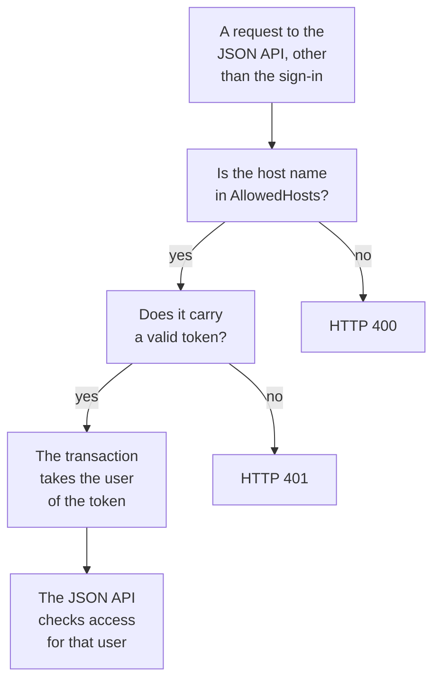

> **Status: Current.** [Where this is implemented](#where-this-is-implemented) names the code and
> the tests.

A client signs in to the server with a user name and a password, and receives a bearer token: a
JSON Web Token that the server signed. The client sends the token with every other request to the
[JSON API](json-api.md). Authentication establishes which user sends a request;
[Security](security.md) then decides what that user may do with each object. Core's server folder
holds the sign-in endpoint, the tokens and the store of users, and an application's server adds
them in its `Startup`, as the sample's does. [Host a server](host-a-server.md) shows how to run
such a server and sign in.

## A request, step by step



1. **The host.** Before anything else, the sample's server compares the `Host` header with its
   setting `AllowedHosts`, or with `localhost` without the setting, and answers a request for
   another host with HTTP 400, whatever its token.
2. **The token.** Every endpoint of the JSON API but the sign-in requires a valid token. A request
   without one, or with one that fails a check, gets HTTP 401 with the header
   `WWW-Authenticate: Bearer`, which adds `error="invalid_token"` for a token that failed.
3. **The user.** The token holds the id of the user. The request runs in a transaction of its own,
   which takes the user object with that id as its user.
4. **Access.** The JSON API decides what the request may read, write and execute for that user, as
   [Where access is checked](security.md#where-access-is-checked) describes.

## Users and passwords

A user is an object of a class that implements Core's interface `User`; in the sample that is
`Person`. The sign-in uses ASP.NET Core Identity, with Core's `AllorsUserStore` in place of
Identity's own storage, so the name, the password hash and the lockout state of a user are roles
of the user object, such as `UserName`, `UserPasswordHash` and `UserLockoutEnd`. The store builds a
`Person` when Identity creates a user, so Core's server code compiles only in a domain with a
class `Person` that implements `User`, as the sample's does.

The sign-in finds a user by `NormalizedUserName`, which `UserNormalizedUserNameRule` derives from
`UserName` in upper case, so a user signs in with the name in any case. The model declares
`NormalizedUserName` as `[Unique]`, but the platform enforces nothing
([#404](https://github.com/allors/allors3/issues/404)). The sample's `user` command refuses a name
that another user has in any case; other code that creates users has to check it as well.

Code sets a password by writing it to `InUserPassword`. The next derivation checks it with
`UserInUserPasswordRule`: a password needs at least 12 characters, with at least four different
ones. The rule hashes the password into `UserPasswordHash` with the password hasher of ASP.NET Core
Identity, gives the user a new `UserSecurityStamp` and clears `InUserPassword`. When users who
already have a password set their own, the rule also requires the current one in
`InExistingUserPassword`, and reports `Invalid password.` without it or with a wrong one. Another
user, such as an administrator, sets a password without it. Through the JSON API this takes the
permission to write these roles; in the sample only the `Role` Administrator has it.
`SetPassword`, which the rule calls, hashes a password without any of these checks: code that calls
it directly skips them.

## Signing in

The client posts the name and the password to the sign-in endpoint,
[`Authentication/Token`](json-api.md#sign-in). When the password matches, the response holds the
id of the user and a new token. Otherwise it is `{"authenticated":false}`, with HTTP 200, whether
the name is unknown, the password is wrong or the user is locked out: the response does not say
which.

The sign-in counts the failed passwords of a user. After five in a row, the user is locked out for
five minutes, and during that time the right password fails as well. A successful sign-in resets
the count. These are the defaults of ASP.NET Core Identity, which the sample's `Startup` keeps.
Core's `User.CoreOnBuild` enables the lockout of every user that is built without a value for
`UserLockoutEnabled`. A lockout ends no token that the user already has.

## The token

A token is a JSON Web Token, signed with HMAC-SHA256 with the key in the setting `JwtToken:Key`.
The key needs at least 32 bytes in UTF-8; the server does not start with a shorter one. A token is
signed, not encrypted, so whoever holds it can read what it holds, for example:

```json
{
  "http://schemas.xmlsoap.org/ws/2005/05/identity/claims/name": "worker@example.com",
  "http://schemas.xmlsoap.org/ws/2005/05/identity/claims/nameidentifier": "240",
  "sub": "worker@example.com",
  "jti": "16a20f76-ee60-4a26-afdb-99b842ad1f01",
  "exp": 1798124764,
  "iss": "my-app",
  "aud": "my-app"
}
```

The server identifies the user by the name identifier alone, which is the id of the user. The
user name appears twice, `jti` is a new random id for every token, and `exp` is the time at which
the token expires, in seconds since 1 January 1970, UTC.

- **The lifetime.** `JwtToken:Expiration` sets it, as a .NET `TimeSpan` such as `7.00:00:00` for
  seven days. Without a value that is a `TimeSpan`, a token lasts 30 days. The server accepts a
  token until five minutes after it expires: Microsoft.IdentityModel, which validates the token,
  allows that much for clocks that differ by default, and `JwtTokens` keeps the default. After that
  a request gets HTTP 401, and the header says that the token expired.
- **The issuer and the audience.** `JwtToken:Issuer` puts an issuer in every token, in `iss`, and
  `JwtToken:Audience` an audience, in `aud`, which is the issuer when that setting is absent. The
  server refuses a token that does not carry the issuer or the audience that it is configured
  with. Without either setting, it accepts every token that its key signed and that has not
  expired.

[Settings](configuration.md#settings) lists the settings of a server.

## What a token outlives

The server keeps no record of the tokens that it issued. It checks a token by its signature and its
claims alone, so a token stays valid for its whole lifetime:

- **A new password ends no token.** It gives the user a new `UserSecurityStamp`, which no token
  holds and the bearer scheme does not check.
- **Nothing withdraws a token.** There is no endpoint to sign out or to renew one; a client signs
  in again for a new token. A server that restarts with another key refuses every earlier token,
  and so signs every user out.
- **Access does not travel in the token.** The server decides access on every request, from the
  database as it is then. A user who leaves a user group loses the grants of that group with the
  first request after the change is committed.
- **A deleted user keeps a valid token.** A request with it fails with HTTP 500 as soon as the
  server checks access for that user, as a pull or a sync that names objects, a push that writes a
  role, an invoke of a method and an access request for grants do. A request that checks no
  access, such as a permission request, still succeeds.

## Where this is implemented

- Core's server folder, `dotnet/Core/Database/Server/Core`, holds the parts. In `Identity`:
  `JwtTokens` creates the tokens and the parameters that check them, and refuses a short key;
  `IdentityBuilderExtensions.AddAllorsJwtBearer` makes the bearer scheme the default scheme to
  authenticate and to challenge a request; `AuthenticationController` is the sign-in endpoint;
  `AllorsUserStore` stores the users. In `Services`, `ClaimsPrincipalServiceMiddleware` passes the
  claims of the token on, and `TransactionService` gives the transaction of a request the user
  whose id they hold.
- The sample's `Startup`, in `sample/Database/Server`, filters the host names and adds Identity
  with Core's stores, the bearer scheme and that middleware.
- `UserNormalizedUserNameRule` and `UserInUserPasswordRule` are in
  `dotnet/Core/Database/Domain/Core/Rules/User`, and `User.CoreOnBuild` and `SetPassword` in
  `UserExtensions`, in `dotnet/Core/Database/Domain/Core/Security`. `PasswordHasher`, in
  `dotnet/Core/Database/Configuration/Core/Database/PasswordHasher`, sets the strength of a
  password.
- `JwtBearerTests` and `AllorsUserStoreTests`, in `dotnet/Core/Database/Server.Local.Tests`, check
  the issuer and the audience of a token and the user store. `LockoutTests`, in
  `dotnet/Core/Database/Server.Remote.Tests`, checks the lockout against the Core test server, and
  `LoginTests`, in `dotnet/Core/Database/Domain.Tests`, that a new user has lockout enabled.
- In `sample/Database/Server.Tests`, `SignInTests` checks the sign-in, the lifetime and the refusal
  of a missing, invalid or foreign token, and `StartupTests` the signing key and the host names.
  `AddUserTests`, in `sample/Database/Commands.Tests`, checks that the `user` command refuses a
  short password and a name that another user has in another case.
- No test checks the tolerance for an expired token, the duration of a lockout and the reset of its
  count, the four different characters of a password, that a user who sets their own password has
  to give the current one, or what a token outlives.
