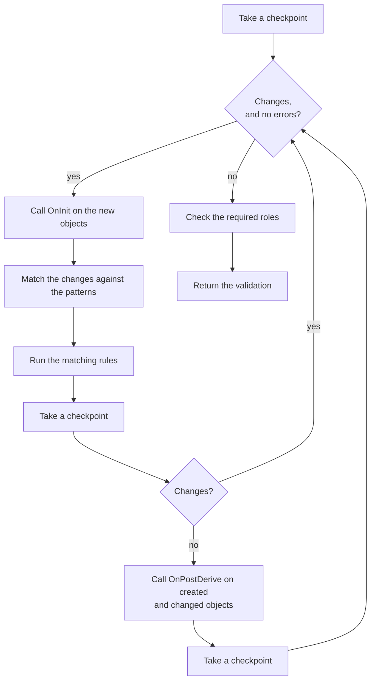

> **Status: Current.** [Where this is implemented](#where-this-is-implemented) names the code
> and the tests.

A derivation brings the objects of a transaction up to date. It looks at what changed, runs the
rules that depend on those changes, looks at what the rules changed, and goes on until nothing
changes any more. Then it checks the result. A rule states once which value follows from which
other values; no code that changes an object has to remember what else must follow.

This page explains what a derivation does. [Write a rule](write-a-rule.md) gives the steps for
one rule, and [Objects and relations](objects-and-relations.md#change-sets) explains the change
sets that derivations are built on.

## A rule

A rule has patterns, which say when it runs, and a method `Derive`, which brings objects up to
date. This is `PersonFullNameRule` of the platform's test domain:

```csharp
public class PersonFullNameRule : Rule
{
    public PersonFullNameRule(MetaPopulation m) : base(m, new Guid("C9895CF4-98B2-4023-A3EA-582107C7D80D")) =>
        this.Patterns = new Pattern[]
        {
            new RolePattern<Meta.Person>(m.Person, v => v.FirstName),
            m.Person.RolePattern(v => v.LastName),
        };

    public override void Derive(ICycle cycle, IEnumerable<IObject> matches)
    {
        foreach (var person in matches.Cast<Person>())
        {
            person.DomainFullName = $"{person.FirstName} {person.LastName}";
        }
    }
}
```

When the first name or the last name of a person changes, the person matches, and `Derive`
writes the full name. The two patterns are two spellings of the same kind of pattern.

## Patterns

A pattern names a role type or an association type, and the type of the objects that it is for.

| Pattern | An object matches when |
| --- | --- |
| A role pattern, `m.Person.RolePattern(v => v.LastName)` | One of its roles of that type changed. |
| An association pattern, `m.Person.AssociationPattern(v => v.OrganisationsWhereOwner)` | One of its associations of that type changed: an object took it into that role, or let it go. |

- **A pattern is for the objects of its type.** The type can be a class or an interface, and the
  role can be declared on a supertype. `new RolePattern(m.C1, m.S12.ChangedRolePingC1)` matches
  the objects of the class `C1`. It does not match those of `C2`, although `C2` has the role as
  well, through the interface `S12`.
- **A path leads to other objects.** A pattern with a path does not match the object that
  changed. It matches the objects at the end of the path that starts there:

  ```csharp
  m.CC.RolePattern(v => v.Assigned, v => v.BBWhereOne2One.ObjectType.AAWhereOne2One),
  ```

  When `Assigned` of a `CC` changes, the rule receives an `AA`: the path goes from the `CC` to
  the `BB` that holds it in `One2One`, and from that `BB` to the `AA` that holds it. `ObjectType`
  steps to the type at the end of a relation, so that the next relation can be named.
- **The patterns cover what `Derive` reads.** A rule runs only when one of its patterns matches.
  A role that `Derive` reads without a pattern for it can change unnoticed, and the derived value
  is then out of date.

## The cycles of a derivation

`transaction.Derive()` runs one derivation. The derivation works in cycles; an arrow in the
diagram points to the step that follows.



- **A cycle works on one change set.** It is the change set of a checkpoint: what changed since
  the previous one.
- **New objects are initialized first.** The cycle calls the method `OnInit` on every object of
  its change set that was created. An object gets the call at most once: in the cycle whose
  change set holds its creation. In the test domain a new person who manages an organization
  becomes its employee this way.
- **Every matching rule runs once in a cycle.** It receives all its matches together, without the
  objects that were deleted. The order in which the rules of one cycle run is not defined.
- **A rule that writes starts the next cycle.** What the rules of a cycle change is the change
  set of the next one. The test domain's `PersonGreetingRule` has a pattern for
  `DomainFullName`, so it runs in the cycle after `PersonFullNameRule` wrote that role.
- **The derivation ends when a cycle changes nothing.** Writing the value that a role already has
  is [no change](objects-and-relations.md#change-sets), so a rule that computes the same result
  again ends the chain.
- **A derivation that does not settle is stopped.** After 100 cycles, the default of `MaxCycles`
  of the derivation service, the derivation throws an exception with the message
  `Maximum amount of domain derivation cycles detected`, also when it was started with
  `Derive(false)`. Rules that keep changing a role that one of their own patterns names cause
  this.
- **`OnPostDerive` runs when the rules are done.** When a cycle changes nothing, the derivation
  calls the method `OnPostDerive` on every object that was created, or of which a role changed,
  in the change sets since it last made these calls. When a part of that method changes
  something, the cycles start again. An object that only such a part created or changed gets no
  call of its own.

## Errors

A rule reports an error to the validation of its cycle and does not throw:

```csharp
cycle.Validation.AddError(person, this.M.Person.LastName, "A person has a last name");
```

`IValidation` also has assertions that report an error of a known kind, among them
`AssertExists`, `AssertNotExists`, `AssertNonEmptyString`, `AssertAtLeastOne`,
`AssertExistsAtMostOne`, `AssertAreEqual` and `AssertIsUnique`. An error can name the object and
the role types or association types that it is about.

- **An error ends the derivation after its cycle.** The rules of that cycle still run, and the
  required roles are still checked; no further cycle starts. `Derive(false, true)` asks for the
  cycles to go on in spite of errors.
- **`Derive()` throws.** It throws a `DerivationException`, which holds the errors.
  `Derive(false)` returns the validation, an `IValidation` with `HasErrors` and `Errors`.
- **Roll back after an error.** The changes stay in the transaction, half derived: no later
  derivation resumes the cycles that the error cut off. A rule that waited for a role written in
  the last cycle does not run, the objects that were created in that cycle get no `OnInit`, and
  `OnPostDerive` is not called when that cycle changed something. Repairing the objects and
  deriving again brings a derived value up to date only where one of its inputs changes again.
- **An error is reported once.** A later derivation looks at the changes since the earlier one,
  so it does not report the same error again as long as the objects stay as they are.

### Required roles

After the last cycle the derivation checks the roles that the model marks as
[`[Required]`](model.md#attributes). It checks every object that was created, or of which a role
changed, in the change sets of its cycles: the changes since the previous checkpoint and the
changes of the rules. It leaves out the deleted objects, and the objects that only a part of
`OnPostDerive` created or changed. It reports an error for each required role that holds nothing:
`ValiData.RequiredPerson is required`.

## Derive before you commit

A commit stores the changes of a transaction as they are. It runs no rules and checks no required
roles: call `Derive()`, and commit when it reports no errors.

```csharp
transaction.Derive();
transaction.Commit();
```

A derivation starts from a checkpoint, so it sees the changes since the previous checkpoint. A
commit, a rollback and an earlier derivation all end a change set. Changes that are committed
without a derivation are therefore invisible to the next derivation, and no rule ever runs for
them. For the same reason, code that calls `Checkpoint()` itself hides the changes before it from
the next derivation.

The platform derives where it changes objects for someone else, among others in these places:

- The setup of a population derives what it creates.
- The JSON API derives every push and every method that a client invokes, and returns the errors.
  It commits a push that has no error of any kind. It commits an invoked method when the
  derivation has no errors, and rolls it back otherwise.

## Derived roles

A role that a rule maintains is declared with [`[Derived]`](model.md#attributes), as
`Person.DomainFullName` is. The attribute keeps clients from writing the role; it does not guard
the role inside the database. Code in the database that writes a derived role by hand leaves a
value that stays until one of the rule's patterns matches again.

## Where this is implemented

- `IRule`, `IPattern`, `ICycle`, `IDerivation` and `IValidation` are in
  `dotnet/System/Database/Allors.Database/Derivation`. `Rule`, `RolePattern` and
  `AssociationPattern` are in `dotnet/Core/Database/Domain/Core/Derivations/Rules`.
- `Derivation`, `Engine`, `Validation` and `DerivationService`, in
  `dotnet/Core/Database/Configuration/Core/Database/Derivations/Default`, hold the cycles, the
  matching, the assertions and the limit of 100 cycles. `Derive()` of a transaction and
  `DerivationException` are below `dotnet/Core/Database/Domain/Core`, in `Extensions` and in
  `Derivations`.
- The tests are in `dotnet/Core/Database/Domain.Tests/Domain`. `DomainDerivationTest` checks a
  rule and the rule that follows it, `RoleDerivationTest` an association pattern,
  `ChangedValidationDomainDerivationTest` the patterns with a path, `PostDeriveTest` the cycles
  after `OnPostDerive`, `RequiredTest` the required roles, `UniqueTests` `AssertIsUnique`, and
  `InitTest` `OnInit`.
- `ChangesTest`, in `dotnet/System/Database/Adapters/Tests.Static/Static`, checks on every
  database adapter that a commit ends a change set and that the checkpoint after a rollback is
  empty. No test of the platform reaches the limit of 100 cycles, checks what an error leaves
  underived, or checks that changes committed without a derivation stay invisible to the next
  one.
