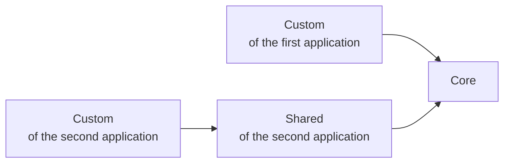

> **Status: Current.** [Where this is implemented](#where-this-is-implemented) names the code
> and the tests.

An Allors3 application is built from domains. A domain holds a part of the model, which is its
interfaces and classes with their relations and methods, together with the behaviour that belongs
to that part. Inheritance is the only relationship between domains: every domain except Core
extends one domain and inherits its model and behaviour.

## Core and the domain of an application

Core is the domain that every application builds on. It is abstract: it declares what every
application needs and leaves the rest open. `User`, for example, is an interface in Core; the
class that implements it comes from a domain that extends Core.

An application has a domain of its own, conventionally named `Custom`. It extends Core directly,
or through other domains of its own. The diagram shows two applications; each arrow points from a
domain to the domain it extends.



- Every domain except Core extends exactly one domain, and an application has one domain of its
  own, so the domains of an application form a chain that ends in Core.
- The application's own domain starts the chain: no domain extends it.
- Base and Apps, the business domains of earlier versions, are not part of the platform.
  [Versions and branches](versions.md) says where they continue.

## Declare a domain

A domain is declared in the repository project, the C# project that declares the model. A struct
carries the id of the domain and names the domain it extends. This is the test domain of the
platform, in `dotnet/Core/Repository/Domain/Custom/Custom.cs`:

```csharp
[Domain("af96e2b7-3bb5-4cd1-b02c-39a67c99a11a")]
[Extends("Core")]
public struct Custom
{
}
```

- `[Domain]` holds the id of the domain. Generate the id of a new domain; do not copy one.
- `[Extends]` names the one domain that this domain extends. Core has no `[Extends]`.
- The declarations in the folder of that file, and in the folders below it, belong to the domain.

## What a domain inherits

### The model

The types of Core are available to a domain that extends it. A class of that domain implements
interfaces of Core and receives their relations and methods. In the test domain, `Person`
implements Core's `User`:

```csharp
[Workspace(Default)]
public partial class Person : User
```

`Person` thereby has the relations of `User`, such as `UserName`. `User` inherits from Core's
interface `Object`, so `Person` also has the methods that Core declares there: `OnBuild`,
`OnPostBuild`, `OnInit` and `OnPostDerive`.

### The behaviour

A method is declared once, in the repository project, and every domain can add a part to it. A
domain writes its part in a member that is named after the domain and the method:

- a part for an interface is an extension method on that interface. Core's part of `OnPostBuild`
  for `Object` is `CoreOnPostBuild`, which gives a required boolean, number, date or unique role
  of a new object a default value when it has none;
- a part for a class is a method of that class. The test domain's part of `OnInit` for `Person`
  is `CustomOnInit`:

```csharp
public partial class Person
{
    public void CustomOnInit(ObjectOnInit method)
    {
        if (this.ExistOrganisationWhereManager)
        {
            this.OrganisationWhereManager.AddEmployee(this);
        }
    }
}
```

When a method is called on an object, Allors runs its parts in this order:

1. The parts for the interfaces of the object's class.
2. The parts of the class itself.

Within one interface or class, the part of a domain runs before the part of the domain it
extends. The parts for the interfaces come first, so Core's `CoreOnPostBuild` for `Object` runs
before the `CustomOnPostBuild` of a class in the application's domain.

`MethodsTests` checks this order on the test domain. The class `C1` implements the interface
`I1`, which inherits from the interface `S1`. For a method of `S1` the parts run as: `S1` of
Custom, `S1` of Core, `I1` of Custom, `I1` of Core, `C1` of Custom, `C1` of Core.

Do not rely on the order among the parts of interfaces that do not inherit from each other. The
comparison that sorts the interfaces combines inheritance with the order of their names, and the
two can contradict each other.

A part can end the run: the remaining parts are skipped once the object is deleted, or once a
part sets `StopPropagation` on the method.

### Setup and security

Setup and security have hooks with the same kind of name, such as `CoreOnPreSetup` and
`CustomOnPreSetup`. They are not methods of the model, and they run the other way round. In the
platform's repository the files in `dotnet/Core/Database/Domain/Virtual` call them one after the
other, the hook of Core first. An application writes such files for its own chain of domains.

## How an application includes Core

An application compiles the source of Core next to its own, selected by folder name. It does not
reference Core as a compiled library.

Core keeps the code that applications inherit in folders named `Core`:
`dotnet/Core/Repository/Domain/Core`, `dotnet/Core/Database/Meta/Core`,
`dotnet/Core/Database/Domain/Core`, `dotnet/Core/Database/Server/Core` and the matching folders
of the other projects. A project includes the matching folder with a glob and adds the folder of
its own domain. This line is from the generator of the adapters,
`dotnet/System/Database/Adapters/Generate/Generate.csproj`, which includes the generator of Core
in this way:

```xml
<Compile Include="..\..\..\..\Core\Database\Generate\Core*\**\*.cs" />
```

A project of an application has the same line, with the path to its copy of the platform, for
example a Git submodule. An application has a project for each layer that it uses, such as the
repository, the meta, the domain, the configuration, the commands and the server, and each of
them includes the folder `Core` of the matching Core project. A domain between Core and the
application's own domain follows the same rule: its inheritable code lives in folders named after
it, and the projects of the application include those folders as well.

## Custom in the platform's repository

Core's own folders named `Custom` hold the platform's test domain: the domain declared above, its
population, and the endpoints and helpers that the Core tests and the Core test server need. The
glob `Core*` does not match them, so an application never compiles them.

`Custom` is also the conventional name of an application's own domain. The application compiles
its own `Custom` folders and never Core's, so the two do not meet in one build.

## Generated code

The model is declared once. From the declarations of the repository project, generators produce
the metadata and the typed classes of the domain and of the workspaces, for .NET and for
TypeScript. Generated files, `*.g.cs` and `*.g.ts`, are not committed and are never edited by
hand. Generate again after every change to the declarations; in this repository
`./build.sh Generate` does that, and a fresh clone does not compile until it has run.
[Build and test](internals/build-and-test.md) describes the build.

## What the application owns

The platform ends at Core. An application owns its business domains, and its screens, forms,
tables, navigation and component libraries. The platform's repository holds no production
application and no production user interface.

## Where this is implemented

- `ExtendsAttribute`, in `dotnet/System/Repository/Attributes`, takes the name of one domain.
  `Repository`, in `dotnet/System/Repository/Allors.Repository`, gives a domain its base domain
  and assigns a declaration to the domain whose folder holds its file.
- `MethodCompiler`, in `dotnet/System/Database/Allors.Database.Meta.Props`, finds the parts of a
  method by the name of the domain and puts them in order; `MethodInvocation`, next to it, runs
  them. `MethodsTests`, in `dotnet/Core/Database/Domain.Tests`, checks the order.
- The projects of Core under `dotnet/Core` hold the folders `Core` and `Custom`. Core's own
  projects compile both, because the platform's tests need the test domain.
  `dotnet/Core/Database/Domain/Virtual` holds the calls to the setup and security hooks.
