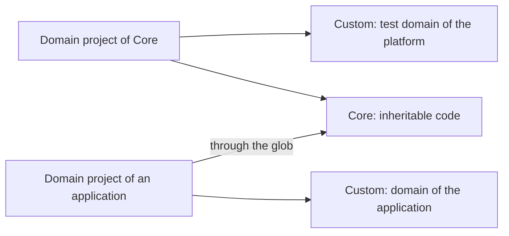

> **Status: Current.** Explanation for maintainers.

Allors3 is a platform for applications built around domain inheritance. The 3.2 line narrows the
repository to the platform and continues from the state that a downstream application runs in
production; [Versions and branches](../versions.md) records where the line starts. This page says
what belongs to the platform and which rules keep it inheritable. It assumes
[Domains](../domains.md), which explains inheritance for the developers of an application.

## Scope

| Area | Responsibility |
| --- | --- |
| System | The database and workspace engines, the adapters, the protocols, the metadata and the generators. |
| Core | The foundational domain behaviour, authorization, the JSON API, authentication and the building blocks of a server, reusable through domain inheritance. |
| Platform tests | Core's test domain, the runnable Core test server, and the suites that prove the behaviour of the platform on every adapter. |
| Downstream applications | Business domains that extend Core, screens, forms, tables, navigation and component libraries. |

Base and Apps are not part of the platform. Their business domains, applications, Angular/Material
and Blazor component libraries, configuration and build targets remain available on the `v3.1`
branch.

## The repository

| Folder | Holds |
| --- | --- |
| `dotnet/System` | The database, with its adapters and their shared tests; the protocols; the repository project machinery with its attributes, generator and templates; the workspace, with its adapters and metadata. |
| `dotnet/Core` | The repository project of Core and of its test domain; the meta, domain, resources, configuration, commands and server projects of the database; the meta, domain and configuration projects of the workspace; their templates and their tests. |
| `typescript/modules` | An nx workspace with the system and core libraries of the TypeScript workspace, their tests and the TypeScript templates. |
| `build` | The Nuke build; see [Build and test](build-and-test.md). |
| `config` | The configuration root templates; see [Configuration](../configuration.md#templates). |
| `docs` | This website; see [Documentation website](documentation-website.md). |

## Folders carry inheritance

An application compiles the source of Core next to its own and selects it by folder name, as
[How an application includes Core](../domains.md#how-an-application-includes-core) describes. That
makes the name of a folder part of the contract between the platform and its applications:

- **Inheritable code belongs in folders named after its domain.** In a project of Core, code that
  applications inherit lives in the folder `Core`.
- Code that only the platform's own tests need lives in the folder `Custom`.
- A file at the root of a project, such as `Program.cs` and `Startup.cs` of the Core test
  server, belongs to the platform's own program. An application writes its own.
- A folder with another name belongs to the project that holds it. `Virtual` in the domain
  project holds the hand-written calls to the setup and security hooks of Core and of the test
  domain; an application writes its own, as [Setup and security](../domains.md#setup-and-security)
  describes.
- A glob of a project selects the folders of its domains explicitly, as `Core*/**/*.cs` does.

The domain project shows how the first two rules work out. An arrow points from a project to a
folder that it compiles.

Moving a file between these folders changes what every application compiles.

## Objects and relations

Objects delegate their operations to their strategies. Object creation and deletion, and every
read and write of a relation, go through the Allors API, so that the platform can maintain both
ends of a relation. [Terminology](../terminology.md#relations) defines the two ends.

The id `0` stands for no object. The ids of database objects are positive and start at 1; the ids
of new objects in a workspace are negative and start at -1. A range of object ids therefore never
contains `0`.

## Test scaffolding is separate from inherited code

The `Custom` folders of Core hold internal scaffolding: the concrete test domain that extends
Core, its setup and population, the endpoints that reset a database, and the helpers for the Core
tests and the Core test server. The glob `Core*` does not match them, so an application does not
compile the scaffolding. The runnable test server is a test harness, not a production deployment.

`Custom` is also the conventional name of an application's own domain. The application compiles
its own `Custom` folders and never Core's, so the two do not meet.

Reusable libraries must not carry test routes, test hooks or other scaffolding; dedicated test
projects are the exception. The same rule holds for TypeScript: the libraries under
`typescript/modules/libs` are inheritable by the workspaces of applications and must not carry
test code or test-only scaffolding, with the dedicated `*-tests` libraries as the exception. The
test domain has its place there too: `libs/core/workspace/derivations-custom` holds its rules,
and `Generate` writes the model of Core with its test domain into the generated folders of the
core libraries. The 3.2 line has no test applications: they left with Base and Apps.

Test coverage must continue to exercise inheritance, relations, permissions, generation, the
adapters and the synchronization of the workspace.

## The database adapters

The Core and TypeScript suites run by default on the Snapshot adapter, an in-memory database that
transactions share. It reports a write conflict as a database server does, so a suite that passes
on it does not hide one. The SqlClient adapter for SQL Server and the Npgsql adapter for
PostgreSQL remain the production path, and CI runs the suites on them as well. The Memory adapter
remains for a single transaction over a population, which is how the domain tests use it.

## Configuration and hosting

The Core test server, its command-line tool and the tests that need a database take their
settings from the configuration root and from environment variables, as
[Configuration](../configuration.md) describes. A program stops without a setting that it needs; the test projects and the Nuke build
default to the template `config/snapshot` instead, so that a test run needs no database server.

An application's server compiles Core's server folder through the glob `Core*`;
[Host a server](../host-a-server.md) shows how to run one, [The JSON API](../json-api.md)
describes what it serves, and [The workspace](../workspace.md) explains the clients that use it. [Authentication](../authentication.md) lives in Core's server folder in
the 3.2 line: ASP.NET Core Identity user and role stores over Allors users, a JWT bearer scheme and
the sign-in endpoint. Moving authentication into plug-ins, with cookie sessions and Microsoft Entra
ID, is part of the archived previous line and returns when an application needs it.
