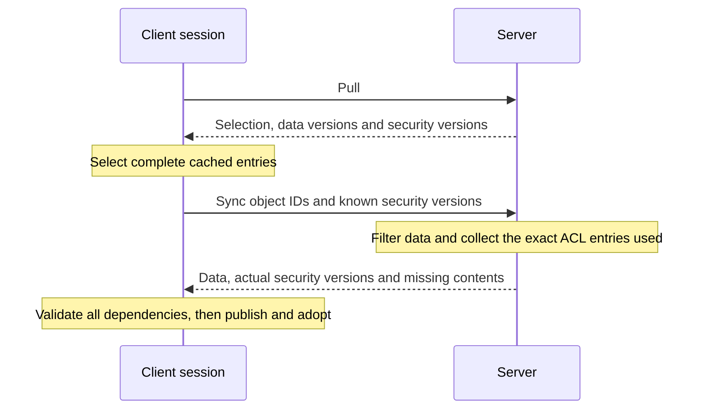

> **Status: Planned.** Agreed design, with implementation in progress. The first step adds
> bundled Sync security and known-version requests to the server and protocol models. Remote
> client loading, immutable cache bindings and the new Reset behaviour remain to be implemented.

The normal loading workflow is Pull followed by Sync when data or security differs from the
client's complete cache entries. Sync returns every security dependency that the client has
not explicitly advertised as known. No historical security service or security-version-mismatch
retry is needed. Completion is deterministic for each Sync response; Pull and Sync may observe
different server states.

The [current session state explanation](workspace-session-state.mdx) describes the existing
clients until their implementation changes. The snapshot rules below intentionally replace
automatic merging on Pull and change Reset to adopt data already received by that session.

## Complete security in Sync

Pull already returns object data versions, grant and revocation IDs, and response-level
grant/revocation version lists. The client checks all of these when selecting cached payloads.
A security-only change can alter the readable data projection even when the object's data
version is unchanged, so it can require Sync.

Each object in Sync continues to reference grant and revocation IDs only. The response-level
grant and revocation tables declare one version per ID, derived from the same ACL instances
that filter the returned role values. Different responses can select different versions.

Known means that the client has both the exact access entry and all its permission definitions.
The workflow retains these entries until loading and adoption finish. It advertises relevant
entries identified through Pull rather than the entire connection cache.

If Pull names grant `11@4` and the client advertises it, Sync can omit its contents when it
also uses `11@4`. If Sync instead uses `11@5`, it includes version 5 and its contents. A newly
applicable grant or revocation is included in the same way. The server never substitutes the
client's advertised permissions for the ACL used to authorize the response.

## Wire contract

The compact JSON member names follow the existing protocol conventions.

| Message | Member | Meaning |
| --- | --- | --- |
| Sync request | `o` | Object IDs to synchronize. |
| Sync request | `g`, `r` | Optional lists of known grant and revocation `[id, version]` pairs. |
| Sync response | `o` | Objects, with their data versions, role values and grant/revocation IDs. |
| Sync response | `g`, `r` | Tables of the actual grants and revocations used. Each entry has `i` for ID, `v` for version and optional `p` for its permission-ID range. |
| Sync response | `p` | Permission definitions required by the included access-entry contents, deduplicated by permission ID. |

An access entry with omitted or null `p` references the exact complete entry advertised by
the client. An empty array `p: []` is a complete entry with no permissions; it must not be
confused with omitted contents. Included contents use the existing permission-range encoding.
The response includes its `g`, `r` and `p` tables even when they are empty.

Every permission referenced by included contents has its definition in the response, once.
This first implementation does not separately advertise known permission definitions. That
optimization can be evaluated later without changing the completeness rule.

New clients must reject missing tables, omitted unadvertised contents, inconsistent versions
and missing definitions before publication or session adoption. They must not manufacture
empty grants or silently fall back to the latest cached entry by ID. Clients rebuilt with these
request models require an updated server: the .NET serializers also send null `g` and `r`
members, which an older server rejects as unknown fields. The first implementation step retains the
existing Access and Permission endpoints while existing clients still use them; the new loading
workflow will not call them.

## Shared entries and session ownership

Within a fixed database, authenticated connection, workspace projection and model scope,
complete grant and revocation entries are keyed by kind, ID and version. Object payloads are
identified by their ID, data version and exact security binding. Published entries are
immutable, including their permission ranges and other contained collections.

Sessions retain references to the entries they selected. Publishing another version into a
shared cache does not advance an existing session object. Cache-index eviction must not
invalidate entries retained by sessions or active loading workflows.

A loading workflow stages its returned objects and dependencies, validates the complete result,
and only then publishes and adopts selected references. Failed loading leaves the session's
active snapshots, latest received snapshots and edits unchanged. Session-local scheduling and
all adoption paths must preserve that rule while allowing different sessions to load concurrently.

## Edited objects and Reset

Each session object retains an active snapshot, a latest received snapshot and its local edits.
A snapshot contains both the data record and its exact grant/revocation bindings. The latest
received snapshot is selected by that session's own successful Pull/Sync, including complete
cache hits. It is never an unqualified lookup of the connection's latest record.

| Event | Agreed behaviour |
| --- | --- |
| A complete snapshot arrives and the object has no edits | Adopt the data and security together. |
| A complete snapshot arrives and the object has edits | Keep its active data, security and edits; retain the received snapshot as the latest. |
| Another complete snapshot arrives while edits remain | Replace only the latest received reference. The active snapshot remains pinned. |
| The user resets the object | Clear its edits and adopt its latest received snapshot, including security, without a network request. |
| The user reapplies selected changes | Create new edits against the adopted snapshot through the normal permission checks. |
| Loading or validation fails | Keep the existing snapshots and edits. |

Any local edits pin the active snapshot, including when the server changes different roles.
Pull does not automatically merge an edited object. Applications can preserve chosen changes
before Reset and reapply them afterward. Reset never adopts a snapshot solely because another
session loaded it. Data and security advance together, so newly readable roles are adopted
with the data that their security permitted the server to return.

Server-side authorization remains authoritative for subsequent operations. Cached permission
descriptions do not grant authority to perform a server operation.

## Implementation and validation

The first implementation step covers the shared protocol models, Sync response construction,
known-version omission, and serializer parity. It must prove cold responses are complete,
exact known entries omit only their contents, newer versions are included, shared dependencies
are deduplicated, and empty permission sets remain distinct from omitted contents.

The following step implements the TypeScript and .NET remote loading paths, selected immutable
bindings, response validation, session isolation and Reset adoption. Its tests must cover
security-only changes, edited and unedited objects, repeated Pull before Reset, cross-session
isolation, rejected responses, and reapplying changes after Reset. Existing merge and Reset
expectations change only where the agreed snapshot rules require it.

The platform change is incomplete until both remote clients follow the same contract. The
current session explanation and guided example must then be updated to match the new tests.
Signals, persistent caching and unrelated Push error-contract changes remain separate work.
