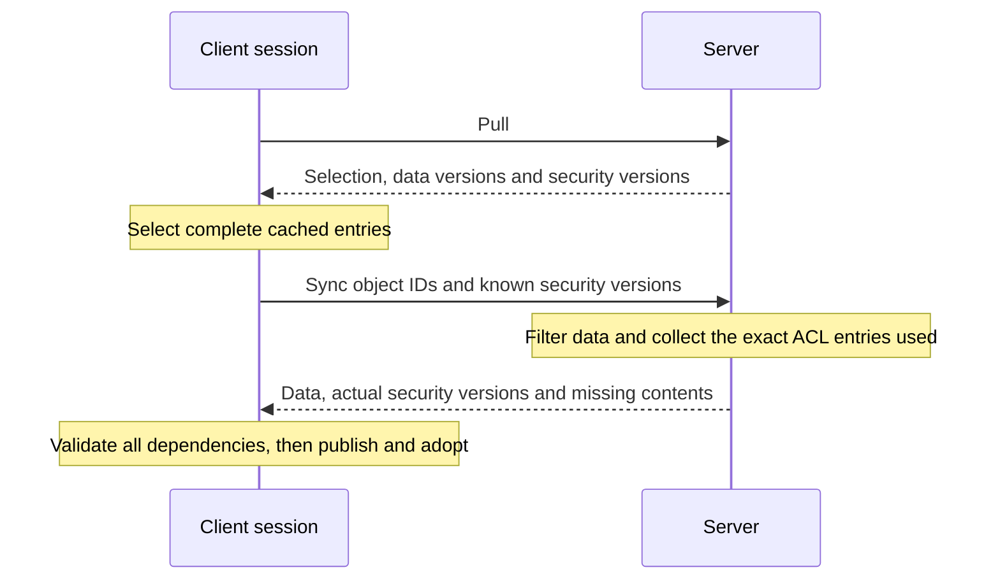

> **Status: Current.** Explanation of the server and both remote workspace clients.

The normal loading workflow is Pull followed by Sync when data or security differs from the
client's complete cache entries. Sync returns every security dependency that the client has
not explicitly advertised as known. No historical security service or security-version-mismatch
retry is needed. Completion is deterministic for each Sync response; Pull and Sync may observe
different server states.

The [session state explanation](workspace-session-state.mdx) describes editing, diff and Reset,
with a guided example. Pull preserves edited objects, and Reset adopts data already received
by that session.

## Complete security in Sync

Pull already returns object data versions, grant and revocation IDs, and response-level
grant/revocation version lists. The client checks all of these when selecting cached payloads.
A security-only change can alter the readable data projection even when the object's data
version is unchanged, so it can require Sync.

Each object in Sync continues to reference grant and revocation IDs only. The response-level
grant and revocation tables declare one version per ID, derived from the same ACL instances
that filter the returned role values. Different responses can select different versions.

Known means that the client has both the exact access entry and all its permission definitions.
The workflow retains these entries until loading and adoption finish. It advertises relevant
entries identified through Pull rather than the entire connection cache.

If Pull names grant `11@4` and the client advertises it, Sync can omit its contents when it
also uses `11@4`. If Sync instead uses `11@5`, it includes version 5 and its contents. A newly
applicable grant or revocation is included in the same way. The server never substitutes the
client's advertised permissions for the ACL used to authorize the response.

## Wire contract

The compact JSON member names follow the existing protocol conventions.

| Message | Member | Meaning |
| --- | --- | --- |
| Sync request | `o` | Object IDs to synchronize. |
| Sync request | `g`, `r` | Optional lists of known grant and revocation `[id, version]` pairs. |
| Sync response | `o` | Objects, with their data versions, role values and grant/revocation IDs. |
| Sync response | `g`, `r` | Tables of the actual grants and revocations used. Each entry has `i` for ID, `v` for version and optional `p` for its permission-ID range. |
| Sync response | `p` | Permission definitions required by the included access-entry contents, deduplicated by permission ID. |

An access entry with omitted or null `p` references the exact complete entry advertised by
the client. An empty array `p: []` is a complete entry with no permissions; it must not be
confused with omitted contents. Included contents use the existing permission-range encoding.
The response includes its `g`, `r` and `p` tables even when they are empty.

Every permission referenced by included contents has its definition in the response, once.
This first implementation does not separately advertise known permission definitions. That
optimization can be evaluated later without changing the completeness rule.

Clients reject missing tables, omitted unadvertised contents, inconsistent versions
and missing definitions before publication or session adoption. They do not manufacture
empty grants or silently fall back to the latest cached entry by ID. Updated clients require
a matching server: older servers reject the new request members as unknown fields. The server retains the
existing Access and Permission endpoints, but the remote loading workflow does not call them.

## Shared entries and session ownership

Within a fixed database, authenticated connection, workspace projection and model scope,
complete grant and revocation entries are keyed by kind, ID and version. Object payloads are
identified by their ID, data version and exact security binding. Published entries are
immutable, including their permission ranges and other contained collections.

Sessions retain references to the entries they selected. Publishing another version into a
shared cache does not advance an existing session object. Cache-index eviction must not
invalidate entries retained by sessions or active loading workflows.
The current indexes retain versions for the connection's lifetime; no eviction policy is
implemented yet.

A loading workflow stages its returned objects and dependencies, validates the complete result,
and only then publishes and adopts selected references. Failed loading leaves the session's
active snapshots, latest received snapshots and edits unchanged. Session-local scheduling and
all adoption paths must preserve that rule while allowing different sessions to load concurrently.

Each session orders its asynchronous Pull, Push and Invoke operations. A Pull that started
before Push cannot later clear changes acknowledged by that Push. Separate sessions can load
concurrently; this does not make synchronous object mutation safe from multiple threads.

## Session adoption

A session receives complete snapshots selected by its own successful Pull/Sync workflow,
including cache hits. An object with pending database-role edits keeps its active data and
security snapshot. The session retains its latest received snapshot separately, and Reset
adopts that reference while clearing the edits, without a request. Session-origin values retain
their separate lifecycle. The [session state explanation](workspace-session-state.mdx) owns the
full editing rules and their behavioural coverage.

Server-side authorization remains authoritative for subsequent operations. Cached permission
descriptions do not grant authority to perform a server operation.

## Implementation and validation

The C# and TypeScript clients use the same contract. Server regressions cover cold responses,
exact known entries, changed security versions, deduplicated dependencies, and empty versus
omitted contents. Client regressions cover complete cache hits, security-only changes, pinned
edits, Reset adoption, isolation between sessions and failure before adoption. The session
explanation links the authoritative tests.

Signals, persistent caching and unrelated Push error-contract changes remain separate work.
