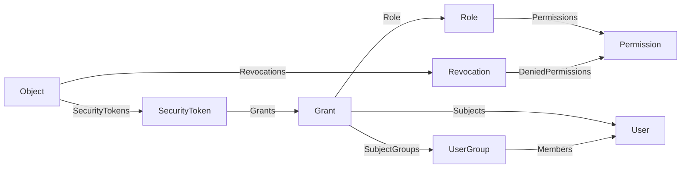

> **Status: Current.** [Where this is implemented](#where-this-is-implemented) names the code and
> the tests.

Core decides what a user may do with an object: read one of its roles, write one, or execute one
of its methods. The decision follows from objects in the database, of classes that Core declares,
so an application controls access by creating such objects and relating them.
[Grant access](grant-access.md) gives the steps. This page explains the model behind them, what
Core's setup creates and where the platform checks access.

## The objects that decide access

Each arrow is a relation of Core's model. It points from the object that holds the role to the
objects in that role, and its label is the name of the role: a `Grant` holds one `Role` in its
role `Role`. An arrow shows the role, the forward end of the relation; the
[association](terminology.md#relations) leads back.

| Type | What its objects are |
| --- | --- |
| `User` | An interface for someone who signs in. An application declares a class that implements it; in the sample application that is `Person`. |
| `UserGroup` | A named group of users, in its role `Members`. |
| `Permission` | The permission for one operation on the objects of one class. The interface has four classes: a `CreatePermission` for each class, a `ReadPermission` and a `WritePermission` for each relation type of the roles of a class, and an `ExecutePermission` for each method type of a class. |
| `Role` | A named set of permissions, in its role `Permissions`. |
| `Grant` | Gives the permissions of its `Role` to the users in its role `Subjects` and to the members of the user groups in its role `SubjectGroups`. |
| `SecurityToken` | A set of grants, in its role `Grants`, for the objects that refer to it. |
| `Revocation` | A set of permissions, in its role `DeniedPermissions`, that it denies to every user. |

Core declares the roles `SecurityTokens` and `Revocations` on its interface `Object`, so every
class that implements `Object`, directly or through another interface, has them. `Revocations`
is a [derived role](derivations.md): a rule of the application gives an object its revocations.

## How access is decided

For one user and one object, Core builds an access control list, an `IAccessControlList`:

1. **The security tokens.** These are the security tokens in the object's role `SecurityTokens`.
   An object without any uses the default `SecurityToken` of the database. While the object is
   new in its transaction, it uses the initial `SecurityToken` instead.
2. **The grants.** These are the grants of those security tokens that count the user among their
   effective users: the user is one of their `Subjects`, or a member of one of their
   `SubjectGroups`.
3. **The revocations.** These are the revocations in the object's role `Revocations`.
4. **The decision.** The user has a permission when one of the grants gives it, through its
   `Role`, and none of the revocations denies it.

The list answers `CanRead` and `CanWrite` for a role type of the object's class, and `CanExecute`
for a method type. `CanWrite` is false for a derived role, whatever the grants give.

Several consequences follow from these steps:

- **Security tokens of its own replace the defaults.** An object whose role `SecurityTokens` holds
  a security token does not use the default `SecurityToken`. Add the default one as well when its
  grants should keep applying.
- **A new object uses the initial security token.** Until the transaction that created the object
  commits, the grants of the initial `SecurityToken` decide; afterwards those of the default one.
  Code that asks for the access control list of an object that it has just created, in the same
  transaction, gets the answer for a new object.
- **A grant applies through a security token.** A `Grant` that no security token holds gives
  nothing.
- **A revocation applies to every user,** the members of Administrators included.
- **Two rules keep a grant up to date.** `GrantEffectiveUsersRule` derives the effective users of
  a `Grant` from its `Subjects` and the `Members` of its `SubjectGroups`, and
  `GrantEffectivePermissionsRule` takes the permissions of its `Role`. An application lists both
  among its rules, with Core's other rules; [Write a rule](write-a-rule.md#3-register-the-rule)
  says why a rule that is not listed never runs.
- **Delegated access.** An object of a class that implements `DelegatedAccessObject` also uses
  the security tokens and the revocations of the object in its role `DelegatedAccess`.

## Permissions

The `Permission` objects are data in the database. Core's service `IPermissions` creates them:
its method `Sync` creates the permissions that the model calls for and deletes those whose class,
relation type or method type the model no longer has.

Core's setup does not call `Sync`. After Core's setup a database therefore has no permissions,
and the security service of the database, `ISecurity`, cannot be created: asking for it throws
`KeyNotFoundException`. Issue [#419](https://github.com/allors/allors3/issues/419) records this.
An application calls `Sync` in its own setup;
[Grant access](grant-access.md#1-create-the-permissions) shows where.

A `Role` gets its permissions from the security setup, `Security.Apply()`, which the setup runs
when `Config.SetupSecurity` is true. The security setup first removes the permissions of every
`Role`. Then the objects classes and the security hooks of the domains grant them again, through
the methods `Grant` of `Security`. A permission that code gives a `Role` anywhere else is gone
after the next `Security.Apply()`.

## What Core's setup creates

[Populations](populations.md#a-new-population) explains the setup. With `Config.SetupSecurity`
true, which is the default, Core's setup creates five `Role` objects: Administrator, Creator,
Guest, GuestCreator and Owner. It also creates three `UserGroup` objects without members:
Administrators, Creators and Guests. Core gives the `Role` objects no permissions; an application
grants each one what it allows.

The setup creates four grants and three security tokens. The objects classes `Grants` and
`SecurityTokens` name them:

| `Grant` | Its `Role` | Its `UserGroup` | On the security tokens |
| --- | --- | --- | --- |
| `Grants.Administrator` | Administrator | Administrators | initial, default and administrator |
| `Grants.Creators` | Creator | Creators | initial |
| `Grants.GuestCreator` | GuestCreator | Guests | initial |
| `Grants.Guest` | Guest | Guests | default |

`SecurityTokens.InitialSecurityToken` and `SecurityTokens.DefaultSecurityToken` are the initial and
the default security token; `SecurityTokens.AdministratorSecurityToken` holds only the grant of
the administrators.

With `Config.SetupSecurity` false, the setup creates the `Role` and `UserGroup` objects and the
three security tokens, but no `Grant` and no permissions.

A user gets a `Grant` and a `SecurityToken` of its own when it is built. Its `OwnerGrant` gives the
`Role` Owner to that user alone, and its `OwnerSecurityToken` holds that grant. An object that has
a user's `OwnerSecurityToken` among its security tokens gives that user the permissions of Owner
on it.

## Creating objects

Every class has a `CreatePermission`, but this version checks none: an access control list has no
`CanCreate`, and a push to the JSON API builds an object of any class that its workspace includes.
What the user may then write on the new object follows from the grants of the initial
`SecurityToken`, because the object is new in the transaction of the push. In Core's setup those
are the grants of Administrators, Creators and Guests.

## Where access is checked

The platform checks access where a user works through a workspace:

- **The JSON API of a server** checks it for the workspace of the request. A sync sends only the
  roles that the user can read. A push writes a role only when the user can write it, and an
  invoke runs a method only when the user can execute it.
- **The Local workspace adapter,** which runs a workspace in the process of the database, checks
  the writes of a push and the methods of an invoke in the same way.
- **A mask hides an object.** The configuration's `WorkspaceMask` can name a role type for a
  class. A pull leaves out an object of that class when the user cannot read that role, and so
  does a sync of the JSON API.

Code in the database is not checked. Rules, methods, the setup, the command-line tool and tests
read and write every role through their transaction. To ask what a user may do there, build an
access control list, as the [test of Grant access](grant-access.md#6-test-the-access) does.

## Where this is implemented

- The model: `dotnet/Core/Repository/Domain/Core/Security`, with `Object` in
  `dotnet/Core/Repository/Domain/Core/Common`.
- `Security`, `Roles`, `UserGroups`, `Grants` and `SecurityTokens` are in
  `dotnet/Core/Database/Domain/Core/Security`. Its folder `AccessControl` holds
  `DatabaseAccessControl` and `WorkspaceAccessControl` with their lists. `UserExtensions`, next to
  them, gives a user its `OwnerGrant` and `OwnerSecurityToken`.
- `Permissions`, which implements `IPermissions`, and the security service `Security` are in
  `dotnet/Core/Database/Configuration/Core/Database`.
- The three rules of security are in `dotnet/Core/Database/Domain/Core/Rules`.
- The JSON API is in `dotnet/Core/Database/Server/Core/Api/Json`, and the responses that check
  access in `dotnet/System/Database/Allors.Database.Workspace.Json`. The Local workspace adapter
  is in `dotnet/System/Workspace/Adapters/Allors.Workspace.Adapters.Local`.
- `AccessControlTests`, `PermissionTests`, `DelegateAccessGrantTests` and
  `DelegateAccessRevocationTests`, in `dotnet/Core/Database/Domain.Tests/Domain/Security`, check
  the access control lists of the platform's test domain. `SecurityTests`, in
  `sample/Database/Domain.Tests`, checks those of the sample application.
