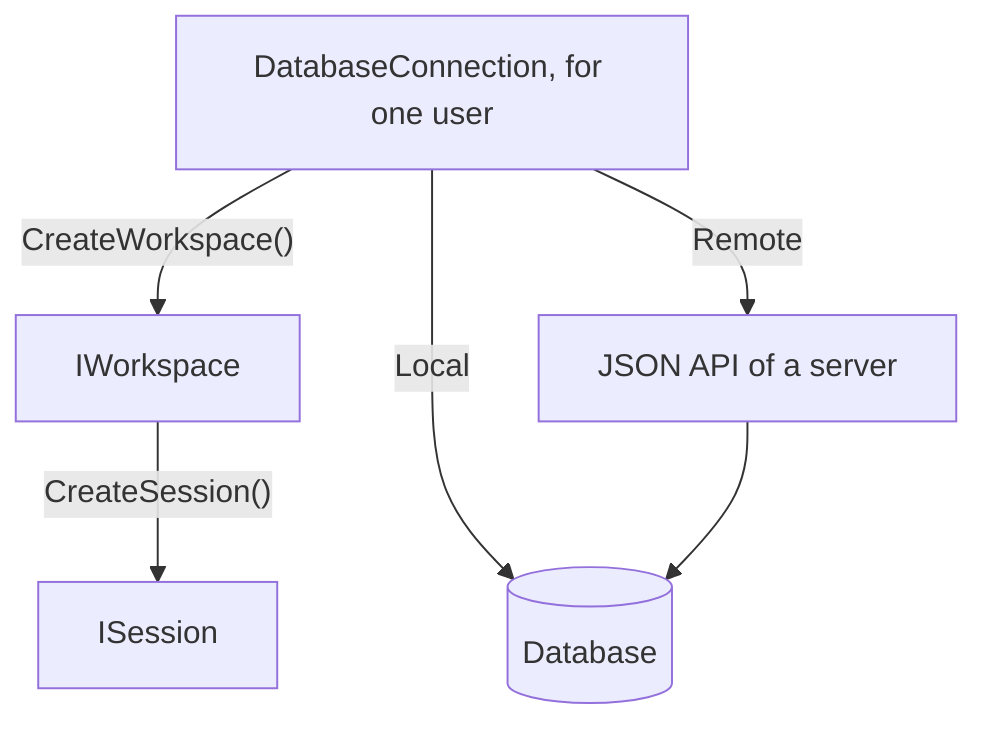

> **Status: Current.** [Where this is implemented](#where-this-is-implemented) names the code and
> the tests.

A workspace is how code outside the database works with its objects: a user interface, a client
of a server, a test. It works for one user. It brings the objects that the user's pulls find into
a session, keeps the user's changes there, and sends them to the database, which checks them,
derives and commits. Code in the database works in a transaction instead, as
[Objects and relations](objects-and-relations.md) describes.

This page explains the .NET workspace. [Use a workspace](use-a-workspace.md) gives the steps,
[Pulls](pulls.md) lists what a pull can ask for, and
[The TypeScript workspace](typescript-workspace.md) describes the TypeScript libraries. The
examples use the [sample application](create-an-application.md), in which a worker may read
work items, mark them done and read the names of people.

## Connection, workspace and session

An arrow points from a part to what it creates or calls. A workspace creates as many sessions as
the application needs. The connection of the Local adapter calls the database in the same process,
and the connection of the Remote adapter calls the JSON API of a server over HTTP.

| Part | What it holds |
| --- | --- |
| `DatabaseConnection` | The configuration of the workspace, the user, and the records of the objects that its sessions have pulled. A workspace adapter provides the class. |
| `IWorkspace` | The configuration and the services of the workspace, such as the metadata, `workspace.Services.Get<M>()`. |
| `ISession` | Objects and their changes, and the methods that pull, push and invoke. |

- **The configuration** names the workspace, gives its metadata and the factory of its typed
  objects, and lists the rules of its sessions. The name is one that
  [`[Workspace]`](model.md#attributes) uses, `Default` in the sample: it decides which classes,
  roles and methods the workspace has, and the generator writes the typed classes for them.
- **A connection acts for one user:** for the Local adapter the user whose id the application
  gives it, for the Remote adapter the user who signed in. Create a connection for each user.
- **A session is a unit of work,** such as a screen. Each session has objects of its own: two
  sessions that pull the same object each hold an object for it, and putting an object of one
  session in a role of an object of another throws an `ArgumentException`. The records belong
  to the connection, and its sessions share them.

## The adapters

| Adapter | Project | Where it runs | The user |
| --- | --- | --- | --- |
| Local | `Allors.Workspace.Adapters.Local`, for .NET 10 | In the process of the database. Each pull, push and invoke runs in a transaction of its own. | The id in `UserId`; there is no sign-in. |
| Remote, with System.Text.Json | `Allors.Workspace.Adapters.Remote.SystemText`, for .NET Standard 2.0 | Anywhere: it calls [the JSON API](json-api.md) of a server. | The user who signed in with `Login`; the bearer token goes with every request. |
| Remote, with Newtonsoft.Json | `Allors.Workspace.Adapters.Remote.Newtonsoft`, for .NET Framework 4.8 | As the System.Text.Json variant. | As the System.Text.Json variant. |

Both adapters offer the same interfaces. [Where the adapters differ](pulls.md#where-the-adapters-differ)
lists the pulls that give different results.

## What a pull brings into a session

A pull names objects of the database. The adapter brings their records into the connection, each
with the version of its object, its roles and what the user may do with it, and the session gets
an object for each:

- **Only the objects that a pull named are in the session.** `session.Instantiate<T>(id)` finds an
  object that a pull brought into this session, or one that the session created, and returns
  `null` for any other.
- **A role names its objects by id.** Reading a role that holds an object that is not in the session
  throws an `Exception` with the message `Strategy is not in Session.` A pull brings the objects
  that you read through a role when it includes them; [Pulls](pulls.md#include) shows how.
- **An association comes from the objects in the session.** `jane.WorkItemsWhereAssignee` holds the
  `WorkItem` objects of the session whose `Assignee` is Jane and whose role `Assignee` the user
  may read. Pull the objects at the other end first.
- **A record changes only with a pull.** The session does not see what others change in the
  database until it pulls the object again.

## What the user may read and write

The session answers `CanRead…` and `CanWrite…` for each role of an object, and `CanExecute…` for
each method, from the record that the last pull brought. It does not ask the database.
[Security](security.md) explains how the database decides.

- **A role reads as empty when `CanRead…` is false for it:** `null`, or no objects. The typed
  property of a required unit role, such as `Done` of `WorkItem`, is not nullable, so reading it
  then throws a `NullReferenceException`. Ask `CanRead…` first, as `CanReadDone`. The property
  throws as well on a new object whose role has no value yet.
- **Writing a role does nothing when `CanWrite…` is false for it.** The setter throws nothing, the
  role keeps its value and the session records no change. Ask `CanWrite…` first.
- **A new object** has every role readable and writable in the session until it is pushed. The
  database decides at the push, as [Creating objects](security.md#creating-objects) explains.
- **The database checks again.** A push writes a role, and an invoke runs a method, only when the
  user may. What the session answers comes from the record and serves the user interface.
- **A role with `Origin.Session`** exists only in the session. The user may always read and write
  it, and a push does not send it.
- **A mask** leaves an object out of a pull when the user may not read the role that masks its
  class, as [Where access is checked](security.md#where-access-is-checked) describes.

## Changes and the push

The session records every change to a role. `session.Create<WorkItem>()` creates a new object,
which has a negative id. `session.HasChanges` is true while an object of the session has a changed
role, so a new object counts once one of its roles is set. `session.Reset()` takes the changed
roles back; it leaves the new objects in the session.

`session.PushAsync()` sends the new objects and the changed roles. The database checks versions and
access, derives, and commits when nothing failed, as [Push](json-api.md#push) describes for the
server; the Local adapter takes the same steps in the process. The result reports what failed in
`VersionErrors`, `AccessErrors`, `MissingErrors`, `DerivationErrors` and `ErrorMessage`, and
`HasErrors` is true when one of them holds something.

- **A push that fails stores nothing,** and the session keeps its changes: correct them and push
  again.
- **A push that succeeds gives each new object its id** in the database, and the object keeps it.
- **After a push the session waits for a pull.** The objects that it pushed keep the values that
  it sent, `HasChanges` stays true, and `CanWrite…` is false for each of their roles, so a write
  does nothing. A pull of those objects brings their new records: the new version, and what the
  derivation of the push changed, such as a derived role. Pull after every push.
- **A derivation error** has its message and the roles that it concerns, each with an object and a
  relation type. For a role of a new object the object is `null`: the database gave the new
  object an id for the derivation and discarded it with the failed push.

## Versions and merges

Each record holds the version of its object, which changes when a transaction commits a change to
the object. A push sends the version of the record:

- **A version error.** When another transaction changed the object after the pull, the push
  reports the object in `VersionErrors` and stores nothing.
- **A merge.** A pull brings the new record. When the session changed a role that the new version
  changed as well, the pull reports the object in `MergeErrors`, `HasErrors` is true, and the
  session keeps its change and the earlier record. Otherwise the session keeps its changes on top
  of the new record, and the next push stores them.
- **To take the database's value,** call `session.Reset()` and pull again. `Reset()` takes back
  every change of the session.

## Methods

A method that `[Workspace]` makes available gives the typed class a property that returns a
`Method`, such as `person.Delete`, and a property `CanExecute…`, such as `CanExecuteDelete`.
`session.InvokeAsync(person.Delete)` runs the method in the database for the user. The database
checks the version and the permission, runs the method, derives, and commits when nothing failed.
`InvokeOptions` runs each method in a transaction of its own (`Isolated`) and goes on after one
that fails (`ContinueOnError`), as [Invoke](json-api.md#invoke) describes. Pull afterwards to see
what the method changed.

## Rules in a session

A derived role can have a rule in the workspace: a class that implements `IRule` of the workspace,
usually through the base class `Rule` of Core's workspace domain. The rule names the class and the
role, and computes the value in `Derive`. The configuration lists the rules, and
`session.Activate(rules)` turns them on in a session; reading the role then calls `Derive`. Core's
test domain has `PersonSessionFullNameRule`, which derives `SessionFullName`, a role with
`Origin.Session`. The sample has no rule in its workspace.

## Where this is implemented

- `dotnet/System/Workspace/Allors.Workspace.Domain` holds `IWorkspace`, `ISession`, `IObject`,
  `IStrategy`, the results in `Api`, and the pulls in `Data`.
- `dotnet/System/Workspace/Adapters/Allors.Workspace.Adapters` holds what the adapters share. Its
  `Strategy`, in `Session`, answers `CanRead`, `CanWrite` and `CanExecute`, reads an unreadable role
  as empty and leaves out a write without permission. `Session/OriginState` holds the records of an
  object, its changes and the merge. The Local adapter and the two variants of the Remote adapter
  are in the folders next to it.
- The templates of the workspace are in `dotnet/Core/Workspace/Templates`; `domain.cs.stg` writes
  the typed classes, with their `CanRead…`, `CanWrite…` and `CanExecute…` properties.
- `dotnet/Core/Workspace/Tests` holds tests that `Tests.Local`, `Tests.Remote.Json.SystemText` and
  `Tests.Remote.Json.Newtonsoft` run on each adapter against Core's test domain, among them
  `SecurityTests`, `PushTests` (`PushShouldUpdateId`), `MergeTests`, `MethodTests` and
  `DerivationTests`. `WorkItemTests`, in `sample/Workspace/Tests`, runs the sample's workspace on
  both adapters. No test reads a role whose object is not in the session or an unreadable required
  role, writes a role without permission, or asks `CanWrite` after a push.
