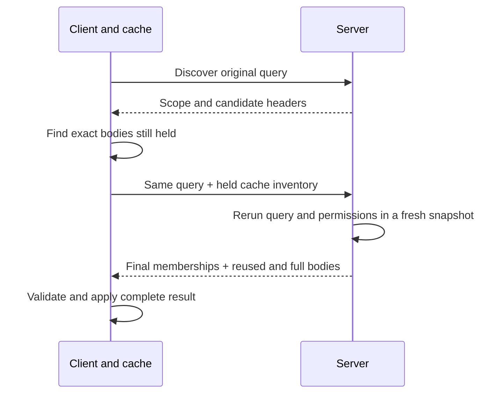

# Complete workspace reads

> **Status: Current.** Reference.

Workspace [Sessions](#scoped-sessions) read in two steps: discover, then
complete the original query with cache inventory. The final response contains selected records and
their security and permissions from one PostgreSQL or SQL Server snapshot. Every normal workspace
uses these reads and protected Push/Invoke. Workspace database backends require PostgreSQL or SQL
Server; Memory remains available for database and domain tests.

Ordinary Local connections, the JSON API and its public operation builders reject Memory at
construction with `NotSupportedException` and SQL configuration guidance.
`LocalConnectionRejectsMemoryBeforeCreatingWorkspace`, `ScopedSessionLocalFactoryRejectsMemory`
and `WorkspaceProtocolConstructorsRejectMemory` verify these boundaries.

## Host configuration

Follow [SQL population maintenance](database-maintenance.md) first: the population must be `Ready`.
Authentication, provisioning and profile updates must commit before a read starts; see
[Authentication](authentication.md).

A Core host enables authenticated complete reads and protected Push/Invoke routes with:

```csharp
services.AddAllorsRead(new ReadConfiguration(
    new Dictionary<string, string> { ["Default"] = "application-representation-1" }));
```

`AddAllorsRead` is in `Allors.Server`; configuration and executor types are in
`Allors.Database.Protocol.Json`. Without registration, an authorized request receives HTTP 503.

Configure a representation revision for each workspace. Change it when metadata, tags, unit
encoding, projection, authorization policy or read representation change. The host chooses
the workspace and user; request fields cannot choose them.

Every read has a **scope**: population incarnation, committed user, workspace, representation
revision and exact context string. Context separates stored results; it does not establish tenancy
or change selection or authorization. Null and an empty context are different.

A Local host supplies `LocalReadIdentity(populationIncarnation, committedUserId)` to `ReadExecutor`
after authentication. Replace that binding after population replacement. The executor owns its
transaction and cannot read from an ambient editing transaction.

## Requests and results

The .NET `Allors.Protocol.Json.Api.Read` classes and matching TypeScript types define the messages.
Requests use `v: 1`, correlation ID `i`, `k: "discover"` or `"read"`, and `p` with selection array `l`
and dependency array `d`. Both arrays may be empty. Expected scope `sc` can be omitted before it is
known; cache hints `h` are optional on the final read. Raw decoding rejects duplicate or unknown fields.

| Selection or result | Behavior |
| --- | --- |
| Explicit object or built-in declarative extent | Supports composite selects/includes and extent pagination. Forward roles require read permission; dependencies follow class eligibility. |
| Record body | Contains readable roles only. An eligible object's identity remains visible even when all roles are unreadable. |
| Relation ID outside the returned pool | Identifies an unloaded object; it does not load a cached record. |
| Named output | Contains objects and collections, preserving declared empty collections and null objects. |
| Missing or workspace-ineligible explicit target | Reports `unavailable`. Absence from a query is not deletion. |
| Custom executable queries or value callbacks | Unsupported by complete reads. |

Named workspace routes and their Session/connection APIs are removed. Use inline declarations
through ordinary Pull; named object and collection outputs remain supported.
`PublicContractsDoNotExposeNamedWorkspaceRoutes`, Core
`AuthenticationSchemeTests.NamedWorkspaceQueryRoutesAreGone` and Identity
`AntiforgeryTests.NamedWorkspaceQueryRouteIsGone` verify API and authenticated HTTP absence.

Allors procedures have been removed from the platform. Ordinary object unit roles and scalar query
arguments remain supported. `PublicContractsDoNotExposeProcedures` verifies the public API;
`LegacyPullDoesNotExecuteRemovedProcedurePayload` verifies that old procedure input cannot execute
through either .NET serializer.

Standalone result values are removed from both workspace APIs and response messages. Complete reads
reject the removed root `v` field, including empty or null maps. Request revision remains `v: 1`;
clients and hosts must update together because the old and new complete-response shapes are
incompatible. Ordinary unit roles and scalar inputs retain their existing encoding.

Each complete response has one outcome per selection, unique records, and all required security
and permission information, including class-only create permissions.



Every successful coordinated read uses both requests, including empty and fully cached queries.
Discovery neither publishes a result nor holds a snapshot open. The final read may find changed
versions, permissions or members; it sends the current bodies needed to finish without restarting
or fetching historical versions. Scope changes, cancellation and failures still stop the operation.

Nonempty hints require an exact expected scope. Record and permission hints must refer to held
bodies. A security hint may list only its identity/version; reusing its body requires an explicit
possession flag. The server reevaluates membership and security, then either sends a full body or
references the exact hinted entry. The caller must retain and validate every reused body and its
required permissions. The connection handles this work.

## Connection cache

Each connection owns an internal cache for its exact scope. Sessions and checkpoints hold immutable
records directly; another Session's read cannot replace their editing baselines. Historical bodies
remain available for exact cache reuse while the connection is live. Current permissions remain
separate from these historical values.

Applications use the normal connection and Session APIs. There is no standalone store, coordinator,
pin or disposable completed-read API. Pull results need no release. Closing a connection clears its
cache lookup after dispatched work drains; already-held immutable values and diffs keep their
existing inspection behavior. This cache has no automatic eviction or memory bound, so long-lived
connections can retain historical versions until close.

The connection captures each query before queueing and owns the exact bodies advertised by that
request. It validates the final response and its complete security/permission closure before
publishing current knowledge together. Malformed responses, incompatible metadata, transport
failure and cancellation before publication leave that knowledge unchanged. A validated scope
change retires the connection; generic failures and message text cannot establish a scope change.

Hints default to 256 total record/security/permission entries and a 1 MiB request. Hints that do not
fit are omitted; an oversized original selection fails. These are safeguards, not measured
performance guarantees. The server retains no discovery ticket or snapshot between requests.

## Scoped Sessions

Create a ready connection asynchronously, then create workspaces and Sessions synchronously.
Every connection has one fixed scope and owns the lifetime of all its Sessions.

| Runtime | Construction |
| --- | --- |
| .NET HTTP | Await `DatabaseConnection.CreateAsync` in either serializer namespace, supplying configuration, a fresh workspace-services factory, borrowed `HttpClient`, ID generator, ranges, representation revision, optional context and cancellation token. |
| .NET Local | Await `DatabaseConnection.CreateAsync` with a borrowed SQL database and `LocalReadIdentity`. Construction validates the committed SQL identity. |
| TypeScript | Await `DatabaseConnection.create(configuration, transport, options, cancellation?)`. Options include `revision`, optional `context` and read bounds; workspace comes from `configuration.name`. |

All three transport capabilities—Read, PushRead and InvokeRead—are required before initialization.
TypeScript names them `read`, `pushRead` and `invokeRead`. The factory captures scope/options,
rule-array contents and transport method references before awaiting. Metadata, object factories and
rule objects retain their identities and must remain stable. Hosts must keep borrowed transport
credentials and handlers stable too; copying a method cannot freeze mutable state inside it.
Disable hidden mutation retries.

The factory performs an empty discover/complete read through the connection,
checks cancellation and returns only when ready. It creates no application
Workspace or Session and invokes no application service or initialization callback. Failed or
cancelled initialization returns no usable connection and leaves borrowed resources host-owned.
HTTP initialization costs two requests per independent connection; further workspaces and Sessions
on it require none. Local also validates committed identity in a separate snapshot.

```mermaid
sequenceDiagram
    participant H as Host
    participant C as Connection
    participant T as Transport
    H->>C: await CreateAsync / create
    C->>T: Discover empty query with captured scope
    T-->>C: Scope and headers
    C->>T: Complete
    T-->>C: Complete closure
    C->>C: Validate; check cancellation; become ready
    C-->>H: Ready connection
    H->>C: Create workspace and Sessions
    C->>C: Check readiness and register ownership
    H->>C: await DisposeAsync / close
    C->>C: Stop admission; drain dispatched work
    C->>C: Clear cache lookup
    C->>C: Close Sessions; release owned resources
    C-->>H: Closed
```

Pull copies selections, arguments, result names, traversal and dependencies before queueing.
Explicit empty result declarations and omitted optional predicate arguments retain their meaning.
Unsupported calls fail before transport.

One connection gate covers reads and mutations through response application, Session adaptation
and notifications. A Session still requires sequential use; separate connections have separate
gates. Ordinary scoped Pull performs discovery and complete read under that gate; it makes no
Sync, Access or Permission follow-up requests.

| Session behavior | Rule |
| --- | --- |
| Pull result | Contains named memberships of editable Session objects, plus scope, outcomes and diagnostics. Edits or conflicts can make objects differ from the read. It is not an immutable snapshot and needs no release. |
| Editing baseline/checkpoint | Belongs to that Session. Another Session's read cannot replace it. A conflicting Pull keeps the entire old baseline and local edits. Refresh accepts a new baseline; explicitly skipped refresh retains the old baseline after Push. |
| Relation targets and Instantiate | Use this Session's accepted records only. Otherwise request an include, dependency or explicit Pull; another Session's cache cannot supply a baseline. |
| Permissions | Follow current connection membership and security bodies, with revocations taking precedence. Historical records do not grant authority. |
| Explicit `unavailable` | Keeps edits and baselines but denies permissions and rejects Push/Invoke for that object before dispatch. A later included record restores availability. Query omission does neither. |

The returned connection permits immediate Push and Invoke; callers need no bootstrap Pull.
Ordinary Push uses the protected [save contract](#save-and-refresh-a-scoped-session).
Ordinary scoped Invoke uses the [atomic method contract](#invoke-and-refresh-a-scoped-session).
A failure or retirement after dispatch can mean a mutation committed. Inspect the returned outcome;
never infer rollback or replay it.

Dispose .NET `ISession` or call TypeScript `ISession.close()` when finished using that Session.
Held values and diffs remain inspectable; further active operations fail. Ordinary getters that
check permissions also reject closed or retired authority.

Before changing credentials, population, metadata, revision, workspace or context, await the
connection's .NET `DisposeAsync()` or TypeScript `close()`, then create a replacement. Cleanup stops
factory and operation admission immediately, drains dispatched read/mutation response handling,
and closes every registered Session across its workspaces. Repeated close calls share one completion.
It does not save, roll back, replay mutations or transfer edits. Rejected queued callers may finish
unwinding later but cannot use released resources. A callback may start close, but must await it
outside its own active operation or construction to avoid waiting for itself.

Borrowed HTTP clients, transports and SQL databases remain host-owned, including after factory
failure. A .NET services factory transfers ownership of each fresh returned workspace/Session
service object. Successful construction calls `OnInit` exactly once after registration; cleanup
disposes Session services before workspace services, attempting every disposal even after a failure. Closing a Session early retains
its owned services until connection drain. In-progress service factories and initialization callbacks
are also drained; failed construction never publishes a usable object.

`NormalHttpFactoryBootstrapsOnceWithoutApplicationServices`,
`NormalSessionInitializationRunsOnceAfterRegistration` and
`NormalConnectionDisposeDrainsKnownAndUnknownMutationOutcomes` verify .NET lifetime behavior.
TypeScript's `normal constructors cannot bypass readiness or Session registration` and
`normal connection close shares one completion and closes Sessions from every workspace without saving`
verify its admission and cleanup contract.

A correlated read failure returns a failed scoped Pull result with request ID, optional scope,
codes, messages, object IDs and selection indexes. Diagnostics do not instantiate objects or become
legacy missing/access/version errors. Malformed messages, transport errors, invalid configuration,
cancellation before publication and retirement throw; structured diagnostic causes are retained.
A merge conflict keeps the old baseline while new permissions remain published. Unexpected
adaptation failure makes the .NET Session unusable. TypeScript does the same if application may be
incomplete; a staging failure before application leaves it usable. Neither undoes the published read.

## Push with immediate server refresh

`AddAllorsRead` also enables authenticated `POST /allors/push-read`. The equivalent Local entrypoint
is `PushReadTransport`, constructed with a `PushReadExecutor`, workspace and `LocalReadIdentity`.
Scoped Session [save and refresh](#save-and-refresh-a-scoped-session) applies this API's results.
Ordinary Push uses this transport.

Use the .NET `Allors.Protocol.Json.Api.PushRead` DTOs or matching TypeScript wire types:

```text
{ v: 1, i, sc, x, push: { n, o }, returnChanged?: boolean, discover?: ReadPull }
```

Omitted or null refresh options request no read; `returnChanged: false` also requests none.
Supply the bound scope from a successful complete read. The server resolves identity from the host,
checks exact scope and validates the query before allowing writes. A population maintenance fence
covers admission through commit. Context `x` appears only in the outer request. Bundled queries may
reference committed object IDs only, including object-valued parameters; negative numeric unit
values remain valid. New objects are returned through their mappings and affected records.

```mermaid
sequenceDiagram
    participant C as Caller
    participant S as PushRead server
    participant D as SQL database
    C->>S: Changes + scope + requested reads
    S->>D: Fence population; validate scope and query
    S->>D: Apply changes and derive
    S->>D: Commit once
    D-->>S: Commit outcome
    opt Commit known; refresh requested
        S->>D: Open one fresh protected snapshot
        S->>D: Read affected objects; discover query
        S->>D: Validate and close snapshot
    end
    S-->>C: Mutation receipt + separate read outcomes
```

| Response part | Meaning |
| --- | --- |
| `push.k = "committed"` | The database commit succeeded. `push.n` maps every submitted new ID. The receipt keeps the admitted write scope even if later work fails. |
| `push.k = "rejected"` | This attempt did not commit. Diagnostics include existing Push access, version, missing-object and derivation errors. No read parts are returned. |
| `push.k = "unknown"` | Commit was attempted but its outcome is uncertain. No read parts are returned. Reconcile before another mutation; never replay automatically. |
| `changed` | When `returnChanged` is true: `k = "changed"` with full records `p`, security `s`, permissions `pm` and unavailable IDs `u`, or a read failure. |
| `discovery` | When `discover` is non-null: the existing discovery success or a read failure. Complete that query through a subsequent ordinary final read. |

Affected objects include submitted no-ops, creations, deletions, derived changes, and both ends of
changed relations across derivation checkpoints. Changes later restored may still be included.
Only workspace-eligible identities appear, including unavailable IDs for eligible deleted objects.
Full records contain readable roles and complete security/permission bodies; they never use cache
references. The affected pool has no invented query outputs or membership.

Both successful read parts describe the same fresh post-commit snapshot and admitted scope. This
snapshot can include other commits: it does not promise the exact versions written by this request.
An independent read error can preserve the other part; a shared snapshot, scope or cleanup failure
discards both. Neither case changes a known commit. Changes to shared security do not make this an
exhaustive refresh of untouched objects, and query membership/order/page are current only after the
final query read.

The existing limits below apply to the complete envelope; the affected pool, including unavailable
IDs, is limited to 10,000. Oversized refreshes fail explicitly after commit, without truncation.
Both .NET serializers and TypeScript offer separate receipt decoding: with a valid JSON envelope,
validate the mutation receipt before the independent read payloads. Receipt decoding requires a
complete JSON envelope within the 64-container depth limit. Lost or malformed responses can still
leave the caller uncertain. This API supplies no durable receipt or exactly-once guarantee.

## Save and refresh a scoped Session

Use ordinary TypeScript `session.push()` or .NET `session.PushAsync()` on a ready connection.
Both common `ISession` interfaces expose `PushOptions` and return `IPushResult` with
shared mutation outcomes. Refresh defaults to true; explicit false uses the same protected save
without requesting affected records. There is no separate public Session PushRead operation.

The .NET Local and both HTTP factories supply the protected transport. A custom transport
without that capability fails connection initialization. TypeScript's `PushReadHttpTransport` supplies
the internal `pushRead` method for a configured endpoint and host-owned fetch implementation; bind
it alongside strict read and Invoke transports. Internal transport and wire names remain PushRead.

```typescript
const saved = await session.push({ discover: query });
// Inspect outcome, diagnostics and application before choosing the next action.
if (saved.outcome === 'committed' && saved.pendingQuery) {
  const refreshed = await saved.pendingQuery.complete();
}
```

.NET accepts `PushOptions` with `Refresh` and `Discover`, then exposes
`PendingQuery.CompleteAsync`. Discovery accepts ordinary declarative Pull inputs. Use committed
objects in the bundled query. Options, query parameters
and submitted changes are copied before queueing; later caller changes cannot alter the attempt.

```mermaid
sequenceDiagram
    participant U as Caller
    participant C as Scoped Session
    participant S as Server
    U->>C: Push(Refresh, optional Discover)
    Note over C: Pause edits in this Session
    C->>S: One protected save with scope and requested reads
    S->>S: Commit once; requested reads use a fresh snapshot
    S-->>C: Independent receipt, refresh and discovery
    C->>C: Validate mappings and read evidence; apply while admissible
    C-->>U: Mutation outcome, read/application states, pending query
    Note over U,C: Saving pause ends; reconciliation and lifetime gates still apply
    opt Complete a usable pending query
        U->>C: CompleteAsync / complete
        C->>S: Captured query with inventory held now
        S-->>C: Complete current query result
        C-->>U: Apply with ordinary merge rules
    end
```

| Result member (TypeScript / .NET) | Meaning |
| --- | --- |
| `outcome` / `Outcome` | `committed`, `rejected` or `unknown` (`Committed`, `Rejected`, `Unknown` in .NET). Expected rejection returns a result in both runtimes. |
| `diagnostics` / `Diagnostics` | Original error text, structured errors, version/access/missing IDs and derivation relations. Inspection never instantiates unknown objects. |
| `creationMappings` / `CreationMappings` | Complete validated negative workspace-ID to positive database-ID mappings. A committed receipt retains these even when local acknowledgement fails. |
| `refresh` / `Refresh` | Remote read status: `not-requested`, `unavailable`, `succeeded` or `failed`. Its optional Pull result exists after local application and retains merge diagnostics. |
| `application` / `Application` | Separate acknowledgement and refresh application states, plus errors from acknowledgement, refresh, discovery or notification. Successful remote reads can still be skipped or fail locally. |
| `discovery` / `Discovery` | Independent remote discovery status and diagnostics. Success does not by itself guarantee a locally usable pending query. |
| `pendingQuery` / `PendingQuery` | Optional one-use explicit completion, available only after successful acknowledgement and usable discovery while the Session remains admissible. |
| `reconciliationRequired` / `ReconciliationRequired` | A snapshot of the Session's mutation block after applying this response. The Session exposes the current flag with the same name. |

A confirmed commit stays committed when a requested read or local application fails. A missing,
untrusted or incomplete receipt produces unknown, including missing/duplicate creation mappings.
A complete valid receipt whose IDs collide with held identities instead remains committed and
reports failed acknowledgement. All mappings are checked before any local remap. No mutation is
retried automatically, and an HTTP status alone does not prove rejection.

Read `succeeded` means its independent wire, scope and metadata checks passed; application reports
whether records were applied, conflicted, skipped or failed. `unavailable` means no trustworthy read
outcome was accepted, without claiming that an uncertain server attempt did not run. A read failure
alone does not require reconciliation. Ordinary lifetime and authority checks still apply, including
retirement when valid evidence proves the scope changed. Incomplete local application can require
reconciliation; notification failure alone does not. `hasErrors` / `HasErrors` is a convenience
aggregate, not the database outcome.

New shared raw diagnostic and mapping values are detached immutable snapshots and remain inspectable
after closure. A contained Pull result still contains editable Session objects. Native diagnostic
causes retain their ordinary runtime behavior. Object-based `IResult` views include only held objects;
the raw ID fields retain diagnostics for other objects. The saved result does not change when a
pending query is completed later.

The saving Session must have no earlier operation in flight. Capture through acknowledgement and
first response application rejects setters, creation, Reset, Restore, Checkpoint and overlapping
operations, including Pull. Inspection and other Sessions remain usable. Do not mutate exposed
value buffers during this pause. Refresh preserves checkpoints and does not call Reset or Checkpoint.
Successfully applied affected records accept a new baseline, so a later Reset returns to it.
Skipping refresh or receiving a failed server read leaves the old baseline and keeps acknowledged
objects unwritable until a successful read supplies their baseline. Local application failure can
leave partially applied state; inspect its application diagnostics and reconciliation requirement. Affected records do not establish query membership or refresh every
untouched object; the [server contract](#push-with-immediate-server-refresh) defines their coverage.

The editing pause ends on every exit. Unknown commitment or unsafe local acknowledgement keeps a
separate reconciliation block. Inspect server state and local diffs, then use a fresh Session;
ordinary reads do not clear this block. Failures before dispatch leave changes unsent and throw.
After dispatch, available commitment evidence is retained through cancellation and retirement.

Pending completion is explicit and one-use. It makes only the final query request, reevaluating
membership and permissions in a fresh snapshot with exact currently held cache bodies. Close or
retirement rejects completion. Intervening edits use ordinary whole-record merge rules. Completion
can fail without changing the preceding save's outcome. Saving with refresh/discovery costs one
request on a bound connection; completion adds one request. An ordinary Pull after saving adds two.

`ProtectedPushRefreshAndSkipUseOneRequest` verifies the default and skip through .NET Local and
both HTTP serializers; TypeScript's `ordinary Push default and explicit skip preserve their baseline
contract` verifies the same over HTTP. Controlled `ProtectedPush*` tests and the response-context
spec cover outcome, diagnostics, application and reconciliation failures.

## Invoke and refresh a scoped Session

Use ordinary `session.InvokeAsync(method)` / `session.invoke(method)`, or supply an ordered method
array. The connection runs the entire batch atomically against committed database
values. Local edits and newly created workspace objects are never submitted by Invoke. Targets must
already have a positive database ID and an accepted version in the invoking Session. Empty arrays
are valid no-ops; repeated targets keep their original version and order.

`InvokeOptions.Refresh` / `refresh` defaults to true. Explicit false uses the same protected batch
without affected refresh. The former `Isolated` / `isolated` and `ContinueOnError` / `continueOnError`
options are removed. The server prepares every target, version and exact workspace method before
writes, checks current execute permission before each method, and derives once after each success.
The first failure rejects the whole batch; success commits once. Methods cannot commit or roll back
the protected transaction themselves.

.NET exposes both single/array overloads with an optional options argument, plus
`InvokeAsync(methods, options, cancellationToken)` on `ISession`. TypeScript accepts
`invoke(methods, options?, abortSignal?)`. Options, method order, IDs and versions are captured before
queueing. One bound Invoke costs one request, with or without refresh; a subsequent ordinary Pull
adds two. Connection bootstrap is separate.

```mermaid
sequenceDiagram
    participant U as Caller
    participant C as Scoped Session
    participant S as Server
    U->>C: Invoke(methods, Refresh)
    Note over C: Retain existing edits; pause new edits and operations
    C->>S: One protected batch with exact scope and versions
    S->>S: Prepare all targets; execute in order; derive after each success
    alt A method fails
        S->>S: Roll back the entire batch
    else Every method succeeds
        S->>S: Commit once; optionally read affected objects in a fresh snapshot
    end
    S-->>C: Independent mutation receipt and affected read
    C->>C: Classify receipt; merge valid refresh while locally admissible
    C-->>U: Mutation, refresh and application states
```

`IInvokeResult` exposes the common mutation fields described in the
[result table](#save-and-refresh-a-scoped-session): outcome, owned diagnostics, refresh, application
and reconciliation. Expected rejections return results in both runtimes. Invoke has no creation
mappings, discovery or pending query, and acknowledgement is always `NotApplicable` / `not-applicable`.
A committed batch stays committed when refresh fails, conflicts or cannot apply. Valid received
refresh remains successful remotely if cancellation, closure or retirement makes local application
skip. Those events alone do not require reconciliation. An unknown outcome or potentially incomplete
local application does; ordinary reads cannot clear that Session block.

Refresh uses the existing Pull merge rules. Compatible local edits and negative creations remain
tracked; conflicting objects retain their old baseline and edits while current permissions still
apply. Invoke never marks edits pushed, resets trackers, remaps local creations or changes checkpoint
ownership. A skipped refresh creates no Push write restriction. The same Session must have no earlier
operation in flight; edits and overlapping operations remain paused through response application
and notifications. Held-state inspection and independent Sessions remain usable.

`AddAllorsRead` registers authenticated `POST /allors/invoke-read`. .NET factories configure
`InvokeReadTransport`; TypeScript hosts compose `InvokeReadHttpTransport.invokeRead` alongside
complete reads and protected Push. The Local transport takes `InvokeReadExecutor`, workspace and
`LocalReadIdentity`. A missing capability fails connection initialization. The internal InvokeRead request
requires an explicit `refresh` Boolean and exact bound scope; no separate public Session InvokeRead
operation exists. Affected records follow the [server refresh rules](#push-with-immediate-server-refresh),
including full security bodies, limits and a fresh post-commit snapshot.

Independent transactions and external effects lie outside the protected batch.

`ProtectedInvokePublicContractUsesSharedResultAndRefreshOnly`,
`ProtectedInvokeRefreshPreservesEditsAndCheckpointOrReportsConflict`,
`ProtectedInvokeRefreshAndSkipUseOneRequest` and `ProtectedInvokeHttpRefreshAndSkipUseOneRequest`
verify the .NET surface, merge and actual transport behavior. TypeScript's
`protected Invoke refresh preserves unsaved edits creations and checkpoint ownership without acknowledging Push`
and its HTTP Invoke cases verify the corresponding contracts.

## Inline declarations

Supply extents, selects, includes and scalar arguments directly in each query. Declarations are
captured before dispatch and validated against the admitted metadata before resolving objects.
Named object and collection outputs remain supported. Prepared declaration registries and reference
fields are removed from both workspace runtimes; raw read and PushRead discovery messages reject
those fields even when null.

Coordinate clients and hosts when deploying this representation change, and update the deployment
representation revision. A revision remains required even without registered definitions.

Built-in filters, binary union/intersection/difference, predicates and sorting are supported.
`Exists` requires an explicit relation endpoint; its parameter form is rejected. Ambiguous or ignored
combinations, such as select plus a separate include or pagination on an explicit object, fail.
Unit values are returned through readable record roles, not unit-valued selects.

## Transports, limits, and failures

.NET Local and both HTTP namespaces provide `ReadTransport`, accepting raw JSON or DTOs with strict
decoding and cancellation. HTTP uses a host-configured `HttpClient` whose base address ends in
`/allors/`; requests go to relative `read`. Local uses the shared executor and bound identity.
TypeScript `ReadHttpTransport` takes the exact read URL and host-supplied `fetch`/authentication
wrapper. Its `read(request, abortSignal?)` accepts either form and relies on the endpoint's byte limits.
Transports capture requests before awaiting, make one attempt, and retain no records.

| Bound | Limit |
| --- | --- |
| UTF-8 request / complete response | 1 MiB / 16 MiB |
| JSON envelope nesting | 64 containers |
| Each selected result, loaded pool or traversed to-many relation | 10,000 objects |
| Security / permission entries | 20,000 / 50,000 |
| Graph traversal | One million steps |

Pagination precedes the result bound. Exceeding a bound fails the read; success never contains a
silently truncated graph. Reduce selections, includes, dependencies or hints. Hosts should enforce
request-body limits at their HTTP server or proxy as well.

Malformed HTTP JSON receives 400; oversized requests receive 413. For ordinary reads, valid execution
failures return a correlated `ReadFailure` without success data. Session Pull exposes correlated
failures through its result diagnostics. HTTP failures and cancellation
throw. Protected Push and Invoke preserve their separate mutation outcomes through post-commit
cancellation and read failure. Private host exception details go to the executor's logger, not the response.

The executor builds and validates the whole response before closing the snapshot, and returns it
only after successful cleanup. It does not retry. The result describes that snapshot and does not
authorize future server operations.
